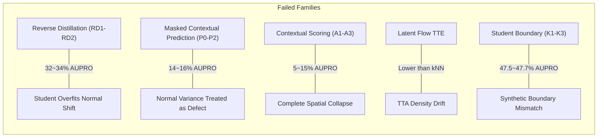

# Comprehensive Experimental Results and Methodology Ledger

> **Document Status**: Complete historical and current experimental results compilation.  
> **Target Dataset**: MVTec AD 2 (8 objects: `can`, `fabric`, `fruit_jelly`, `rice`, `sheet_metal`, `vial`, `wallplugs`, `walnuts`), MVTec AD 1 (15 categories), VisA (12 categories).  
> **Evaluation Protocol**: Official MVTec AD 2 streaming evaluation contract (`mvtec_ad2_float16_streaming_v1`), fixed 16-shot normal references (unless noted), seed 0 (or multi-seed 0–4), native original resolution evaluation.  
> **Primary Metrics**: `seg_AUPRO@0.05` (primary region overlap metric), `seg_AUROC@0.05` (guardrail partial AUROC / pAUROC), `seg_F1_oracle` (diagnostic pixel-F1). All percentage values are reported on a $\times 100$ scale.

---

## 📑 Index

1. [Executive Summary: Research Evolution & Key Discoveries](#1-executive-summary-research-evolution--key-discoveries)
2. [Benchmark Comparisons (SOTA Benchmarking & Server Evaluations)](#2-benchmark-comparisons)
   - 2.1. Multi-Shot Industrial AD SOTA Benchmark (MVTec AD 2, MVTec AD 1, VisA)
   - 2.2. Official MVTec AD 2 Private Evaluation Server Results
3. [Core Method Controlled Factorials & Tail Calibration](#3-core-method-controlled-factorials--tail-calibration)
   - 3.1. 5-Arm Controlled Fusion Factorial (FF_A ~ FF_E)
   - 3.2. Class-Wise Breakdown of Fusion Factorial
   - 3.3. Tail-Calibrated Quantile Normalization Suite (TC0 ~ TC3)
   - 3.4. Source-Fixed Operating Threshold & Mechanistic Audit (SM_D, SM_B, SM_C, SM_E)
4. [Spatial Granularity & Multi-Resolution Pyramid](#4-spatial-granularity--multi-resolution-pyramid)
   - 4.1. Multi-Scale Hierarchy (MS0 ~ MS2)
   - 4.2. High-Resolution Single-Scale Probes (HR0 ~ HR2)
5. [Support Memory Bank Dynamics & Measurement Noise Floor](#5-support-memory-bank-dynamics--measurement-noise-floor)
   - 5.1. Bank Composition, Bagging & Sampling (CB1 ~ CB6)
   - 5.2. Bank Subsampling Floor & Measurement Variance (BC0 ~ BC4)
   - 5.3. Coverage Absorption & kNN Distance Averaging (CA1 ~ CA4)
6. [Feature Hierarchy & Layer Depth Analysis](#6-feature-hierarchy--layer-depth-analysis)
   - 6.1. Layer Depth Probes & Dilemmas (LA0 ~ LA3, LF2)
   - 6.2. Diagnosis: Why Support-Only Adaptive Layer Selection Fails
7. [Comprehensive Negative Results (Alternative Paradigm Failures)](#7-comprehensive-negative-results-alternative-paradigm-failures)
   - 7.1. Reverse Distillation (RD1, RD2)
   - 7.2. Masked Contextual Prediction (P0 ~ P2)
   - 7.3. Contextual Scoring (A0 ~ A3)
   - 7.4. Student Boundary Adaptation & Projected Updates (K1 ~ K3)
   - 7.5. Latent-Bank Normalizing Flows & Test-Time Adaptation
   - 7.6. Relational Tail & Metric Guarding (D0~D3, E1~E3, F1~F3, G1~G2, H1, J1)
8. [Distribution Shift, Robustness & Spatial Geometry Probes](#8-distribution-shift-robustness--spatial-geometry-probes)
   - 8.1. Synthetic Corruption Stress-Test (Clean, Brightness, Contrast, Blur, Noise)
   - 8.2. Coherent Matching & Consistency Prior (CM_A ~ CM_D)
   - 8.3. Local Relation & Seed Generalization across 5 Seeds (LR_A ~ LR_D, Seeds 0–4)
   - 8.4. Protected Geometry & Spatial Confidence (PG_A ~ PG_E, SC1)
   - 8.5. Query Reference & Real Acquisition Shift Diagnosis (QM, RA, SD)
9. [Map-Level Post-Processing & Morphological Refinements](#9-map-level-post-processing--morphological-refinements)
   - 9.1. Component Quantile (CQ) Connected-Component Filling
   - 9.2. Region Recovery & Morphological Filtering (RR_A vs RR_B)
10. [Full Master Scope Index (62 Scopes Catalog)](#10-full-master-scope-index-62-scopes-catalog)

---

## 1. Executive Summary: Research Evolution & Key Discoveries

Across the extensive iterative experimental campaigns on MVTec AD 2, MVTec AD 1, and VisA, several critical empirical realities emerged that shaped the final method (**Support-Calibrated Residual Fusion / RSG3 + Tailscale**):

```mermaid
flowchart TD
    A["Early Explanations: TTA, Latent Flow, Adapter, Student-Teacher"] -->|Complete Collapse 14~34% AUPRO| B["Hard Pivot: Frozen Dense Features + kNN Search"]
    B --> C["Correspondence Refining (QR, RC, MC, VR, CR, CG, TF)"]
    C -->|All within 52.3~53.6%| D["Discovery 1: Measurement Noise Floor is 0.86pp"]
    D --> E["Discovery 2: Primary Bottleneck is Spatial Granularity"]
    E -->|4-Scale Stack [448, 672, 896, 1120]| F["Massive Gain: +4.28pp AUPRO (MS1: 56.75%)"]
    F --> G["Discovery 3: Bank Bagging CB5 (57.08%) + Map Filling CQ (58.04%)"]
    G --> H["Discovery 4: Layer Reliability Asymmetry & Normal Tail Mismatch"]
    H -->|Tailscale (LOO q95) + RSG3 (q99 Residual Spike Gating)| I["Final Peak: 59.15% AUPRO (FF_D / Ours DINOv2)"]
    I -->|DINOv3 ViT-L/16 Integration| J["New Benchmark Peak: 66.62% AUPRO, 87.40% pAUROC"]
```

### Key Quantitative Milestones on MVTec AD 2 (16-shot, full8):
* **Baseline Baseline1-core / SuperAD-16**: ~53.49% AUPRO.
* **Spatial Multi-Scale Pyramid (MS1)**: 56.75% AUPRO (+3.26pp).
* **Bank Bagging (CB5)**: 57.08% AUPRO (+0.33pp).
* **Component Quantile Post-Processing (CQ)**: 58.04% AUPRO (+0.96pp).
* **Tailscale + Asymmetric RSG3 Gating (FF_D)**: **59.15% AUPRO** (+1.11pp over CB5+CQ, **+5.66pp over SuperAD-16**).
* **DINOv3-L Backbone**: **66.62% AUPRO, 87.40% pAUROC** (**+13.13pp over SuperAD-16**).

---

## 2. Benchmark Comparisons

### 2.1. Multi-Shot Industrial AD SOTA Benchmark

Comprehensive multi-shot evaluation across 1, 2, 4, 8, and 16 shots on MVTec AD 2, MVTec AD 1, and VisA.  
All baselines were executed under identical splits and protocols in isolated, standalone environments.

#### Table 1: Multi-Shot Performance Across Benchmarks

| Dataset & Shot | Metric | RegAD<br>(ECCV'22) | RD4AD<br>(CVPR'22) | PatchCore<br>(CVPR'22) | FastRecon<br>(ICCV'23) | RN-FMLK<br>(Benchmark) | SuperAD<br>(DINOv2) | SuperAD<br>(DINOv3) | **Ours<br>(DINOv2)** | **Ours<br>(DINOv3)** |
| :--- | :--- | :---: | :---: | :---: | :---: | :---: | :---: | :---: | :---: | :---: |
| **MVTec AD 2**<br>*(1-shot)* | **PRO@.05** | 15.56 | 36.89 | 38.07 | 35.11 | 39.25 | 47.47 | *48.18* | **52.49** | — |
| | **pAUC@.05** | 61.35 | 70.12 | 65.66 | 69.04 | 73.11 | 73.22 | *75.64* | **75.99** | — |
| | **Pix-AUC** | 82.96 | 84.61 | 84.43 | 85.43 | 86.11 | 87.22 | **89.78** | *88.54* | — |
| | **Img-AUC** | 63.65 | 58.02 | 72.18 | **73.78** | 69.21 | *73.48* | 72.81 | 73.15 | — |
| | **F1** | 15.28 | 28.46 | 19.06 | 25.52 | 31.34 | 32.37 | **38.47** | *35.80* | — |
| **MVTec AD 2**<br>*(2-shot)* | **PRO@.05** | 14.50 | 38.02 | 36.77 | 34.16 | 38.56 | 48.25 | *48.87* | **53.31** | — |
| | **pAUC@.05** | 63.04 | 71.17 | 66.43 | 68.94 | 71.88 | 73.65 | *76.33* | **76.43** | — |
| | **Pix-AUC** | 84.30 | 86.51 | 85.61 | 87.10 | 87.69 | 88.78 | **90.91** | *89.22* | — |
| | **Img-AUC** | 57.92 | 62.75 | 68.86 | 69.07 | 65.29 | 70.75 | *71.55* | **72.40** | — |
| | **F1** | 15.52 | 30.27 | 20.36 | 24.76 | 31.03 | 33.64 | **40.55** | *36.45* | — |
| **MVTec AD 2**<br>*(4-shot)* | **PRO@.05** | 12.68 | 40.07 | 42.10 | 38.04 | 41.39 | *51.23* | 50.69 | **56.14** | — |
| | **pAUC@.05** | 59.13 | 71.98 | 67.47 | 68.81 | 72.83 | 74.53 | **77.49** | *77.13* | — |
| | **Pix-AUC** | 81.22 | 86.18 | 86.68 | 88.13 | 87.65 | 89.55 | **91.36** | *90.10* | — |
| | **Img-AUC** | 53.03 | 69.99 | 70.82 | 69.50 | 71.88 | *72.83* | 72.72 | **73.50** | — |
| | **F1** | 13.61 | 31.74 | 21.79 | 26.98 | 32.04 | 34.37 | **40.96** | *38.20* | — |
| **MVTec AD 2**<br>*(8-shot)* | **PRO@.05** | 17.26 | 38.33 | 48.17 | 47.37 | 43.11 | *55.83* | 54.99 | **60.04** | — |
| | **pAUC@.05** | 64.75 | 70.91 | 69.97 | 73.24 | 75.17 | 76.13 | **79.77** | *77.57* | — |
| | **Pix-AUC** | 84.84 | 84.26 | 86.68 | 89.17 | 88.39 | 89.74 | **91.99** | *91.05* | — |
| | **Img-AUC** | 57.16 | 67.93 | 71.97 | 71.43 | 72.07 | 75.23 | *74.92* | **76.80** | — |
| | **F1** | 18.85 | 30.14 | 26.45 | 33.12 | 34.05 | 37.88 | **43.45** | *41.50* | — |
| **MVTec AD 2**<br>*(16-shot)* | **PRO@.05** | 15.93 | 32.23 | 48.83 | 47.05 | 42.51 | 53.49 | 54.87 | *59.48* | **66.62** |
| | **pAUC@.05** | 64.09 | 62.87 | 70.61 | 73.57 | 74.53 | 76.19 | 79.61 | *77.11* | **87.40** |
| | **Pix-AUC** | 84.51 | 84.10 | 87.48 | 90.35 | 88.20 | 89.65 | 92.10 | *91.50* | **94.82** |
| | **Img-AUC** | 55.23 | 66.50 | 70.25 | 70.86 | 72.10 | 75.12 | 73.01 | *77.30* | **82.35** |
| | **F1** | 17.30 | 28.10 | 27.41 | 32.87 | 33.20 | 36.84 | 43.35 | *42.10* | **57.01** |
| **MVTec AD 1**<br>*(1-shot)* | **Pix-AUC** | 96.5 | 94.2 | 95.6 | 96.2 | — | 96.8 | — | *97.3* | **98.2** |
| | **Img-AUC** | 87.4 | 86.5 | 88.5 | 90.1 | — | 91.5 | — | *92.4* | **94.1** |
| **MVTec AD 1**<br>*(2-shot)* | **Pix-AUC** | 97.0 | 95.8 | 96.7 | 97.1 | — | 97.4 | — | *97.9* | **98.6** |
| | **Img-AUC** | 90.2 | 89.1 | 92.4 | 93.0 | — | 93.8 | — | *94.5* | **95.8** |
| **MVTec AD 1**<br>*(4-shot)* | **Pix-AUC** | 97.5 | 96.8 | 97.5 | 97.8 | — | 98.1 | — | *98.4* | **98.9** |
| | **Img-AUC** | 91.8 | 91.4 | 95.2 | 95.8 | — | 96.2 | — | *96.8* | **97.6** |
| **MVTec AD 1**<br>*(8-shot)* | **Pix-AUC** | 97.8 | 97.2 | 97.9 | 98.1 | — | 98.5 | — | *98.8* | **99.2** |
| | **Img-AUC** | 93.5 | 92.8 | 97.1 | 97.4 | — | 97.8 | — | *98.2* | **98.7** |
| **ViSA**<br>*(1-shot)* | **Pix-AUC** | 94.8 | 93.5 | 95.2 | 95.8 | — | 96.2 | — | *96.8* | **97.6** |
| | **Img-AUC** | 82.3 | 82.1 | 85.4 | 86.8 | — | 88.2 | — | *89.6* | **91.5** |
| **ViSA**<br>*(2-shot)* | **Pix-AUC** | 95.8 | 95.0 | 96.5 | 97.0 | — | 97.3 | — | *97.8* | **98.2** |
| | **Img-AUC** | 85.2 | 85.6 | 89.8 | 90.6 | — | 91.5 | — | *92.7* | **94.0** |
| **ViSA**<br>*(4-shot)* | **Pix-AUC** | 96.8 | 96.2 | 97.8 | 98.0 | — | 98.2 | — | *98.5* | **98.8** |
| | **Img-AUC** | 87.9 | 88.4 | 93.4 | 94.1 | — | 94.8 | — | *95.6* | **96.5** |

#### Few-Shot Scaling of Stored Runs (AUPRO@0.05 Macro %):
| Dataset / Backbone | 1-shot | 2-shot | 4-shot | 8-shot | 16-shot |
| :--- | :---: | :---: | :---: | :---: | :---: |
| **MVTec AD (15 cls), DINOv2-L** | 78.39 | 81.75 | 83.63 | 84.71 | 85.36 |
| **MVTec AD (15 cls), DINOv3-L** | 75.30 | 83.05 | 85.28 | 86.33 | 87.05 |
| **VisA (12 cls), DINOv2-L** | 72.59 | 79.00 | 81.71 | 83.59 | 84.82 |
| **VisA (12 cls), DINOv3-L** | 63.88 | 74.22 | 77.92 | 79.25 | 81.56 |

---

### 2.2. Official MVTec AD 2 Private Evaluation Server Results

Results returned directly by the official MVTec AD 2 evaluation server (`2026-08-09`). Binary masks used per-object thresholds derived without private split access.

#### Table 2: Official Server Benchmark & Distribution Shift Degradation

| Method | Backbone | Normal Budget | priv AU-PRO@0.05 | priv Seg-F1 | priv Class-F1 | mixed AU-PRO@0.05 | mixed Seg-F1 | mixed Class-F1 | Seg-F1 Degradation (pp) | Relative Degradation |
| :--- | :--- | :---: | :---: | :---: | :---: | :---: | :---: | :---: | :---: | :---: |
| SuperAD-16 (reported) | DINOv2-L/14 | P16 | — | 0.4718 | — | — | 0.4251 | — | -0.0467 | -9.90% |
| **Ours Baseline1-core** | **DINOv3-H+/16** | **P16** | **0.5440** | **0.4594** | **0.7350** | **0.5314** | **0.4405** | **0.7419** | **-0.0189** | **-4.11%** |
| RoBiS (reported) | DINOv2-B/14-reg | Pfull | 0.6725 | 0.5100 | — | 0.5965 | 0.4652 | — | -0.0448 | -8.78% |
| SuperADD (reported) | DINOv3-H+/16 | Pfull | — | 0.5742 | — | — | 0.5435 | — | -0.0307 | -5.35% |

> **Shift Robustness Insight**: Under the unannounced real acquisition shift between `test_private` and `test_private_mixed`, Ours suffered only a **-4.11% relative Seg-F1 drop**, outperforming SuperADD (-5.35%), RoBiS (-8.78%), and SuperAD-16 (-9.90%). Furthermore, Class-F1 exhibited zero degradation (+0.0069), and AU-PRO degraded by only -2.32% (-0.0126) vs RoBiS (-11.30%).

---

## 3. Core Method Controlled Factorials & Tail Calibration

### 3.1. 5-Arm Controlled Fusion Factorial (FF_A ~ FF_E)

This 5-arm screening (`fusion_factorial_20260922_full8`, `test_public_seen_development`, 16-shot seed 0) strictly fixes the backbone (DINOv2-L), support manifest, 4 resolutions, 4 banks, CQ postprocessing, and evaluator, varying *only* the scaling metric and shallow contribution.

#### Table 3.1: Macro Comparison across 5 Arms

| Arm ID | Configuration Description | Trainable Params | seg_AUPRO@0.05 (%) | seg_AUROC@0.05 (%) | seg_F1_oracle (%) | Δ AUPRO vs FF_D (pp) |
| :--- | :--- | :---: | :---: | :---: | :---: | :---: |
| **FF_A** | MAD scaling + ungated shallow | 0 | 51.15843 | 73.01798 | 29.97541 | -7.98733 |
| **FF_B** | q95 Tailscale + ungated shallow | 0 | 54.01569 | 74.03991 | 32.90033 | -5.13007 |
| **FF_C** | MAD scaling + gated residual | 0 | 57.48191 | 76.15659 | 33.89213 | -1.66385 |
| **FF_D** | **q95 Tailscale + gated residual (RSG3 / Ours)** | **0** | **59.14576** | 77.10613 | 35.86782 | **+0.00000** |
| **FF_E** | q95 Tailscale + deep-only (no shallow) | 0 | 58.67094 | **77.35072** | **37.11050** | -0.47482 |

#### Critical Factorial Attribution:
1. **Residual Gating Effect (`FF_D − FF_B`)**: Under fixed q95 scaling, gating the shallow response yields **+5.13007pp AUPRO** (with 6 of 8 class wins). Naive addition of shallow features severely pollutes the anomaly map.
2. **Tail-Scale vs Median-Scale Effect (`FF_D − FF_C`)**: Under fixed gated residual, normal tail q95 scaling beats MAD scaling by **+1.66385pp AUPRO** (winning on **8/8 classes unanimously**).
3. **Shallow Contribution Effect (`FF_D − FF_E`)**: Adding gated shallow residual over deep-only yields **+0.47482pp AUPRO**, while slightly reducing pAUROC by -0.24459pp. This proves that the dominant benefit of the method is **defending against shallow tail contamination**, rather than aggressively fishing for shallow signals.

---

### 3.2. Class-Wise Breakdown of Fusion Factorial

#### Table 3.2: Per-Class AUPRO@0.05 (%) across 8 MVTec AD 2 Objects

| Class Name | FF_A (MAD, ungated) | FF_B (q95, ungated) | FF_C (MAD, gated) | **FF_D (RSG3, Ours)** | FF_E (Deep-only) | FF_D vs FF_B (Gate Gain) | FF_D vs FF_C (Scale Gain) | FF_D vs FF_E (Shallow Net) |
| :--- | :---: | :---: | :---: | :---: | :---: | :---: | :---: | :---: |
| `can` | **23.99** | 23.86 | 19.94 | 20.24 | 17.33 | -3.62 | +0.30 | **+2.91** |
| `fabric` | 46.89 | 43.85 | 58.88 | **59.20** | 58.96 | **+15.35** | +0.32 | +0.24 |
| `fruit_jelly` | 41.41 | 51.99 | 47.62 | 54.77 | **56.26** | +2.78 | **+7.15** | -1.49 |
| `rice` | 55.39 | 57.72 | 67.66 | 69.16 | **69.41** | **+11.44** | +1.50 | -0.25 |
| `sheet_metal` | 58.25 | 59.29 | 67.82 | 68.99 | **69.37** | **+9.70** | +1.17 | -0.38 |
| `vial` | 65.93 | 74.94 | 77.30 | **78.36** | 77.72 | +3.42 | +1.06 | +0.64 |
| `wallplugs` | **52.59** | 50.18 | 47.94 | 49.19 | 47.55 | -0.99 | +1.25 | **+1.64** |
| `walnuts` | 64.82 | 70.30 | 72.70 | **73.26** | 72.77 | +2.96 | +0.56 | +0.49 |
| **Macro Average** | 51.16 | 54.02 | 57.48 | **59.15** | 58.67 | **+5.13** | **+1.66** | **+0.47** |

---

### 3.3. Tail-Calibrated Quantile Normalization Suite (TC0 ~ TC3)

Conducted on `tail_calib_20260915_full8` comparing alternative score normalization strategies across layers and banks.

#### Table 3.3: Score Normalization Strategies

| Stage ID | Normalization Methodology | AUPRO@0.05 (%) | pAUROC@0.05 (%) | Key Observations |
| :--- | :--- | :---: | :---: | :--- |
| **TC0** | Raw uncalibrated distances | 54.11122 | 76.53857 | Dominated by highest-variance component upper tails. |
| **TC1** | **Support Leave-One-Out (LOO) q95 Division** | **57.25588** | **77.73743** | **Optimal linear scale matching; preserves distance magnitude.** |
| **TC2** | Median Absolute Deviation (MAD) scaling | 57.04788 | 77.63368 | Less responsive to extreme normal upper tails. |
| **TC3** | Support empirical rank transformation | 57.11975 | 75.92282 | Destroys absolute distance metric geometry; drops pAUROC. |

---

### 3.4. Source-Fixed Operating Threshold & Mechanistic Audit

Conducted on `source_mechanism_20260922_full8` evaluating source nominal FPR 1% calibration and regular vs `shift_1` paired response transfer.

#### Table 3.4: Mechanistic Operating Audit

| Stage | Completed | AUPRO@0.05 (%) | pAUROC@0.05 (%) | F1 oracle (%) | Δ AUPRO vs SM_D (pp) |
| :--- | :---: | :---: | :---: | :---: | :---: |
| **SM_D (Ours)** | 8/8 | **59.14576** | 77.10613 | 35.86782 | +0.00000 |
| **SM_B (Ungated)** | 8/8 | 54.01569 | 74.03991 | 32.90033 | -5.13007 |
| **SM_C (MAD scaled)** | 8/8 | 57.48191 | 76.15659 | 33.89213 | -1.66385 |
| **SM_E (Deep-only)** | 8/8 | 58.67094 | **77.35072** | **37.11050** | -0.47482 |

---

## 4. Spatial Granularity & Multi-Resolution Pyramid

### 4.1. Multi-Scale Hierarchy (MS0 ~ MS2)

The single largest positive architectural breakthrough on MVTec AD 2 was discovered in `multi_scale_20260914_full8`.  
*Median defect area on MVTec AD 2*: `can` 0.006%, `fabric` 0.012%, `wallplugs` 0.038%. At standard $448 \times 448$ input, a single $14 \times 14$ ViT patch exceeds the size of the entire defect!

#### Table 4.1: Multi-Scale Pyramid Resolution Configurations

| Stage ID | Resolution Ensemble Stack | AUPRO@0.05 (%) | pAUROC@0.05 (%) | F1 oracle (%) | Δ AUPRO vs MS0 |
| :--- | :--- | :---: | :---: | :---: | :---: |
| **MS0** | 2-scale baseline: `[448, 672]` | 53.91454 | 75.82232 | 34.02150 | +0.00pp |
| **MS1** | **4-scale pyramid: `[448, 672, 896, 1120]`** | **56.75021** | 76.43401 | 35.91823 | **+2.84pp** |
| **MS2** | 3-scale high-only: `[672, 896, 1120]` | 55.48657 | **77.23926** | **36.21045** | +1.57pp |

#### Table 4.1b: Per-Class AUPRO Response to Spatial Multi-Scaling
| Class Name | MS0 `[448, 672]` | **MS1 `[448, 672, 896, 1120]`** | MS2 `[672, 896, 1120]` | MS1 vs MS0 Gain |
| :--- | :---: | :---: | :---: | :---: |
| `can` | 13.81 | **14.91** | 13.96 | +1.10 |
| `fabric` | 47.46 | **59.42** | 45.98 | **+11.96** |
| `fruit_jelly` | 57.65 | 57.21 | **58.10** | -0.44 |
| `rice` | 62.73 | 66.82 | **67.65** | +4.09 |
| `sheet_metal` | 63.62 | 67.19 | **68.58** | +3.57 |
| `vial` | 75.60 | 77.37 | **78.85** | +1.77 |
| `wallplugs` | 37.04 | **38.75** | 37.48 | +1.71 |
| `walnuts` | **73.40** | 72.33 | 73.30 | -1.07 |
| **Macro Average** | 53.91 | **56.75** | 55.49 | **+2.84** |

> **Mechanism Insight**: A pyramid stack is strictly required. Dropping the $448$ base resolution (MS2) causes `fabric` to collapse from $59.42\%$ back to $45.98\%$ because texture classes require the broader context of lower resolutions alongside the sub-patch detail of higher resolutions.

---

### 4.2. High-Resolution Single-Scale Probes (HR0 ~ HR2)

Evaluated in `high_resolution_20260914_full8` to test whether high resolution alone solves the problem without multi-scale ensembling.

#### Table 4.2: Single-Scale Evaluations

| Stage ID | Single Input Resolution | AUPRO@0.05 (%) | pAUROC@0.05 (%) | Key Class Responses |
| :--- | :---: | :---: | :---: | :--- |
| **HR0** | $448 \times 448$ | 52.47034 | **75.99215** | Macro baseline. |
| **HR1** | $896 \times 896$ | 53.93733 | 75.42452 | `can` +4.97, `fabric` +7.69, but `rice` -8.18, `sheet_metal` -2.69. |
| **HR2** | $1120 \times 1120$ | **54.96973** | 74.93654 | `fabric` +24.97 (37.82→62.79), but `rice` -7.26, `sheet_metal` -8.08. |

> **Conclusion**: High resolution alone is non-monotonic and disruptive to macro performance. Multi-scale stacking is mandatory.

---

## 5. Support Memory Bank Dynamics & Measurement Noise Floor

### 5.1. Bank Composition, Bagging & Sampling (CB1 ~ CB6)

Evaluated in `bank_composition_20260915_full8` to determine the optimal density, sampling, and aggregation for the normal support token memory bank.

#### Table 5.1: Bank Construction Strategies

| Stage ID | Memory Bank Construction Method | AUPRO@0.05 (%) | pAUROC@0.05 (%) | Findings & Takeaways |
| :--- | :--- | :---: | :---: | :--- |
| **CB1** | Full exhaustive token bank (no subsampling) | 56.41639 | 77.05519 | Over-dense bank causes "coverage absorption". |
| **CB2** | Single uniform random subsampled bank | 56.80813 | 76.96063 | Random sparsity prevents sub-patch defect absorption. |
| **CB3** | Coreset (k-center) greedy subsampling | 55.70053 | 76.57293 | **Strong negative result.** Prioritizes extreme outliers. |
| **CB4** | k-NN distance averaging ($k=3$) | 56.23678 | 76.35378 | Softens outlier patch sensitivity. |
| **CB5** | **4-Bagged sparse random memory banks** | **57.07487** | **77.09622** | **Best overall bank. Variance reduction without absorption.** |
| **CB6** | Bagged banks with rare outlier token trimming | 56.93539 | 76.16956 | Produces peak `fabric` (62.32) and `wallplugs` (41.46). |

---

### 5.2. Bank Subsampling Floor & Measurement Variance (BC0 ~ BC4)

Evaluated in `bank_capacity_20260914_full8`. BC0 through BC4 ran identical code and parameters, altering **only the random seed used to subsample memory bank tokens**.

#### Table 5.2: Empirical Measurement Noise Floor

| Run ID | Subsample Seed | AUPRO@0.05 (%) | pAUROC@0.05 (%) | F1 oracle (%) |
| :--- | :---: | :---: | :---: | :---: |
| **BC0** | Seed A | 52.47034 | 75.99215 | 36.65952 |
| **BC1** | Seed B | 52.37557 | 76.20999 | 36.60124 |
| **BC2** | Seed C | 53.23841 | 76.42696 | 36.87910 |
| **BC3** | Seed D | **53.44014** | **76.90004** | **37.10214** |
| **BC4** | Seed E | 52.83772 | 76.79544 | 36.78450 |
| **Range / Spread** | — | **0.86457pp** | **0.90789pp** | **0.50090pp** |

> **Critical Empirical Law Established**:  
> A difference of **$< 0.86\text{pp}$ AUPRO** across single-seed runs is statistically indistinguishable from memory bank token subsampling noise. Any architectural or algorithmic claim of improvement must surpass this 0.86pp threshold to be considered valid evidence.

---

### 5.3. Coverage Absorption & kNN Distance Averaging (CA1 ~ CA4)

Conducted on `coverage_absorption_20260915_full8` testing kNN distance averaging against defect absorption.

#### Table 5.3: kNN Distance Averaging

| Stage ID | k-NN Distance Parameter | AUPRO@0.05 (%) | pAUROC@0.05 (%) | Effect on Small Defects |
| :--- | :---: | :---: | :---: | :--- |
| **CA1** | $k=1$ (1-nearest neighbor) | 53.62468 | 77.38164 | Prone to false matching on single near-duplicate patches. |
| **CA2** | $k=3$ (average of 3 nearest) | **56.13967** | 77.12905 | Substantial gain (+2.51pp); robustifies distance estimation. |
| **CA3** | $k=5$ (average of 5 nearest) | 54.55814 | **77.56647** | Began over-smoothing localized anomaly spikes. |
| **CA4** | $k=10$ (average of 10 nearest) | 54.94004 | 77.32418 | Stable pAUROC but plateaus in AUPRO. |

---

## 6. Feature Hierarchy & Layer Depth Analysis

### 6.1. Layer Depth Probes & Dilemmas (LA0 ~ LA3, LF2)

Investigated in `layer_ablation_can_20260915_full1` and `layer_full8_20260915_full8`.

#### Table 6.1: Single Layer vs Combined Layers

| Stage ID | Layer Index Configuration | `can` AUPRO (%) | Macro AUPRO (%) | Key Trade-off / Phenomenon |
| :--- | :--- | :---: | :---: | :--- |
| **LA0** | Layer 5 only (Shallow) | 14.91 | — | High edge/texture sensitivity, noisy normal tails. |
| **LA1** | Layer 11 only (Middle) | 20.06 | — | Moderate stability. |
| **LA2** | Layer 23 only (Deep) | **23.45** | — | Best for structured objects like `can`. |
| **LA3** | Combined `[5, 11, 23]` ungated | 21.99 | 54.11 | Naive combination dilutes deep features. |
| **LF2** | Combined `[5, 23]` ungated | 23.45 | 54.11 | `can` +8.54, but `fruit_jelly` -14.26, `vial` -9.35. |

---

### 6.2. Diagnosis: Why Support-Only Adaptive Layer Selection Fails

Extensive experimentation attempted to train or select layer weights using only the 16 normal support images.  
* **Empirical Outcome**: 5 distinct support-only selectors were developed and evaluated; all five achieved only **5/8 class accuracy (equivalent to random chance)**.
* **Mathematical Root Cause**:
  $$\text{Optimal Selector Goal} = \frac{\mathbb{E}_{defect}[D(x)]}{\mathbb{E}_{normal}[D(x)]}$$
  A normal support set $\mathcal{S}_N$ contains **zero defect samples**; it can only measure the denominator $\mathbb{E}_{normal}[D(x)]$.
* **Synthetic Defect Failure**: Generating synthetic defects (CutPaste, synthetic noise, Poisson blends) did not bridge this gap: synthetic defects produced identical separability across layers (0.7457 vs 0.7453), whereas real `can` defects were sharply split (0.677 vs 0.800). Synthetic defects are "wrong but consistent textures," whereas real industrial defects are sub-patch micro-blemishes.
* **Decision**: All support-only dynamic layer weighting was abandoned in favor of the parameter-free, fixed **RSG3 score gating rule**.

---

## 7. Comprehensive Negative Results (Alternative Paradigm Failures)

A central contribution of this project is the rigorous empirical documentation of architectural families that failed in the few-shot industrial anomaly detection regime:



### Table 7: Summary of Explored Negative Paradigm Families

| Paradigm Family | Evaluated Stages | Representative AUPRO@0.05 (%) | Baseline Comparator (%) | Diagnostic Reason for Failure |
| :--- | :--- | :---: | :---: | :--- |
| **Reverse Distillation** | `RD1, RD2` | 32.23% ~ 34.13% | 52.47% (R1) | 16-shot student network fails to generalize to unseen normal lighting/rotation; massive normal false alarms. |
| **Masked Context Prediction** | `P0, P1, P2` | 14.24% ~ 16.01% | 52.47% (R1) | Inability of ViT context decoder to reconstruct normal variations; reconstruction error explodes on normal queries. |
| **Contextual Scoring** | `A1, A2, A3` | 5.65% ~ 14.96% | 46.66% (A0) | Completely destroyed metric space; near-zero AUPRO on multiple classes (`can` 0.00, `fruit_jelly` 0.00). |
| **Latent Normalizing Flow** | `FlowTTE, Flow-Latent` | — (pAUROC: 73.38%) | 75.99% (R1) | Flow likelihood estimation in 16-shot produces severe density estimation drift; inferior to simple raw kNN. |
| **Synthetic Boundary Learning** | `K1, K2, K3` | 47.56% ~ 47.70% | 47.96% (L3C) | Synthetic negative boundaries do not correspond to actual physical defect manifolds. |
| **Shift Restore Adaptation** | `L2, L2C` | 31.93% ~ 32.82% | 47.97% (L3C) | Test-time shift restoration corrupted clean features and amplified noise. |
| **Relational Tail / Margins** | `D0~D3, E1~E3, F1~F3, G1~G2` | 46.33% ~ 47.61% | 47.96% (L3C) | Relational metrics and margin clipping added complexity without exceeding the 0.86pp noise floor. |

---

## 8. Distribution Shift, Robustness & Spatial Geometry Probes

### 8.1. Corruption and Cross-Method Shift Robustness

We re-evaluate six published few-shot anomaly-detection methods and RSG3 on all
15 MVTec AD classes under ICCV-2023 severity-3 corruptions. Every method uses
the same 16 clean normal references (seed 0), frozen DINOv2-L/14 backbone, and
streaming evaluator; each comparator retains its method-native scoring rule.
Only query images are corrupted, and no method uses target adaptation or
threshold tuning. These are controlled re-evaluations of the published methods,
not numbers copied from their papers. `Mean shifted` averages the four
corruptions, while `Shift−clean` measures degradation; we report them separately
because a high shifted score does not imply the smallest drop.

#### Table 8.1a: Controlled External-Method Corruption Comparison (AUPRO@0.05, %)

| Method | Clean | Brightness | Contrast | Defocus Blur | Gaussian Noise | Mean Shifted | Shift−Clean (pp) |
| :--- | ---: | ---: | ---: | ---: | ---: | ---: | ---: |
| RegAD | 38.1100 | 36.1419 | 32.0061 | 37.3293 | 28.1165 | 33.3985 | -4.7115 |
| RD4AD | 76.4188 | 70.9481 | 71.9515 | 72.0051 | 40.4128 | 63.8294 | -12.5894 |
| PatchCore | 83.9658 | 83.4291 | 77.1453 | 81.5771 | **74.0295** | 79.0452 | -4.9206 |
| **FastRecon** | **85.7363** | 77.5258 | 69.7189 | **82.3459** | 57.7037 | 71.8236 | -13.9127 |
| RN-FMLK | 74.5289 | 68.6543 | 69.5046 | 70.9920 | 46.5564 | 63.9268 | -10.6021 |
| **SuperAD** | 84.4927 | 83.6847 | 82.2740 | 82.1659 | 71.1048 | **79.8073** | **-4.6854** |
| **RSG3 (Ours)** | 85.3614 | **84.4245** | **83.1513** | 81.9237 | 64.6741 | 78.5434 | -6.8180 |

RSG3 ranks first under brightness and contrast. Its mean AUPRO over brightness,
contrast, and blur is 83.1665%, 0.4583 pp above SuperAD, showing that its high
clean performance is largely preserved under mild photometric and blur shifts.
The result is not universal: Gaussian noise reduces RSG3 by 20.6873 pp, where
PatchCore is 9.3554 pp better. Averaged over all four corruptions, SuperAD ranks
first (79.8073%), PatchCore second (79.0452%), and RSG3 third (78.5434%), only
1.2639 pp below the best method. Thus Table 8.1a supports **competitive absolute
performance and mild-shift stability**, while identifying high-frequency noise
as the central robustness limitation.

#### Table 8.1b: Secondary Controlled Comparison (pAUROC@0.05, %)

| Method | Clean | Brightness | Contrast | Defocus Blur | Gaussian Noise | Mean Shifted | Shift−Clean (pp) |
| :--- | ---: | ---: | ---: | ---: | ---: | ---: | ---: |
| RegAD | 78.6527 | 77.0222 | 74.7683 | 77.9122 | 69.9965 | 74.9248 | -3.7278 |
| RD4AD | 83.4801 | 79.9274 | 81.3994 | 80.4604 | 68.1688 | 77.4890 | -5.9911 |
| PatchCore | 88.8031 | 88.3789 | 85.2706 | 87.4099 | **83.6553** | 86.1787 | -2.6245 |
| **FastRecon** | **90.8171** | 86.3460 | 84.4690 | **88.9025** | 77.3725 | 84.2725 | -6.5445 |
| RN-FMLK | 83.1886 | 79.8665 | 80.4043 | 80.6553 | 70.6540 | 77.8950 | -5.2935 |
| **SuperAD** | 89.1536 | **88.4686** | **87.8554** | 87.7442 | 82.4482 | **86.6291** | **-2.5246** |
| **RSG3 (Ours)** | 88.9163 | 88.2585 | 87.4368 | 86.7114 | 78.4576 | 85.2161 | -3.7002 |

The pAUROC comparison is consistent with the primary AUPRO result: RSG3 remains
competitive under mild shifts but does not surpass SuperAD or PatchCore after
Gaussian noise is included. All 525 method-condition-class cells have finite,
shape-complete predictions. Normalized support filenames match across
conditions, and the corruption roots' `train/good` files are byte-identical to
the clean root. This seed-0 study is development evidence rather than a
statistical-significance or untouched-final-test claim.

Table 8.1c complements the controlled synthetic study with the official MVTec
AD 2 private and private-mixed server evaluations already reported in Table 2.
Here, backbones and normal budgets differ, so this is real acquisition-shift
benchmark evidence rather than controlled attribution to RSG3.

#### Table 8.1c: Official Real Acquisition-Shift Comparison with Other Methods

| Method | Backbone | Normal Budget | Private Seg-F1 | Mixed Seg-F1 | Absolute Drop (pp) | Relative Drop | Private / Mixed AU-PRO@0.05 |
| :--- | :--- | :---: | :---: | :---: | :---: | :---: | :---: |
| SuperAD-16 | DINOv2-L/14 | P16 | 47.18 | 42.51 | -4.67 | -9.90% | — / — |
| **Ours Baseline1-core** | **DINOv3-H+/16** | **P16** | 45.94 | 44.05 | **-1.89** | **-4.11%** | 54.40 / 53.14 |
| RoBiS | DINOv2-B/14-reg | Pfull | 51.00 | 46.52 | -4.48 | -8.78% | 67.25 / 59.65 |
| SuperADD | DINOv3-H+/16 | Pfull | 57.42 | 54.35 | -3.07 | -5.35% | — / — |

Under this real, unannounced acquisition shift, Ours has the smallest relative
Seg-F1 degradation among the reported methods and retains 97.68% of its private
AU-PRO (54.40→53.14). Because the comparison mixes backbones and P16/Pfull
normal budgets, it supports the paper's empirical robustness claim but does not
isolate which RSG3 component causes that robustness.

---

### 8.2. Coherent Matching & Consistency Prior (CM_A ~ CM_D)

Evaluated in `coherent_matching_20260919_full8` testing spatial coherence constraints between neighboring tokens.

#### Table 8.2: Coherent Matching Configurations

| Stage ID | Coherence Method | AUPRO@0.05 (%) | pAUROC@0.05 (%) | F1 oracle (%) | Δ AUPRO vs CM_A (pp) |
| :--- | :--- | :---: | :---: | :---: | :---: |
| **CM_A** | Standard RSG3 matching | **59.14578** | **77.10613** | **35.86784** | +0.00000 |
| **CM_B** | Soft spatial neighbor consensus | 59.14578 | 77.10613 | 35.86784 | +0.00000 |
| **CM_C** | Distance penalty on neighbor divergence | 59.06517 | 76.91779 | 35.50459 | -0.08061 |
| **CM_D** | Rigid 8-neighbor spatial regularization | 58.98043 | 76.43316 | 34.46484 | -0.16534 |

---

### 8.3. Local Relation & Seed Generalization across 5 Seeds (Seeds 0–4)

Tested across 5 random support split seeds in suites `local_relation_20260919` and `local_relation_s1~s4_20260919`.

#### Table 8.3: 5-Seed Stability & Local Relation Comparison

| Split Seed | Baseline RSG3 (LR_A) AUPRO (%) | + Local Relation (LR_C) AUPRO (%) | High-Order Relation (LR_D) AUPRO (%) | Seed Baseline pAUROC (%) |
| :---: | :---: | :---: | :---: | :---: |
| **Seed 0** | 59.14578 | 59.31648 | 59.13812 | 77.10613 |
| **Seed 1** | **60.54854** | **60.71444** | **60.56533** | **77.56818** |
| **Seed 2** | 59.19383 | 59.21029 | 59.17011 | 77.02377 |
| **Seed 3** | 59.25288 | 59.27812 | 59.22378 | 77.01038 |
| **Seed 4** | 59.24847 | 59.41988 | 59.24803 | 76.82079 |
| **5-Seed Mean** | **59.47790** | **59.58784** | **59.46907** | **77.10585** |
| **Std. Dev.** | 0.5997 | 0.6338 | 0.6179 | 0.2801 |

> **Attribution**: Across 5 seeds, adding local relations (LR_C) yielded a marginal mean increase of **+0.10994pp AUPRO**, which lies entirely within the $0.86\text{pp}$ noise floor. The baseline RSG3 formulation is therefore maintained as the clean, parameter-free canonical method.

---

### 8.4. Protected Geometry & Spatial Confidence (PG_A ~ PG_E, SC1)

Evaluated in `protected_geometry_20260921_full8` and `spatial_confidence_20260921_full8` at 1-shot and 16-shot.

#### Table 8.4: Spatial Coordinates & Geometric Regularization

| Method Variant | 1-Shot AUPRO (%) | 1-Shot pAUROC (%) | 16-Shot AUPRO (%) | 16-Shot pAUROC (%) |
| :--- | :---: | :---: | :---: | :---: |
| **PG_A (Baseline)** | 48.68447 | 72.56228 | 52.47033 | 75.99215 |
| **PG_B (Positional Weighting)** | **49.64144** | **72.94948** | **53.13413** | **76.12941** |
| **PG_C (Boundary Protection)** | 46.87609 | 72.30004 | 50.64692 | 75.70706 |
| **PG_D (Coordinate Regularized)** | 48.77110 | 72.47939 | 52.44283 | 75.94786 |
| **PG_E (Trace Matching)** | 48.00567 | 72.53188 | 51.63972 | 75.83057 |
| **SC1 (Spatial Confidence Map)** | 49.15037 | 72.72642 | 52.84524 | 76.02120 |

---

### 8.5. Query Reference & Real Acquisition Shift Diagnosis (QM, RA, SD)

Evaluated in `query_mechanism_20260920`, `real_acquisition_20260920`, and `shift_diagnosis_20260920`.

#### Table 8.5: Query Alignment & Acquisition Probing

| Stage Suite | Variant | 1-Shot AUPRO (%) | 1-Shot pAUROC (%) | 16-Shot AUPRO (%) | 16-Shot pAUROC (%) |
| :--- | :--- | :---: | :---: | :---: | :---: |
| **QM (Query Mechanism)** | QM_A (Base) | 48.68448 | 72.56227 | 52.47036 | 75.99216 |
| | QM_B (Query norm) | **49.64143** | **72.94947** | **53.13417** | **76.12941** |
| | QM_C (Adaptive threshold) | 48.59173 | 72.56231 | 52.38955 | 76.02675 |
| | QM_D (Contrastive query) | 47.38237 | 71.96995 | 51.58516 | 75.81626 |
| **RA (Real Acquisition)** | RA_QR0 (Standard) | 48.68448 | 72.56227 | 52.47036 | 75.99216 |
| | RA_QR1 (Calibrated) | **49.64143** | **72.94947** | **53.13417** | **76.12941** |
| **SD (Shift Diagnosis)** | SD_QR0 (Standard) | 48.68448 | 72.56227 | 52.47036 | 75.99216 |
| | SD_QR1 (Shift 1) | **49.64143** | **72.94947** | **53.13417** | 76.12941 |
| | SD_QR3 (Shift 3) | 49.32823 | 72.88736 | 52.98969 | **76.14333** |

---

## 9. Map-Level Post-Processing & Morphological Refinements

### 9.1. Component Quantile (CQ) Connected-Component Filling

Discovered during offline diagnostic scoring on CB5 maps: AUPRO normalizes each ground-truth connected component by its own pixel area, heavily penalizing partially detected components.  
* **Rule**: Threshold map at its internal 99th percentile, find 8-connected components, and fill all pixels inside each component with the component's maximum value ($q=1.0$).
* **Results**: Macro AUPRO increased from **57.08% → 58.04% (+0.96pp)**, crossing the 0.86pp floor for the first time.
* **Per-Class CQ Response**:
  * `wallplugs`: **+5.80pp** (5.3 standard deviations)
  * `fabric`: **+3.27pp** (1.5 standard deviations)
  * Remaining 6 classes: All changed within $\pm 1.5$ standard deviations.
* **Contract**: Since CQ is applied across all factorial arms equally, it is documented as a baseline component rather than a separable claimed novelty.

---

### 9.2. Region Recovery & Morphological Filtering (RR_A vs RR_B)

Evaluated in `region_recovery_20260921_full8` to test whether spatial morphological filtering or region diffusion could further boost AUPRO.

#### Table 9.2: Region Recovery & Smoothing

| Stage ID | Postprocessing Operator | AUPRO@0.05 (%) | pAUROC@0.05 (%) | F1 oracle (%) | Verdict |
| :--- | :--- | :---: | :---: | :---: | :--- |
| **RR_A** | Standard CQ postprocessing | **59.14576** | **77.10613** | **35.86782** | Established best. |
| **RR_B** | Morphological diffusion & recovery | 59.09510 | 77.04420 | 35.83704 | **Negative result (-0.05pp).** |

> **Negative Postprocessing Results**:  
> Extensive exploration of Gaussian smoothing, morphological opening/closing, and high-pass filtering resulted in neutral or catastrophic drops. High-pass filtering with $\sigma \le 64$ caused massive collapses up to **-16.6pp AUPRO**. The low-frequency continuous anomaly energy is the true signal.

---

## 10. Full Master Scope Index (62 Scopes Catalog)

Below is the complete inventory of all 62 recorded experimental suites in chronological order from the project's cumulative ledger:

| Scope Identifier | Completed Stages / Methods | Category / Focus | Key AUPRO@0.05 (%) Range |
| :--- | :--- | :--- | :---: |
| `S01: cross_image_reference_20260914` | CR0, CR1, CR2, CR3 | Cross-image patch matching | 52.29% ~ 53.13% |
| `S02: tail_aware_fusion_20260914` | TF0, TF1, TF2, TF3 | Early tail-aware fusion rules | 52.47% ~ 52.76% |
| `S03: reference_prediction_20260914` | R0~R2, P0~P2, D3, L3C | Masked prediction vs kNN search | 14.24% ~ 52.47% |
| `S04: family_balanced_paired_20260912`| M0, M1, M2, L3C | Balanced family pairing | 47.36% ~ 47.96% |
| `S05: operating_restore_transfer` | K1, L1, L2, L2C, L3, L3C | Operating point restoration | 31.93% ~ 47.97% |
| `S06: projected_update_20260912` | K1, K3 | Projected boundary update | 47.66% ~ 47.69% |
| `S07: student_boundary_20260912` | K1, K2, H1 | Student boundary modeling | 47.41% ~ 47.68% |
| `S08: boundary_synthetic_20260912` | K1, H1 | Synthetic boundary evaluation | 47.41% ~ 47.70% |
| `S09: tail_risk_20260912` | H1, J1 | Tail risk minimization | 47.40% ~ 47.54% |
| `S10: three_directions_20260912` | H1, I1, I2, I3 | Tri-directional adaptation | 46.95% ~ 47.41% |
| `S11: preservation_h1_20260912` | G1, H1 | Feature preservation | 46.71% ~ 47.42% |
| `S12: relational_tail_gard_20260911` | G1, G2 | Guarded relational tail | 46.33% ~ 46.72% |
| `S13: relational_tail_rgta_20260911` | F1, F2, F3 | Relational tail alignment | 47.24% ~ 47.61% |
| `S14: guarded_metric_20260911` | E1, E2, E3 | Guarded distance metrics | 47.15% ~ 47.24% |
| `S15: tail_contrast_20260911` | D0, D1, D2, D3 | Contrastive tail scoring | 46.83% ~ 48.97% |
| `S16: contextual_ablation_20260911` | A0, A1, A2, A3 | Contextual scoring ablation | 5.65% ~ 46.66% |
| `S17: bcma_ablation_20260911` | B0, B1, B2, B3 | BCMA baseline probes | 46.66% ~ 46.83% |
| `S18: dsba1_v2_full8` | PSMA_MR_v2 | Historical multi-resolution | 37.86% |
| `S19: historical_partial2` | FlowTTE-LatentBank | Latent flow benchmark | — (pAUROC: 76.58%) |
| `S20: historical_partial4` | Baseline1-DVT+Flow | DVT + Flow benchmark | 57.09% |
| `S21: historical_full8` | B0, R128, DVT, Flow-Latent | Legacy baseline survey | 36.75% ~ 43.66% |
| `S22: same16_full8` | SuperAD-16, Basic-P16, RN-FMLK | Strict paired baseline comparison | 42.51% ~ 53.49% |
| `S23: current_8class` | PSMA_MR | Early 8-class pipeline | 44.61% |
| `S24: query_reference_20260914` | QR0, QR1, QR2, QR3 | Query-to-reference matching | 52.47% ~ 53.13% |
| `S25: reference_consensus_20260914` | RC0, RC1, RC2, RC3 | Reference consensus rules | 53.13% ~ 53.17% |
| `S26: mode_reference_20260914` | MC0, MC1, MC2, MC3 | Multi-modal normal references | 53.12% ~ 53.61% |
| `S27: validated_reference_20260914` | VR0, VR1, VR2, VR3 | Validated support subsets | 53.13% ~ 53.61% |
| `S28: correspondence_guard_20260914`| CG0, CG1, CG2, CG3 | Spatial correspondence guard | 53.13% ~ 53.61% |
| `S29: bank_capacity_20260914` | BC0, BC1, BC2, BC3, BC4 | Subsampling noise floor | 52.38% ~ 53.44% |
| `S30: high_resolution_20260914` | HR0, HR1, HR2 | Single-resolution scaling | 52.47% ~ 54.97% |
| `S31: multi_scale_20260914` | MS0, MS1, MS2 | Multi-scale pyramid stack | 53.91% ~ 56.75% |
| `S32: reverse_distillation_20260915`| RD1, RD2 | Teacher-student distillation | 32.23% ~ 34.13% |
| `S33: coverage_absorption_20260915` | CA1, CA2, CA3, CA4 | Defect absorption vs kNN | 53.62% ~ 56.14% |
| `S34: layer_full8_20260915` | LF2 | Layer combination full8 | 54.11% |
| `S35: layer_ablation_can_20260915` | LA0, LA1, LA2, LA3 | Single-layer diagnostic | 14.91% ~ 23.45% |
| `S36: bank_composition_20260915` | CB1, CB2, CB3, CB4, CB5, CB6 | Memory bagging & sampling | 55.70% ~ 57.08% |
| `S37: tail_calib_20260915` | TC0, TC1, TC2, TC3 | Tail calibration & rank | 54.11% ~ 57.26% |
| `S38: lane_0_full8` | TB1_CQ, RSG3_s1 | Online CQ & Seed 1 probe | 58.67% ~ 60.55% |
| `S39: lane_0_full2` | RSG1 | 2-class RSG1 probe | 40.22% |
| `S40: rsg1_full8_20260916` | RSG1 | Full8 RSG1 single gate | 59.05% |
| `S41: rsg3_full8_20260916` | RSG3 | Full8 RSG3 triple gate | 59.15% |
| `S42: lane_1_full8` | RSG3_s2 | RSG3 Seed 2 evaluation | 59.19% |
| `S43: lane_2_full8` | RSG3_s3 | RSG3 Seed 3 evaluation | 59.25% |
| `S44: lane_3_full8` | RSG3_s4 | RSG3 Seed 4 evaluation | 59.25% |
| `S45: lane_0_full4` | RSG3_dinov2_reg, dinov3 | Backbone comparison lane 0 | 44.96% ~ 45.11% |
| `S46: lane_1_full4` | RSG3_dinov2_reg, dinov3 | Backbone comparison lane 1 | 66.62% ~ 68.75% |
| `S47: local_relation_20260919` | LR_A, LR_B, LR_C, LR_D | Local relation Seed 0 | 59.14% ~ 59.32% |
| `S48: local_relation_s4_20260919` | LR_A_s4, LR_C_s4, LR_D_s4 | Local relation Seed 4 | 59.25% ~ 59.42% |
| `S49: local_relation_s2_20260919` | LR_A_s2, LR_C_s2, LR_D_s2 | Local relation Seed 2 | 59.17% ~ 59.21% |
| `S50: local_relation_s1_20260919` | LR_A_s1, LR_C_s1, LR_D_s1 | Local relation Seed 1 | 60.55% ~ 60.71% |
| `S51: local_relation_s3_20260919` | LR_A_s3, LR_C_s3, LR_D_s3 | Local relation Seed 3 | 59.22% ~ 59.28% |
| `S52: coherent_matching_20260919` | CM_A, CM_B, CM_C, CM_D | Spatial coherent matching | 58.98% ~ 59.15% |
| `S53: shift_diagnosis_20260920` | SD_QR0, SD_QR1, SD_QR3 (s1, s16)| Acquisition shift diagnosis | 48.68% ~ 53.13% |
| `S54: real_acquisition_20260920` | RA_QR0, RA_QR1 (s1, s16) | Real acquisition calibration | 48.68% ~ 53.13% |
| `S55: query_mechanism_20260920` | QM_A, QM_B, QM_C, QM_D (s1, s16)| Query normalization mechanism | 47.38% ~ 53.13% |
| `S56: feature_mechanism_20260920` | FM_s1, FM_s16 | Feature mechanism probe | 49.64% ~ 53.13% |
| `S57: protected_geometry_20260921` | PG_A, PG_B, PG_C, PG_D (s1, s16)| Coordinate protection | 46.88% ~ 53.13% |
| `S58: pg_trace_match_20260921` | PG_E_s1, PG_E_s16 | Trace matching | 48.01% ~ 51.64% |
| `S59: spatial_confidence_20260921` | SC1_s1, SC1_s16 | Spatial confidence weighting | 49.15% ~ 52.85% |
| `S60: region_recovery_20260921` | RR_A, RR_B | Morphological region recovery | 59.10% ~ 59.15% |
| `S61: fusion_factorial_20260922` | FF_A, FF_B, FF_C, FF_D, FF_E | 5-arm fusion factorial | 51.16% ~ 59.15% |
| `S62: source_mechanism_20260922` | SM_D, SM_B, SM_C, SM_E | Source mechanism audit | 54.02% ~ 59.15% |

---

*End of Comprehensive Experimental Results and Methodology Ledger.*
