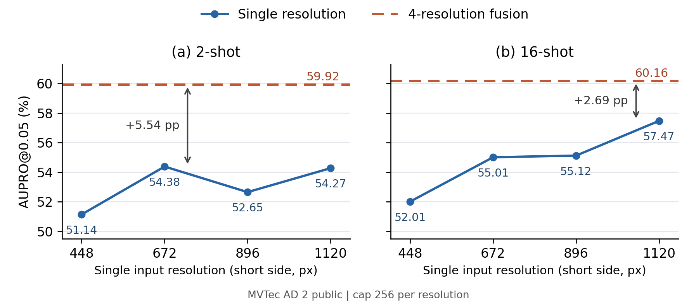
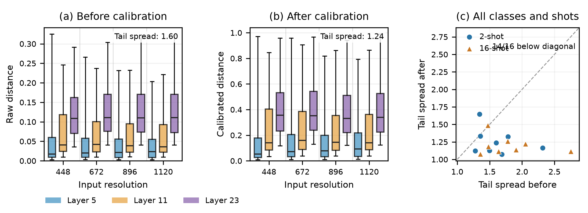
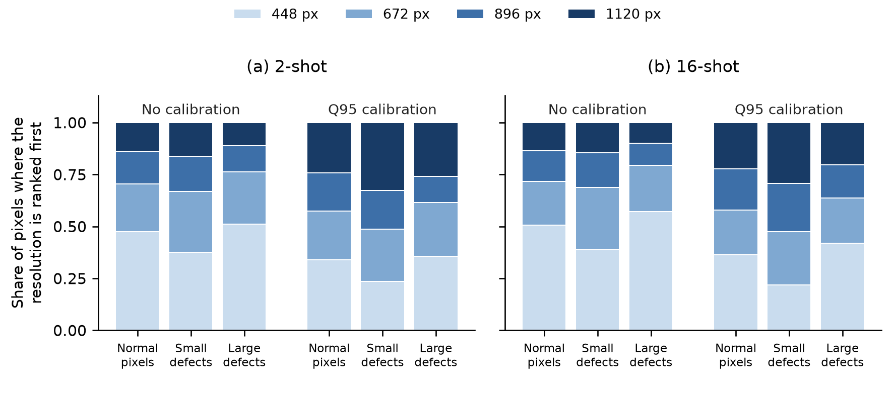

# ScopeAD — 실험 결과 및 표·피규어 자료

## 공통 표기

- 수치는 %, 높을수록 좋다. 차이는 pp다. —는 미확인 값이다. 다중 seed 결과는 seed 0/1/2의 class macro에 대한 mean ± sample SD다.
- AD2 public은 8클래스, MVTec AD는 15클래스, VisA는 12클래스의 macro다. shot은 클래스당 정상 support 이미지 수다.
- **ScopeAD 수치는 공식 확정 설정(Q95 + Rényi 지수 순서 통계량 집계 + CQ99, FP16, cap256)의 측정값이다. 아직 실험하지 않은 조건은 —로 둔다.** 구성 요소 분석(표 4–8)과 표 9는 이전 linear0125 설정의 측정값으로 남기며 각 표에 설정을 명시한다.
- 표에는 측정값과 평가 조건을, 피규어 자료에는 확보된 원자료와 축·계열 정보를 기록한다. 그림 4A는 완성 이미지를 포함하며, 심층 분석의 피규어 자료는 원자료로 기록한다.

## 1. 전체 성능

### 1.1. MVTec AD 2 public

**표 1. AD2 public full8, 1–16-shot, seed 0/1/2 mean ± sample SD.** 각 seed의 class macro를 집계했다. ScopeAD는 Rényi 집계 + Q95 + CQ99, FP16, cap256, 4해상도다. 모든 shot(1/2/4/8/16)을 seed 0/1/2로 실험했다. seed 1/2의 support는 비교군과 같은 manifest(1/4/8-shot은 public_v13, 2/16-shot은 E1)를 사용했고 seed 0은 VOID support다. PatchCore·AnomalyDINO·FastRecon·SubspaceAD·SuperAD는 단일 1120 입력, RAD는 1280 resize 후 1120 crop, RegAD는 224 입력이다. RegAD 외 여섯 비교군은 FP32다. 행별 최고값은 굵게, 차순위는 밑줄로 표시했다. 순위는 RegAD(224) 포함 전체 열에서 매겼다.

| Shot | Metric      |     PatchCore |          AnomalyDINO |     FastRecon |           RAD |           SubspaceAD |              SuperAD | RegAD (224)† | Ours (ScopeAD, Rényi, FP16) |
| ---: | :---------- | ------------: | -------------------: | ------------: | ------------: | -------------------: | -------------------: | ------------: | ---------------------------: |
|    1 | AUPRO@0.05  | 38.45 ± 1.85 |        35.95 ± 2.24 | 14.92 ± 2.27 | 26.42 ± 1.71 |        44.87 ± 1.87 | <u>46.31 ± 3.73</u> | 12.73 ± 0.38 |      **52.18 ± 4.07** |
|      | pAUROC@0.05 | 64.19 ± 0.68 | <u>70.67 ± 0.69</u> | 55.70 ± 0.67 | 59.57 ± 0.35 |        70.56 ± 0.56 |        70.13 ± 1.14 | 57.76 ± 0.30 |      **73.01 ± 1.60** |
|      | I-AUROC     | 65.51 ± 1.91 |        66.83 ± 1.08 | 58.10 ± 4.46 | 58.68 ± 3.03 |        67.02 ± 2.27 | <u>67.68 ± 0.32</u> | 57.73 ± 1.82 |      **73.59 ± 0.36** |
|    2 | AUPRO@0.05  | 42.25 ± 2.08 |        38.20 ± 1.90 | 16.73 ± 2.39 | 31.61 ± 1.47 |        45.90 ± 0.75 | <u>49.80 ± 2.33</u> | 15.05 ± 0.30 |      **56.78 ± 2.77** |
|      | pAUROC@0.05 | 65.43 ± 0.38 | <u>72.26 ± 0.56</u> | 57.14 ± 1.03 | 61.78 ± 0.15 |        71.53 ± 0.18 |        71.52 ± 0.58 | 58.76 ± 0.49 |      **75.83 ± 0.51** |
|      | I-AUROC     | 67.53 ± 1.55 |        68.95 ± 3.84 | 57.63 ± 6.82 | 59.37 ± 2.54 | <u>70.42 ± 1.79</u> |        70.19 ± 2.16 | 60.56 ± 3.94 |      **75.04 ± 1.48** |
|    4 | AUPRO@0.05  | 46.94 ± 1.00 |        40.32 ± 0.75 | 21.88 ± 1.73 | 36.51 ± 1.02 |        47.14 ± 0.76 | <u>54.25 ± 0.86</u> | 17.40 ± 1.07 |      **59.49 ± 0.12** |
|      | pAUROC@0.05 | 66.90 ± 0.22 |        73.09 ± 0.91 | 59.26 ± 0.80 | 63.84 ± 0.41 |        72.45 ± 0.20 | <u>73.59 ± 0.13</u> | 60.36 ± 0.48 |      **76.96 ± 0.55** |
|      | I-AUROC     | 68.62 ± 2.28 |        70.90 ± 0.97 | 59.73 ± 4.40 | 62.31 ± 4.84 | <u>71.02 ± 0.56</u> |        70.97 ± 2.08 | 63.79 ± 2.34 |      **76.14 ± 0.50** |
|    8 | AUPRO@0.05  | 49.98 ± 1.90 |        41.64 ± 1.01 | 27.32 ± 0.14 | 40.79 ± 0.79 |        47.28 ± 0.40 | <u>55.44 ± 1.21</u> | 19.25 ± 0.64 |      **60.40 ± 0.89** |
|      | pAUROC@0.05 | 68.22 ± 0.53 |        73.71 ± 0.20 | 61.74 ± 0.50 | 65.62 ± 0.69 |        72.56 ± 0.21 | <u>74.31 ± 0.38</u> | 62.02 ± 0.32 |      **77.57 ± 0.17** |
|      | I-AUROC     | 69.20 ± 0.75 | <u>71.29 ± 1.69</u> | 63.46 ± 4.29 | 65.84 ± 0.43 |        70.46 ± 1.18 |        70.75 ± 0.58 | 64.34 ± 1.05 |      **76.39 ± 0.67** |
|   16 | AUPRO@0.05  | 52.73 ± 1.36 |        42.30 ± 1.25 | 35.23 ± 0.57 | 42.58 ± 1.10 |        47.63 ± 0.14 | <u>55.89 ± 1.07</u> | 20.28 ± 0.80 |      **60.74 ± 0.72** |
|      | pAUROC@0.05 | 69.36 ± 0.51 |        73.97 ± 0.23 | 65.63 ± 0.43 | 66.62 ± 0.89 |        72.78 ± 0.07 | <u>74.60 ± 0.52</u> | 63.46 ± 0.76 |      **77.77 ± 0.34** |
|      | I-AUROC     | 69.00 ± 0.53 | <u>72.07 ± 1.27</u> | 67.45 ± 1.16 | 67.60 ± 1.35 |        70.46 ± 1.07 |        69.79 ± 0.52 | 65.64 ± 1.34 |      **76.40 ± 0.95** |

평가 조건: ScopeAD는 DINOv2-L [5,11,23], SuperAD·PatchCore는 DINOv2-L [5,11,17,23], AnomalyDINO는 프로젝트 DINOv2-L [23], RAD는 DINOv3-B/16, SubspaceAD는 DINOv2-registers-G/14다. FastRecon은 ResNet-50 논문 설정의 독립 재구현에 입력 해상도를 변경했고, RegAD는 공식 source-trained ResNet-18 STN 체크포인트다. 전체 파이프라인 비교이며 backbone·관측 수·정밀도·계산량은 동일하지 않다.

출처: 비교군은 [v18 §4.1–4.2의 설정·프로토콜 및 결과 출처](Outline_v18.md). ScopeAD seed 0은 [최종 Rényi 실행](../../results/remote_runs/dsba3/scopead_renyi_cq_20261018/), seed 1/2는 [다중 seed 실행](../../results/remote_runs/dsba3/scopead_multiseed_renyi_20261019/ad2)이다. SD는 seed 3개의 sample SD이며, shot이 적을수록 support 선택에 따른 변동이 크다(1-shot AUPRO SD 4.07, 4-shot 0.12).

### 1.2. MVTec AD 2 private/mix

**표 2. MVTec AD 2 공식 private 평가, 8-class macro (%).** 각 셀은 TESTpriv / TESTpriv,mix 순서다. AU-PRO@0.05는 연속 score map 지표이며, ClassF1·SegF1은 임계값 적용 결과다. 굵은 글씨는 (a) 블록 안의 열별 최고값, 밑줄은 차순위다. (b) 참고 블록은 조건이 달라 순위에서 제외했다.

| 방법                                              |            AU-PRO@0.05            |            ClassF1            |               SegF1               |
| :------------------------------------------------ | :-------------------------------: | :----------------------------: | :-------------------------------: |
| **(a) Few-shot (16-shot)**                  |                                  |                                |                                  |
| PatchCore                                         |    <u>58.33</u> / <u>57.03</u>    | **78.21** / <u>78.02</u> |    <u>29.96</u> / <u>27.75</u>    |
| AnomalyDINO                                       |           50.35 / 44.86           |         77.87 / 77.91         |           26.65 / 18.62           |
| SuperAD                                           | **62.82** / **60.08** | <u>78.14</u> / **78.19** | **39.43** / **33.86** |
| RAD                                               |                —                |               —               |                —                |
| SubspaceAD                                        |                —                |               —               |                —                |
| Ours (ScopeAD, Rényi)                            |                —                |               —               |                —                |
| **(b) Full-data Reference (출판/리더보드)** |                                  |                                |                                  |
| PatchCore                                         |            28.8 / 26.0            |           8.0 / 9.9           |             3.7 / 3.4             |
| RD                                                |            26.4 / 25.0            |          70.8 / 72.9          |            18.1 / 16.7            |
| RD++                                              |            27.1 / 25.2            |          70.5 / 73.0          |            19.2 / 16.7            |
| EfficientAD-S                                     |            30.8 / 19.2            |          76.8 / 77.8          |            15.4 / 8.0            |
| MSFlow                                            |            24.3 / 11.9            |          51.1 / 72.0          |            21.8 / 9.0            |
| SimpleNet                                         |            21.1 / 13.7            |          73.3 / 77.1          |            17.7 / 8.7            |
| DSR                                               |            20.3 / 17.4            |          78.0 / 78.0          |            10.9 / 9.5            |
| SuperAD                                           |           60.51 / 58.37           |         70.20 / 74.40         |           47.18 / 42.51           |
| RoBiS                                             |           67.25 / 59.65           |         79.62 / 79.86         |           51.00 / 46.52           |
| SuperADD                                          |           61.36 / 59.07           |         68.03 / 73.25         |           57.42 / 54.35           |

평가 조건: few-shot은 16-shot seed 0이며 ScopeAD 행은 Rényi 설정의 공식 제출이 없어 비워 두었다(이전 linear0125 제출 65.21 / 63.25는 results/scopead_linear0125_private_submission_20261014에 보존). 완료된 네 제출의 support manifest는 bc6a0c851eb3…다. ScopeAD는 3계층·4해상도·FP16, PatchCore·SuperAD는 4계층·단일 1120·FP32, AnomalyDINO는 마지막 계층·단일 1120·FP32다. 같은 support를 사용한 전체 파이프라인 비교이며 관측 수·정밀도·계산량까지 동일한 대조는 아니다. mix는 별도 조명 구성 평가이며 public/private의 합집합이 아니다. Full-data Reference는 정상 데이터 예산·백본·입력·후처리가 다른 출판·리더보드 참고 결과다.

F1 조건: ScopeAD는 support 제외 train/good에서 매 8번째 정상 이미지를 사용해 class별 pixel p95×1.421로 threshold를 정했다. PatchCore·AnomalyDINO·SuperAD도 class별 normal pixel p95×1.421을 사용했으며 방법 간 calibration 이미지의 완전 일치 여부는 미확인이다. private GT는 사용하지 않았다. F1 calibration에는 16-shot 이외의 정상 이미지가 사용되었다.

공식 확인: 2026-10-15 공식 리더보드 재조회. 네 제출 모두 평가 완료다. ScopeAD 제출 ID c7a8b8f7-cf48-4d12-ba04-7e22a01c83a0, PatchCore 제출 ID 40269ae8-8a85-4450-b342-fa9669d03cbb, AnomalyDINO 제출 ID 40ce24a7-8be4-4463-803a-1496c323d31e, SuperAD 제출 ID 0f1dc50a-17a6-4c34-9c79-43ff7fc1077c.

제출 상태(2026-10-19): 최종 Rényi 설정의 private 추론(8클래스, TIFF·PNG 각 4,090개, 클래스별 threshold = 정상 픽셀 p95 × 1.421)을 마치고 제출했으나(ID 33e9a341-6d39-43eb-9724-e93789fe4907) 서버의 형식 검사에서 INVALID로 처리되어 평가 결과가 없다. 서버 메시지는 "Missing directories: [anomaly_images]. Unexpected directories: [can, fabric, fruit_jelly, rice, ...]"이다. 기존 압축파일은 공식 압축 스크립트가 포함하는 바깥 제출물 폴더를 생략했다. 이를 포함한 `ScopeAD_renyi_q95_16shot.tar.gz`를 새로 생성했고, MVTec 공식 검사기로 전체 8,180개 파일의 구조·이름·이미지 형식 검사를 통과했다. 완성 압축파일의 전체 경로·개수·크기와 gzip 무결성도 확인했다. 추론값과 threshold는 변경하지 않았다. 수정 파일은 `/home/hun/Volume/upload_scopead_renyi_20261019/corrected/ScopeAD_renyi_q95_16shot.tar.gz`이며, 서버 재제출은 아직 완료되지 않았다. 현재 계정의 업로드 할당량은 2/2다. 기록과 검증 근거는 `results/scopead_renyi_private_submission_20261019/RESULTS.md` 및 `submission_record.json`에 있다.

해석: 이전 linear0125 제출은 private·mixed AUPRO에서 가장 높았으나, 현재 확정 설정은 아직 제출하지 않았으므로 이 비교는 확정 설정에 대해 성립하지 않는다.

출처: [ScopeAD 공식 결과](../../results/scopead_linear0125_private_submission_20261014/comparison.md), [PatchCore 공식 결과](../../results/patchcore_private_submission_20261014/comparison.md), [AnomalyDINO 공식 결과](../../results/anomalydino_private_submission_20261014/comparison.md), [SuperAD 공식 결과](../../results/superad_private_submission_20261014/comparison.md), [Full-data 참고 기록](../../results/rsg4_private_submission_20260928/comparison.md).

### 1.3. 교차 데이터셋 비교

**표 3. MVTec AD / VisA, seed 0, I-AUROC / P-AUROC.** 대상 데이터셋의 정상 support로 bank를 구성한다. ScopeAD는 Rényi 집계 설정으로 MVTec AD와 VisA의 1, 2, 4, 8, 16-shot을 모두 실험했다. 비교군 셀의 —는 결과가 없는 조건이다. q·λ는 대상 데이터셋마다 재조정하지 않았다. 행별 최고값은 굵게, 차순위는 밑줄로 표시했다. I-AUROC와 P-AUROC는 각각 따로 순위를 매겼다.

| Dataset  | Shot |   PatchCore   |     AnomalyDINO     |        FastRecon        |      RAD      |       SubspaceAD       |              SuperAD              |     RegAD     |     Ours (ScopeAD, Rényi)     |
| :------- | ---: | :-----------: | :------------------: | :---------------------: | :-----------: | :---------------------: | :-------------------------------: | :-----------: | :----------------------------: |
| MVTec AD |    1 | 88.12 / 96.22 | <u>92.52</u> / 94.49 |      88.84 / 96.60      | 80.83 / 93.25 |  89.25 / <u>96.92</u>  | **92.54** / **96.93** |    — / —    |         92.32 / 96.62         |
| MVTec AD |    2 | 92.67 / 96.97 |    95.17 / 95.56    |  93.51 / <u>97.29</u>  | 84.15 / 94.27 |      90.95 / 97.24      |  <u>95.43</u> / **97.36**  |    — / —    |    **95.49** / 97.28    |
| MVTec AD |    4 | 95.06 / 97.37 |    95.92 / 96.07    | 95.61 / **97.87** | 85.38 / 94.67 |      91.35 / 97.16      |    <u>96.65</u> / <u>97.70</u>    |    — / —    |    **96.82** / 97.59    |
| MVTec AD |    8 | 96.13 / 97.80 |    96.67 / 96.45    | 96.76 / **98.16** | 87.85 / 95.29 |      92.94 / 97.17      |  **97.39** / <u>97.95</u>  |    — / —    |      <u>97.35</u> / 97.86      |
| MVTec AD |   16 | 98.15 / 97.99 |    97.48 / 96.80    | 98.52 / **98.38** | 90.29 / 95.61 |      92.51 / 97.19      |  **98.94** / <u>98.09</u>  |    — / —    |      <u>98.66</u> / 97.99      |
| VisA     |    1 | 86.09 / 95.56 |    87.06 / 95.62    |      84.65 / 96.75      | 72.67 / 95.37 | 85.44 / **98.09** |  **90.29** / <u>97.06</u>  | 71.12 / 93.41 |      <u>88.52</u> / 96.53      |
| VisA     |    2 | 87.87 / 96.29 |    90.64 / 96.63    |      87.67 / 97.43      | 77.24 / 96.37 | 86.36 / **98.21** |  **92.20** / <u>97.68</u>  | 71.59 / 94.59 |      <u>91.59</u> / 97.14      |
| VisA     |    4 | 89.52 / 96.92 |    91.37 / 97.57    |      89.21 / 97.91      | 79.16 / 97.45 | 86.85 / **98.26** |    <u>92.94</u> / <u>98.02</u>    | 76.42 / 96.14 |    **94.28** / 97.69    |
| VisA     |    8 | 92.36 / 97.18 |    93.11 / 97.99    |      91.53 / 98.11      | 86.32 / 97.93 | 88.29 / **98.33** |    <u>94.50</u> / <u>98.29</u>    | 80.19 / 96.64 |    **94.97** / 98.12    |
| VisA     |   16 | 93.64 / 97.30 |    93.53 / 98.30    |      93.38 / 98.32      | 88.56 / 98.18 |  88.99 / <u>98.37</u>  |  <u>95.19</u> / **98.43**  | 81.22 / 96.98 | **95.86** / <u>98.37</u> |

출처: [v18 표 5 및 비교 설정](Outline_v18.md), [최신 VisA 비교군 audit](../../results/remote_runs/dsba3/table5_fill_visa_audit_20261013/combined/visa_py311/comparison.md).

## 2. 구성 요소 유효성 검사 (Component Ablation Study)

공통 조건: AD2 public full8, seed 0, 기존 CQ 포함 결과다. 별도 표기가 없으면 q95, λ=0.125, cap256, 4bags를 사용한다.

### 2.1. 주요 구성 요소의 종합 ablation

**표 4. 주요 구성 요소의 ablation, AUPRO@0.05 (%).** A는 단일 해상도 기준선이며, B–F는 이전 행에 표시된 요소를 차례로 추가한 비교다. F는 최종 확정 모델이다. ✓는 적용, ×는 미적용, —는 해당 조합의 미확인 결과다. 채워진 수치는 위 공통 조건의 기존 측정값이며, 최종 CQ-off 구성의 결과와 구분한다.

| 구성                                     | 다중 해상도 | 개별 메모리 bank | Shallow fusion | Scale calibration | Rényi L-추정량 |    2-shot AUPRO |   16-shot AUPRO |
| ---------------------------------------- | :----------: | :--------------: | :------------: | :---------------: | :-------------: | --------------: | --------------: |
| A. Base                                  |      ×      |        ×        |       ×       |        ×        |       ×       |           50.51 |           53.78 |
| B. + Multi-resolution                    |      ✓      |        ×        |       ×       |        ×        |       ×       |           55.62 |           57.90 |
| C. + Separate banks                      |      ✓      |        ✓        |       ×       |        ×        |       ×       |           58.23 |           57.93 |
| D. + Shallow fusion                      |      ✓      |        ✓        |       ✓       |        ×        |       ×       |           59.06 |           59.17 |
| E. + Scale calibration                   |      ✓      |        ✓        |       ✓       |        ✓        |       ×       |           59.33 |           59.57 |
| **F. + Rényi aggregation (Ours)** | **✓** |   **✓**   |  **✓**  |   **✓**   |  **✓**  | **59.92** | **60.16** |

설정과 원자료 대응:

- **A·B:** deep 계층 [11,23]의 특징을 연결한 통합 bank, 보정 없음. A는 단일 1120, B는 448/672/896/1120 결합이다. 해상도 합계 설정 cap을 맞추려면 A는 cap1024, B는 해상도별 cap256으로 비교한다. CQ99 후처리를 적용했고, MVTec AD 2 test_public 8클래스 macro, seed 0 단일 실행이다. 실행 로그는 2026-10-15 dsba3 실행(scopead_table4_ab_20261015)이며, 32개 클래스 평가가 모두 완료되었다.
- **C·D·E·F:** 4해상도·계층별 개별 bank·cap256·4bags다. C/F는 shallow 점수 기여만 제외하며, 기존 구현에서는 shallow 특징과 bank도 계산한다. D/E는 deep 두 계층의 평균에 shallow 점수를 λ=0.125로 더한다. C/D는 보정 없음, E/F는 정상 참조 q95 보정이다. 원자료는 아래 출처의 AD2 Stage A `deep none` / `linear none` / `linear q95` / `deep q95`에 각각 대응한다.
- **Sparse bank:** 모든 행에 sparse 샘플링을 적용하는 구성이다. 개별 bank 열은 계층별 bank 분리를 뜻하며, sparse 샘플링의 유무를 뜻하지 않는다. Sparse bank의 성능·비용 근거는 Q5에 제시한다.
- **기존 Layer-concat 결과:** 표 7의 52.12 / 57.48은 [5,11,23]의 세 계층 특징과 q95를 사용한다. A·B와 계층 및 보정 조건이 달라 누적 표의 빈칸을 대체할 수 없다.

출처: [calibration factorial — AD2 Stage A](../../results/remote_runs/dsba3/scarf_calibration_factorial_seed0_fp16_20261009/comparison.md), [기존 Layer-concat 설정](../../configs/benchmarks/scarf_component_ablation_local_seed0_fp16_20261009/ad2_concat_s02_seed0.yaml).

### 2.2. 다해상도 관측 및 용량 일치 대조

**그림 4A. 단일 해상도에 따른 성능과 다해상도 결합 비교.** 왼쪽은 2-shot, 오른쪽은 16-shot이다. x축은 단일 입력 해상도, y축은 AUPRO@0.05(%)다. 실선은 각 단일 해상도, 수평 점선은 네 해상도의 결합 성능이다. 화살표는 최선 단일 해상도 대비 차이(+5.54/+2.69pp)를 표시한다.

평가 조건: AD2 public full8. 계층·가중치·q95·해상도별 cap256은 고정했으며, 다해상도는 총 configured cap이 단일 해상도의 4배다. 총 설정 cap을 맞춘 비교는 표 4B에 제시한다. 두 패널은 같은 y축 범위를 사용한다. 다해상도는 별도 결합 조건이므로 단일 해상도 곡선에 이어 붙이지 않는다.

**그림 4A 원자료.** 셀은 AUPRO@0.05 / pAUROC@0.05다. 그림에는 AUPRO를 표시하며 pAUROC도 아래에 보존한다.

| 해상도 구성                 |        2-shot |       16-shot |
| :-------------------------- | ------------: | ------------: |
| 448                         | 51.14 / 75.80 | 52.01 / 76.52 |
| 672                         | 54.38 / 74.97 | 55.01 / 76.17 |
| 896                         | 52.65 / 73.46 | 55.12 / 74.62 |
| 1120                        | 54.27 / 72.47 | 57.47 / 74.86 |
| 4 해상도 (448/672/896/1120) | 59.92 / 76.36 | 60.16 / 77.52 |

**표 4B. 해상도 합계 configured cap 대응 비교, 16-shot.** cap은 이미지·계층·bag·해상도별 토큰 상한이다. 실제 고유 패치 수와 계산량은 동일하지 않다. 4해상도 행은 표 1 16-shot의 최종 Rényi 실행과 같은 실행이다. 단일 1120 행은 해상도 합계 cap 1024에 맞춘 별도 실행이며, 그림 4A의 단일 1120 값(57.47, 해상도별 cap 256)과 cap 조건이 다르다.

| 구성      | 해상도별 cap | 해상도 합계 cap | AUPRO | pAUROC |
| --------- | -----------: | --------------: | ----: | -----: |
| 단일 1120 |         1024 |            1024 | 57.14 |  75.49 |
| 4해상도   |          256 |            1024 | 60.16 |  77.52 |

**소결론.** 다해상도 결합은 동일한 정상 support를 사용하는 최선의 단일 해상도보다 AUPRO@0.05가 2-shot에서 5.54pp, 16-shot에서 2.69pp 높았다(그림 4A). 16-shot에서 해상도 합계 cap을 1024로 맞춘 비교에서도 3.02pp 높았다(표 4B). 즉, **설정상 같은 저장 용량을 하나의 해상도에 배분하는 것보다 여러 해상도에 나눠서 관측하고 결합하는 편이 유리했다.**

이 결론은 AD2 public, seed 0, 기존 CQ 포함 조건에 한정한다. 계산량과 실제 고유 패치 수는 통제하지 않았으며, 해상도별로 서로 다른 결함 단서를 보완한다는 메커니즘까지 확인한 것은 아니다.

출처: [single resolution](../../results/remote_runs/dsba3/scarf_single_resolution_fp16_20261012/comparison.md), [capacity/cost](../../results/remote_runs/dsba3/scopead_v18_q95_linear0125_fp16_20261012/combined/capacity_cost_ad2/comparison.md).

### 2.3. 비대칭 계층 결합(Shallow fusion) 유효성

**표 6. Shallow 가중치 비교, q95 고정, AUPRO@0.05 / pAUROC@0.05.** deep-only는 점수 기여만 제거하며 3계층 특징과 bank는 계속 계산한다. λ=0.125는 CQ 포함 AD2 public 2-shot seed 0 AUPRO로 전체 후보 중 post-hoc 선택했다.

| λ    | 의미                           |        2-shot |       16-shot |
| ----- | ------------------------------ | ------------: | ------------: |
| 0     | deep-only score                | 58.66 / 76.49 | 58.67 / 77.35 |
| 0.125 | 선택된 비대칭 결합             | 59.33 / 76.48 | 59.57 / 77.46 |
| 0.25  | shallow 비중 증가              | 58.43 / 76.00 | 59.48 / 77.21 |
| 0.5   | deep 각 층과 shallow 동일 비중 | 54.92 / 74.39 | 58.21 / 76.31 |
| 1     | deep 평균과 shallow 동일 비중  | 48.39 / 71.31 | 54.02 / 74.04 |
| 2     | shallow 강조                   | 40.48 / 67.00 | 47.33 / 70.19 |

**표 6B. 최종 설정(Q95 + Rényi 집계 + CQ 포함)에서 shallow 가중치 λ 비교, seed 0, AUPRO@0.05 / pAUROC@0.05.** 표 6은 mean 집계에서 측정했으므로, 최종 집계에서 λ를 다시 확인했다. λ=0.125 행은 표 1의 seed 0 실행과 같다. 다른 조건(계층 [5,11,23], 4해상도, cap256, support)은 동일하다.

| λ                     |                  2-shot |                 16-shot |
| ---------------------- | ----------------------: | ----------------------: |
| 0 (deep-only score)    |           59.05 / 76.32 |           59.11 / 77.33 |
| 0.0625                 |           59.76 / 76.42 |           59.73 / 77.48 |
| **0.125 (최종)** | **59.92 / 76.36** |           60.16 / 77.52 |
| 0.25                   |           59.32 / 75.91 | **60.36 / 77.35** |
| 0.5                    |           56.23 / 74.41 |           59.47 / 76.57 |

최종 집계에서도 shallow를 더하면 AUPRO가 올라 λ=0.125는 λ=0보다 2-shot에서 +0.87pp, 16-shot에서 +1.05pp 높다. 0.0625~0.25 범위에서는 변화가 1pp 안쪽이어서 λ에 민감하지 않다. 0.5부터는 2-shot에서 크게 떨어진다. 16-shot에서는 λ=0.25(60.36)가 0.125(60.16)보다 0.20pp 높아 λ=0.125가 모든 조건의 최적은 아니다. λ=0.125는 2-shot 개발 평가로 고른 값이며 이 표도 같은 AD2 public seed 0 평가이므로 post-hoc 확인이다. seed 0 단일 실행이다.

출처: 표 6B는 [λ 스윕](../../results/remote_runs/dsba3/scopead_final_validation_20261019/lambda_sweep), 표 6은 [fusion sensitivity](../../results/remote_runs/dsba3/scarf_fusion_sensitivity_fp16_20261008/comparison.md), [λ 선택 기록](../../results/remote_runs/dsba3/scarf_fusion_sensitivity_fp16_20261008/lambda_selection.json).

### 2.4. 관측별 독립 매칭 대 결합 매칭 대조

**표 7. Layer-concat과 관측별 bank 전체 구성 비교, seed 0.** AD2는 AUPRO@0.05 / pAUROC@0.05, MVTec AD·VisA는 I-AUROC / P-AUROC다. 매칭·정규화·계층 가중치가 함께 다르므로 bank 분리만을 통제한 대조는 아니다.

| 데이터셋 | 구성                  |        2-shot |       16-shot |
| -------- | --------------------- | ------------: | ------------: |
| AD2      | Layer concat          | 52.12 / 71.97 | 57.48 / 74.80 |
| AD2      | 관측별 bank 전체 구성 | 59.33 / 76.48 | 59.57 / 77.46 |
| MVTec AD | Layer concat          | 93.08 / 96.86 | 98.19 / 97.79 |
| MVTec AD | 관측별 bank 전체 구성 | 96.13 / 97.39 | 98.74 / 98.05 |
| VisA     | Layer concat          | 89.09 / 95.79 | 94.09 / 97.02 |
| VisA     | 관측별 bank 전체 구성 | 92.15 / 97.32 | 95.99 / 98.49 |

출처: [component ablation](../../results/local_runs/scarf_component_ablation_local_seed0_fp16_20261009/comparison.md).

## 3. 메커니즘 심층 분석: Calibrated Scale Aggregation의 작동 원리

ScopeAD는 계층·해상도 조합마다 별도의 bank를 구성한다. 각 bank가 내놓는 최근접 거리는 패치 수용영역과 특징 밀도 차이로 인해 값의 범위(척도)가 서로 다르다. 이 점수들을 효과적으로 결합하기 위해 ScopeAD는 (1) 정상 support의 Q95 상단 분위수로 단위를 일치시키는 **척도 보정(Scale Calibration)**과, (2) 다해상도 점수를 정렬하여 극치 지수 순서 통계량 기댓값으로 가중 집계하는 **Rényi 순서 통계량 L-추정량**을 적용한다. 본 절에서는 이 결합 메커니즘이 왜 필요한지 3단계 실증 진단을 통해 분석한다.

### 3.1. [진단 1] 관측별 점수 척도의 불일치와 정상 상단 분위수 보정

**그림 5B. 정상 참조 보정에 따른 관측별 점수 척도의 변화.** 본문용 3패널 그림.

**논문 캡션.** **Effect of normal-reference calibration on observation-wise score distributions.** (a–b) Normal-query distance distributions before and after calibration on MVTec AD 2 public (vial, 2-shot), using the same sampled pixels across four resolutions and three feature layers. Boxes indicate the interquartile range, center lines the median, and whiskers the 5th–95th percentiles. The panels retain their respective raw and calibrated units. (c) Across all eight classes at 2- and 16-shot, each point compares the before/after tail spread, defined as the maximum divided by the minimum of the 12 observation-wise normal-score 95th percentiles. Points below the diagonal indicate reduced scale mismatch (14/16 conditions). Calibration factors are estimated from normal support data only.

**그림 해석 및 범위.** Q95 보정은 관측별 정상 점수의 상단 분위수 차이를 줄인다(16개 조건 중 14개). vial 예시에서 관측별 Q95의 최댓값/최솟값은 1.60에서 1.24로 줄지만, 중앙값의 비는 6.30에서 6.78로 오히려 커진다. Q95로 나누는 연산은 상단 꼬리만 맞추고 분포 전체를 맞추지는 않는다. 이 성질은 높은 점수끼리 순위를 매기는 order 집계와 맞물리며, 표 5A에서 보정이 order 집계와 결합할 때만 이득이 커지는 결과와 일관된다. 2-shot can과 16-shot wallplugs는 척도 차이가 줄지 않았다. 진단 표본은 클래스당 정상 픽셀을 최대 2,048개로 제한했다.

[논문용 PDF](../figures/fig_scopead_calibration_paper.pdf) · [그림 구성 및 선택 기준](../figures/fig_scopead_calibration_paper.json) · [전체 분포·진단 조건·원자료](../../results/remote_runs/dsba3/scopead_calibration_diagnostic_20261015/diagnostics/README.md)

### 3.2. [진단 2] 척도 보정이 해상도 순위 왜곡을 바로잡는 기제

**그림 5A. 해상도별 1등 점유율.** 픽셀마다 해상도 네 개 중 어느 해상도의 점수가 가장 높은지 센 비율이며, 8클래스 macro다. 작은 결함은 결함 영역 면적이 이미지의 0.1% 미만, 큰 결함은 1% 이상인 영역이다. 큰 결함은 그 크기의 결함이 있는 7개 클래스의 평균이다.

**표 5F. 순위 진단 요약, 8클래스 macro.** 실효 Rényi 가중치는 각 해상도가 순위별로 받는 가중치를 정상 픽셀에서 평균한 값이며, 네 해상도가 같은 비중이면 0.25다. 결함 근거 해상도는 결함 영역마다 "영역 평균 점수 ÷ 같은 이미지 정상 픽셀의 Q95"가 가장 큰 해상도다.

| 지표                                   | 2-shot 없음 |  2-shot Q95 | 16-shot 없음 | 16-shot Q95 |
| :------------------------------------- | ----------: | ----------: | -----------: | ----------: |
| 정상 픽셀에서 448이 1등인 비율         |       47.5% |       33.9% |        50.7% |       36.4% |
| 결함 픽셀에서 448이 1등인 비율         |       47.6% |       32.2% |        52.2% |       36.8% |
| 448이 가장 자주 1등인 클래스 수        |         8/8 |         5/8 |          8/8 |         7/8 |
| 실효 Rényi 가중치 448 / 1120          | 0.34 / 0.18 | 0.28 / 0.24 |  0.34 / 0.18 | 0.28 / 0.23 |
| 작은 결함에서 1120이 1등인 비율        |       16.3% |       32.6% |        14.5% |       29.2% |
| 1등 해상도와 결함 근거 해상도의 일치율 |       44.0% |       47.6% |        44.1% |       46.0% |

보정이 없으면 8개 클래스 모두에서 448이 가장 자주 1등을 차지한다. 448이 1등인 비율은 정상 픽셀(47.5%)과 결함 픽셀(47.6%)에서 거의 같다. 해상도 사이의 순위가 결함 여부에 반응하지 않는다는 뜻이다. 그래서 Rényi 가중치는 실제로는 448에 0.34, 1120에 0.18을 주는 고정 가중치처럼 작동하고, 높은 해상도에서 잘 보이는 작은 결함의 비중이 줄어든다. Q95로 보정하면 448의 점유율이 34–36%로 내려가고 실효 가중치가 0.25 근처로 고르게 된다. 작은 결함에서 1120이 1등인 비율은 16.3%에서 32.6%(2-shot), 14.5%에서 29.2%(16-shot)로 약 두 배가 된다. 큰 결함에서는 보정 뒤에도 448과 672가 1등을 많이 차지해, 결함 크기에 맞는 해상도가 위로 올라오는 경향과 일치한다.

해석의 한계도 있다. 1등 해상도와 결함 근거 해상도의 일치율은 3.6 / 1.9pp만 올라 개선 폭이 작다. 결함 픽셀과 정상 픽셀의 1등 분포 차이(total variation)는 2-shot에서 0.125 → 0.137로 늘었지만 16-shot에서는 0.122 → 0.110으로 줄어 일관되지 않다. 448의 원시 거리가 다른 해상도보다 크다는 설명은 점유율에서 추론한 것이며 거리값을 직접 비교하지는 않았다. 진단은 seed 0 한 번이며, GT는 방법의 예측이 끝난 뒤 이 분석에만 사용했다.

### 3.3. [진단 3] 척도 보정과 Rényi 순서 통계량 집계의 상호작용

**표 5A. 보정 × 해상도 집계, 2-shot, CQ-off.** 셀은 AUPRO@0.05 / pAUROC@0.05다. order는 선형 순서 통계량 가중이다.

| 보정       |     mean 집계 |    order 집계 | order − mean (AUPRO) |
| :--------- | ------------: | ------------: | --------------------: |
| 없음       | 58.35 / 76.71 | 58.57 / 76.78 |                 +0.22 |
| z-score    | 58.16 / 76.77 | 58.95 / 76.82 |                 +0.79 |
| Q95 (기본) | 58.50 / 76.67 | 59.16 / 76.69 |                 +0.66 |

보정 없이 순서 통계량 집계를 쓰면 이득이 +0.22pp에 그친다. Q95로 단위를 맞춘 뒤에는 같은 집계의 이득이 +0.66pp로 세 배 커진다. 반대로 mean 집계에서는 Q95 보정의 이득이 +0.15pp뿐이다. 보정의 효과는 단독으로 크지 않고, 해상도 사이의 순위를 매기는 집계와 결합할 때 나타난다. z-score도 같은 경향(+0.79pp)을 보여, 단위 정렬 자체가 order 집계의 전제 조건임을 지지한다.

**표 5A-2. 최종 조건(CQ 포함)의 보정 × 집계.** 셀은 AUPRO@0.05 / pAUROC@0.05다. mean 행은 표 4 D·E와 같은 실행이고, Rényi 행은 순위 진단 실행에서 얻었다. Q95 + Rényi 행은 최종 모델이며 기존 기록값(59.92 / 60.16)을 그대로 재현했다.

| 보정          | 집계                    |                  2-shot |                 16-shot |
| :------------ | :---------------------- | ----------------------: | ----------------------: |
| 없음          | mean                    |           59.06 / 76.47 |           59.17 / 77.65 |
| 없음          | Rényi                  |           58.99 / 76.44 |           59.03 / 77.76 |
| Q95           | mean                    |           59.33 / 76.48 |           59.57 / 77.46 |
| **Q95** | **Rényi (최종)** | **59.92 / 76.36** | **60.16 / 77.52** |

보정 없이 mean을 Rényi로 바꾸면 AUPRO가 오히려 0.07 / 0.14pp 낮아진다. Q95 보정 뒤에는 같은 변경으로 0.59 / 0.59pp 높아진다. CQ-off 2-shot(표 5A)과 같은 방향이며, 최종 평가 조건의 2·16-shot에서 모두 확인됐다.

**표 5A-3. 최종 조건(CQ 포함)의 보정 × 집계, seed 0/1/2 mean ± sample SD.** 셀은 AUPRO@0.05 / pAUROC@0.05이며 AD2 public full8이다. seed 0은 표 5A-2와 같은 실행이고 seed 1/2는 비교군과 같은 support manifest(2·16-shot은 E1)로 새로 실행했다. Q95 + Rényi 행은 표 1의 ScopeAD와 같은 실행이다.

| 보정          | 집계                    |                                  2-shot |                                 16-shot |
| :------------ | :---------------------- | --------------------------------------: | --------------------------------------: |
| 없음          | mean                    |           56.12 ± 2.76 / 76.10 ± 0.49 |           59.73 ± 0.86 / 77.76 ± 0.32 |
| 없음          | Rényi                  |           56.32 ± 2.49 / 76.18 ± 0.40 |           59.72 ± 0.77 / 77.96 ± 0.25 |
| Q95           | mean                    |           56.03 ± 3.00 / 75.86 ± 0.59 |           60.06 ± 0.88 / 77.60 ± 0.37 |
| **Q95** | **Rényi (최종)** | **56.78 ± 2.77 / 75.83 ± 0.51** | **60.74 ± 0.72 / 77.77 ± 0.34** |

seed별 AUPRO 차이(seed 0 / 1 / 2, pp)는 다음과 같다.

| 비교                         |                                2-shot |                               16-shot |
| :--------------------------- | ------------------------------------: | ------------------------------------: |
| Q95에서 Rényi − mean       |    +0.59 / +1.21 / +0.44 (평균 +0.75) |    +0.58 / +0.48 / +0.98 (평균 +0.68) |
| 보정 없음에서 Rényi − mean |   −0.07 / +0.48 / +0.21 (평균 +0.20) | −0.15 / −0.17 / +0.29 (평균 −0.01) |
| Rényi에서 Q95 − 없음       |   +0.93 / +0.63 / −0.19 (평균 +0.46) |    +1.13 / +1.00 / +0.91 (평균 +1.01) |
| mean에서 Q95 − 없음         | +0.27 / −0.11 / −0.43 (평균 −0.09) |    +0.40 / +0.34 / +0.23 (평균 +0.32) |

Q95 보정 아래에서 Rényi 집계로 바꾸면 2·16-shot 모두 세 seed에서 AUPRO가 올라 평균 +0.75 / +0.68pp였다. 보정 없이 같은 변경을 하면 평균 +0.20 / −0.01pp로 효과가 거의 없다. 16-shot에서는 Rényi 아래에서 Q95의 이득이 세 seed 모두 양수(평균 +1.01pp)여서 "보정이 집계의 효과를 만든다"는 해석이 seed 사이에서도 유지됐다. 2-shot에서는 Rényi 아래 Q95의 이득이 seed 2에서 −0.19pp였고 평균 +0.46pp여서 방향은 같지만 크기가 일정하지 않다. 2-shot의 seed 사이 SD(2.5~3.0pp)가 이 차이보다 훨씬 크므로, 절대 성능이 아니라 같은 seed 안의 짝지은 차이를 기준으로 읽어야 한다. 표 5A-3은 seed 3개의 짝지은 비교다. 클래스 변동을 포함한 후속 bootstrap 분석은 §3.5에 기록했다.

**메커니즘 분석 소결론.**
관측별 bank 구조에서 보정 단독의 효과는 작고 shot에 따라 부호가 바뀐다(표 5E). Q95와 Rényi를 결합하면 AD2 public macro 평균이 높아지지만, 후속 3-seed 개입 분석에서는 순위 변경만의 이득이 +0.050/−0.141pp로 작고 점수 크기 보정의 영향이 더 컸다(§3.5). 보정 뒤 448의 최고 점수 점유율이 줄고 1120의 점유율이 증가하더라도 정상 픽셀에서도 같은 변화가 나타나므로, 이 순위 변화만으로 성능 개선 원인을 설명할 수 없다. **현재 근거는 척도 보정이 큰 응답을 강조하는 Rényi 집계와 결합해 평균 성능을 개선한다는 것이며, 모든 클래스에서 필요한 필수 단계라는 주장은 보류한다.** 상호작용의 클래스 bootstrap 구간은 0을 포함하고 fabric 의존성이 크다. 보정 대안 및 oracle 비교는 척도 선택에 대한 민감성을 보여주지만, 실제 support Q95의 추정 불확실성을 직접 측정한 근거와는 구분한다.

이 결론은 AD2 public에 한정한다. CQ 포함 2×2는 seed 0/1/2의 2·16-shot으로 확인했고(표 5A-3), CQ-off 2×2(표 5A)와 순위 진단은 seed 0이다. Q95와 λ=0.125는 같은 AD2 public 개발 평가에서 선택했으므로 post-hoc 선택이다.

### 3.4. 다해상도 집계 및 척도 보정 대안 비교

**표 5B. 해상도 집계 방식 비교, Q95 고정, CQ-off.** 셀은 AUPRO@0.05 / pAUROC@0.05다. —는 실행하지 않은 조합이다.

| 집계 방식                      |                  2-shot |                 16-shot |
| :----------------------------- | ----------------------: | ----------------------: |
| mean                           |           58.50 / 76.67 |           58.72 / 77.51 |
| power mean (p=1.5)             |           58.61 / 76.68 |                      — |
| power mean (p=2)               |           58.72 / 76.69 |                      — |
| log-sum-exp                    |           58.87 / 76.70 |                      — |
| top-3 mean                     |           59.02 / 76.63 |           59.08 / 77.55 |
| power top-3 (p=1.5)            |           59.06 / 76.63 |                      — |
| power top-3 (p=2)              |           59.08 / 76.63 |                      — |
| order (convex)                 |           59.07 / 76.66 |           59.11 / 77.57 |
| order (linear)                 |           59.16 / 76.69 |           59.19 / 77.60 |
| **order (Rényi, 최종)** | **59.27 / 76.64** | **59.27 / 77.60** |

순위 정보를 쓰는 집계(top-3, order 계열)가 크기만 키우는 집계(power mean, log-sum-exp)보다 일관되게 높았다. Rényi 가중은 선형 가중보다 +0.11 / +0.08pp 높아 차이가 작다. Rényi의 역할은 성능을 크게 올리는 데 있지 않고, 수작업으로 고른 가중치 대신 순서 통계량 이론에서 가중치를 유도해 자유 매개변수를 없애는 데 있다. order (linear)와 Rényi 행은 같은 실행에서 얻었다.

**표 5C. Bank별 척도 보정 방식 비교, mean 집계 고정, CQ-off.** 셀은 AUPRO@0.05 / pAUROC@0.05다. 축소 Q95는 Q95와 결과가 같아 생략했다.

| 계열                  | 보정 방식            |                  2-shot |       16-shot |
| :-------------------- | :------------------- | ----------------------: | ------------: |
| 없음                  | none                 |           58.34 / 76.71 | 58.35 / 77.70 |
| 분위수 척도           | **Q95 (기본)** | **58.50 / 76.67** | 58.72 / 77.51 |
|                       | 이미지 중앙값 분위수 |           58.48 / 76.54 | 58.80 / 77.55 |
|                       | 다중 분위수          |           58.45 / 76.55 | 58.80 / 77.55 |
|                       | 부분 중심화          |           58.41 / 76.81 | 58.56 / 77.48 |
|                       | 분위수 barycenter    |           58.31 / 76.80 | 58.38 / 77.15 |
|                       | 분위수 anchor        |           58.24 / 76.91 | 58.40 / 77.23 |
|                       | 중심화               |           58.04 / 76.96 | 58.12 / 77.37 |
| 모멘트 척도           | RMS                  |           58.43 / 76.42 | 58.92 / 77.55 |
|                       | 평균                 |           58.28 / 76.23 | 58.98 / 77.52 |
|                       | 표준편차 (z-score)   |           58.16 / 76.77 | 58.34 / 77.46 |
| 강건 척도             | Qn                   |           57.93 / 76.45 | 58.01 / 77.27 |
|                       | MAD                  |           57.67 / 76.55 | 57.54 / 77.20 |
|                       | Box-Cox + MAD        |           56.63 / 77.05 | 56.32 / 77.35 |
|                       | log + MAD            |           55.44 / 76.62 | 55.96 / 77.09 |
| 분포 적합 (생존확률)  | GPD                  |           58.40 / 76.81 | 58.33 / 77.05 |
|                       | 상단 꼬리            |           58.37 / 76.81 | 58.37 / 77.12 |
|                       | Gamma                |           58.36 / 76.88 | 57.99 / 77.71 |
|                       | 상단 폭              |           58.36 / 76.97 | 58.26 / 77.12 |
|                       | 경험적               |           58.27 / 76.66 | 58.56 / 76.94 |
|                       | 로그정규             |           57.87 / 76.90 | 57.44 / 77.69 |
|                       | Gaussian             |           57.23 / 76.71 | 57.77 / 76.72 |
| 공유·축소 추정       | Weibull bank Q95     |           58.46 / 76.46 | 58.74 / 77.50 |
|                       | 경험적 Bayes RMS     |           58.35 / 76.40 | 58.88 / 77.54 |
|                       | 경험적 Bayes 평균    |           58.21 / 76.22 | 58.95 / 77.51 |
|                       | 공분산 Q95           |           56.43 / 76.00 | 58.98 / 77.88 |
| 방향 분포             | vMF 농도             |           58.18 / 76.15 |            — |
|                       | vMF 혼합             |           58.19 / 76.15 |            — |
| 상한 (평가 라벨 사용) | oracle 척도          |           63.82 / 78.33 | 63.12 / 78.72 |

2-shot에서는 Q95보다 높은 보정 방식이 없었다. 16-shot에서는 평균·공분산·경험적 Bayes·RMS 척도가 Q95보다 0.20–0.26pp 높았지만 2-shot에서는 모두 Q95보다 낮았다. 강건 척도와 분포 적합 방식은 오히려 none보다 낮은 경우가 많았다. 반면 평가 라벨로 척도를 맞춘 oracle은 Q95보다 +5.32 / +4.40pp 높다. 척도를 정확히 맞출 수 있다면 큰 이득이 있지만, 소수의 정상 support로 그 척도를 추정하는 것이 병목이다. oracle은 평가 라벨을 쓰므로 방법으로 비교할 수 없는 상한이다.

**표 5D. CQ 포함 최종 경로, AUPRO@0.05 / pAUROC@0.05.** 표 4의 D·E·F와 같은 실행이며 최종 모델과 같은 평가 조건이다.

| 단계                    | 보정          | 집계                     |                  2-shot |                 16-shot |       Δ AUPRO (2 / 16) |
| :---------------------- | :------------ | :----------------------- | ----------------------: | ----------------------: | ----------------------: |
| 표 4 D                  | 없음          | mean                     |           59.06 / 76.47 |           59.17 / 77.65 |                      — |
| 표 4 E                  | Q95           | mean                     |           59.33 / 76.48 |           59.57 / 77.46 |           +0.27 / +0.40 |
|                         | Q95           | order (linear)           |           59.91 / 76.45 |           60.08 / 77.55 |           +0.58 / +0.51 |
| **표 4 F (최종)** | **Q95** | **order (Rényi)** | **59.92 / 76.36** | **60.16 / 77.52** | **+0.01 / +0.08** |

CQ를 켜도 CQ-off와 같은 순서가 유지된다. 보정 없는 mean 결합(D) 대비 최종 모델의 이득은 +0.86 / +0.99pp이고, 그중 대부분은 보정 뒤 순서 통계량 집계로 바꾸는 단계에서 나온다.

**표 5E. 보정만 바꾼 비교, mean 집계, CQ 포함, AUPRO@0.05 (보조).** 1–16-shot 전체에서 보정 단독의 효과를 확인한다.

| Shot |  none |   MAD |   Q95 | Q95 − none |
| ---: | ----: | ----: | ----: | ----------: |
|    1 | 55.06 | 53.59 | 54.81 |      −0.25 |
|    2 | 59.06 | 58.57 | 59.33 |       +0.27 |
|    4 | 59.02 | 57.00 | 58.69 |      −0.33 |
|    8 | 58.69 | 57.28 | 58.68 |      −0.01 |
|   16 | 59.17 | 58.52 | 59.57 |       +0.40 |

mean 집계에서는 Q95 보정 단독의 효과가 shot에 따라 부호가 바뀐다. 표 5A와 §3.5는 보정과 order 집계의 평균적인 결합 이득을 보여주지만, 모든 클래스에서 보정이 전제 조건이라는 주장을 뒷받침하지는 않는다.

출처: [3-seed 보정 × 집계](../../results/remote_runs/dsba3/scopead_final_validation_20261019/calib_seeds), [보정 × 집계 2×2](../../results/remote_runs/dsba3/scopead_gaussian_scale_20261017/), [z-score](../../results/remote_runs/dsba3/scopead_moment_normalization_20261016/), [집계 방식](../../results/remote_runs/dsba3/scopead_multiscale_aggregation_v2_20261017/), [비선형 집계](../../results/remote_runs/dsba3/scopead_multiscale_nonlinear_20261017/), [LSE·top-3](../../results/remote_runs/dsba3/scopead_multiscale_aggregation_20261017/), [Rényi·linear 동일 실행](../../results/remote_runs/dsba3/scopead_renyi_spatial_contrast_20261017/), [보정 방식](../../results/remote_runs/dsba3/scopead_statistical_normalization_20261015/), [후속 보정](../../results/remote_runs/dsba3/scopead_statistical_followup_20261016/), [분위수 변형](../../results/remote_runs/dsba3/scopead_quantile_scale_20261016/), [관측 정렬](../../results/remote_runs/dsba3/scopead_observation_alignment_20261016/), [중심화](../../results/remote_runs/dsba3/scopead_centered_calibration_20261015/), [vMF](../../results/remote_runs/dsba3/scopead_directional_calibration_20261017/), [oracle](../../results/remote_runs/dsba3/scopead_oracle_scale_20261016/), [CQ 포함 최종 경로](../../results/remote_runs/dsba3/scopead_renyi_cq_20261018/), [CQ 포함 보정 비교](../../results/remote_runs/dsba3/scarf_calibration_factorial_seed0_fp16_20261009/comparison.md), [순위 진단·CQ 포함 2×2](../../results/remote_runs/dsba3/scopead_order_rank_diagnostic_20261018/), [순위 진단 프로토콜](../../configs/benchmarks/scopead_order_rank_diagnostic_20261018/PROTOCOL.md), [그림 원자료](../figures/fig_scopead_order_rank_diagnostic.json).

### 3.5. Q95 × Rényi 메커니즘·통계 분석 — 완료 (2026-10-20)

AD2 public full8, 2·16-shot, seed 0/1/2에서 원본 48개×26조건 분석과 후속
48개×6조건 분석을 완료했다. 같은 float32 token 거리·support·bank·FP16 특징을
재사용했고 실제 noise-guard 경로와 CQ99를 유지했다. 후속 네 endpoint의
AUPRO는 원본과 정확히 일치했다. 캐시 index hash 및 support/query manifest도
일치했다. 이미 개발에 사용한 public의 사후 분석이다.

**표 5G. 순위 결정 점수와 합산 점수를 교차한 개입, AUPRO@FPR≤5% (%).**
8클래스 macro 후 3-seed 평균. 앞 두 평균 행은 표 5A-3과 같은 값이다.
“순위만 변경”은 Q95로 순위를 정하고 원점수를 합산한다. “크기만 변경”은
원순위를 유지하고 Q95 점수를 합산한다. 개입 조건은 분석용이다.

| Shot | none+평균 | none+Rényi | 순위만 변경 | 크기만 변경 | Q95+평균 | Q95+Rényi |
|---|---:|---:|---:|---:|---:|---:|
| 2 | 56.118 | 56.321 | 56.371 | **56.779** | 56.030 | 56.777 |
| 16 | 59.734 | 59.725 | 59.583 | 60.429 | 60.057 | **60.738** |

none+Rényi 대비 순위만 변경한 효과는 +0.050/−0.141pp, 크기만 변경한 효과는
+0.457/+0.704pp다. 두 요소를 모두 바꾸면 +0.456/+1.014pp다. 2-shot에서는
크기 보정만으로 최종 이득과 거의 같은 값이 나왔다. 16-shot에서는 크기 보정에
순위 변경을 더했을 때 +0.309pp가 추가됐다. 점수 크기 보정의 영향이 더 뚜렷하며,
순위 변경 자체가 이득의 충분조건이라는 해석은 지지되지 않는다.
보정은 bag×layer×resolution에 적용되므로 이 실험을 해상도 보정만의 효과로
해석하지 않는다. 공통 CQ99를 거친 최종 성능의 개입 비교다.

**보조 지표 pAUROC@FPR≤5% (%).** none+평균 / none+Rényi / Q95+평균 /
Q95+Rényi는 2-shot에서 76.105 / 76.184 / 75.859 / 75.832,
16-shot에서 77.765 / 77.956 / 77.604 / 77.768이다.
최종−none+Rényi의 pAUROC 차이는 −0.352/−0.187pp다.
따라서 AUPRO 개선을 픽셀 지표 전반의 성능 향상으로 확대하지 않는다.

**표 5H. Q95×집계 상호작용과 클래스 이질성.**
I=(Q95+Rényi−Q95+평균)−(none+Rényi−none+평균).
클래스 내 3-seed 효과를 평균한 뒤 8개 클래스를 bootstrap 10,000회 재표집했다.

| Shot | 평균 I (pp) | 클래스 bootstrap 95% 구간 | 양수 클래스 | fabric 제외 I (pp) | 최종−none+Rényi (pp) |
|---|---:|---|---:|---:|---:|
| 2 | +0.544 | [−0.314, +1.822] | 4/8 | −0.045 | +0.456 |
| 16 | +0.690 | [−0.285, +2.235] | 4/8 | −0.029 | +1.014 |

세 seed의 macro 상호작용은 모두 양수이나 클래스 구간은 두 shot 모두 0을
포함한다. fabric의 최종−none+Rényi 차이는 +3.653/+7.744pp이고 이 클래스를
제외하면 전체 차이는 −0.001/+0.052pp다. 현재 평균 이득은 fabric에 크게
의존하므로 클래스 전반의 보편적인 시너지로 주장하지 않는다.

**정상 꼬리와 순위.** 네 해상도를 사용한 정상 이미지에서 해상도별 표본
Q95/Q99/Q99.9의 로그 척도 차이를 측정했다. fabric은 꼬리 차이가 줄면서
성능이 올랐으나, rice는 차이가 줄어도 성능이 내려가 정렬만으로 설명되지 않는다.
최고 점수 해상도 448의 정상 점유율은 47.94→34.61% / 51.13→36.83%,
1120의 결함 점유율은 14.12→30.94% / 14.00→27.19%로 바뀌었다.
정상에서도 1120 비중이 증가하므로 순위 점유율 변화 자체를 결함 선택성의
증거로 보지 않는다. 정상 표본은 이미지당 최대 16384픽셀이며 Q99.9의 표본
꼬리 오차가 크다. 실제 해상도 축소 라우팅 이미지는 이번 원본 실행에서 0개였다.

**표 5I. 정상 이미지 임계값의 교차검증, 목표 calibration FPR=1%.**
최대 5-fold에서 다른 fold의 정상 이미지만으로 임계값을 정하고 held-out
이미지의 모든 픽셀을 평가했다. 실제 평가 FPR도 표시한다. 단위 %.

| Shot | 조건 | 실제 FPR | TPR | PRO |
|---|---|---:|---:|---:|
| 2 | none+Rényi | 1.267 | 48.149 | 52.228 |
| 2 | Q95+Rényi | 1.240 | 47.338 | 53.072 |
| 16 | none+Rényi | 1.347 | 52.631 | 56.967 |
| 16 | Q95+Rényi | 1.334 | 51.995 | 58.205 |

짝지은 이미지 bootstrap 2,000회에서 PRO 차이는 +0.844pp
[+0.195, +1.570] / +1.237pp [+0.606, +1.973]이며, TPR는
−0.812pp [−1.120, −0.497] / −0.637pp [−0.809, −0.468]다.
이미지 재표집을 모든 조건·seed에 공유하며 픽셀을 독립 표본으로 다루지 않는다.
이 구간은 임계값과 support를 고정한 평가 이미지 변동의 조건부 구간이다.
클래스 모집단·support·임계값 추정의 불확실성을 포함하지 않는다.
실제 FPR가 서로 달라 동일 FPR 검출률 비교로 해석하지 않는다.

별도로 공통 평가곡선의 같은 FPR=1%를 비교해도 PRO는 +0.995/+1.035pp,
TPR는 −1.285/−0.798pp다. PRO는 결함 영역에 같은 비중을 두고 TPR는
결함 픽셀 수로 가중하므로 결과가 다를 수 있다. 영역별 검출과 면적 가중
검출의 trade-off 근거이며 작은 결함의 직접적인 개선 증거로 부르지 않는다.

**표 5J. 합성 보정 분모 오차에 대한 AUPRO 변화 (pp).**
bag×layer×resolution마다 평균 1의 log-normal 분모 오차를 주입했다.
클래스 내 모든 query에 같은 오차를 적용하고 각 σ에서 3회 반복했다.

| σ | 2-shot 평균 Δ | 2-shot Rényi Δ | 16-shot 평균 Δ | 16-shot Rényi Δ |
|---|---:|---:|---:|---:|
| 0.1 | −0.031 | −0.174 | −0.026 | −0.163 |
| 0.2 | −0.007 | −0.447 | +0.014 | −0.245 |
| 0.3 | −0.025 | −0.742 | +0.055 | −0.473 |

Rényi가 평균보다 보정 오차에 민감하다. 이는 큰 응답을 강조하는 집계가
잘못 커진 점수를 증폭할 수 있다는 설명과 일치한다. 실제 Q95 추정 오차를
측정한 실험은 아니므로 시드별 실패 원인을 이 결과만으로 단정하지 않는다.
Q95에서 평균→중간→Rényi→최댓값의 AUPRO는 2-shot
56.030→56.616→56.777→55.855, 16-shot
60.057→60.559→60.738→60.413이다. 최고 응답 하나만 고르는 최대값도
불리하므로 큰 값을 더 강조할수록 항상 좋아지는 것은 아니다.

**갱신된 해석.** Q95의 점수 크기 조정과 큰 응답을 강조하는 Rényi 집계의
결합이 현재 AD2 public macro 평균과 영역별 PRO를 개선한다. 순위 변경
단독을 핵심 원인으로 제시하지 않는다. 클래스 이질성과 픽셀 TPR 감소를
함께 보고하고, 보정의 보편적 필수성·일관된 전체 검출 향상을 주장하지 않는다.

[완료 결과](../../results/remote_runs/dsba3/scopead_statistical_20261020/RESULTS.md) ·
[전체 분석·클래스별 표](../../results/remote_runs/dsba3/scopead_statistical_20261020/ANALYSIS.md) ·
[분석 그림 PNG](../../results/remote_runs/dsba3/scopead_statistical_20261020/mechanism_analysis.png) ·
[분석 그림 PDF](../../results/remote_runs/dsba3/scopead_statistical_20261020/mechanism_analysis.pdf) ·
[원본 분석 계획](../../configs/benchmarks/scopead_mechanism_20261020/PROTOCOL.md) ·
[통계 분석 계획](../../configs/benchmarks/scopead_mechanism_20261020/STATISTICAL_PROTOCOL.md)

### 3.6. Rényi 추가 응답·검출 변화 추적 — 완료 (2026-10-21)

최종 설정을 고정하고 AD2 public full8 × 2·16-shot × seed 0/1/2의
48/48개 분석을 마쳤다. 원본 cache/statistical source hash 및 support/query
manifest가 일치했다. CQ 후 네 조건의 AUPRO·pAUROC 재현 오차는 정확히 0,
교차검증 검출 count도 일치했다. 추가 응답 gap 및 detector margin 분해의
최대 오차는 각각 7.153e-7/1.192e-7로 허용치 2e-5 이하다.
새 방법·파라미터를 선택하는 실험이 아니라 같은 public의 사후 분석이다.

**평균과 추가 응답의 분해.** CQ 전 Rényi=mu+E이며, 네 해상도에서
E=(9g1+14g2+13g3)/48, gi=s_(i+1)−s_(i)다.
즉 평균 응답에 해상도 간 점수 차이에 따른 추가 응답을 더한다.
E/mu는 평균 대비 추가 응답으로, 정상/결함에 같은 픽셀 표본을 사용했다.
단, 조건 간에는 대응 픽셀을 공유하지만 정상과 결함은 서로 다른 픽셀 집합이다.
분모가 0이면 missing이며 이미지당 정상 최대8192/결함 최대4096픽셀을 쓴다.

**표 5K. 상대 추가 응답 E/mu, 이미지·seed·클래스 평균 (%).**

| Shot | 영역 | none | Q95 | 변화 (pp) |
|---|---|---:|---:|---:|
| 2 | 정상 이미지 | 7.741 | 7.102 | −0.639 |
| 2 | 결함 이미지의 배경 | 7.724 | 7.013 | −0.710 |
| 2 | 결함 영역 | 5.335 | 5.361 | +0.026 |
| 16 | 정상 이미지 | 8.559 | 7.552 | −1.007 |
| 16 | 결함 이미지의 배경 | 8.527 | 7.478 | −1.049 |
| 16 | 결함 영역 | 6.362 | 6.114 | −0.248 |

정상·배경의 추가 응답이 줄고 결함 응답은 상대적으로 보존된다.
다른 fold 정상 mu Q95로 표준화한 E의 정상/결함 값도 2-shot
4.305→3.795 / 6.181→6.194%, 16-shot
4.574→3.798 / 8.011→7.664%로 같은 경향이다.
이 값은 정상 참조 단위로 나눈 E×100이며 E/mu와 다른 지표다.
E/mu가 결함에서 언제나 크거나 그 자체로 결함을 분류한다는 뜻은 아니다.

**통계적 근거.** 결함−배경 E/mu 대비의 Q95−none 변화는
+0.737/+0.802pp이며 두 shot 모두 6/8클래스에서 양수다.
클래스 bootstrap 10,000회의 95% 구간은
[+0.0612,+1.7171]/[+0.0019,+2.0226]pp다.
16-shot의 하한은 0에 매우 가까우며 다중 사후 분석의 탐색적 근거로 해석한다.
정상 이미지 E/mu Q99의 변화는 −1.296/−1.612pp,
클래스 구간 [−2.286,−0.502]/[−2.997,−0.476]pp이고
감소 클래스는 각각 7/8 및 6/8이다. 이는 정상 최종 점수 전체의 Q99와 다르다.
fabric 제외 시 결함−배경 대비 변화도 +0.302/+0.248pp로 방향이 유지된다.

**표 5L. 영역 coverage의 Q95×집계 상호작용 (pp).**
각 GT 영역의 검출 비율을 이미지 내 평균한 뒤 이미지·seed·클래스를 평균했다.
이 가중 방식은 §3.5의 전체 영역 가중 PRO와 다르다.
같은 normal-image crossfit fold의 목표 FPR1% 임계값을 고정했으나
arm별 실제 FPR은 다르므로 동일 FPR의 인과 효과로 부르지 않는다.

| Shot | CQ 전 | CQ 후 | CQ 후 클래스 95% 구간 | CQ 후 fabric 제외 |
|---|---:|---:|---|---:|
| 2 | +0.385 | +0.645 | [−0.702,+2.687] | −0.296 |
| 16 | +1.178 | +1.213 | [−0.685,+4.310] | −0.257 |

분포 변화는 여러 클래스에서 관측되지만 검출 이득은 fabric에 집중된다.
CQ 후 fabric의 coverage 상호작용은 +7.236/+11.497pp다.
클래스 구간은 두 shot 모두 0을 포함한다. 임계값·support·관측 클래스를
고정한 paired image bootstrap 구간은 +0.184~+1.159 / +0.607~+1.922pp로,
클래스 모집단의 변동을 포함하는 구간과 구분한다.

**해상도 응답 집중도.** Q95 상태에서 해상도별 영역 평균 점수 중 최댓값이
총합에서 차지하는 비중과 mean→Rényi coverage 차이의 Spearman 상관은
두 shot 모두 8/8클래스에서 양수다(2-shot 0.287~0.560,
16-shot 0.034~0.522). 특정 해상도의 두드러진 응답을 평균보다 강조하는
집계 구조와 맞는다. 같은 점수로 계산된 기술적 연관이므로 독립적 인과
검증이나 Q95 고유 효과의 증명은 아니다. 면적·회색조 대비의 상관 방향은
클래스마다 다르다. 작은 결함의 평균 coverage 상호작용은
+0.857/+1.527pp지만 fabric 제외 시 −0.182/−0.056pp다.
보편적인 작은 결함 개선 주장은 하지 않는다.

**CQ 및 임계값 추적.** 새로 검출·누락된 픽셀을 정상/결함으로 나누고,
CQ 후 margin 변화=E+CQ 변화차−임계값 차+float16 양자화 차로 재현했다.
CQ가 신규 검출에 기여하지만 CQ를 끈 AUPRO에서도 Q95×Rényi 상호작용은
+0.552/+0.814pp다. 따라서 CQ만으로 결합 효과를 설명할 수 없다.
점수가 증가한 것과 임계값을 넘어 실제 검출된 것을 구분해야 한다.

**앞선 결과와 통합한 해석.** §3.5의 순위/크기 개입에서 크기 보정의 영향이
더 컸고, 이번 분석에서는 그 변화가 정상의 상대 추가 응답 억제와 연결됐다.
Rényi는 특정 해상도에서 두드러지는 반응을 활용한다. 이 설명은 Q95와
Rényi의 역할을 연결하지만 실제 검출 이득의 클래스 의존성과 픽셀 TPR 감소도
함께 보고해야 한다. 모든 클래스에서 보정이 필수이거나 순위가 항상 더
정확해진다는 주장으로 확대하지 않는다.

[완료 기록](../../results/remote_runs/dsba3/scopead_response_trace_20261020/RESULTS.md) ·
[전체 분석·클래스별 결과](../../results/remote_runs/dsba3/scopead_response_trace_20261020/ANALYSIS.md) ·
[분석 그림 PNG](../../results/remote_runs/dsba3/scopead_response_trace_20261020/response_mechanism.png) ·
[분석 그림 PDF](../../results/remote_runs/dsba3/scopead_response_trace_20261020/response_mechanism.pdf) ·
[실험 계획](../../configs/benchmarks/scopead_response_trace_20261020/PROTOCOL.md)

### 3.7. 평균 점수 조건부 분석·클래스별 재분석·보정 축 분리 완료 (2026-10-21)

최종 설정을 고정하고 기존 full8 × 2·16-shot × 3-seed 자료에서 다음을 분석한다.

1. 보정 전후 같은 픽셀을 baseline raw mu의 동일 normal-fold 분위수 구간으로
   나누어 E/mu와 normal-reference E의 변화를 비교한다. 조건마다 서로 다른
   픽셀을 구간에 넣는 혼동을 줄이며, Q95 후 mu까지 동일하게 고정한 것은 아니다.
2. fabric과 나머지 클래스의 기존 detector gain/loss 및 FP 변화, 결함 유형별
   coverage 변화와 응답 집중도를 재집계한다. 예측이나 임계값은 다시 선택하지 않는다.
3. support log-Q95 분모를 bag 공통 척도·계층 효과·해상도 효과·두 축 residual로
   분해하고 none/global/layer/resolution/separable/full × mean/Renyi를 재평가한다.
   같은 bag 공통 척도를 유지한 global을 축별 대조로 사용한다.

1·2번은 기존 sample/trace의 CPU 재분석으로 48/48개 완료·회수·검증했다.
동일 baseline raw mu 구간으로 나눠도 두 shot 모두 정상·배경의 10/10구간
평균에서 상대 추가 응답이 감소했다. Q95 후 mu까지 동일하게 고정한 것은 아니며
구간별 효과를 모두 유의하다고 주장하지 않는다. 결함−배경 변화가 full8로 관측된
구간은 2-shot5–9, 16-shot6–9이고 모두 양수였다.

fabric의 small GT 영역은 180/192개(93.75%)지만 결함 픽셀의 1.39%다.
기존 고정 normal threshold에서 Q95+Rényi−none+Rényi의 small 영역 평균
coverage 변화는 +6.852/+10.409pp, 나머지는 −1.362/−0.838pp였다.
픽셀 수로 가중한 변화의 합이 기존 TPR 변화 −2.601/−1.556pp와 일치해,
많은 작은 영역의 개선과 면적이 큰 영역의 손실이 영역/픽셀 지표에서
반대로 나타날 수 있음을 구체화했다. 이를 보편적 작은 결함 개선으로 확대하지 않는다.
trace의 defect_type은 bad 폴더명이므로 의미론적 subtype 분석으로 부르지 않는다.

3번도 dsba3 GPU0–3에서 48/48개 캐시 재평가를 완료했다. 48개 원본
source hash와 support/query manifest가 일치하고 기존 none/full × mean/Rényi의
AUPRO·pAUROC 최대 오차는 0이다. Q95 token 재구성 최대 오차는 4.768e-7이다.

**표 7D. 보정 축 개입, AUPRO@FPR≤.05(%), full8 × 3seed 평균.**
각 축 개입은 같은 bag 공통 척도를 유지한 global과 비교한다.

| 분모 | 2-shot Mean | 2-shot Rényi | 16-shot Mean | 16-shot Rényi |
|---|---:|---:|---:|---:|
| none | 56.118 | 56.321 | 59.734 | 59.725 |
| global | 56.119 | 56.322 | 59.735 | 59.725 |
| layer | 55.910 | 56.130 | 59.900 | 59.824 |
| resolution | 56.265 | 56.872 | 59.885 | 60.547 |
| separable | 56.021 | 56.779 | 60.025 | 60.727 |
| full Q95 | 56.030 | 56.777 | 60.057 | 60.738 |

Rényi의 resolution−global 효과는 +0.551/+0.822pp로 평균 집계의
+0.146/+0.151pp보다 컸다. layer−global은 −0.192/+0.099pp로 방향이
일관되지 않았고, full−separable은 −0.002/+0.011pp였다. 따라서 관측된
결합 이득은 주로 해상도 척도 보정과 관련된다는 해석을 지지한다.

다만 resolution−global의 클래스 bootstrap 95% 구간은
[−0.362,+1.992]/[−0.404,+2.795]pp로 0을 포함하고, fabric 제외 시
−0.110/−0.098pp다. 모든 클래스에 보편적인 이득 또는 계층 보정의
독립 기여를 주장하지 않는다. 분포 변화와 검출 이득의 클래스 의존성을
함께 제시하며 최종 full Q95 설정은 유지한다. 성능 개선 후보를 선택한 실험이 아니다.

[축별 분석·클래스/시드 편차](../../results/remote_runs/dsba3/scopead_axis_analysis_20261021/AXIS_ANALYSIS.md) ·
[완료된 1·2번 분석](../../results/remote_runs/dsba3/scopead_axis_analysis_20261021/REANALYSIS.md).

[계획](../../configs/benchmarks/scopead_axis_analysis_20261021/PROTOCOL.md) ·
[실행 기록](../../results/remote_runs/dsba3/scopead_axis_analysis_20261021/RESULTS.md)

## 4. 자원 효율성, 환경 강건성 및 민감도 분석

### 4.1. Bank 용량 상한(cap) 및 추론 비용 분석

**표 8. cap 성능·비용, AD2 16-shot seed 0, 최종 설정(Q95 + Rényi 집계 + CQ99, FP16).** Fit·query는 클래스별 측정치의 평균이며, peak는 클래스별 query 중 torch가 할당한 최대 메모리의 평균이다(p95·최대 peak와 구분). configured cap 상한을 비교하며, full-token bank와의 비교는 포함하지 않는다. 1120 단일 행은 해상도 하나라 Rényi 집계가 필요 없어 mean 집계를 쓴다. 네 구성은 서로 다른 GPU에서 동시에 실행했고(GPU 4개 모두 같은 모델), 같은 GPU에서 순차 실행한 비교가 아니므로 시간은 구성 사이의 상대 비교로만 읽어야 한다.

| 구성                     |  cap |           AUPRO | pAUROC | Fit (s) | Query (ms/image) | Query peak (GiB) |
| ------------------------ | ---: | --------------: | -----: | ------: | ---------------: | ---------------: |
| 1120 단일                |  256 |           57.48 |  74.86 |   11.09 |              861 |             1.91 |
| 1120 단일                | 1024 |           57.13 |  75.49 |   12.48 |             1053 |             3.04 |
| **4해상도 (최종)** |  256 | **60.16** |  77.52 |   17.21 |             1365 |             3.12 |
| 4해상도                  | 1024 |           60.33 |  77.94 |   22.42 |             1789 |             6.71 |

4해상도 cap256은 최선의 1120 단일 구성(cap256)보다 AUPRO가 2.68pp 높고, query 시간은 1.59배(861 → 1365 ms), peak 메모리는 1.63배(1.91 → 3.12 GiB)다. 4해상도에서 cap을 1024로 올리면 AUPRO가 +0.17pp(60.16 → 60.33)에 그치는 반면 query 시간은 1.31배, peak 메모리는 2.15배 늘어, cap256이 비용 대비 효율이 높다. 이 +0.17pp는 seed 0 단일 실행의 차이이며, 이전 mean 집계 실험에서는 cap1024가 오히려 0.40pp 낮았다(아래 참고 표). 같은 해상도 구성에서 cap 변화에 대한 부호가 집계 방식에 따라 달라졌으므로, cap 효과는 0.5pp 안쪽의 작은 차이로 본다. 측정은 단일 seed·단일 실행이다.

**표 8 참고. 이전 mean 집계(q95 + linear0125) 설정의 측정값.** 이전 실행이며 위 표와 같은 GPU 조건에서 얻은 값이 아니므로 시간과 메모리를 위 표와 직접 비교하지 않는다.

| 구성      |  cap | AUPRO | pAUROC | Fit (s) | Query (ms/image) | Query peak (GiB) |
| --------- | ---: | ----: | -----: | ------: | ---------------: | ---------------: |
| 1120 단일 |  256 | 57.47 |  74.86 |   12.77 |              993 |             1.91 |
| 1120 단일 | 1024 | 57.14 |  75.49 |   14.42 |             1182 |             3.04 |
| 4해상도   |  256 | 59.57 |  77.46 |   20.62 |             1526 |             3.07 |
| 4해상도   | 1024 | 59.17 |  77.56 |   27.04 |             1941 |             6.69 |

출처: 표 8은 [최종 설정 비용 측정](../../results/remote_runs/dsba3/scopead_final_cost_20261019/), 참고 표는 [capacity/cost 원본](../../results/remote_runs/dsba3/scopead_v18_q95_linear0125_fp16_20261012/combined/capacity_cost_ad2/comparison.md)이다. 구성별 비용 항목(백본 추출·매칭·보정·집계·CQ)의 절대값과 비율은 이 측정에 포함하지 않았다.

### 4.2. 획득 환경 변화(Stratum Shift)에 대한 강건성

AD2 public, seed 0, AUPRO@0.05. ScopeAD는 Rényi 설정이며 1/2/4/8/16-shot을 모두 실험했다. 패널은 acquisition stratum, x축은 shot, y축은 AUPRO, 계열은 PatchCore·SuperAD·ScopeAD다.

| Shot | Method           | Regular (8 cls) | Shift 1 (8 cls) | Shift 2 (7 cls) | Shift 3 (7 cls) |
| ---: | :--------------- | --------------: | --------------: | --------------: | --------------: |
|    1 | PatchCore        |           41.37 |           40.43 |           39.84 |           40.40 |
|    1 | SuperAD          |           50.55 |           49.53 |           49.20 |           50.05 |
|    1 | ScopeAD (Rényi) |           57.28 |           56.14 |           54.98 |           55.24 |
|    2 | PatchCore        |           45.37 |           44.94 |           43.56 |           44.27 |
|    2 | SuperAD          |           53.78 |           52.67 |           51.46 |           52.47 |
|    2 | ScopeAD (Rényi) |           61.56 |           60.22 |           59.26 |           59.02 |
|    4 | PatchCore        |           48.65 |           48.01 |           46.81 |           46.81 |
|    4 | SuperAD          |           56.70 |           55.70 |           53.14 |           54.02 |
|    4 | ScopeAD (Rényi) |           61.42 |           59.10 |           59.09 |           58.70 |
|    8 | PatchCore        |           50.20 |           48.07 |           46.94 |           46.93 |
|    8 | SuperAD          |           57.04 |           55.35 |           52.90 |           53.52 |
|    8 | ScopeAD (Rényi) |           60.94 |           58.91 |           57.92 |           58.42 |
|   16 | PatchCore        |           55.51 |           53.04 |           52.34 |           52.75 |
|   16 | SuperAD          |           58.51 |           56.33 |           54.04 |           55.24 |
|   16 | ScopeAD (Rényi) |           61.88 |           60.30 |           58.74 |           60.05 |

집계 조건: Regular·Shift1은 8클래스, Shift2·3은 fruit_jelly를 제외한 7클래스다. 패널 간 macro 차이는 클래스 구성이 달라 shift 감소량과 동일하지 않다.

**공통 7클래스 자료.** ScopeAD(Rényi) 16-shot seed 0 결과다.

| 획득 조건 | AUPRO@0.05 | pAUROC@0.05 |
| --------- | ---------: | ----------: |
| Regular   |      62.62 |       78.31 |
| Shift 1   |      60.83 |       78.28 |
| Shift 2   |      58.74 |       76.83 |
| Shift 3   |      60.05 |       77.18 |

출처: [strata suite](../../results/remote_runs/dsba3/scopead_v18_q95_linear0125_fp16_20261012/combined/strata_ad2/comparison.md), [16-shot capacity/strata](../../results/remote_runs/dsba3/scopead_v18_q95_linear0125_fp16_20261012/combined/capacity_cost_ad2/comparison.md), [비교군 strata 출처](Outline_v18.md).

### 4.3. 합성 열화(Synthetic Corruption) 강건성

**표 S3. MVTec AD 16-shot seed 0, AUPRO@0.05 / pAUROC@0.05.** ScopeAD(Rényi) 행은 최종 설정(Q95 + Rényi + CQ99, FP16, cap256, seed 0, support는 열화 없음)으로 실험했다. s3는 corruption severity 3이다. FastRecon은 DINO 기반 프로젝트 변형, RegAD는 DINOv2 프로젝트 변형이며 AD2 public 표의 설정과 다르다.

| 방법                                |     Clean     | Brightness s3 |  Contrast s3  | Defocus blur s3 | Gaussian noise s3 |
| :---------------------------------- | :-----------: | :-----------: | :-----------: | :-------------: | :---------------: |
| PatchCore                           | 83.97 / 88.80 | 83.43 / 88.38 | 77.15 / 85.27 |  81.58 / 87.41  |   74.03 / 83.66   |
| AnomalyDINO                         | 77.62 / 85.31 | 72.54 / 82.61 | 72.08 / 82.48 |  70.69 / 81.06  |   33.02 / 66.81   |
| FastRecon (project adaptation)†    | 85.74 / 90.82 | 77.53 / 86.35 | 69.72 / 84.47 |  82.35 / 88.90  |   57.70 / 77.37   |
| RAD                                 | 80.12 / 87.03 | 78.70 / 86.04 | 74.96 / 84.33 |  70.44 / 81.13  |   49.23 / 72.05   |
| SubspaceAD                          | 83.89 / 86.98 | 80.45 / 84.91 | 78.49 / 83.39 |  78.17 / 83.39  |   64.61 / 78.01   |
| SuperAD                             | 84.49 / 89.15 | 83.68 / 88.47 | 82.27 / 87.86 |  82.17 / 87.74  |   71.10 / 82.45   |
| RegAD (DINOv2 project adaptation)‡ | 38.11 / 78.65 | 36.14 / 77.02 | 32.01 / 74.77 |  37.33 / 77.91  |   28.12 / 70.00   |
| Ours (ScopeAD, Rényi)              | 85.08 / 88.64 | 84.31 / 88.01 | 83.34 / 87.40 |  81.02 / 85.89  |   67.50 / 79.47   |

출처: [corruption suite](../../results/remote_runs/dsba3/scopead_v18_q95_corruption_comparators_20261013/combined/). ScopeAD(Rényi) 행은 [최종 설정 corruption 실행](../../results/remote_runs/dsba3/scopead_final_validation_20261019/) (clean은 같은 support manifest로 별도 실행했고 표 3의 16-shot 값과 일치한다).

clean 대비 AUPRO 변화(pp)는 ScopeAD가 brightness −0.8, contrast −1.7, defocus blur −4.1, Gaussian noise −17.6이다. 같은 순서로 SuperAD는 −0.8, −2.2, −2.3, −13.4, PatchCore는 −0.5, −6.8, −2.4, −9.9다. ScopeAD는 clean AUPRO가 가장 높고 brightness·contrast에서도 SuperAD를 앞서지만, defocus blur에서 SuperAD보다 1.2pp 낮고 Gaussian noise에서는 PatchCore(74.03), SuperAD(71.10)보다 낮은 67.50이다. 따라서 높은 해상도 관측을 쓰는 설계는 노이즈·블러 열화에 더 민감하며, 이 한계는 논문의 한계 절에 반영해야 한다. 단일 seed이며 열화는 강도 3 하나만 평가했다.

### 4.4. 하이퍼파라미터 민감도 분석 (q 및 λ)

**표 9. 정상 참조 분위수와 대안 변환, AD2 seed 0.** 셀은 AUPRO@0.05 / pAUROC@0.05다. Δ는 반올림 전 원자료를 기준으로 한 q95 대비 AUPRO 차이(pp)다.

|             척도 분위수$q$             |    2-shot    |    16-shot    | $\Delta$ AUPRO vs. Default (2-shot / 16-shot) |
| :---------------------------------------: | :-----------: | :-----------: | :---------------------------------------------: |
|                   0.50                   | 58.22 / 75.47 | 59.03 / 77.15 |                 −1.11 / −0.55                 |
|                   0.80                   | 59.11 / 76.29 | 59.56 / 77.53 |                 −0.22 / −0.02                 |
|                   0.90                   | 59.29 / 76.42 | 59.60 / 77.49 |                 −0.04 / +0.03                 |
|              0.95 (Default)              | 59.33 / 76.48 | 59.57 / 77.46 |                   0.00 / 0.00                   |
|                   0.99                   | 59.37 / 76.52 | 59.55 / 77.39 |                 +0.04 / −0.02                 |
|                   0.999                   | 59.20 / 76.22 | 59.55 / 77.26 |                 −0.13 / −0.02                 |
|  꼬리 확률 변환(−log 생존확률), q=0.95  | 59.11 / 76.65 | 59.25 / 77.14 |                 −0.22 / −0.32                 |
| 토큰별 로컬 척도(local_reliability=scale) | 52.34 / 75.33 | 57.46 / 78.03 |                 −6.99 / −2.11                 |

**표 9B. 최종 설정(Q95 + Rényi 집계 + CQ 포함)에서 정상 참조 분위수 q 민감도, AD2 seed 0.** 셀은 AUPRO@0.05 / pAUROC@0.05이고, Δ는 q=0.95 대비 AUPRO 차이(pp, 2-shot / 16-shot)다. q=0.95 행은 표 1의 seed 0 실행이다.

|           q           |         2-shot         |         16-shot         |   Δ AUPRO   |
| :-------------------: | :---------------------: | :---------------------: | :-----------: |
|          0.5          |      58.62 / 75.00      |      59.55 / 76.94      | -1.31 / -0.61 |
|          0.8          |      59.53 / 76.06      |      60.01 / 77.48      | -0.40 / -0.14 |
|          0.9          |      59.81 / 76.29      |      60.15 / 77.51      | -0.11 / -0.01 |
| **0.95 (최종)** | **59.92 / 76.36** | **60.16 / 77.52** | +0.00 / +0.00 |
|         0.99         |      59.92 / 76.45      |      60.19 / 77.54      | -0.00 / +0.03 |
|         0.999         |      59.60 / 75.89      |      60.22 / 77.46      | -0.32 / +0.06 |

q가 0.8~0.999이면 AUPRO 변화가 2-shot에서 0.4pp 안쪽(0.8 제외 시 0.3pp 안쪽), 16-shot에서 0.15pp 안쪽이다. q=0.5처럼 중앙값 근처 분위수는 2-shot에서 1.3pp 떨어진다. q=0.99와 0.999는 16-shot에서 0.95보다 약간 높지만(+0.03, +0.06pp) 2-shot에서는 같거나 낮아, 0.95가 모든 조건의 최적은 아니다. 최종 집계에서 q=0.95는 넓은 평탄 구간 안에 있고, 이 표도 q 선택에 쓴 AD2 public seed 0 평가이므로 post-hoc 확인이다.

축·계열: q 패널은 처음 여섯 행의 q를 x축, AUPRO를 y축으로 하며 2/16-shot을 계열로 사용한다. 꼬리 확률 변환과 local scale은 별도 변형이다. λ 패널 원자료는 표 6이며, x축은 λ, y축은 AUPRO다.

출처: 표 9B는 [q 스윕](../../results/remote_runs/dsba3/scopead_final_validation_20261019/q_sweep), 표 9는 [fusion sensitivity·quantile 자료](../../results/remote_runs/dsba3/scarf_fusion_sensitivity_fp16_20261008/comparison.md), [v18 표 11의 대안 변환 자료·출처](Outline_v18.md).

## 5. 부록 및 추가 결과 (Appendix)

### 5.1. 교차 데이터셋 다중 seed

**표 S1. ScopeAD 전 shot, seed 0/1/2 mean ± sample SD, I-AUROC / P-AUROC.** 최종 Rényi 설정이며 MVTec AD 15클래스, VisA 12클래스 macro다. seed 0은 표 3의 manifest, seed 1/2는 seed로 결정되는 support 선택(manifest 없음)을 사용했으며 외부 비교군과 support를 맞추지 않았다. 표 3의 ScopeAD 값은 seed 0 단일 실행이다.

| Dataset  |            1-shot            |            2-shot            |            4-shot            |            8-shot            |            16-shot            |
| :------- | :---------------------------: | :---------------------------: | :---------------------------: | :---------------------------: | :---------------------------: |
| MVTec AD | 93.70 ± 1.38 / 96.67 ± 0.04 | 95.60 ± 0.24 / 97.27 ± 0.02 | 96.07 ± 1.07 / 97.61 ± 0.09 | 97.72 ± 0.55 / 97.84 ± 0.04 | 98.37 ± 0.25 / 98.00 ± 0.00 |
| VisA     | 88.47 ± 0.09 / 96.62 ± 0.13 | 91.79 ± 0.88 / 97.23 ± 0.09 | 94.33 ± 0.14 / 97.73 ± 0.04 | 95.06 ± 0.10 / 98.14 ± 0.02 | 95.76 ± 0.09 / 98.39 ± 0.02 |

출처: [ScopeAD seed 0](../../results/remote_runs/dsba3/scopead_mvtec_renyi_cq_20261018/), [seed 1/2 다중 seed 실행](../../results/remote_runs/dsba3/scopead_multiseed_renyi_20261019/), 설정 [configs/benchmarks/scopead_multiseed_renyi_20261019](../../configs/benchmarks/scopead_multiseed_renyi_20261019/).

### 5.2. 교차 데이터셋 해상도 비교

**표 S2. 단일·다해상도 비교, seed 0, I-AUROC / P-AUROC.** 단일 1120 행은 이전 linear0125 실행값이며, 4 해상도 행은 Rényi 설정으로 MVTec AD와 VisA의 2-shot, 16-shot을 실험했다.

| Dataset  | 해상도 구성 |        2-shot |       16-shot |
| :------- | :---------- | ------------: | ------------: |
| MVTec AD | 1120 단일   | 94.90 / 96.51 | 98.21 / 97.49 |
| MVTec AD | 4 해상도    | 95.49 / 97.28 | 98.66 / 97.99 |
| VisA     | 1120 단일   | 86.88 / 96.19 | 94.39 / 97.80 |
| VisA     | 4 해상도    | 91.59 / 97.14 | 95.86 / 98.37 |

출처: [v18 표 10b](Outline_v18.md), [single resolution](../../results/remote_runs/dsba3/scarf_single_resolution_fp16_20261012/comparison.md).

### 5.3. 성능 대비 추론 비용 곡선 원자료

원자료는 표 8이다. x축은 query 시간(ms/image), y축은 AUPRO@0.05이며, 계열은 단일 1120 / 4해상도, 점별 cap은 256 / 1024다. 비용은 기존 CQ 포함 조건이다.
