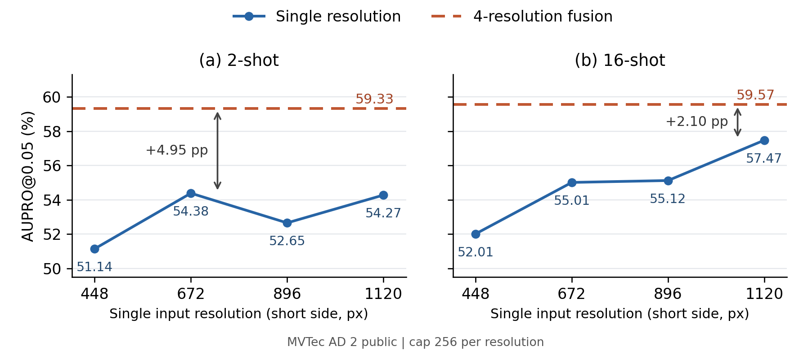
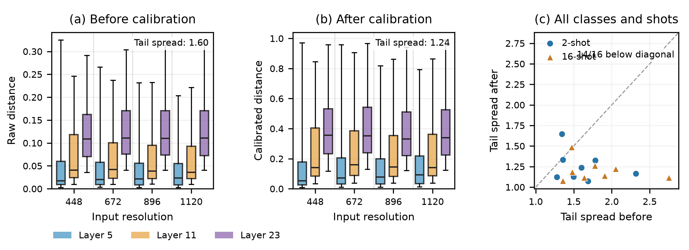

# ScopeAD — 실험 결과 및 표·피규어 자료

## 공통 표기

- 수치는 %, 높을수록 좋다. 차이는 pp다. —는 미확인 값이다.
- AD2 public은 8클래스, MVTec AD는 15클래스, VisA는 12클래스의 macro다. shot은 클래스당 정상 support 이미지 수다.
- **ScopeAD 수치는 기존 CQ 포함 측정값이다. CQ-off 최종 구성의 측정값과 구분한다.**
- 표에는 측정값과 평가 조건을, 피규어 자료에는 확보된 원자료와 축·계열 정보를 기록한다. 그림 4A는 완성 이미지를 포함하며, 심층 분석의 피규어 자료는 원자료로 기록한다.

## 1. 전체 성능

### 1.1. MVTec AD 2 public

**표 1. AD2 public full8, 1–16-shot, seed 0/1/2 mean ± sample SD.** 각 seed의 class macro를 집계했다. ScopeAD는 CQ 포함, FP16, cap256, 4해상도다. PatchCore·AnomalyDINO·FastRecon·SubspaceAD·SuperAD는 단일 1120 입력, RAD는 1280 resize 후 1120 crop, RegAD는 224 입력이다. RegAD 외 여섯 비교군은 FP32다.

| Shot | Metric | PatchCore | AnomalyDINO | FastRecon | RAD | SubspaceAD | SuperAD | RegAD (224)† | Ours (ScopeAD, linear0125, FP16)‡ |
| ---: | :---------- | ------------: | -------------------: | ------------: | ------------: | -------------------: | -------------------: | ------------: | --------------------------------: |
| 1 | AUPRO@0.05 | 38.45 ± 1.85 | 35.95 ± 2.24 | 14.92 ± 2.27 | 26.42 ± 1.71 | 44.87 ± 1.87 | 46.31 ± 3.73 | 12.73 ± 0.38 | 51.31 ± 4.01 |
|  | pAUROC@0.05 | 64.19 ± 0.68 | 70.67 ± 0.69 | 55.70 ± 0.67 | 59.57 ± 0.35 | 70.56 ± 0.56 | 70.13 ± 1.14 | 57.76 ± 0.30 | 72.93 ± 1.69 |
|  | I-AUROC | 65.51 ± 1.91 | 66.83 ± 1.08 | 58.10 ± 4.46 | 58.68 ± 3.03 | 67.02 ± 2.27 | 67.68 ± 0.32 | 57.73 ± 1.82 | 73.47 ± 1.23 |
| 2 | AUPRO@0.05 | 42.25 ± 2.08 | 38.20 ± 1.90 | 16.73 ± 2.39 | 31.61 ± 1.47 | 45.90 ± 0.75 | 49.80 ± 2.33 | 15.05 ± 0.30 | 56.03 ± 2.99 |
|  | pAUROC@0.05 | 65.43 ± 0.38 | 72.26 ± 0.56 | 57.14 ± 1.03 | 61.78 ± 0.15 | 71.53 ± 0.18 | 71.52 ± 0.58 | 58.76 ± 0.49 | 75.86 ± 0.59 |
|  | I-AUROC | 67.53 ± 1.55 | 68.95 ± 3.84 | 57.63 ± 6.82 | 59.37 ± 2.54 | 70.42 ± 1.79 | 70.19 ± 2.16 | 60.56 ± 3.94 | 74.93 ± 1.54 |
| 4 | AUPRO@0.05 | 46.94 ± 1.00 | 40.32 ± 0.75 | 21.88 ± 1.73 | 36.51 ± 1.02 | 47.14 ± 0.76 | 54.25 ± 0.86 | 17.40 ± 1.07 | 58.73 ± 0.12 |
|  | pAUROC@0.05 | 66.90 ± 0.22 | 73.09 ± 0.91 | 59.26 ± 0.80 | 63.84 ± 0.41 | 72.45 ± 0.20 | 73.59 ± 0.13 | 60.36 ± 0.48 | 76.94 ± 0.60 |
|  | I-AUROC | 68.62 ± 2.28 | 70.90 ± 0.97 | 59.73 ± 4.40 | 62.31 ± 4.84 | 71.02 ± 0.56 | 70.97 ± 2.08 | 63.79 ± 2.34 | 75.88 ± 0.46 |
| 8 | AUPRO@0.05 | 49.98 ± 1.90 | 41.64 ± 1.01 | 27.32 ± 0.14 | 40.79 ± 0.79 | 47.28 ± 0.40 | 55.44 ± 1.21 | 19.25 ± 0.64 | 59.74 ± 1.03 |
|  | pAUROC@0.05 | 68.22 ± 0.53 | 73.71 ± 0.20 | 61.74 ± 0.50 | 65.62 ± 0.69 | 72.56 ± 0.21 | 74.31 ± 0.38 | 62.02 ± 0.32 | 77.51 ± 0.17 |
|  | I-AUROC | 69.20 ± 0.75 | 71.29 ± 1.69 | 63.46 ± 4.29 | 65.84 ± 0.43 | 70.46 ± 1.18 | 70.75 ± 0.58 | 64.34 ± 1.05 | 75.99 ± 0.58 |
| 16 | AUPRO@0.05 | 52.73 ± 1.36 | 42.30 ± 1.25 | 35.23 ± 0.57 | 42.58 ± 1.10 | 47.63 ± 0.14 | 55.89 ± 1.07 | 20.28 ± 0.80 | 60.06 ± 0.88 |
|  | pAUROC@0.05 | 69.36 ± 0.51 | 73.97 ± 0.23 | 65.63 ± 0.43 | 66.62 ± 0.89 | 72.78 ± 0.07 | 74.60 ± 0.52 | 63.46 ± 0.76 | 77.61 ± 0.37 |
|  | I-AUROC | 69.00 ± 0.53 | 72.07 ± 1.27 | 67.45 ± 1.16 | 67.60 ± 1.35 | 70.46 ± 1.07 | 69.79 ± 0.52 | 65.64 ± 1.34 | 75.92 ± 0.82 |

평가 조건: ScopeAD는 DINOv2-L [5,11,23], SuperAD·PatchCore는 DINOv2-L [5,11,17,23], AnomalyDINO는 프로젝트 DINOv2-L [23], RAD는 DINOv3-B/16, SubspaceAD는 DINOv2-registers-G/14다. FastRecon은 ResNet-50 논문 설정의 독립 재구현에 입력 해상도를 변경했고, RegAD는 공식 source-trained ResNet-18 STN 체크포인트다. 전체 파이프라인 비교이며 backbone·관측 수·정밀도·계산량은 동일하지 않다.

출처: [v18 §4.1–4.2의 설정·프로토콜 및 결과 출처](Outline_v18.md).

### 1.2. MVTec AD 2 private/mix

**표 2. MVTec AD 2 공식 private 평가, 8-class macro (%).** 각 셀은 TESTpriv / TESTpriv,mix 순서다. AU-PRO@0.05는 연속 score map 지표이며, ClassF1·SegF1은 임계값 적용 결과다.

| 방법                                              |       AU-PRO@0.05       |         ClassF1         |          SegF1          |
| :------------------------------------------------ | :---------------------: | :---------------------: | :---------------------: |
| **(a) Few-shot (16-shot)**                  |                        |                        |                        |
| PatchCore                                         |     58.33 / 57.03     |     78.21 / 78.02     |     29.96 / 27.75     |
| AnomalyDINO                                       |     50.35 / 44.86     |     77.87 / 77.91     |     26.65 / 18.62     |
| SuperAD                                           |     62.82 / 60.08     |     78.14 / 78.19     |     39.43 / 33.86     |
| RAD                                               |           —           |           —           |           —           |
| SubspaceAD                                        |           —           |           —           |           —           |
| Ours (ScopeAD, linear0125)                    |     65.21 / 63.25     |     76.57 / 77.68     |     37.71 / 34.00     |
| **(b) Full-data Reference (출판/리더보드)** |                        |                        |                        |
| PatchCore                                         |       28.8 / 26.0       |        8.0 / 9.9        |        3.7 / 3.4        |
| RD                                                |       26.4 / 25.0       |       70.8 / 72.9       |       18.1 / 16.7       |
| RD++                                              |       27.1 / 25.2       |       70.5 / 73.0       |       19.2 / 16.7       |
| EfficientAD-S                                     |       30.8 / 19.2       |       76.8 / 77.8       |       15.4 / 8.0       |
| MSFlow                                            |       24.3 / 11.9       |       51.1 / 72.0       |       21.8 / 9.0       |
| SimpleNet                                         |       21.1 / 13.7       |       73.3 / 77.1       |       17.7 / 8.7       |
| DSR                                               |       20.3 / 17.4       |       78.0 / 78.0       |       10.9 / 9.5       |
| SuperAD                                           |      60.51 / 58.37      |      70.20 / 74.40      |      47.18 / 42.51      |
| RoBiS                                             |      67.25 / 59.65      |      79.62 / 79.86      |      51.00 / 46.52      |
| SuperADD                                          |      61.36 / 59.07      |      68.03 / 73.25      |      57.42 / 54.35      |

평가 조건: few-shot은 16-shot seed 0이며 ScopeAD는 기존 CQ 포함 제출이다. 완료된 네 제출의 support manifest는 bc6a0c851eb3…다. ScopeAD는 3계층·4해상도·FP16, PatchCore·SuperAD는 4계층·단일 1120·FP32, AnomalyDINO는 마지막 계층·단일 1120·FP32다. 같은 support를 사용한 전체 파이프라인 비교이며 관측 수·정밀도·계산량까지 동일한 대조는 아니다. mix는 별도 조명 구성 평가이며 public/private의 합집합이 아니다. Full-data Reference는 정상 데이터 예산·백본·입력·후처리가 다른 출판·리더보드 참고 결과다.

F1 조건: ScopeAD는 support 제외 train/good에서 매 8번째 정상 이미지를 사용해 class별 pixel p95×1.421로 threshold를 정했다. PatchCore·AnomalyDINO·SuperAD도 class별 normal pixel p95×1.421을 사용했으며 방법 간 calibration 이미지의 완전 일치 여부는 미확인이다. private GT는 사용하지 않았다. F1 calibration에는 16-shot 이외의 정상 이미지가 사용되었다.

공식 확인: 2026-10-15 공식 리더보드 재조회. 네 제출 모두 평가 완료다. ScopeAD 제출 ID c7a8b8f7-cf48-4d12-ba04-7e22a01c83a0, PatchCore 제출 ID 40269ae8-8a85-4450-b342-fa9669d03cbb, AnomalyDINO 제출 ID 40ce24a7-8be4-4463-803a-1496c323d31e, SuperAD 제출 ID 0f1dc50a-17a6-4c34-9c79-43ff7fc1077c.

해석: 완료된 네 few-shot 제출 중 ScopeAD의 AUPRO가 private·mixed에서 가장 높다. SuperAD 대비 +2.39 / +3.17 pp, PatchCore 대비 +6.88 / +6.22 pp다. F1의 전반적 우위는 확인되지 않았다. private SegF1은 SuperAD가 1.72 pp 높고, mixed SegF1은 ScopeAD가 0.14 pp 높다. RAD·SubspaceAD는 아직 공식 결과가 없어 빈칸으로 유지한다.

출처: [ScopeAD 공식 결과](../../results/scopead_linear0125_private_submission_20261014/comparison.md), [PatchCore 공식 결과](../../results/patchcore_private_submission_20261014/comparison.md), [AnomalyDINO 공식 결과](../../results/anomalydino_private_submission_20261014/comparison.md), [SuperAD 공식 결과](../../results/superad_private_submission_20261014/comparison.md), [Full-data 참고 기록](../../results/rsg4_private_submission_20260928/comparison.md).

### 1.3. 교차 데이터셋 비교

**표 3. MVTec AD / VisA, seed 0, I-AUROC / P-AUROC.** 대상 데이터셋의 정상 support로 bank를 구성한다. ScopeAD는 기존 CQ 포함 결과이며, q·λ는 대상 데이터셋마다 재조정하지 않았다.

| Dataset | Shot | PatchCore | AnomalyDINO | FastRecon | RAD | SubspaceAD | SuperAD | RegAD | Ours (ScopeAD, linear0125) |
| :------- | ---: | :-----------: | :-----------: | :--------------------: | :-----------: | :--------------------: | :-------------------------------: | :-----------: | :------------------------------: |
| MVTec AD | 1 | 88.12 / 96.22 | 92.52 / 94.49 | 88.84 / 96.60 | 80.83 / 93.25 | 89.25 /96.92 | 92.54 / 96.93 | — / — | 92.76 / 96.77 |
| MVTec AD | 2 | 92.67 / 96.97 | 95.17 / 95.56 | 93.51 / 97.29 | 84.15 / 94.27 | 90.95 / 97.24 | 95.43 / 97.36 | — / — | 96.13 / 97.39 |
| MVTec AD | 4 | 95.06 / 97.37 | 95.92 / 96.07 | 95.61 /97.87 | 85.38 / 94.67 | 91.35 / 97.16 | 96.65 / 97.70 | — / — | 96.99 / 97.68 |
| MVTec AD | 8 | 96.13 / 97.80 | 96.67 / 96.45 | 96.76 /98.16 | 87.85 / 95.29 | 92.94 / 97.17 | 97.39 / 97.95 | — / — | 97.60 / 97.93 |
| MVTec AD | 16 | 98.15 / 97.99 | 97.48 / 96.80 | 98.52 /98.38 | 90.29 / 95.61 | 92.51 / 97.19 | 98.94 / 98.09 | — / — | 98.74 / 98.05 |
| VisA | 1 | 86.09 / 95.56 | 87.06 / 95.62 | 84.65 / 96.75 | 72.67 / 95.37 | 85.44 / 98.09 | 90.29 / 97.06 | 71.12 / 93.41 | 89.88 / 96.73 |
| VisA | 2 | 87.87 / 96.29 | 90.64 / 96.63 | 87.67 / 97.43 | 77.24 / 96.37 | 86.36 / 98.21 | 92.20 / 97.68 | 71.59 / 94.59 | 92.15 / 97.32 |
| VisA | 4 | 89.52 / 96.92 | 91.37 / 97.57 | 89.21 / 97.91 | 79.16 / 97.45 | 86.85 / 98.26 | 92.94 / 98.02 | 76.42 / 96.14 | 94.19 / 97.82 |
| VisA | 8 | 92.36 / 97.18 | 93.11 / 97.99 | 91.53 / 98.11 | 86.32 / 97.93 | 88.29 / 98.33 | 94.50 / 98.29 | 80.19 / 96.64 | 95.01 / 98.25 |
| VisA | 16 | 93.64 / 97.30 | 93.53 / 98.30 | 93.38 / 98.32 | 88.56 / 98.18 | 88.99 / 98.37 | 95.19 / 98.43 | 81.22 / 96.98 | 95.99 / 98.49 |

출처: [v18 표 5 및 비교 설정](Outline_v18.md), [최신 VisA 비교군 audit](../../results/remote_runs/dsba3/table5_fill_visa_audit_20261013/combined/visa_py311/comparison.md).

## 2. 구조 유효성 검사

공통 조건: AD2 public full8, seed 0, 기존 CQ 포함 결과다. 별도 표기가 없으면 q95, λ=0.125, cap256, 4bags를 사용한다.

### 주요 구성 요소의 종합 ablation

**표 4. 주요 구성 요소의 ablation, AUPRO@0.05 (%).** 구성 이름은 해당 행에 적용된 요소를 나타낸다. A–E는 구성 요소를 차례로 추가한 비교이며, F는 최종 보정 조건에서 shallow의 기여를 확인하는 deep-only 대조군이다. ✓는 적용, ×는 미적용, —는 해당 조합의 미확인 결과다. 채워진 수치는 위 공통 조건의 기존 측정값이며, 최종 CQ-off 구성의 결과와 구분한다.

| 구성 | 다중 해상도 | 개별 메모리 bank | Shallow fusion | Scale calibration | 2-shot AUPRO | 16-shot AUPRO |
|---|:---:|:---:|:---:|:---:|---:|---:|
| A. 단일 해상도·계층 통합 bank | × | × | × | × | — | — |
| B. 다중 해상도·계층 통합 bank | ✓ | × | × | × | — | — |
| C. 다중 해상도 + 개별 bank | ✓ | ✓ | × | × | 58.23 | 57.93 |
| D. 다중 해상도 + 개별 bank + Shallow fusion | ✓ | ✓ | ✓ | × | 59.06 | 59.17 |
| **E. 네 요소 모두 적용 (Full method)** | **✓** | **✓** | **✓** | **✓** | **59.33** | **59.57** |
| F. 다중 해상도 + 개별 bank + Scale calibration | ✓ | ✓ | × | ✓ | 58.66 | 58.67 |

설정과 원자료 대응:

- **A·B:** deep 계층 [11,23]의 특징을 연결한 통합 bank, 보정 없음. A는 단일 1120, B는 448/672/896/1120 결합이다. 해상도 합계 설정 cap을 맞추려면 A는 cap1024, B는 해상도별 cap256으로 비교한다. 이 조합의 기존 결과는 확인되지 않았다.
- **C·D·E·F:** 4해상도·계층별 개별 bank·cap256·4bags다. C/F는 shallow 점수 기여만 제외하며, 기존 구현에서는 shallow 특징과 bank도 계산한다. D/E는 deep 두 계층의 평균에 shallow 점수를 λ=0.125로 더한다. C/D는 보정 없음, E/F는 정상 참조 q95 보정이다. 원자료는 아래 출처의 AD2 Stage A `deep none` / `linear none` / `linear q95` / `deep q95`에 각각 대응한다.
- **Sparse bank:** 모든 행에 sparse 샘플링을 적용하는 구성이다. 개별 bank 열은 계층별 bank 분리를 뜻하며, sparse 샘플링의 유무를 뜻하지 않는다. Sparse bank의 성능·비용 근거는 Q5에 제시한다.
- **기존 Layer-concat 결과:** 표 7의 52.12 / 57.48은 [5,11,23]의 세 계층 특징과 q95를 사용한다. A·B와 계층 및 보정 조건이 달라 누적 표의 빈칸을 대체할 수 없다.

확보된 대조의 AUPRO 차이(2-shot / 16-shot): **shallow 추가 C→D는 +0.83 / +1.24pp**, **scale calibration D→E는 +0.27 / +0.40pp**, **보정 후 shallow 추가 F→E는 +0.67 / +0.90pp**다. A→B와 B→C의 기여는 A·B 결과 확보 후 계산한다. 각 차이는 해당 구성에서의 효과이며, calibration의 현재 차이는 작다.

출처: [calibration factorial — AD2 Stage A](../../results/remote_runs/dsba3/scarf_calibration_factorial_seed0_fp16_20261009/comparison.md), [기존 Layer-concat 설정](../../configs/benchmarks/scarf_component_ablation_local_seed0_fp16_20261009/ad2_concat_s02_seed0.yaml).

### Q1. 해상도 결합은 유효한가?

**그림 4A. 단일 해상도에 따른 성능과 다해상도 결합 비교.** 왼쪽은 2-shot, 오른쪽은 16-shot이다. x축은 단일 입력 해상도, y축은 AUPRO@0.05(%)다. 실선은 각 단일 해상도, 수평 점선은 네 해상도의 결합 성능이다. 화살표는 최선 단일 해상도 대비 차이(+4.95/+2.10pp)를 표시한다.

평가 조건: AD2 public full8. 계층·가중치·q95·해상도별 cap256은 고정했으며, 다해상도는 총 configured cap이 단일 해상도의 4배다. 총 설정 cap을 맞춘 비교는 표 4B에 제시한다. 두 패널은 같은 y축 범위를 사용한다. 다해상도는 별도 결합 조건이므로 단일 해상도 곡선에 이어 붙이지 않는다.

**그림 4A 원자료.** 셀은 AUPRO@0.05 / pAUROC@0.05다. 그림에는 AUPRO를 표시하며 pAUROC도 아래에 보존한다.

| 해상도 구성 | 2-shot | 16-shot |
| :------------------------------------ | ----------------------: | ----------------------: |
| 448 | 51.14 / 75.80 | 52.01 / 76.52 |
| 672 | 54.38 / 74.97 | 55.01 / 76.17 |
| 896 | 52.65 / 73.46 | 55.12 / 74.62 |
| 1120 | 54.27 / 72.47 | 57.47 / 74.86 |
| 4 해상도 (448/672/896/1120) | 59.33 / 76.48 | 59.57 / 77.46 |

**표 4B. 해상도 합계 configured cap 대응 비교, 16-shot.** cap은 이미지·계층·bag·해상도별 토큰 상한이다. 실제 고유 패치 수와 계산량은 동일하지 않다.

| 구성 | 해상도별 cap | 해상도 합계 cap | AUPRO | pAUROC |
|---|---:|---:|---:|---:|
| 단일 1120 | 1024 | 1024 | 57.14 | 75.49 |
| 4해상도 | 256 | 1024 | 59.57 | 77.46 |

**Q1 종합 결론.** 다해상도 결합은 동일한 정상 support를 사용하는 최선의 단일 해상도보다 AUPRO@0.05가 2-shot에서 4.95pp, 16-shot에서 2.10pp 높았다(그림 4A). 16-shot에서 해상도 합계 cap을 1024로 맞춘 비교에서도 2.44pp 높았다(표 4B; 반올림 전 수치 기준). 즉, **설정상 같은 저장 용량을 하나의 해상도에 배분하는 것보다 여러 해상도에 나눠서 관측하고 결합하는 편이 유리했다.**

이 결론은 AD2 public, seed 0, 기존 CQ 포함 조건에 한정한다. 계산량과 실제 고유 패치 수는 통제하지 않았으며, 해상도별로 서로 다른 결함 단서를 보완한다는 메커니즘까지 확인한 것은 아니다.

출처: [single resolution](../../results/remote_runs/dsba3/scarf_single_resolution_fp16_20261012/comparison.md), [capacity/cost](../../results/remote_runs/dsba3/scopead_v18_q95_linear0125_fp16_20261012/combined/capacity_cost_ad2/comparison.md).

### Q2. 서로 다른 관측의 거리 점수를 어떤 기준으로 결합해야 하는가?

관측은 계층·입력 해상도의 조합을 뜻한다. 관측마다 최근접 거리의 값 범위가 다르면, 거리를 그대로 더할 때 명시적인 가중치뿐 아니라 거리값 자체의 크기도 각 관측의 영향력을 좌우한다. 따라서 **거리를 그대로 결합하는 방식과 정상 참조 분포를 기준으로 단위를 맞춘 뒤 결합하는 방식을 비교한다.**

- **none vs q95:** 정상 참조 기준의 단위 정렬이 위치 추정 성능에 도움이 되는지 확인한다.
- **MAD vs q95:** 정상 참조를 사용할 때 척도 정의에 따른 성능 차이를 확인한다.
- **정규화 × shallow 가중치:** 거리 단위의 선택에 따라 shallow 비중의 효과가 달라지는지 살펴본다. 표 5B는 일부 조합의 결과가 미확인이다.

**표 5A. 정규화 비교.** 셀은 AUPRO@0.05 / pAUROC@0.05 / I-AUROC다. 4해상도·cap256·같은 support에서 정규화만 변경했다.

| Shot | none | MAD | q95 (기본) | q95 − none (AUPRO) | q95 − MAD (AUPRO) |
| ---: | --------------------: | --------------------: | --------------------: | ------------------: | -----------------: |
| 1 | 55.06 / 73.84 / 74.46 | 53.59 / 72.73 / 73.95 | 54.81 / 73.32 / 74.47 | −0.25 | +1.22 |
| 2 | 59.06 / 76.47 / 76.75 | 58.57 / 76.34 / 75.85 | 59.33 / 76.48 / 76.52 | +0.27 | +0.76 |
| 4 | 59.02 / 77.25 / 76.29 | 57.00 / 76.29 / 74.86 | 58.69 / 76.87 / 75.71 | −0.33 | +1.69 |
| 8 | 58.69 / 77.67 / 75.70 | 57.28 / 76.67 / 74.88 | 58.68 / 77.35 / 75.41 | −0.01 | +1.40 |
| 16 | 59.17 / 77.65 / 75.11 | 58.52 / 77.17 / 74.45 | 59.57 / 77.46 / 74.98 | +0.40 | +1.05 |

**표 5B. 정규화 × shallow 가중치의 확보 결과.** 셀은 2-shot / 16-shot AUPRO@0.05다. —는 해당 조합의 미확인 값이다.

| 거리 단위 | λ=0 (deep-only) | λ=0.125 | λ=0.5 (3계층 동일 비중) |
|---|---:|---:|---:|
| none | 58.23 / 57.93 | 59.06 / 59.17 | — |
| q95 | 58.66 / 58.67 | 59.33 / 59.57 | 54.92 / 58.21 |

출처: [normalization factorial](../../results/remote_runs/dsba3/scarf_calibration_factorial_seed0_fp16_20261009/comparison.md), [fusion sensitivity](../../results/remote_runs/dsba3/scarf_fusion_sensitivity_fp16_20261008/comparison.md).

**그림 5C. 정상 참조 보정에 따른 관측별 점수 척도의 변화.** 본문용 3패널 그림.

**논문 캡션.** **Effect of normal-reference calibration on observation-wise score distributions.** (a–b) Normal-query distance distributions before and after calibration on MVTec AD 2 public (vial, 2-shot), using the same sampled pixels across four resolutions and three feature layers. Boxes indicate the interquartile range, center lines the median, and whiskers the 5th–95th percentiles. The panels retain their respective raw and calibrated units. (c) Across all eight classes at 2- and 16-shot, each point compares the before/after tail spread, defined as the maximum divided by the minimum of the 12 observation-wise normal-score 95th percentiles. Points below the diagonal indicate reduced scale mismatch (14/16 conditions). Calibration factors are estimated from normal support data only.

**그림 해석 및 범위.** 현재 그림은 calibration의 유효성을 확정하는 본문 근거로는 부족한 진단 그림이다. (a–b)의 vial 예시에서 관측별 Q95 최댓값/최솟값은 1.60 → 1.24로 줄지만, 중앙값의 최댓값/최솟값은 6.30 → 6.78로 오히려 커진다. 따라서 (c)의 14/16은 상단 분위수의 상대적 척도 차이가 줄어든 조건 수이며, 분포 전체의 정렬이나 정상 오탐률의 일치를 뜻하지 않는다. 원래 연산은 정상 support Q95로 나누는 척도 보정이므로 중앙값·분산의 일치를 보장하지 않는다. 정상 참조가 query에서도 공통 기준으로 작동하는지는 bag별 보정 단계에서 정상 query의 기준 초과율이 관측 사이에 가까워지는지 추가 확인해야 한다. Bag 평균 이후의 현재 표본으로 기준 초과율을 계산하더라도 bag별 보정의 5% 기준과 직접 동일시할 수 없다. 예시 vial은 2-shot에서 척도 차이 감소량이 작은 순으로 4번째인 클래스다(8개 중 중간 순위). 정상 분포 전체가 같아지거나 정상·이상 분리가 크게 개선된다는 의미는 아니다. 클래스당 정상 픽셀 최대 2,048개의 이미지별 표본 수를 제한한 진단 표본을 사용했다. 2-shot can과 16-shot wallplugs는 척도 차이가 줄지 않았으며 (c)에 함께 표시했다.

[논문용 PDF](../figures/fig_scopead_calibration_paper.pdf) · [그림 구성 및 선택 기준](../figures/fig_scopead_calibration_paper.json) · [전체 분포·진단 조건·원자료](../../results/remote_runs/dsba3/scopead_calibration_diagnostic_20261015/diagnostics/README.md)

### Q3. shallow 결합과 가중치는 유효한가?

**표 6. Shallow 가중치 비교, q95 고정, AUPRO@0.05 / pAUROC@0.05.** deep-only는 점수 기여만 제거하며 3계층 특징과 bank는 계속 계산한다. λ=0.125는 CQ 포함 AD2 public 2-shot seed 0 AUPRO로 전체 후보 중 post-hoc 선택했다.

| λ | 의미 | 2-shot | 16-shot |
|---|---|---:|---:|
| 0 | deep-only score | 58.66 / 76.49 | 58.67 / 77.35 |
| 0.125 | 선택된 비대칭 결합 | 59.33 / 76.48 | 59.57 / 77.46 |
| 0.25 | shallow 비중 증가 | 58.43 / 76.00 | 59.48 / 77.21 |
| 0.5 | deep 각 층과 shallow 동일 비중 | 54.92 / 74.39 | 58.21 / 76.31 |
| 1 | deep 평균과 shallow 동일 비중 | 48.39 / 71.31 | 54.02 / 74.04 |
| 2 | shallow 강조 | 40.48 / 67.00 | 47.33 / 70.19 |

출처: [fusion sensitivity](../../results/remote_runs/dsba3/scarf_fusion_sensitivity_fp16_20261008/comparison.md), [λ 선택 기록](../../results/remote_runs/dsba3/scarf_fusion_sensitivity_fp16_20261008/lambda_selection.json).

### Q4. 개별 bank를 사용하는 결합 구성은 유효한가?

**표 7. Layer-concat과 관측별 bank 전체 구성 비교, seed 0.** AD2는 AUPRO@0.05 / pAUROC@0.05, MVTec AD·VisA는 I-AUROC / P-AUROC다. 매칭·정규화·계층 가중치가 함께 다르므로 bank 분리만을 통제한 대조는 아니다.

| 데이터셋 | 구성 | 2-shot | 16-shot |
|---|---|---:|---:|
| AD2 | Layer concat | 52.12 / 71.97 | 57.48 / 74.80 |
| AD2 | 관측별 bank 전체 구성 | 59.33 / 76.48 | 59.57 / 77.46 |
| MVTec AD | Layer concat | 93.08 / 96.86 | 98.19 / 97.79 |
| MVTec AD | 관측별 bank 전체 구성 | 96.13 / 97.39 | 98.74 / 98.05 |
| VisA | Layer concat | 89.09 / 95.79 | 94.09 / 97.02 |
| VisA | 관측별 bank 전체 구성 | 92.15 / 97.32 | 95.99 / 98.49 |

출처: [component ablation](../../results/local_runs/scarf_component_ablation_local_seed0_fp16_20261009/comparison.md).

### Q5. sparse bank의 성능·비용은 어떤가?

**표 8. cap 성능·비용, AD2 16-shot seed 0.** Fit·query는 클래스별 측정치의 평균이며, peak는 클래스별 query peak의 평균이다. p95·최대 peak와 구분한다. configured cap 상한을 비교하며, full-token bank와의 비교는 포함하지 않는다.

| 구성 | cap | AUPRO | pAUROC | Fit (s) | Query (ms/image) | Query peak (GiB) |
|---|---:|---:|---:|---:|---:|---:|
| 1120 단일 | 256 | 57.47 | 74.86 | 12.77 | 993 | 1.91 |
| 1120 단일 | 1024 | 57.14 | 75.49 | 14.42 | 1182 | 3.04 |
| 4해상도 | 256 | 59.57 | 77.46 | 20.62 | 1526 | 3.07 |
| 4해상도 | 1024 | 59.17 | 77.56 | 27.04 | 1941 | 6.69 |

출처: [capacity/cost 원본](../../results/remote_runs/dsba3/scopead_v18_q95_linear0125_fp16_20261012/combined/capacity_cost_ad2/comparison.md), [비용 집계 표](../cvpr-2026-author-kit-template/sec/4_experiments.tex).

## 3. 심층 분석 — 피규어 원자료

### 3.1. 그림 1 자료 — 획득 조건별 성능

AD2 public, seed 0, AUPRO@0.05. ScopeAD는 기존 CQ 포함 결과다. 패널은 acquisition stratum, x축은 shot, y축은 AUPRO, 계열은 PatchCore·SuperAD·ScopeAD다.

| Shot | Method | Regular (8 cls) | Shift 1 (8 cls) | Shift 2 (7 cls) | Shift 3 (7 cls) |
| ---: | :----- | --------------: | ---------------: | --------------: | --------------: |
| 1 | PatchCore | 41.37 | 40.43 | 39.84 | 40.40 |
| 1 | SuperAD | 50.55 | 49.53 | 49.20 | 50.05 |
| 1 | ScopeAD (linear0125) | 55.94 | 55.41 | 53.63 | 54.30 |
| 2 | PatchCore | 45.37 | 44.94 | 43.56 | 44.27 |
| 2 | SuperAD | 53.78 | 52.67 | 51.46 | 52.47 |
| 2 | ScopeAD (linear0125) | 61.01 | 59.73 | 58.20 | 58.31 |
| 4 | PatchCore | 48.65 | 48.01 | 46.81 | 46.81 |
| 4 | SuperAD | 56.70 | 55.70 | 53.14 | 54.02 |
| 4 | ScopeAD (linear0125) | 60.40 | 58.51 | 58.33 | 57.85 |
| 8 | PatchCore | 50.20 | 48.07 | 46.94 | 46.93 |
| 8 | SuperAD | 57.04 | 55.35 | 52.90 | 53.52 |
| 8 | ScopeAD (linear0125) | 59.94 | 58.17 | 57.42 | 57.86 |
| 16 | PatchCore | 55.51 | 53.04 | 52.34 | 52.75 |
| 16 | SuperAD | 58.51 | 56.33 | 54.04 | 55.24 |
| 16 | ScopeAD (linear0125) | 61.17 | 60.03 | 58.10 | 59.45 |

집계 조건: Regular·Shift1은 8클래스, Shift2·3은 fruit_jelly를 제외한 7클래스다. 패널 간 macro 차이는 클래스 구성이 달라 shift 감소량과 동일하지 않다.

**공통 7클래스 자료.** ScopeAD 16-shot seed 0, 기존 CQ 포함 결과다.

| 획득 조건 | AUPRO@0.05 | pAUROC@0.05 |
|---|---:|---:|
| Regular | 61.76 | 78.16 |
| Shift 1 | 60.48 | 78.10 |
| Shift 2 | 58.10 | 76.64 |
| Shift 3 | 59.45 | 77.04 |

출처: [strata suite](../../results/remote_runs/dsba3/scopead_v18_q95_linear0125_fp16_20261012/combined/strata_ad2/comparison.md), [16-shot capacity/strata](../../results/remote_runs/dsba3/scopead_v18_q95_linear0125_fp16_20261012/combined/capacity_cost_ad2/comparison.md), [비교군 strata 출처](Outline_v18.md).

### 3.2. 그림 2 자료 — q·λ 민감도

**표 9. 정상 참조 분위수와 대안 변환, AD2 seed 0.** 셀은 AUPRO@0.05 / pAUROC@0.05다. Δ는 반올림 전 원자료를 기준으로 한 q95 대비 AUPRO 차이(pp)다.

| 척도 분위수$q$ | 2-shot | 16-shot | $\Delta$ AUPRO vs. Default (2-shot / 16-shot) |
| :---------------------------------------: | :---------------------: | :---------------------: | :---------------------------------------------: |
| 0.50 | 58.22 / 75.47 | 59.03 / 77.15 | −1.11 / −0.55 |
| 0.80 | 59.11 / 76.29 | 59.56 / 77.53 | −0.22 / −0.02 |
| 0.90 | 59.29 / 76.42 | 59.60 / 77.49 | −0.04 / +0.03 |
| 0.95 (Default) | 59.33 / 76.48 | 59.57 / 77.46 | 0.00 / 0.00 |
| 0.99 | 59.37 / 76.52 | 59.55 / 77.39 | +0.04 / −0.02 |
| 0.999 | 59.20 / 76.22 | 59.55 / 77.26 | −0.13 / −0.02 |
| 꼬리 확률 변환(−log 생존확률), q=0.95 | 59.11 / 76.65 | 59.25 / 77.14 | −0.22 / −0.32 |
| 토큰별 로컬 척도(local_reliability=scale) | 52.34 / 75.33 | 57.46 / 78.03 | −6.99 / −2.11 |

축·계열: q 패널은 처음 여섯 행의 q를 x축, AUPRO를 y축으로 하며 2/16-shot을 계열로 사용한다. 꼬리 확률 변환과 local scale은 별도 변형이다. λ 패널 원자료는 표 6이며, x축은 λ, y축은 AUPRO다.

출처: [fusion sensitivity·quantile 자료](../../results/remote_runs/dsba3/scarf_fusion_sensitivity_fp16_20261008/comparison.md), [v18 표 11의 대안 변환 자료·출처](Outline_v18.md).

### 3.3. 그림 3 자료 — 성능·추론 비용

원자료는 표 8이다. x축은 query 시간(ms/image), y축은 AUPRO@0.05이며, 계열은 단일 1120 / 4해상도, 점별 cap은 256 / 1024다. 비용은 기존 CQ 포함 조건이다.

## 4. 추가 결과

### 4.1. 교차 데이터셋 다중 seed

**표 S1. ScopeAD 전 shot, seed 0/1/2 mean ± sample SD, I-AUROC / P-AUROC.** 기존 CQ 포함 결과다.

| Dataset | 1-shot | 2-shot | 4-shot | 8-shot | 16-shot |
| :------- | :----------------------------: | :----------------------------: | :----------------------------: | :----------------------------: | :-----------------------------: |
| MVTec AD | 94.06 ± 1.34 / 96.79 ± 0.03 | 96.04 ± 0.30 / 97.38 ± 0.04 | 96.30 ± 1.03 / 97.69 ± 0.08 | 97.94 ± 0.60 / 97.90 ± 0.04 | 98.52 ± 0.20 / 98.05 ± 0.00 |
| VisA | 89.66 ± 0.24 / 96.82 ± 0.13 | 92.38 ± 1.04 / 97.40 ± 0.08 | 94.40 ± 0.24 / 97.86 ± 0.05 | 95.11 ± 0.10 / 98.27 ± 0.02 | 95.78 ± 0.18 / 98.50 ± 0.02 |

출처: [v18 표 5b의 다중 seed 결과·출처](Outline_v18.md).

### 4.2. 교차 데이터셋 해상도 비교

**표 S2. 단일·다해상도 비교, seed 0, I-AUROC / P-AUROC.** ScopeAD 기존 CQ 포함 결과다.

| Dataset | 해상도 구성 | 2-shot | 16-shot |
| :------- | :----------------- | ----------------------: | ----------------------: |
| MVTec AD | 1120 단일 | 94.90 / 96.51 | 98.21 / 97.49 |
| MVTec AD | 4 해상도 | 96.13 / 97.39 | 98.74 / 98.05 |
| VisA | 1120 단일 | 86.88 / 96.19 | 94.39 / 97.80 |
| VisA | 4 해상도 | 92.15 / 97.32 | 95.99 / 98.49 |

출처: [v18 표 10b](Outline_v18.md), [single resolution](../../results/remote_runs/dsba3/scarf_single_resolution_fp16_20261012/comparison.md).

### 4.3. Synthetic corruption

**표 S3. MVTec AD 16-shot seed 0, AUPRO@0.05 / pAUROC@0.05.** ScopeAD는 기존 CQ 포함 결과다. s3는 corruption severity 3이다. FastRecon은 DINO 기반 프로젝트 변형, RegAD는 DINOv2 프로젝트 변형이며 AD2 public 표의 설정과 다르다.

| 방법 | Clean | Brightness s3 | Contrast s3 | Defocus blur s3 | Gaussian noise s3 |
| :--------------------------------- | :-------------------------------: | :--------------------: | :--------------------: | :-------------------------------: | :-------------------------------: |
| PatchCore | 83.97 / 88.80 | 83.43 / 88.38 | 77.15 / 85.27 | 81.58 / 87.41 | 74.03 / 83.66 |
| AnomalyDINO | 77.62 / 85.31 | 72.54 / 82.61 | 72.08 / 82.48 | 70.69 / 81.06 | 33.02 / 66.81 |
| FastRecon (project adaptation)† | 85.74 / 90.82 | 77.53 / 86.35 | 69.72 / 84.47 | 82.35 / 88.90 | 57.70 / 77.37 |
| RAD | 80.12 / 87.03 | 78.70 / 86.04 | 74.96 / 84.33 | 70.44 / 81.13 | 49.23 / 72.05 |
| SubspaceAD | 83.89 / 86.98 | 80.45 / 84.91 | 78.49 / 83.39 | 78.17 / 83.39 | 64.61 / 78.01 |
| SuperAD | 84.49 / 89.15 | 83.68 / 88.47 | 82.27 / 87.86 | 82.17 / 87.74 | 71.10 / 82.45 |
| RegAD (DINOv2 project adaptation)‡ | 38.11 / 78.65 | 36.14 / 77.02 | 32.01 / 74.77 | 37.33 / 77.91 | 28.12 / 70.00 |
| Ours (ScopeAD, linear0125) | 85.42 / 88.98 | 84.64 / 88.35 | 83.40 / 87.59 | 81.46 / 86.38 | 68.43 / 80.19 |

출처: [corruption suite](../../results/remote_runs/dsba3/scopead_v18_q95_corruption_comparators_20261013/combined/).
