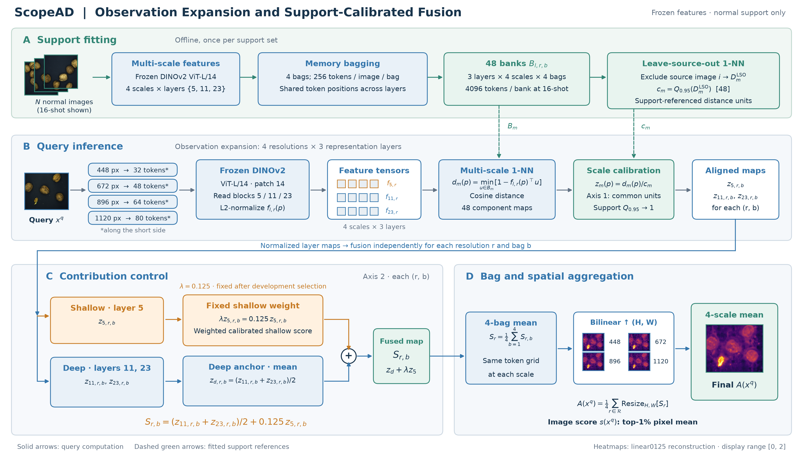
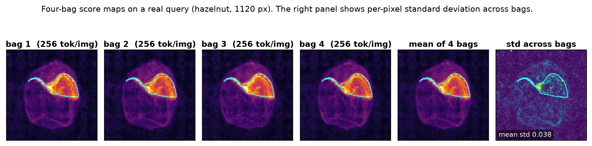
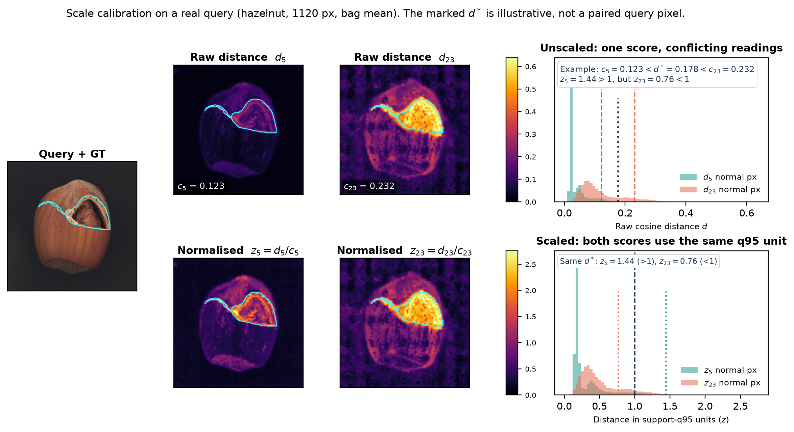
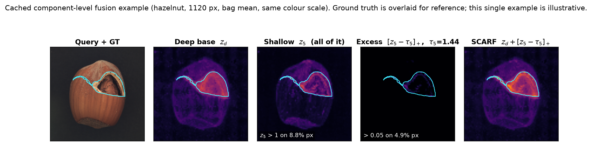

# SCARF: Support-Calibrated Asymmetric Residual Fusion for Few-Shot Industrial Anomaly Localization

> **문서 목적**: CVPR/WACV 제출용 본문 8쪽 기준 연구 아웃라인 (v17).
> **v17 주요 개정 사항**:
>
> 1. **성능 근거에 맞춘 서술 비중**: 다해상도 구성과 분위수 척도 보정을 중심으로 설명하고, shallow 잔차는 보조 결함 단서를 선택적으로 결합하는 장치로 배치한다. 표 8의 +7.43pp와 +1.67pp는 각각 나머지 구성을 고정한 조건부 비교이며 합산 기여도가 아니다.
> 2. **선행 연구 기반 논리 보강 (2026-10-08)**: FPN·S²·FeatUp·DPT·ViT 분석을 공간 관측의 근거로, CAM 정규화와 ViM의 이질적 점수 척도 정렬을 관측별 점수 결합의 근거로 연결한다. ImageNet-C/P·confidence calibration·shift uncertainty는 점수 해석과 평가 범위를 설명하고, AD 문헌은 매칭과 산업 평가 설정에 사용한다. 검증한 서지와 주장별 인용 범위는 A.4에 기록한다.
> 3. **두 축의 상호 보완성**: 다해상도는 같은 이미지의 공간 관측 척도를 늘리고, scale calibration은 결합 전 각 관측의 정상 거리 단위를 맞춘다. 신규 정상 사례 확보, shift 식별, shift 불변성 및 고정 FPR 보장은 별도의 주장으로 구분한다.
> 4. **Shallow 잔차의 보조 역할**: 정상 support 기준 초과량만 가산한다. 단순 평균 대비 +0.94pp, 전체 가산 대비 +5.13pp의 개발 결과를 보고하되 결함만 통과하거나 기준선 성능을 항상 보존한다고 주장하지 않는다.
>
> **원고 작성 가이드 (CVPR/WACV 본문 약 8쪽 배분)**:
>
> - §1. Introduction (약 1.0쪽) | §2. Related Work (약 0.5쪽) | §3. Method (약 2.0쪽, ASD-STE100 규격 기술)
> - §4. Experiments (약 4.0쪽) | §5. Discussion & Limitations (약 0.35쪽) | §6. Conclusion (약 0.15쪽)
> - ※ 저자용 검증 매트릭스 및 연구 기록은 문서 말미의 [Appendix: Author Research Notes]에 보존한다.

---

## Index

- **Abstract**
- **1. Introduction**
  - 1.1. 소수 정상 reference와 거리 해석의 모호성 (High-Score Ambiguity)
  - 1.2. Few-shot 공간 관측 확장과 shift 환경의 거리 척도 보정
  - 1.3. SCARF 프레임워크와 주요 기여
- **2. Related Work**
  - 2.1. Frozen-feature reference matching in few-shot AD
  - 2.2. Multi-scale spatial observation and support-referenced score alignment
  - 2.3. Score interpretation and distribution shift
- **3. Method (ASD-STE100 기술 규격 스타일)**
  - 3.1. 시스템 개요 및 서포트 피팅·쿼리 추론 절차 (그림 1)
  - 3.2. 정상 서포트 뱅크 구축 및 메모리 배깅 (그림 M1)
  - 3.3. Scale Calibration: 분위수 기반 거리 정규화 (Axis 1: Scale, 그림 M2)
  - 3.4. Asymmetric Residual Fusion: 비대칭 초과량 결합 (Axis 2: Layer, 그림 M3)
  - 3.5. 고정 다해상도 결함 맵 공간 통합 (Anomaly Map Aggregation)
  - 3.6. 파라미터 규격 및 재현성 계약
- **4. Experiments**
  - 4.1. 평가 설정 (표 1, 2, 3)
  - 4.2. Few-shot 주 비교 (표 4, 5)
  - 4.3. Distribution Shift 평가 (표 6, 그림 2, 표 7)
  - 4.4. Ablation Study (표 8, 8a, 9, 10, 11)
  - 4.5. Efficiency and Qualitative Analysis (표 12, 12a, 그림 3)
- **5. Discussion & Limitations**
  - 5.1. 다해상도 관측·척도 보정과 Shallow 잔차의 클래스별 특성
  - 5.2. 저-FPR 곡선 메트릭과 고정 배포 임계값의 실무적 과제
- **6. Conclusion**
- **[Appendix: Author Research Notes]**
  - A.1. Claim–evidence–status matrix
  - A.2. Controlled comparison and decision rules
  - A.3. Review and audit feedback record
  - A.4. Verified literature and claim boundaries

---

## Abstract

산업 이상 국소화에서는 소수 정상 이미지로 새로운 제품을 검사하고, 미세 결함과 촬영 조건 변화에 함께 대응해야 한다. 동결된 시각 백본의 정상 패치 매칭은 재학습 없이 검사를 가능하게 하지만, 제한된 reference와 feature의 공간 해상도는 작은 결함의 위치 특정에 제약을 준다. 다해상도 관측은 같은 이미지에서 서로 다른 크기의 구조를 관찰하게 하며, 이를 결합하려면 해상도·계층마다 다른 정상 거리 척도를 고려해야 한다.

본 논문은 **Support-Calibrated Asymmetric Residual Fusion (SCARF)**을 제안한다. SCARF는 고정 4개 입력 해상도(448~1120px)에서 패치 거리를 계산하고, 각 컴포넌트의 정상 support 상위 분위수($q=0.95$)로 거리 단위를 보정한다. 정규화된 심층 평균을 기준선으로 사용하며, 얕은 계층의 정상 support 기준($\beta=0.99$) 초과량만 잔차로 가산한다. 다해상도는 공간 관측을 확장하고, 척도 보정은 관측 간 결합 비중을 정상 reference에 맞춘다. 추가 query 적응은 수행하지 않는다.

MVTec AD 2 16-shot 개발 비교에서 SCARF는 단일 448px·MAD·평균 결합 기준선의 47.95% 대비 **59.15% AUPRO@0.05 (+11.20pp)**를 달성했다. 나머지 구성을 고정한 비교에서 다해상도를 448px 단일 입력으로 대체하면 7.43pp, 분위수 보정을 MAD로 대체하면 1.67pp, 잔차 결합을 단순 평균으로 대체하면 0.94pp 낮아졌다. 이 차이들은 개별 조건부 효과이며 합산 분해가 아니다. 동일 support와 DINOv2 ViT-L/14를 사용한 SuperAD 파이프라인 비교에서는 AUPRO@0.05가 **4.47pp**, pAUROC@0.05가 **0.70pp** 높았고, 공식 private 평가에서 TESTpriv **64.80%**, TESTpriv,mix **62.49%**를 기록했다.

---

## 1. Introduction — 약 1.0쪽

### 1.1. 소수 정상 reference와 거리 해석의 모호성 (High-Score Ambiguity)

- **사전학습 표현의 재사용**: DINOv2는 동결된 feature를 분류와 dense prediction 등 여러 시각 과제로 전이할 수 있음을 보여준다(Oquab et al., 2023). 산업 검사에서는 이 표현을 정상 reference와 매칭하여 제품별 재학습 부담을 줄일 수 있다(§2.1).
- **정상성 정보의 제약**: 소수 support는 미관측 자세·표면·조명을 충분히 대표하지 못할 수 있다. 다해상도로 같은 이미지를 관찰해도 새로운 정상 사례가 추가되는 것은 아니다.
- **큰 점수의 해석**: 일반 시각 인식에서도 corruption 강건성은 원래 분포의 정확도와 별도로 평가해야 하며(Hendrycks and Dietterich, 2019), 분포 변화는 예측 신뢰도의 해석을 바꿀 수 있다(Ovadia et al., 2019). 이를 패치 매칭에 연결하면 큰 거리가 결함과 미관측 정상 변동 모두에서 발생할 수 있다는 설계 동기가 된다. 이는 우리 문제에 대한 해석이며 선행 연구가 SCARF의 거리 메커니즘을 직접 입증한 것은 아니다.

### 1.2. Few-shot 공간 관측 확장과 shift 환경의 거리 척도 보정

SCARF는 **같은 이미지에서 무엇을 관찰할 것인가**와 **관측별 점수를 어떻게 결합할 것인가**를 함께 설계한다. Few-shot은 데이터·재학습의 제약을, shift는 정상 support 기준의 일반화를 평가하는 조건을 제공한다.

**Vision 문헌에서 본 설계로 이어지는 논리**: FPN·S²·FeatUp은 공간 척도와 feature 해상도가 시각 과제의 성능을 좌우할 수 있음을 보여준다(Lin et al., 2017; Shi et al., 2024; Fu et al., 2024). 다해상도 관측을 normal-only 패치 매칭에 적용할 때는 각 관측의 거리 맵을 어떤 척도로 결합할지도 정해야 한다. Kim et al. (2021)은 CAM 정규화 방식이 위치 추정 결과에 영향을 준다고 보고했고, Wang et al. (2022)은 ViM에서 서로 다른 단서를 결합하기 전에 학습 데이터로 상대 척도를 맞췄다. SCARF는 이 문제를 정상 support에서 계산한 컴포넌트별 거리 분위수로 다루고, deep 평균에 shallow 초과량만 가산한다. 두 선행 연구는 결합 규칙의 설계 동기이며, SCARF의 q95 및 잔차 효과 크기는 자체 소거와 해상도·용량 통제 비교로 평가한다.

1. **Multi-resolution: 제한된 이미지의 공간 관측 확장**:

   - FPN은 여러 크기의 객체를 다루는 다중 척도 표현의 유용성을 보였다(Lin et al., 2017). 동결된 모델을 여러 입력 척도에서 실행하는 S²는 분류·분할·깊이 추정에서 표현 성능 향상을 보고했다(Shi et al., 2024). FeatUp은 의미 표현이 풍부해도 feature의 공간 해상도가 dense prediction을 제한할 수 있음을 보여준다(Fu et al., 2024).
   - SCARF는 448/672/896/1120px에서 관측한다. $14\times14$ 패치는 입력 좌표에서 고정되지만 높은 해상도에서는 같은 원본 영역을 더 많은 토큰으로 표현한다. 이는 기존 영상의 세밀한 표본화이며 새로운 정상 변동이나 센서 정보를 생성하지 않는다.
   - 표 8의 +7.43pp는 4-scale과 448-only의 차이로 최고 입력 해상도 증가도 포함한다. 결합 자체의 근거는 최고 해상도와 총 bank 용량을 통제한 표 10/E12의 1120-only 비교로 보완한다. 문헌은 공간 관측의 동기를 제공하며 few-shot 희소성 해소를 보장하지 않는다.
2. **Scale calibration: 관측 확장 뒤의 점수 단위 정렬**:

   - 공간 맵의 수치화와 결합은 관측한 feature 자체와 별도로 설계해야 한다. Kim et al. (2021)은 CAM의 정규화 선택이 약지도 위치 추정 결과를 바꾼다고 보고했고, Wang et al. (2022)은 feature residual과 분류 logit의 척도를 학습 데이터 기준으로 맞춰 결합했다. 전자는 CAM, 후자는 이미지 단위 분류 OOD를 다루므로 SCARF의 정상 패치 거리 q95와 동일한 연산은 아니다.
   - Guo et al. (2017)은 정확도와 confidence calibration을 구분했고, Ovadia et al. (2019)은 원래 분포의 post-hoc calibration도 shift에서 실패할 수 있음을 보였다. 이들은 shift에서 점수 해석을 별도로 검증할 근거를 제공하지만, SCARF의 거리 단위 보정을 직접 입증하지는 않는다.
   - 계층·해상도별 정상 거리 분포가 다르면 같은 원시 수치가 같은 정상 변동 수준을 뜻하지 않는다. SCARF는 경험적 q95를 관측별 단위로 사용한다. MAD는 중심의 강건한 산포 척도이고 q95는 상위 꼬리의 특정 기준점을 맞춘다. q95가 모든 분포에서 우수하거나 꼬리 모양 전체를 같게 만든다는 주장은 하지 않는다.
   - **이 보정은 shift 판별기가 아니다.** 관측별 기준 단위와 결합 비중을 support에서 정한다. $z=1$은 support 기준점이지 query의 5% FPR 보장이나 이상 확률이 아니다. +1.67pp는 MAD 대비 whole-public 개발 결과다. shift 특이적 효과는 동일 설정의 regular/shift별 보정 소거로 확인해야 한다.
3. **상호 보완성: 관측과 결합의 역할 분담**:

   - Multi-resolution은 여러 공간 척도의 단서를 확보하고 calibration은 이를 정상 reference 기준으로 비교·결합하게 한다. 두 요소는 관측 단계와 점수 결합 단계에서 역할이 다르다.
   - 각 컴포넌트에서 양의 상수로 나누는 보정은 내부 점수 순위를 바꾸지 않는다. 성능 차이는 여러 맵의 결합에서 상대 비중이 달라지는 경로로 발생할 수 있다. 이를 본 연구의 기제 설명으로 제시한다.
   - 표 8은 구성별 조건부 효과를, 표 10은 최고 해상도·용량을 넘어선 관측 구성의 이득을 지지한다. 통계적 상호작용이나 '다해상도가 shift 노이즈를 증폭한다'는 인과관계는 현재 표들만으로 확정하지 않는다.
4. **Multi-layer residual: 보조 단서의 선택적 수용**:

   - DPT는 ViT의 여러 중간 계층 토큰을 공간 맵으로 재구성하고 결합하여 깊이 추정·분할을 개선했다(Ranftl et al., 2021). 이는 계층 관측을 활용하는 동기이며, 학습된 decoder의 효과를 SCARF의 training-free 결합 효과로 직접 전이하지 않는다.
   - ViT 분석은 초기 층부터 local/global 정보가 함께 존재하며 계층 간 표현 유사도가 높음을 보여준다(Raghu et al., 2021). 'shallow는 질감만, deep은 의미만'이라는 엄격한 분업이나 deep의 조명 불변성을 가정하지 않는다.
   - Layer 11/23 평균에 Layer 5의 support 기준 초과량만 가산하는 선택은 §4.4의 개발 비교와 활성 분석으로 정당화한다. 평균 대비 +0.94pp, 전체 가산 대비 +5.13pp는 선택적 결합의 근거이며 모든 활성 잔차가 결함이라는 보장은 아니다.

### 1.3. SCARF 프레임워크와 주요 기여

1. **공간 관측 확장과 support 기반 점수 보정의 결합**: 동결된 백본의 다해상도 관측과 컴포넌트별 정상 분위수 정규화를 결합한다. 다해상도 표현(Lin et al., 2017; Shi et al., 2024; Fu et al., 2024)과 공간 맵 정규화(Kim et al., 2021)·이질적 점수 척도 정렬(Wang et al., 2022)의 기존 Vision 연구를 기반으로 하며, 기여는 normal-only 매칭에서 거리 단위와 계층 결합을 함께 설계하고 저-FPR 국소화로 검증한 데 둔다.
2. **비대칭 초과 잔차 결합**: 심층 평균을 기준선으로 유지하고 shallow의 support 기준 초과량만 가산한다. 학습되는 결합 가중치는 없으며 $q,\beta$는 고정 하이퍼파라미터다. 평균 및 전체 가산과의 개발 비교로 효과를 평가한다.
3. **조건을 명시한 구성 요소 검증**: 표 8의 기준선 대비 +11.20pp 시스템 개선과 각 대체 구성의 조건부 차이, 표 10의 최고 해상도·총 bank 용량 통제를 보고한다. 동일 백본·support의 SuperAD 비교와 공식 private 평가로 파이프라인 성과를 제시한다.

---

## 2. Related Work — 약 0.5쪽

### 2.1. Frozen-Feature Reference Matching in Few-Shot AD

DINOv2 (Oquab et al., 2023)는 재사용 가능한 시각 표현의 기반이다. [PatchCore (Roth et al., 2022)](https://openaccess.thecvf.com/content/CVPR2022/html/Roth_Towards_Total_Recall_in_Industrial_Anomaly_Detection_CVPR_2022_paper.html)는 CNN 중간 특징과 coreset memory bank의 최근접 패치 매칭을 제안했다. [AnomalyDINO (Damm et al., 2025)](https://openaccess.thecvf.com/content/WACV2025/html/Damm_AnomalyDINO_Boosting_Patch-Based_Few-Shot_Anomaly_Detection_with_DINOv2_WACV_2025_paper.html)는 DINOv2 few-shot 매칭을 평가했고, [SuperAD (Zhang et al., 2025)](https://arxiv.org/abs/2505.19750)는 다층 DINOv2 표현으로 복잡한 조명·크기의 산업 이상을 다뤘다. SCARF는 이 매칭 계열의 거리 단위와 결합 규칙을 설계한다. 선행 방법 전체가 shift를 다루지 못한다고 일반화하지 않는다.

### 2.2. Multi-Scale Spatial Observation and Support-Referenced Score Alignment

FPN (Lin et al., 2017)은 객체 검출에서 다중 척도 pyramid를, S² (Shi et al., 2024)는 동결된 모델의 여러 입력 척도를 분류·분할·깊이 추정에 활용했다. S²는 확대 입력을 기본 입력 크기의 타일로 나누어 처리한 뒤 feature map을 재조립·평균 풀링하고 채널 방향으로 연결한다. SCARF는 해상도별 전체 입력에서 정상 패치 거리를 계산하고 원본 좌표의 거리 맵을 평균한다. 따라서 동결 표현의 다중 척도 활용이라는 동기를 공유하되 관측·결합 연산은 다르다. FeatUp (Fu et al., 2024)은 deep feature의 공간 해상도를 개선해 dense prediction에 활용했다. SCARF는 backbone 재학습이나 학습된 feature upsampler 없이 해상도별 정상 패치 거리 맵을 결합한다. 공간 관측 확장은 이 선행 연구의 기반을 따르고, 거리 단위 보정과 결합 규칙을 본 설계로 제시한다.

[Kim et al. (2021)](https://openaccess.thecvf.com/content/ICCV2021/html/Kim_Normalization_Matters_in_Weakly_Supervised_Object_Localization_ICCV_2021_paper.html)은 CAM의 정규화 방식이 약지도 위치 추정 성능에 영향을 준다고 분석했다. [Wang et al. (2022)](https://openaccess.thecvf.com/content/CVPR2022/html/Wang_ViM_Out-of-Distribution_With_Virtual-Logit_Matching_CVPR_2022_paper.html)은 분류 logit과 feature residual을 결합할 때 학습 데이터의 평균으로 두 값의 척도를 맞췄다. 두 연구는 점수 맵 해석과 이질적 점수 결합에 정규화가 중요할 수 있음을 보여준다. SCARF는 이미지별 CAM이나 분류 logit 대신 정상 support 패치 거리의 컴포넌트별 q95를 결합 단위로 사용하며, 그 선택의 성능 근거는 표 8의 MAD 대조에 둔다.

DPT (Ranftl et al., 2021)는 여러 ViT 계층의 토큰을 재구성·결합하여 깊이 추정과 분할을 개선했다. 다층 관측을 사용할 근거이지만 학습된 decoder를 사용하므로 training-free 잔차의 효과는 별도 검증해야 한다. Raghu et al. (2021)은 ViT가 초기부터 global 정보를 활용하며 CNN보다 계층 간 표현이 유사함을 보고했다. 이는 계층 표현을 탐색할 동기와 단순한 local/semantic 이분법의 한계를 제공한다. SCARF의 Layer 5 선택과 효과는 자체 소거·활성 분석으로 지지한다.

### 2.3. Score Interpretation and Distribution Shift

ImageNet-C/P (Hendrycks and Dietterich, 2019)는 일반 시각 인식의 corruption·perturbation 평가를 정립했다. Guo et al. (2017)은 예측 confidence calibration을, Ovadia et al. (2019)은 calibration의 shift 일반화 한계를 연구했다. 이 문헌은 점수 해석을 표현 성능과 별도로 검증할 동기를 제공한다. SCARF의 q95 연산은 정답 확률 보정과 구분되는 **support 기준 거리 단위 정렬**이며, 두 calibration 문헌은 이 연산의 직접적인 선행 기법이 아니다. q95 보정의 효과는 표 8로 평가한다. [MVTec AD 2 (Heckler-Kram et al., 2026)](https://link.springer.com/article/10.1007/s11263-026-02743-0)는 조명 변화와 작은 결함을 포함한 산업 평가 설정을 제공한다. 이 환경에서 저-FPR 곡선 지표와 고정 임계값 결과를 구분해 평가한다.

---

## 3. Method (ASD-STE100 기술 규격 스타일) — 약 2.0쪽

### 3.1. 시스템 개요 및 서포트 피팅·쿼리 추론 절차

**목적**:
동결된 사전학습 비전 백본의 고정 다층·다해상도 패치 특징을 사용하여, 정상 서포트 이미지 $N$장으로부터 테스트 쿼리 이미지 $x^q$의 결함 영역을 국소화한다.

**입력**:

1. 정상 서포트 이미지 집합 $\mathcal{S} = \{x_1^s, x_2^s, \dots, x_N^s\}$.
2. 테스트 쿼리 이미지 $x^q$.
3. 동결된 DINOv2-L/14 백본 네트워크.
4. 고정 계층 집합 $\mathcal{L} = \{5, 11, 23\}$, 고정 해상도 집합 $\mathcal{R} = \{448, 672, 896, 1120\}$, 배그 수 $B=4$.

**출력**:

1. 픽셀 단위 결함 국소화 맵 $A(x^q) \in \mathbb{R}^{H \times W}$.
2. 이미지 단위 결함 점수 $s(x^q) \in \mathbb{R}$.

**공통 설계 연산자 (Support-Referenced Ratio Operator)**:
임의의 관측 통계량 $t$와 정상 서포트 기준 분포 $\mathcal{N}_S[t]$에 대해, 분위수 비율 연산자 $\mathcal{T}_q[t]$를 다음과 같이 정의한다:

$$
\mathcal{T}_q[t] = \frac{t}{Q_q(\mathcal{N}_S[t])}
$$

여기서 $Q_q(D)$는 분포 $D$의 $q$-분위수(Quantile) 값이다. 이 연산자는 척도 보정($q=0.95$)과 잔차 게이트($\beta=0.99$)에 일관되게 적용된다.

*그림 1. SCARF 전체 파이프라인 개요도. (A) 서포트 피팅 단계: 48개 컴포넌트 뱅크를 구축하고 $c_m, \tau_{5,r,b}$를 1회 사전 계산한다. (B) 쿼리 추론 단계: 고정 4개 해상도에서 거리 정규화 $\to$ 잔차 결합 $\to$ Bag 평균 및 4-해상도 역투영 평균을 거쳐 최종 결함 맵을 산출한다.*

**전체 파이프라인의 2단계 절차**:

- **1단계 (서포트 피팅 단계, 사전 1회 수행)**:
  1. 계층 $l \in \{5, 11, 23\}$, 해상도 $r \in \{448, 672, 896, 1120\}$, bag $b \in \{1, 2, 3, 4\}$의 조합 $m = (l, r, b)$를 각각 보정하는 관측 단위인 **컴포넌트(Component)**로 정의한다 (총 $3 \times 4 \times 4 = 48$개). 컴포넌트들은 같은 support와 backbone을 공유하며 통계적 독립성을 가정하지 않는다.
  2. 서포트 이미지 집합 $\mathcal{S}$로부터 각 컴포넌트 $m$에 대응하는 총 48개의 전용 메모리 뱅크 $B_m$을 생성한다.
  3. Leave-Source-Out (LSO) 매칭을 수행하여 48개 컴포넌트의 정상 거리 분포 $D_m^{\text{LSO}}$를 측정한다.
  4. 단위 척도 $c_m = Q_q(D_m^{\text{LSO}})$ ($q=0.95$) 및 Shallow 초과 임계값 $\tau_{5,r,b} = Q_\beta(D_{5,r,b}^{\text{LSO}}) / c_{5,r,b}$ ($\beta=0.99$)를 사전 계산한다.
- **2단계 (쿼리 추론 단계, 온라인)**:
  1. 쿼리 영상 $x^q$에 대해 고정 4개 해상도 $\mathcal{R}$에서 계층별 패치 특징 벡터를 추출한다.
  2. 48개 컴포넌트 뱅크에 대해 1-NN 코사인 거리 $d_m(x^q, p)$를 계산하고, 사전 계산된 단위 척도 $c_m$으로 나누어 무차원 정규화 점수 $z_m(x^q, p)$를 산출한다.
  3. 각 해상도와 배그에서 Deep 기준선 $z_{d,r,b}(x^q, p)$에 Shallow 초과 잔차 $e_{5,r,b}(x^q, p)$를 가산하여 결합 점수 $S_{r,b}(x^q, p)$를 산출한다.
  4. 4개 배그의 점수 맵을 동일 토큰 격자에서 산술 평균하여 해상도별 점수 맵 $S_r(x^q, p)$를 생성한다.
  5. 4개 고정 해상도의 점수 맵을 원본 영상 크기 $(H, W)$로 양선형 보간한 뒤 동일 가중 평균하여 최종 결함 국소화 맵 $A(x^q)$ 및 이미지 단위 결함 점수 $s(x^q)$를 출력한다.

---

### 3.2. 정상 서포트 뱅크 구축 및 메모리 배깅

**목적**:
VRAM 사용량을 낮추고 표본화 분산을 줄이면서, 다층·다해상도 패치 특징을 저장하는 참조 뱅크를 구축한다.

**입력 파라미터 규격**:

1. **계층 집합 $\mathcal{L}$**: $\{5, 11, 23\}$. DINOv2-L/14의 5번째, 11번째, 23번째 블록 출력이다.
2. **해상도 집합 $\mathcal{R}$**: $\{448, 672, 896, 1120\}$. 영상의 짧은 변 길이를 해당 수치로 조정한다. 백본 패치 크기는 $14 \times 14$ 픽셀로 고정된다.
3. **배그 수 $B$**: 4.

|  해상도$r$  | 짧은 변 토큰 수 | 정사각 기준 토큰 수 | 토큰 1개가 덮는 영상 길이 비율 | 관측 특성                             |
| :------------: | :-------------: | :-----------------: | :----------------------------: | :------------------------------------ |
| **448** |       32       |        1,024        |            약 3.1%            | 짧은 변 32개 토큰의 가장 성긴 관측    |
| **672** |       48       |        2,304        |            약 2.1%            | 중간 수준의 구조 정보 제공            |
| **896** |       64       |        4,096        |            약 1.6%            | 국소 결함 표본화 밀도 강화            |
| **1120** |       80       |        6,400        |            약 1.25%            | 선택한 4개 해상도 중 가장 촘촘한 관측 |

**배깅 뱅크 생성 절차**:

1. 해상도 $r$에서 각 서포트 이미지 $x_i^s$로부터 256개의 패치 토큰을 무작위 비복원 추출한다.
2. 서로 다른 4개의 난수 시드를 적용하여 이 과정을 4회 반복한다. 4개의 독립 배그 $b \in \{1, 2, 3, 4\}$를 생성한다.
3. 동일한 배그 $b$ 내에서 세 계층($l \in \{5, 11, 23\}$)은 동일한 공간 위치의 패치 토큰을 공유한다.
4. 계층 $l$, 해상도 $r$, 배그 $b$의 조합을 하나의 컴포넌트 $m = (l, r, b)$로 정의한다. 총 컴포넌트 수는 $3 \times 4 \times 4 = 48$개이다.
5. 16-shot 조건에서 단일 컴포넌트 뱅크 $B_m$은 $16 \times 256 = 4,096$개의 토큰으로 구성된다.

**1-NN 최근접 거리 계산**:
쿼리 위치 $p$에서 추출된 L2 정규화 특징 벡터를 $f_{l,r}(x^q, p)$라 한다. 컴포넌트 뱅크 $B_{l,r,b}$에 대한 1-NN 코사인 거리 $d_{l,r,b}(x^q, p)$를 다음과 같이 계산한다:

$$
d_{l,r,b}(x^q, p) = \min_{u \in B_{l,r,b}} \left[ 1 - f_{l,r}(x^q, p)^\top u \right]
$$

*그림 M1. 실제 hazelnut query(1120px)의 4개 독립 Bag 점수 맵과 평균. 각 Bag은 이미지당 256개 토큰을 사용한다. 오른쪽은 픽셀별 Bag 간 표준편차(전체 평균 0.038)를 나타내며, 4-Bag 평균이 희소 표본화 차이를 완화함을 보여준다.*

---

### 3.3. Scale Calibration: 분위수 기반 거리 정규화 (Axis 1: Scale)

**목적**:
서로 다른 계층과 해상도의 거리 척도를 동일한 무차원 척도로 정렬한다.

**입력**:

1. 컴포넌트 메모리 뱅크 $B_m$ ($m = (l, r, b)$).
2. 쿼리 패치 특징 벡터 $f_m(x^q, p)$.
3. 분위수 파라미터 $q \in (0, 1)$ (기본값: $q = 0.95$).

**출력**:

1. 컴포넌트 단위 척도 $c_m \in \mathbb{R}$.
2. 무차원 정규화 점수 맵 $z_m(x^q, p) \in \mathbb{R}$.

**계산 절차**:

1. **Leave-Source-Out (LSO) 정상 거리 분포 수집**:

   - 컴포넌트 뱅크 $B_m$에서 서포트 이미지 $x_i^s$로부터 추출된 토큰 부분집합을 $B_m^{(i)}$로 정의한다.
   - 각 토큰 $v \in B_m^{(i)}$에 대해 나머지 서포트 토큰 집합 $B_m \setminus B_m^{(i)}$와의 최근접 거리를 계산한다.
   - 모든 서포트 이미지 $i \in \{1, \dots, N\}$의 거리값을 모아 LSO 정상 거리 분포 $D_m^{\text{LSO}}$를 생성한다:
     $$
     D_m^{\text{LSO}} = \bigcup_{i=1}^{N} \left\{ \min_{u \in B_m \setminus B_m^{(i)}} \left[1 - v^\top u\right] \;:\; v \in B_m^{(i)} \right\}
     $$
   - 16-shot 조건에서 $D_m^{\text{LSO}}$는 4,096개의 거리값으로 구성된다.
2. **컴포넌트 단위 척도 $c_m$ 결정**:

   - 정상 support 거리의 상위 5% 기준점을 단위로 사용한다. query Type-I error 보장은 아니다.
   - $q = 0.95$를 기본값으로 설정한다.
   - 정상 거리 분포 $D_m^{\text{LSO}}$의 $q$-분위수를 컴포넌트 단위 척도 $c_m$으로 결정한다:
     $$
     c_m = Q_{q}\!\left(D_m^{\text{LSO}}\right)
     $$
3. **쿼리 패치 코사인 거리 $d_m(x^q, p)$ 계산**:

   - 쿼리 특징 $f_m(x^q, p)$와 메모리 뱅크 $B_m$ 사이의 1-NN 코사인 거리를 $d_m(x^q, p)$로 정의한다:
     $$
     d_m(x^q, p) \triangleq \min_{u \in B_m} \left[ 1 - f_m(x^q, p)^\top u \right]
     $$
   - $f_m(x^q, p)^\top u$는 L2 정규화 특징 간 코사인 유사도이다.
   - $1 - f_m^\top u$는 정상 reference와의 특징 차이이며 결함 확률이 아니다.
   - 아래첨자 $m$은 대상 메모리 뱅크 $B_m$을 지정한다.
   - 인자 $(x^q, p)$는 쿼리 영상 $x^q$의 2차원 공간 위치 $p$를 지정한다.
4. **무차원 정규화 점수 $z_m(x^q, p)$ 계산**:

   - 쿼리 거리 $d_m(x^q, p)$를 단위 척도 $c_m$으로 나누어 정규화 점수 $z_m(x^q, p)$를 계산한다:
     $$
     z_m(x^q, p) = \mathcal{T}_{q}[d_m] = \frac{d_m(x^q, p)}{c_m}
     $$

**기술 규격 및 판정 기준**:

- **$z_m(x^q, p) = 1.0$**: 해당 패치 거리가 정상 상위 5% 경계값과 일치함을 나타낸다. 결합 전 support 참조 단위이며 최종 판정 임계값이 아니다.
- **$z_m(x^q, p) = 2.0$**: 해당 패치 거리가 정상 상위 5% 경계값의 2배임을 나타낸다.
- **support 기준점 정렬**: 분위수를 추정한 LSO 정상 거리 표본에서 $z_m \le 1.0$인 비율은 약 95%다. 유한 표본의 분위수 보간과 동점에 따라 정확한 비율은 달라질 수 있다. query 초과율과 결합 맵의 FPR은 이 정의에서 도출되지 않는다. 이는 q95 연산의 적용 범위이며 Guo et al. (2017)과 Ovadia et al. (2019)의 분류 confidence calibration과 구분한다.
- **파라미터 검증 상태**: 기본값은 $q=0.95$다. 표 11의 FP16·16-shot·seed 0 개발 비교에서 $q=0.90/0.98$로 변경한 AUPRO 차이는 기본값 대비 −0.065/+0.090pp다. 이 고정 support draw의 국소 민감도이며 데이터셋 간 둔감성은 검증하지 않았다.

그림 M2. 실제 query의 원시·정규화 점수 맵과 정상 픽셀 분포. 위 분포의 예시 원시 거리 $d^*$는 레이어별 support 기준 상위 분위수($q=0.95$) 기준 사이에 놓여, 같은 수치가 Layer 5에서는 기준 초과, Layer 23에서는 기준 미만으로 해석될 수 있음을 보여준다. 아래에서는 각 점수를 해당 레이어의 $q=0.95$ 단위로 환산해 $z=1$을 공통 기준으로 비교한다.

---

### 3.4. Asymmetric Residual Fusion: 비대칭 초과량 결합 (Axis 2: Layer)

**목적**:
Shallow의 support 기준 이하 기여를 제거하고 초과량을 Deep 평균에 가산한다. 초과량은 미관측 정상 변동에서도 발생할 수 있다.
*(고정 축소 가중치 $\lambda$를 곱하는 선형 가중합 $z_d + \lambda z_5$와 비교할 비선형 연산은 $[z_5-\tau_5]_+$다. Support 기준 이하의 shallow 기여를 0으로 만들고 초과량만 가산한다. 결합 가중치는 학습하지 않으며 $q,\beta$는 고정 하이퍼파라미터다. 선형 가중합 대비 우위는 해당 대조 실험으로 판단한다.)*

**입력**:

1. 각 계층의 정규화 점수 맵 $z_{l,r,b}(x^q, p)$ ($l \in \{5, 11, 23\}$).
2. Layer 5의 LSO 정상 거리 분포 $D_{5,r,b}^{\text{LSO}}$.
3. Layer 5의 단위 척도 $c_{5,r,b} = Q_q(D_{5,r,b}^{\text{LSO}})$.
4. 잔차 게이트 분위수 파라미터 $\beta \in (q, 1)$ (기본값: $\beta = 0.99$).

**출력**:

1. 계층 결합 점수 맵 $S_{r,b}(x^q, p) \in \mathbb{R}$.

**계산 절차**:

1. **Deep 기준선 점수 $z_{d,r,b}(x^q, p)$ 계산**:

   - 쿼리 영상 $x^q$의 위치 $p$에서 Layer 11과 Layer 23의 정규화 점수를 산술 평균한다:
     $$
     z_{d,r,b}(x^q, p) = \frac{z_{11,r,b}(x^q, p) + z_{23,r,b}(x^q, p)}{2}
     $$
2. **Shallow 초과 임계값 $\tau_{5,r,b}$ 계산**:

   - Shallow 계층(Layer 5)의 support 기준 초과량을 정하기 위해 잔차 게이트 파라미터 $\beta \in (q, 1)$를 정의한다.
   - LSO 정상 거리의 99번째 백분위수 이하에서 기여를 0으로 만드는 $\beta = 0.99$를 기본값으로 설정한다. 그보다 큰 정상 거리도 잔차를 활성화할 수 있다.
   - Layer 5의 LSO 정상 거리 분포 $D_{5,r,b}^{\text{LSO}}$의 $\beta$-분위수를 단위 척도 $c_{5,r,b}$로 나누어 초과 임계값 $\tau_{5,r,b}$를 계산한다:
     $$
     \tau_{5,r,b} = \frac{Q_{\beta}\!(D_{5,r,b}^{\text{LSO}})}{c_{5,r,b}} = \frac{Q_{\beta}\!(D_{5,r,b}^{\text{LSO}})}{Q_{q}\!(D_{5,r,b}^{\text{LSO}})} \ge 1.0 \quad (\beta > q)
     $$
   - $\beta > q$ ($0.99 > 0.95$)이므로 $\tau_{5,r,b}$는 항상 1.0 이상으로 보장된다.
3. **초과 잔차 $e_{5,r,b}(x^q, p)$ 계산**:

   - 쿼리 영상 $x^q$의 위치 $p$에서 Layer 5 점수가 임계값 $\tau_{5,r,b}$를 초과한 연속 크기를 ReLU 형태로 추출한다:
     $$
     e_{5,r,b}(x^q, p) = \max\!\left(0,\; z_{5,r,b}(x^q, p) - \tau_{5,r,b}\right)
     $$
4. **컴포넌트 점수 결합**:

   - Deep 기준선 점수에 초과 잔차를 가산하여 결합 점수 $S_{r,b}(x^q, p)$를 산출한다:
     $$
     S_{r,b}(x^q, p) = z_{d,r,b}(x^q, p) + e_{5,r,b}(x^q, p)
     $$

**기술 규격 및 판정 기준**:

- **조건 1 ($z_{5,r,b}(x^q, p) \le \tau_{5,r,b}$)**:
  - 초과 잔차는 $e_{5,r,b}(x^q, p) = 0$이다.
  - 결합 점수는 $S_{r,b}(x^q, p) = z_{d,r,b}(x^q, p)$이다.
  - Support 기준 이하의 shallow 기여를 결합 점수에서 제거한다. 이 조건은 픽셀의 정상·결함 레이블과 무관하게 적용된다.
- **조건 2 ($z_{5,r,b}(x^q, p) > \tau_{5,r,b}$)**:
  - 초과 잔차는 $e_{5,r,b}(x^q, p) = z_{5,r,b}(x^q, p) - \tau_{5,r,b} > 0$이다.
  - 결합 점수는 $S_{r,b}(x^q, p) = z_{d,r,b}(x^q, p) + e_{5,r,b}(x^q, p)$이다.
  - support 기준 초과량을 가산한다. 이 조건만으로 결함 여부를 확정하지 않는다.
- **파라미터 검증 상태**: 기본값은 $\beta=0.99$다. 표 11의 FP16·16-shot·seed 0 개발 비교에서 $\beta=0.95/0.98/0.995$의 AUPRO 차이는 기본값 대비 −0.154/+0.032/−0.098pp다. $\beta=q=0.95$는 권장 규격 $\beta>q$ 밖의 경계 소거이며, 다중 seed·데이터셋 안정성은 미검증이다.

| 픽셀 위치 유형               | $z_d$ (Deep 기준선) | $z_5$ (Shallow) | $\tau_5$ (임계값) | $e_5$ (초과 잔차) | 전체 가산 점수 ($z_d + z_5$) | SCARF 점수 ($S$) |      |                |
| :--------------------------- | :-------------------: | :---------------: | :-----------------: | :-----------------------------------------------------------------------: | :--: | :------------: |
| **정상 매끈한 면**     |         0.55         |       0.40       |        1.30        |                                   0.00                                   | 0.95 | **0.55** |
| **정상 질감 변화 면**  |         0.65         |       1.25       |        1.30        |                                   0.00                                   | 1.90 | **0.65** |
| **미세 스크래치 결함** |         0.85         |       2.80       |        1.30        |                                   1.50                                   | 3.65 | **2.35** |
| **대형 파손 결함**     |         2.40         |       3.00       |        1.30        |                                   1.70                                   | 5.40 | **4.10** |

*그림 M3. Deep 기준선, Shallow 점수, 잔차의 실제 비교. Shallow 점수에서 $\tau_5$ 이하의 기여를 제거하고 초과량만 남긴다. 표시된 사례의 정상 윤곽·결함 반응을 비교하며, 활성 잔차가 결함에만 발생한다는 보장은 하지 않는다.*

---

### 3.5. 고정 다해상도 결함 맵 공간 통합 (Anomaly Map Aggregation)

**목적**:
고정 4개 해상도와 다중 배그의 국소 결합 점수를 단일 2차원 결함 국소화 맵 및 이미지 단위 결함 점수로 통합한다.

**입력**:

1. 각 해상도 $r$ 및 배그 $b$에서의 결합 점수 맵 $S_{r,b}(x^q, p)$.
2. 고정 해상도 집합 $\mathcal{R} = \{448, 672, 896, 1120\}$.

**출력**:

1. 픽셀 단위 최종 결함 국소화 맵 $A(x^q) \in \mathbb{R}^{H \times W}$.
2. 이미지 단위 결함 점수 $s(x^q) \in \mathbb{R}$.

**계산 절차**:

1. **Bag 점수 평균**:

   - 해상도 $r$에서 4개 배그의 결합 점수를 동일 토큰 위치 $p$에서 산술 평균한다:
     $$
     S_r(x^q, p) = \frac{1}{4} \sum_{b=1}^{4} S_{r,b}(x^q, p)
     $$
2. **공간 역투영 및 다해상도 평균**:

   - 각 해상도의 점수 맵 $S_r(x^q)$를 원래 입력 영상 크기 $(H, W)$로 양선형 보간(Bilinear Interpolation)한다.
   - 고정 4개 해상도 집합 $\mathcal{R}$의 맵을 동일 가중 평균하여 최종 결함 국소화 맵 $A(x^q)$를 산출한다:
     $$
     A(x^q) = \frac{1}{|\mathcal{R}|} \sum_{r \in \mathcal{R}} \operatorname{Resize}_{H,W}\left[ S_r(x^q) \right]
     $$
3. **이미지 단위 결함 점수 산출**:

   - 최종 결함 맵 $A(x^q)$의 전체 픽셀 최댓값으로 이미지 단위 결함 점수 $s(x^q)$를 정의한다:
     $$
     s(x^q) = \max_p A(x^q, p)
     $$

---

### 3.6. 파라미터 규격 및 재현성 계약

**시스템 파라미터 고정 사양**:

- 시각 백본: DINOv2-L/14 (동결, 파라미터 수 약 304M, 패치 크기 14).
- 서포트 이미지 수 $N$: $\{1, 2, 4, 8, 16\}$.
- 계층 인덱스 $\mathcal{L}$: $\{5, 11, 23\}$.
- 입력 해상도 짧은 변 $\mathcal{R}$: $\{448, 672, 896, 1120\}$ (모든 query에서 고정).
- 배그 수 $B$: 4.
- 배그당 이미지별 샘플링 토큰 수: 256.
- 척도 분위수 $q$: 0.95 (Scale Calibration).
- 잔차 게이트 분위수 $\beta$: 0.99 (Asymmetric Residual Gate).

**재현성 데이터 계약**:
모든 실험은 고정된 난수 시드(Seed 0, 1, 2)와 고정된 서포트 이미지 매니페스트를 사용하여 결정론적으로 실행된다. 추론 시 역전파, 파라미터 업데이트, 테스트 라벨 입력은 사용되지 않는다. (선택적으로 국소 결함 요철 완화를 위해 가벼운 형태학적 연결 성분 최댓값 채움 후처리를 적용할 수 있다.)

---

## 4. Experiments — 약 4.0쪽

### 4.1. 평가 설정 (Evaluation Setup)

**표 1. MVTec AD 2 split과 레이블 범위**

| Split                |                        이미지 수 | 조명·레이블 범위                                                                  |
| :------------------- | -------------------------------: | :--------------------------------------------------------------------------------- |
| `train/good`       |                            2,528 | 정상; regular 조명                                                                 |
| `validation/good`  |                              302 | 정상; regular 조명                                                                 |
| `test_public`      | 1,084 (379 normal / 705 anomaly) | 여러 조명; 라벨 공개 개발 평가                                                     |
| `test_private`     |              2,045 (748 / 1,297) | regular 조명; GT 서버 비공개                                                       |
| `test_private,mix` |              2,045 (748 / 1,297) | 대응 장면의 seen/unseen 조명을 무작위 구성; 별도 split, public/private 합집합 아님 |

**표 2. support·seed·지표·threshold 설정**

| 항목                      | 설정                                                                                                                                            |
| :------------------------ | :---------------------------------------------------------------------------------------------------------------------------------------------- |
| 주 few-shot 평가          | MVTec AD 2`test_public`; 8 classes; 1/2/4/8/16 normal support images per class                                                                |
| Seed / 집계               | 표 4: 모든 방법·shot에서 seed 0–2 mean ± sample SD. 표 4a의 기존 SuperAD·PatchCore 1/4/8-shot은 seed 0 단일값                               |
| MVTec AD / VisA 범위      | MVTec AD 15 classes, VisA 12 classes; 1/2/4-shot 표는 §4.2                                                                                     |
| Primary metric            | Class-macro AUPRO@0.05 (%)                                                                                                                      |
| 보조 metric               | Class-macro pAUROC@0.05, I-AUROC (%)                                                                                                            |
| 연속 score metric         | AUPRO·pAUROC는 anomaly score map에서 계산; I-AUROC는 SuperAD/PatchCore와 동일하게 anomaly score map 상위 1% 평균(top-1% mean)을 기준으로 집계  |
| 공식 private F1 threshold | `train/good` 중 16-shot support 제외 후 매 8번째 이미지를 calibration에 사용; class별 calibration pixel score p95 × 1.421. Private GT 미사용 |
| F1 oracle                 | Query label로 threshold를 선택하는 진단값; 운영 지표 표에는 포함하지 않음                                                                       |

**표 3. AD2 `test_public` 비교군 설정 (표 4 / 기존 입력)**

| 방법                            | 학습·support fit                                                   | Backbone / feature layers                | 입력·resolution·추가 설정                                                                                     |
| :------------------------------ | :------------------------------------------------------------------ | :--------------------------------------- | :-------------------------------------------------------------------------------------------------------------- |
| SCARF (Ours)                    | Frozen; support bank·scale fitting                                 | DINOv2 ViT-L/14; [5, 11, 23]             | 448/672/896/1120; 4-scale memory bank                                                                           |
| SuperAD                         | Frozen; support reference bank                                      | DINOv2 ViT-L/14; [5, 11, 17, 23]         | 1120; 기존 입력 672                                                                                             |
| PatchCore                       | Frozen; support memory / coreset                                    | DINOv2 ViT-L/14; [5, 11, 17, 23]         | 1120; 기존 입력 672                                                                                             |
| AnomalyDINO                     | Frozen; support references                                          | Project DINOv2 ViT-L/14; [23]            | 1120 (모든 클래스); 기존 입력 672,`sheet_metal` 448                                                           |
| FastRecon (paper configuration) | No gradient training; closed-form support fit                       | ResNet-50                                | 1120, grid 140×140; 기존 입력 368; 15% coreset; λ=0.3                                                         |
| RAD                             | Frozen; support retrieval bank                                      | DINOv3 ViT-B/16; [3, 6, 9, 11]           | Square 1280 → center crop 1120; 기존 설정 512 → 448; global category bank                                     |
| SubspaceAD                      | Frozen; support PCA fit                                             | DINOv2-with-registers ViT-G/14; [22–28] | 1120; 기존 입력 672                                                                                             |
| RegAD                           | Official source-trained registration model; fixed source checkpoint | ResNet-18 STN; learned registration      | 224×224; official positional Gaussian and Mahalanobis scoring; same 2-shot bottle checkpoint for all AD2 shots |

모든 방법은 같은 support 경로·query·evaluator를 사용한다. 표 4는 비교군의 유효 입력을 1120으로 변경한 해상도 실험이며, backbone·feature layer·method fitting·후처리는 각 방법 설정을 유지한다. RegAD는 224 입력을 유지한다. FastRecon의 원 논문 입력은 368이며, 표 4의 1120 설정은 명시적인 해상도 변경 실험이다. FastRecon은 논문 설정의 독립 재구현이며([구현 감사](../../configs/benchmarks/public_v13_20260929/FASTRECON_REGAD_AUDIT.md)), RAD도 논문 식을 따른 독립 구현([프로토콜](../../configs/benchmarks/public_v13_20260929/RAD_PROTOCOL.md))이다. 이 비교의 SuperAD는 공통 support를 사용하며, 원 논문에서 전체 `train`으로 coreset을 만들어 16 reference를 고르는 설정과 다르다([paper](https://arxiv.org/abs/2505.19750)). 따라서 외부 비교는 전체 파이프라인 비교다.

---

### 4.2. Few-shot 주 비교 (Few-shot Main Benchmark)

**표 4. MVTec AD 2 `test_public`: 입력 최대 해상도 1120 few-shot 비교 (%)**

PatchCore·SuperAD·AnomalyDINO·FastRecon·SubspaceAD는 단일 1120 입력, RAD는 1280 resize → 1120 center crop을 사용하며, 여섯 비교군은 FP32다. SCARF는 FP16 autocast, cap256, 448/672/896/1120 네 scale을 사용한다. † RegAD는 공식 체크포인트의 STN 구조가 224 입력에 고정된 모델이므로 224 측정값을 함께 병기했다. 최대 입력 해상도를 맞춘 비교에서도 backbone·feature layer·관측 수·정밀도·계산량은 서로 다른 전체 파이프라인 비교다.

| Shot | Metric      |     PatchCore |          AnomalyDINO |     FastRecon |           RAD |           SubspaceAD |              SuperAD | RegAD (224)† |      Ours (SCARF, FP16) |
| ---: | :---------- | ------------: | -------------------: | ------------: | ------------: | -------------------: | -------------------: | ------------: | ----------------------: |
|    1 | AUPRO@0.05  | 38.45 ± 1.85 |        35.95 ± 2.24 | 14.92 ± 2.27 | 26.42 ± 1.71 |        44.87 ± 1.87 | <u>46.31 ± 3.73</u> | 12.73 ± 0.38 | **51.05 ± 3.79** |
|      | pAUROC@0.05 | 64.19 ± 0.68 | <u>70.67 ± 0.69</u> | 55.70 ± 0.67 | 59.57 ± 0.35 |        70.56 ± 0.56 |        70.13 ± 1.14 | 57.76 ± 0.30 | **72.33 ± 1.61** |
|      | I-AUROC     | 65.51 ± 1.91 |        66.83 ± 1.08 | 58.10 ± 4.46 | 58.68 ± 3.03 |        67.02 ± 2.27 | <u>67.68 ± 0.32</u> | 57.73 ± 1.82 | **73.30 ± 0.10** |
|    2 | AUPRO@0.05  | 42.25 ± 2.08 |        38.20 ± 1.90 | 16.73 ± 2.39 | 31.61 ± 1.47 |        45.90 ± 0.75 | <u>49.80 ± 2.33</u> | 15.05 ± 0.30 | **55.62 ± 2.70** |
|      | pAUROC@0.05 | 65.43 ± 0.38 | <u>72.26 ± 0.56</u> | 57.14 ± 1.03 | 61.78 ± 0.15 |        71.53 ± 0.18 |        71.52 ± 0.58 | 58.76 ± 0.49 | **75.64 ± 0.53** |
|      | I-AUROC     | 67.53 ± 1.55 |        68.95 ± 3.84 | 57.63 ± 6.82 | 59.37 ± 2.54 | <u>70.42 ± 1.79</u> |        70.19 ± 2.16 | 60.56 ± 3.94 | **74.26 ± 1.45** |
|    4 | AUPRO@0.05  | 46.94 ± 1.00 |        40.32 ± 0.75 | 21.88 ± 1.73 | 36.51 ± 1.02 |        47.14 ± 0.76 | <u>54.25 ± 0.86</u> | 17.40 ± 1.07 | **58.29 ± 0.10** |
|      | pAUROC@0.05 | 66.90 ± 0.22 |        73.09 ± 0.91 | 59.26 ± 0.80 | 63.84 ± 0.41 |        72.45 ± 0.20 | <u>73.59 ± 0.13</u> | 60.36 ± 0.48 | **76.57 ± 0.60** |
|      | I-AUROC     | 68.62 ± 2.28 |        70.90 ± 0.97 | 59.73 ± 4.40 | 62.31 ± 4.84 | <u>71.02 ± 0.56</u> |        70.97 ± 2.08 | 63.79 ± 2.34 | **75.34 ± 0.43** |
|    8 | AUPRO@0.05  | 49.98 ± 1.90 |        41.64 ± 1.01 | 27.32 ± 0.14 | 40.79 ± 0.79 |        47.28 ± 0.40 | <u>55.44 ± 1.21</u> | 19.25 ± 0.64 | **59.33 ± 0.92** |
|      | pAUROC@0.05 | 68.22 ± 0.53 |        73.71 ± 0.20 | 61.74 ± 0.50 | 65.62 ± 0.69 |        72.56 ± 0.21 | <u>74.31 ± 0.38</u> | 62.02 ± 0.32 | **77.12 ± 0.10** |
|      | I-AUROC     | 69.20 ± 0.75 | <u>71.29 ± 1.69</u> | 63.46 ± 4.29 | 65.84 ± 0.43 |        70.46 ± 1.18 |        70.75 ± 0.58 | 64.34 ± 1.05 | **75.58 ± 0.53** |
|   16 | AUPRO@0.05  | 52.73 ± 1.36 |        42.30 ± 1.25 | 35.23 ± 0.57 | 42.58 ± 1.10 |        47.63 ± 0.14 | <u>55.89 ± 1.07</u> | 20.28 ± 0.80 | **59.63 ± 0.80** |
|      | pAUROC@0.05 | 69.36 ± 0.51 |        73.97 ± 0.23 | 65.63 ± 0.43 | 66.62 ± 0.89 |        72.78 ± 0.07 | <u>74.60 ± 0.52</u> | 63.46 ± 0.76 | **77.23 ± 0.29** |
|      | I-AUROC     | 69.00 ± 0.53 | <u>72.07 ± 1.27</u> | 67.45 ± 1.16 | 67.60 ± 1.35 |        70.46 ± 1.07 |        69.79 ± 0.52 | 65.64 ± 1.34 | **75.60 ± 0.71** |

수치가 있는 셀은 seed 0/1/2 각각의 8-class macro를 먼저 계산한 뒤 집계한 평균 ± 표본 표준편차다. 굵은 값과 밑줄은 각 행의 최고·차상위 평균을 나타낸다. 정상 support만 fitting에 사용하며, GT·레이블은 평가에만 사용했다. AD2 `test_public`은 반복 사용한 개발 평가다. RegAD의 224 결과는 1120 실험 결과가 아니며 공식 224 모델 특성을 참고하기 위해 병기된 수치다.

수치 출처: [PatchCore·SuperAD·AnomalyDINO 1120 완료·검증 보고서](../../results/remote_runs/dsba3/public_1120_multishot_20261003/comparison.md), [FastRecon·RAD·SubspaceAD 1120 최종 3-seed 집계](../../results/remote_runs/dsba3/public_1120_remaining_20261005/retry1/partial_suite_effective1120/comparison.md#final-seed-aggregates), [해상도 변경·실행 프로토콜](../../configs/benchmarks/public_1120_remaining_20261005/PROTOCOL.md), [SCARF FP16 all-shot 집계·검증](../../results/remote_runs/dsba3/scarf_fp16_seed0_extension_20261005/comparison.md). 추가 세 비교군은 2026-10-06 10:46:54 KST에 360/360 class run으로 완료되었으며, 45개 설정 모두 full8 coverage를 갖는다. 최종 metric은 finite이고 prediction/GT map 수·shape가 일치하며 non-finite prediction은 0이다.

<!-- public1120-fp16:start -->

<!-- public1120-fp16:end -->

**표 5. MVTec AD·VisA few-shot 비교.** 각 방법 셀은 I-AUROC / P-AUROC(전체 FPR 구간, %) 순서다.

| Dataset  | Shot |   PatchCore   |     AnomalyDINO     |           FastRecon           |      RAD      |       SubspaceAD       |              SuperAD              |     RegAD     |           Ours (SCARF)           |
| :------- | ---: | :-----------: | :------------------: | :----------------------------: | :-----------: | :--------------------: | :-------------------------------: | :-----------: | :-------------------------------: |
| MVTec AD |    1 | 88.12 / 96.22 | <u>92.52</u> / 94.49 |         88.84 / 96.60         | 80.83 / 93.25 |  89.25 /<u>96.92</u>  | **92.54** / **96.93** |    — / —    |           91.35 / 96.63           |
| MVTec AD |    2 | 92.67 / 96.97 |    95.17 / 95.56    |         93.51 / 97.29         | 84.15 / 94.27 |     90.95 / 97.24     | **95.43** / **97.36** |    — / —    |    <u>95.26</u> / <u>97.31</u>    |
| MVTec AD |    4 | 95.06 / 97.37 |    95.92 / 96.07    |     95.61 /**97.87**     | 85.38 / 94.67 |     91.35 / 97.16     |  **96.65** / <u>97.70</u>  |    — / —    |       <u>96.47</u> / 97.66       |
| MVTec AD |    8 | 96.13 / 97.80 |    96.67 / 96.45    | <u>96.76</u> / **98.16** | 87.85 / 95.29 |     92.94 / 97.17     |  **97.39** / <u>97.95</u>  |    — / —    |           96.56 / 97.89           |
| MVTec AD |   16 | 98.15 / 97.99 |    97.48 / 96.80    | <u>98.52</u> / **98.38** | 90.29 / 95.61 |     92.51 / 97.19     |  **98.94** / <u>98.09</u>  |    — / —    |           97.89 / 98.02           |
| VisA     |    1 | 86.09 / 95.56 | <u>87.06</u> / 95.62 |      84.65 /<u>96.75</u>      | 72.67 / 95.37 | 85.44 /**98.09** |  **90.29** / <u>97.06</u>  | 71.12 / 93.41 |       <u>86.74</u> / 96.73       |
| VisA     |    2 | 87.87 / 96.29 |    90.64 / 96.63    |         87.67 / 97.43         | 77.24 / 96.37 |        — / —        | **92.20** / **97.68** | 71.59 / 94.59 |    <u>91.47</u> / <u>97.46</u>    |
| VisA     |    4 | 89.52 / 96.92 |    91.37 / 97.57    |         89.21 / 97.91         |    — / —    |        — / —        |  <u>92.94</u> / **98.02**  | 76.42 / 96.14 |  **93.82** / <u>97.94</u>  |
| VisA     |    8 | 92.36 / 97.18 |    93.11 / 97.99    |         91.53 / 98.11         |    — / —    |        — / —        |    <u>94.50</u> / <u>98.29</u>    | 80.19 / 96.64 | **94.52** / **98.34** |
| VisA     |   16 | 93.64 / 97.30 |    93.53 / 98.30    |         93.38 / 98.32         |    — / —    |        — / —        |    <u>95.19</u> / <u>98.43</u>    | 81.22 / 96.98 | **95.52** / **98.56** |

표시된 값은 seed 0 단일 측정이며, 각 shot·class에서 비교 방법 간 support hash가 일치하는 15개 MVTec AD 및 12개 VisA 클래스의 macro 평균이다. [E9 MVTec AD](../../results/v7_evidence/E9_mvtec/comparison.md), [E9 VisA](../../results/v7_evidence/E9_visa/comparison.md), [SCARF MVTec AD](../../results/remote_runs/dsba3/table5_rsg4_20261001/mvtec_seed0_s01_full15/comparison.md), [SCARF VisA](../../results/remote_runs/dsba3/table5_rsg4_20261001/visa_seed0_s01_full12/comparison.md).

각 행에서 지표별(I-AUROC, P-AUROC) 1위는 굵게(**), 2위는 밑줄(<u></u>)로 표기했다.
표 5의 신규 비교군(AnomalyDINO, RAD, SubspaceAD)은 표 4와 동일한 1120 입력 해상도 및 E9 매니페스트를 적용했다. MVTec AD 16-shot 행은 E9 baseline 설정(PatchCore, SuperAD, FastRecon) 및 신규 1120 설정을 포함한 15클래스 완료 결과다. SCARF VisA 16-shot은 [완료 보고서 및 E9 pairing audit](../../results/remote_runs/dsba3/table5_rsg4_20261001/visa_seed0_s16_full12/comparison.md)의 12-class macro다. 원본 `metrics.json`의 I-AUROC 및 전체 구간 pixel AUROC를 각각 평균했으며, E9 SuperAD와 12/12 클래스의 support·query·GT content hash 및 개수가 일치한다. 표 5의 기존 FastRecon 값은 E9의 DINOv2 기반 프로젝트 변형이며, 표 4의 `fastrecon_paper` 설정과 구분한다.

---

### 4.3. Distribution Shift 평가 (Distribution Shift Evaluation)

#### 4.3.1. 공식 `test_private`·`test_private,mix`

**표 6. MVTec AD 2 공식 private 평가, 8-class macro (%)**

각 셀은 `TESTpriv / TESTpriv,mix` (일반 조명 / 혼합 조명) 순서다. AU-PRO@0.05는 연속 anomaly score map을 평가하며, ClassF1·SegF1은 결정 임계값 적용 결과다.

| 방법                                              |       AU-PRO@0.05       |         ClassF1         |          SegF1          |
| :------------------------------------------------ | :---------------------: | :---------------------: | :---------------------: |
| **(a) Few-shot (16-shot)**                  |                        |                        |                        |
| PatchCore                                         |           —           |           —           |           —           |
| AnomalyDINO                                       |           —           |           —           |           —           |
| SuperAD                                           |           —           |           —           |           —           |
| RAD                                               |           —           |           —           |           —           |
| SubspaceAD                                        |           —           |           —           |           —           |
| **Ours (SCARF)**                            | **64.80 / 62.49** | **76.38 / 77.52** | **34.84 / 30.68** |
| **(b) Full-data Reference (출판/리더보드)** |                        |                        |                        |
| PatchCore                                         |       28.8 / 26.0       |        8.0 / 9.9        |        3.7 / 3.4        |
| RD                                                |       26.4 / 25.0       |       70.8 / 72.9       |       18.1 / 16.7       |
| RD++                                              |       27.1 / 25.2       |       70.5 / 73.0       |       19.2 / 16.7       |
| EfficientAD-S                                     |       30.8 / 19.2       |       76.8 / 77.8       |       15.4 / 8.0       |
| MSFlow                                            |       24.3 / 11.9       |       51.1 / 72.0       |       21.8 / 9.0       |
| SimpleNet                                         |       21.1 / 13.7       |       73.3 / 77.1       |       17.7 / 8.7       |
| DSR                                               |       20.3 / 17.4       |       78.0 / 78.0       |       10.9 / 9.5       |
| SuperAD                                           |      60.51 / 58.37      |      70.20 / 74.40      |      47.18 / 42.51      |
| RoBiS                                             |      67.25 / 59.65      |      79.62 / 79.86      |      51.00 / 46.52      |
| SuperADD                                          |      61.36 / 59.07      |      68.03 / 73.25      |      57.42 / 54.35      |

SCARF의 Score map은 표 4와 동일한 16-shot support(seed 0) 기반이며, ClassF1·SegF1 threshold는 support 제외 `train/good`의 8번째 간격 샘플링(pixel p95 × 1.421)을 사용했다(private labels 미사용). Full-data rows는 원 논문 및 공식 리더보드 발표 수치로 정상 데이터 예산·백본·입력 크기·후처리가 달라 few-shot과 직접 순위화하지 않는다. 출처: [공식 제출 보고서](../../results/rsg4_private_submission_20260928/comparison.md).

#### 4.3.2. MVTec AD 2 public native acquisition strata

**그림 2. Support shot별 `test_public` native acquisition strata의 AUPRO@0.05.** 패널: Regular, Shift 1, Shift 2, Shift 3; 선: SCARF, SuperAD, PatchCore.

**획득 조건 주석**: Regular와 Shift 1–3은 MVTec AD 2의 `test_public`에 원래 포함된 실제 촬영 조건이며, 동일 장면을 조명·노출 조건을 바꾸어 촬영한 이미지들이다. 정상 support는 regular 조명의 `train/good`에서 선택하므로, Shift 1–3은 support에서 관측하지 못한 환경 변화에 대한 평가이다. Regular와 Shift 1은 8개 클래스, Shift 2·3은 `fruit_jelly`를 제외한 7개 클래스의 macro 값이다.

#### 4.3.3. MVTec AD synthetic corruption

**표 7. MVTec AD synthetic corruption 비교.** 각 조건은 AUPRO@0.05 / pAUROC@0.05(%) 순서다.

| 방법                             |               Clean               |      Brightness s3      |       Contrast s3       |          Defocus blur s3          |         Gaussian noise s3         |
| :------------------------------- | :-------------------------------: | :---------------------: | :---------------------: | :-------------------------------: | :-------------------------------: |
| PatchCore                        |           83.97 / 88.80           |      83.43 / 88.38      |      77.15 / 85.27      |           81.58 / 87.41           | **74.03** / **83.66** |
| AnomalyDINO                      |              — / —              |         — / —         |         — / —         |              — / —              |              — / —              |
| FastRecon (project adaptation)† | **85.74** / **90.82** |      77.53 / 86.35      |      69.72 / 84.47      | **82.35** / **88.90** |           57.70 / 77.37           |
| RAD                              |              — / —              |         — / —         |         — / —         |              — / —              |              — / —              |
| SubspaceAD                       |              — / —              |         — / —         |         — / —         |              — / —              |              — / —              |
| SuperAD                          |           84.49 / 89.15           | 83.68 /**88.47** | 82.27 /**87.86** |           82.17 / 87.74           |           71.10 / 82.45           |
| RegAD                            |              — / —              |         — / —         |         — / —         |              — / —              |              — / —              |
| **Ours (SCARF)**           |           85.36 / 88.92           | **84.42** / 88.26 | **83.15** / 87.44 |           81.92 / 86.71           |           69.01 / 80.58           |

MVTec AD 15 classes; 16 normal support images; seed 0; corruption severity 3; support remains clean. SCARF는 별도의 query 적응 없이 고정 설정으로 평가했다. brightness·contrast에서 AUPRO 우위를 보이지만 blur·Gaussian noise에서는 최고값이 아니므로 corruption 전반의 일관된 우위를 주장하지 않는다. Corruption별 구분 평가는 Hendrycks and Dietterich (2019)의 연구와 연결된다. 수치 출처: [MVTec AD corruption comparison](../../results/comparisons/corruption_compare_20260922/comparison.md).

† FastRecon은 기존 `fastrecon` DINOv2-L/14 기반 local-neighbor ridge reconstruction 변형의 완료 결과(5조건 × 15클래스)다. 표 4의 ResNet-50 기반 `fastrecon_paper`와 다른 구성으로, 원 논문 재현 결과로 해석하지 않는다([구현 차이 감사](../../configs/benchmarks/public_v13_20260929/FASTRECON_REGAD_AUDIT.md)). RegAD의 기존 DINOv2 dense-matching 변형은 표 4의 공식 registration 모델과 달라 해당 빈 셀에 대입하지 않았다. 굵은 값은 표시된 구성 중 각 조건·지표의 최고값이다.

---

### 4.4. Ablation Study (소거 및 기제 분석)

#### 4.4.1. Component effectiveness

**표 8. SCARF 프레임워크 종합 구성 요소 소거 분석 (Framework Component Breakdown, %)**

MVTec AD 2 `test_public`, 16-shot, seed 0, full8. 동결된 DINOv2 ViT-L/14 백본을 공유하며 모든 모듈을 배제한 바닐라 기준선(47.95%)부터 최종 SCARF(59.15%)까지 각 대체 구성과 Full의 조건부 차이를 비교한다. 기준선도 MAD 보정을 사용하며 무보정 raw-distance baseline은 아니다.

| 구성 (Configuration)           | Multi-Scale (448~1120) | Scale Norm ($q=0.95$) | Residual Gate ($\\beta=0.99$) |    Spatial Refine (CQ)    |     AUPRO@0.05     |   pAUROC@0.05   | $\\Delta$ vs. Full | $\\Delta$ vs. Vanilla |   핵심 특성 및 해석   |                                                           |
| :----------------------------- | :--------------------: | :-------------------------------------------------------: | :-----------------------: | :-----------------: | :-------------: | :------------------: | :---------------------: | :-------------------: | :-------------------------------------------------------- |
| **Full SCARF (Ours)**    | **✓ (4-scale)** |                    **✓ (q95)**                    | **✓ (q99 excess)** | **✓ (CQ99)** | **59.15** |   **77.11**   |  **0.00 (Base)**  |   **+11.20**   | **전체 제안 모듈 통합 (표시된 구성 중 최고 AUPRO)** |
| (b) w/o Residual Gate          |      ✓ (4-scale)      |                         ✓ (q95)                         |      — (단순 Mean)      |      ✓ (CQ99)      |      58.21      |        76.31        |         −0.94         |        +10.26        | 얕은 층을 단순 평균 결합 시 저-FPR 국소화 저하            |
| (c) w/o Scale Calibration      |      ✓ (4-scale)      |                         — (MAD)                         |      ✓ (q99 excess)      |      ✓ (CQ99)      |      57.48      |        76.16        |         −1.67         |         +9.53         | q95 대신 MAD를 사용한 조건부 성능 차이                    |
| (d) w/o Multi-Resolution       |     — (448 only)     |                         ✓ (q95)                         |      ✓ (q99 excess)      |      ✓ (CQ99)      |      51.72      |        76.20        |    **−7.43**    |         +3.77         | 해상도 수와 최고 해상도를 함께 낮춘 비교                  |
| **(e) Vanilla Baseline** |     — (448 only)     |                         — (MAD)                         |      — (단순 Mean)      |         —         | **47.95** |   **75.85**   |    **−11.20**    | **0.00 (Base)** | **단일 해상도·MAD·평균 결합 기준선**              |

**종합 소거 분석 핵심 해석**:

1. **시스템 개선 (+11.20pp)**: 단일 448px·MAD·평균 결합·CQ 없음의 기준선 47.95%에서 Full 59.15%로 향상한다. 여러 조건을 동시에 변경한 전체 파이프라인 비교다.
2. **해상도 구성의 조건부 효과 (−7.43pp)**: 나머지 설정을 고정하고 4-scale을 448-only로 대체한 차이다. 공간 척도의 활용 동기는 Lin et al. (2017), Shi et al. (2024), Fu et al. (2024)로 설명하고, 최고 해상도 증가와 다해상도 결합을 구분하는 근거는 표 10으로 제시한다.
3. **보정과 결합의 조건부 효과**: q95를 MAD로 대체하면 −1.67pp, 잔차를 단순 평균으로 대체하면 −0.94pp다. 전체 가산 대비 차이는 +5.13pp다. 서로 다른 대조군의 차이를 −2.61pp의 합산 손실로 해석하지 않는다. Guo et al. (2017)과 Ovadia et al. (2019)은 점수 해석과 shift 검증의 동기이며 q95의 직접적인 우위는 자체 비교 근거다.
4. **공간 정제(CQ)**: CQ 없는 점수맵은 58.32%로 Full보다 0.83pp 낮고 기준선보다 10.37pp 높다. 후처리를 포함한 전체 성과와 보정·결합 결과를 구분한다. 단일 구성 제거 비교만으로 통계적 상호작용을 측정할 수 없다.

Cap 확대의 이득은 완료된 네 조건에서 양수지만 크기가 다르다. Cap256 gated는 MVTec AD 1·2-shot과 VisA 1-shot에서 deep-only보다 낮고, 전체 가산은 모든 행에서 gated보다 낮다. 따라서 게이트 없는 shallow 누적을 억제하는 효과와 deep-only를 넘어서는 순이득을 구분해야 한다. 출처: [MVTec AD 진단](../../results/remote_runs/rsg4_diagnosis_20261001/mvtec_seed0_s01_full15/comparison.md), [VisA 진단](../../results/remote_runs/rsg4_diagnosis_20261001/visa_seed0_allshots_full12/comparison.md).

**표 8b. FP16 잔차 결합 통제 비교 (AUPRO@0.05 / pAUROC@0.05, %)**

| 결합 규칙                                  |    2-shot AUPRO | 2-shot pAUROC |   16-shot AUPRO |  16-shot pAUROC |
| :----------------------------------------- | --------------: | ------------: | --------------: | --------------: |
| SCARF:$d+[s-\tau]_+$                     |           58.70 |         76.24 |           59.15 |           77.10 |
| Deep-only:$d$                            |           58.66 |         76.49 |           58.67 |           77.35 |
| Hard gate:$d+s\mathbf{1}[s>\tau]$        |           52.02 |         72.88 |           55.34 |           73.74 |
| Linear:$d+0.125s$ (선택된 $\lambda^*$) | **59.33** |         76.48 | **59.57** | **77.46** |
| Linear:$d+0.25s$                         |           58.43 |         76.00 |           59.48 |           77.21 |
| Linear:$d+0.5s$                          |           54.92 |         74.39 |           58.21 |           76.31 |
| Linear:$d+s$                             |           48.39 |         71.31 |           54.02 |           74.04 |
| Linear:$d+2s$                            |           40.48 |         67.00 |           47.33 |           70.19 |

MVTec AD 2의 이미 관측한 개발 모집단인 `test_public`, full8, seed 0. $d=(z_{11}+z_{23})/2$, $s=z_5$. FP16, DINOv2 ViT-L/14, 448/672/896/1120, cap256/source, 4 bags, q95/q99, CQ99를 고정했다. Deep-only도 동일 3개 계층 특징과 bank를 유지하는 결합 소거다. 기존 구성 소거인 표 8과 정밀도·실행 provenance를 구분하며 새 수치를 과거 대조군에 혼합하지 않는다. 모든 168개 class run의 support/query/GT, bank hash, 코드·환경·백본과 출력 coverage를 검증했고, 결합 대조군의 보정값도 정확히 일치했다. 이번 모집단에서 고정 noise guard는 활성화되지 않았다.

$\lambda^*=0.125$는 2-shot full8 AUPRO만으로 $\{0,0.125,0.25,0.5,1,2\}$ 중 선택하고 16-shot 해석 전에 고정했다. 16-shot SCARF는 deep-only 대비 AUPRO **+0.48pp**지만 pAUROC는 **−0.24pp**이며, 클래스 5/8에서 AUPRO가 높다. Hard gate 대비 AUPRO **+3.81pp**, pAUROC **+3.37pp**다. 선택된 선형 결합보다 AUPRO **−0.43pp**, pAUROC **−0.35pp** 낮으므로, 이 결과는 선형 대조군 대비 비선형 게이트의 성능 우위·필수성을 지지하지 않는다. 단일 seed의 개발 비교이며 통계적 유의성·private 일반화는 판단하지 않는다. 출처: [FP16 결합·민감도 결과](../../results/remote_runs/dsba3/scarf_fusion_sensitivity_fp16_20261008/comparison.md), [선형 가중치 선택 기록](../../results/remote_runs/dsba3/scarf_fusion_sensitivity_fp16_20261008/lambda_selection.json).

4.4.2. Calibration and residual-gate mechanism

**표 9. Support-calibrated residual gate 활성 비율 분석 (Pixel Activation, %)**

| 구분 / 관측 모집단 (Query Population)                                    | 환경 조건 (Condition / Stratum) | 게이트 활성 픽셀 비율 (%) | 비교 분석 및 해석                                                          |
| :----------------------------------------------------------------------- | :------------------------------ | :-----------------------: | :------------------------------------------------------------------------- |
| **(a) 영역별 잔차 활성 (Region-wise Activation)**                  |                                 |                          |                                                                            |
| Normal query pixels                                                      | All strata (전체)               |           1.15%           | 평가된 정상 query 영역의 관측 활성률; 보장된 FPR 아님                      |
| Defect query pixels                                                      | All strata (전체)               |     **11.22%**     | 정상 픽셀 대비**약 9.8배 높은 관측 활성률**; 모든 결함의 활성은 아님 |
| **(b) 획득 조건별 정상 활성 (Acquisition-conditioned Activation)** |                                 |                          |                                                                            |
| Normal query pixels                                                      | Regular (기준 환경)             |           1.00%           | 표시 정밀도에서 1%; support q99로부터 query 활성률이 보장되지는 않음       |
| Normal query pixels                                                      | Shift 1 (조명/취득 변화)        |           1.34%           | Shift 1의 정상 잔차 활성률; 최종 맵의 위양성률과 구분                      |
| *Matched normal pairs*                                                 | *Shift 1 − Regular*          |       *+0.27 pp*       | 매칭된 정상 쌍의 활성 변화; 전체 macro의 차이 및 조명 불변성과 구분        |

MVTec AD 2 `test_public`, 16-shot, seed 0, class macro 기준. 배그별 이진 게이트를 평균하고 각 해상도를 최근접 보간으로 원본 크기에 펼쳐 해상도 평균을 계산한 뒤, 클래스별 픽셀 가중률을 구해 클래스를 평균했다. 활성 조건 $z_5 > \tau_5$는 $d_5 > Q_{0.99}(D_5)$와 동치이며, 척도 정규화 계수와 무관하게 고정된다. 출처: [fusion factorial analysis](../../results/comparisons/fusion_factorial_20260922/analysis.json). 메커니즘 실측 맵은 §3.4의 그림 M3(잔차 분해 맵)에 제시되어 있다.

#### 4.4.3. Resolution Construction: 해상도 구성의 용량 통제 비교

**표 10. Multi-scale Resolution Control 분석 (%)**

| 해상도 구성 (Resolution setting)         | 토큰 수 / Bag (Tokens / bag) | Full8 AUPRO@0.05 | $\Delta$ vs. 단일 | Full8 pAUROC@0.05 |      Regular AUPRO / pAUROC      |      Shift 1 AUPRO / pAUROC      |
| :--------------------------------------- | :--------------------------: | :--------------: | :-----------------: | :---------------: | :-------------------------------: | :-------------------------------: |
| **Multi-scale (448/672/896/1120)** |             256             | **59.15** |   **+2.19**   |  **77.11**  | **61.26** / **77.94** | **59.40** / **77.34** |
| 1120 only (단일 최고해상도)              |             256             |      56.96      |     0.00 (Base)     |       74.58       |           59.16 / 75.28           |           56.89 / 74.98           |
| 1120 only (용량 일치, capacity-matched)  |             1024             |      56.63      |       −0.33       |       75.17       |           59.20 / 76.06           |           56.16 / 75.57           |

MVTec AD 2 `test_public`, 16-shot, seed 0, full8. DINOv2 ViT-L/14, E12 historical fusion-base RSG3 provenance. 토큰 용량을 1024로 늘려도 단일 해상도(56.63%)는 멀티스케일 융합(59.15%, +2.52 pp) 성능에 미치지 못하여, 단순히 고해상도 단독에 의존하는 것보다 다양한 관측 척도를 결합하는 구성 자체가 이 고정 support draw에서 최고 해상도와 용량 외의 관측 구성 이득을 지지한다. 일반 Vision의 입력 척도 활용(Shi et al., 2024)과 연결하되 전체 모집단의 필연적 이득으로 일반화하지 않는다. 출처: [E12 resolution control](../../results/v7_evidence/E12_resolution_control/comparison.md).

#### 4.4.4. Hyperparameter sensitivity and stability

**표 11. Support-referenced ratio 분위수 파라미터 ($q, \beta$) 민감도 분석 (%)**

| (a) 척도 분위수$q$   | (b) 게이트 분위수$\beta$ |        AUPRO@0.05        |   pAUROC@0.05   | $\Delta$ AUPRO vs. Default (pp) | 비고 및 분석 관점 |                                                 |
| :-------------------------------------------------: | :----------------------: | :-------------: | :-------------------------------: | :---------------: | :---------------------------------------------- |
|                        0.90                        |           0.99           |      59.08      |               77.09               |      −0.06      | 척도 정규화 분위수 하향                         |
|              **0.95 (Default)**              | **0.99 (Default)** | **59.15** |          **77.10**          |  **0.00**  | **기록된 기본 설정 유지**                 |
|                        0.98                        |           0.99           |      59.24      |               77.13               |       +0.09       | 척도 정규화 분위수 상향                         |
|                        0.95                        |           0.95           |      58.99      |               76.61               |      −0.15      | $\beta=q$ 경계 소거; 권장 $\beta>q$ 규격 밖 |
|                        0.95                        |           0.98           |      59.18      |               76.88               |       +0.03       | 게이트 임계값 소폭 완화                         |
|                        0.95                        |          0.995          |      59.05      |               77.27               |      −0.10      | 게이트 임계값 엄격화                            |

MVTec AD 2 `test_public`, 16-shot, seed 0, full8. 표 8b와 동일한 FP16·4-scale·cap256 실행 조건이다. 기본 설정($q=0.95, \beta=0.99$)의 임계값은 정상 support 통계로 계산한다. 측정한 6개 설정에서 AUPRO는 58.991~59.235% (폭 0.244pp), pAUROC는 76.610~77.267% (폭 0.657pp)다. 기본값 대비 AUPRO 변화는 −0.154~+0.090pp로 이 고정 support draw에서는 작다. $\beta$에 따른 pAUROC 변화는 최대 −0.494pp이며 두 지표의 최적 설정도 다르다. 사후 작은 차이로 기본값을 재선택하지 않고 q95/q99를 유지한다. 이는 측정한 개별 설정의 국소 민감도이며 연속 구간·상호작용·다중 seed·다른 데이터셋의 안정성 증거는 아니다. 출처: [FP16 민감도 결과](../../results/remote_runs/dsba3/scarf_fusion_sensitivity_fp16_20261008/comparison.md).

---

### 4.5. Efficiency and Qualitative Analysis (효율성 및 정성 분석)

#### 4.5.1. FP32 계산 비용 및 런타임 프로파일링

**표 12. SCARF 및 비교군 계산 비용·런타임 프로파일링**

| Arm       | Reference bank vectors / class | Support fit time (s) | Query macro mean (ms) | Pooled query mean / p95 (ms) | Peak PyTorch allocated VRAM, fit / query (GiB) | Peak sampled GPU-used memory, fit / query (GiB) |
| :-------- | -----------------------------: | -------------------: | --------------------: | ---------------------------: | ---------------------------------------------: | ----------------------------------------------: |
| SCARF     |   196,608 (48 component banks) |       87.25 ± 83.66 |  5,746.20 ± 6,106.81 |         5,521.24 / 18,600.45 |                                   10.43 / 3.44 |                                   11.88 / 11.88 |
| Deep-only |   131,072 (32 component banks) |      88.06 ± 100.45 |  5,697.24 ± 7,263.05 |         5,377.36 / 23,037.45 |                                    7.68 / 3.03 |                                     9.03 / 9.03 |
| 1120-only |    49,152 (12 component banks) |       50.97 ± 53.57 |  3,822.07 ± 4,768.14 |         3,585.60 / 15,327.88 |                                    6.86 / 2.65 |                                     7.63 / 7.63 |
| SuperAD   |       All tokens; count unspec |        10.48 ± 2.17 |      793.95 ± 154.16 |            803.03 / 1,069.34 |                                    1.42 / 1.42 |                                     9.04 / 9.04 |

측정 조건: MVTec AD 2 full8 test_public, seed 0, 16 support images per class, frozen DINOv2 ViT-L/14, FP32, batch size 1. 출처: [cost-profile report](../../results/remote_runs/dsba3/rsg4_cost_profile_20260930/comparison.md).

SCARF 구성 요소를 분리한 로컬 RTX 4090 계측(16-shot, 클래스당 12 query, 총 96 query)은 Fitting **32.52 ± 27.95초/클래스**, query **1,983.4 ± 1,807.0ms/장**이었다:

| SCARF 구성 요소                                         | Fitting 시간 (초/클래스, 비율) |     Query 시간 (ms/장, 비율) |
| :------------------------------------------------------ | -----------------------------: | ---------------------------: |
| 이미지 읽기                                             |                  0.899 (2.76%) |               53.517 (2.70%) |
| 입력 전처리                                             |                  2.160 (6.64%) |              131.315 (6.62%) |
| DINOv2 특징 추출                                        |                24.271 (74.62%) |           1,516.714 (76.47%) |
| 특징 정리·정규화                                       |                  0.879 (2.70%) |               53.438 (2.69%) |
| Support bank 구축                                       |                  2.213 (6.80%) |                           — |
| Support 기준 거리 보정 통계·거리 계산 (bank 결합 별도) |                  0.295 (0.90%) |                           — |
| 다해상도 패치 최근접 검색                               |                             — |               92.736 (4.68%) |
| 점수 척도 보정·bag 결합                                |                             — |                2.701 (0.14%) |
| 비대칭 잔차 결합 ($z_d + [z_5-\tau_5]_+$)             |                             — |                1.389 (0.07%) |
| 다해상도 공간 역투영 및 보간                            |                  1.674 (5.15%) |               91.705 (4.62%) |
| Component Quantile                                      |                             — |               36.000 (1.82%) |
| 기타 계측 오버헤드                                      |                  0.133 (0.41%) |                3.854 (0.19%) |
| **전체**                                          |      **32.525 (100.0%)** | **1,983.368 (100.0%)** |

$\to$ 제안하는 척도 보정과 비대칭 잔차 결합은 전체 연산 시간의 **0.21%**(4.09ms)에 불과하며, 대부분의 연산은 동결된 사전학습 백본의 특징 추출(76.47%)에 집중되어 실무 적용 시 오버헤드가 거의 없다.

#### 4.5.2. Bank cap 확대 비용

**표 12a. Cap256 / cap1024 paired 비용 계측**

RTX A6000, FP32 backbone, AD2 16-shot seed 0, 고정 query 96장 순차 실행 결과:

|  Cap |   Fit (s/class) | Query mean (s/image) | 클래스별 query p95 (s/image) | Peak allocated fit / query (GiB) |
| ---: | --------------: | -------------------: | ---------------------------: | -------------------------------: |
|  256 |  86.72 ± 87.71 |       5.388 ± 5.856 |               5.519 ± 6.108 |                     10.43 / 3.44 |
| 1024 | 116.39 ± 95.46 |       5.982 ± 6.241 |               6.264 ± 6.807 |                     12.11 / 5.69 |

#### 4.5.3. 정성적 비교

**그림 3. 정성적 이상치 맵(Qualitative Anomaly Map) 비교 패널 사양**

- **행 구성 (3 Rows)**:
  1. (Row 1) Regular 환경의 정상 및 미세 스크래치 결함.
  2. (Row 2) Shift 1 조명/외관 드리프트 환경.
  3. (Row 3) Gaussian noise 환경.
- **열 구성 (7 Columns)**:
  Input Query Image, Ground Truth Mask, SuperAD, PatchCore, Ours (SCARF), Deep-only Base ($z_d$), Shallow Residual ($e_5$).
- **시각적 확인 항목** (그림에서 관측한 결과를 서술하며 아래 효과를 미리 확정하지 않는다):
  1. Row 1: $z_5$, $e_5$, Deep-only와 최종 맵을 함께 비교하여, support 기준 이하 반응의 제거와 기준 초과 반응이 결함 경계에 미치는 영향을 확인한다. 정상 영역에서 남는 잔차도 표시한다.
  2. Row 2: Shift 1에서 정상 배경의 $d_5$와 $e_5$를 비교한다. 잔차 감소 여부와 남은 활성 영역을 보여주고, 맵만으로 최종 오경보율이나 조명 불변성을 확정하지 않는다.
  3. Row 3: 노이즈 조건에서 각 해상도와 최종 맵의 결함·배경 반응을 비교한다. 잡음 상쇄의 인과 설명은 추가 분석이 필요한 가설로 두고, 표 7의 Gaussian noise 결과와 함께 해석한다.

---

## 5. Discussion & Limitations — 약 0.35쪽

### 5.1. 다해상도 관측·척도 보정과 Shallow 잔차의 클래스별 특성

다중 척도 표현(Lin et al., 2017; Shi et al., 2024)과 공간 해상도 개선(Fu et al., 2024)을 normal-only 패치 매칭에 연결하는 것이 출발점이다. 표 8의 4-scale→448-only 차이는 −7.43pp, q95→MAD 차이는 −1.67pp다. 서로 다른 대체 구성의 차이를 더해 +9.10pp의 독립 기여나 통계적 시너지로 해석할 수 없다. 표 10은 최고 해상도·용량을 통제한 이득을 보여주지만 고정 16-shot support draw의 개발 결과다.

Shallow의 전체 정상 영역 평균 활성 비율은 1.15%다. Deep-only 대비 AUPRO 차이는 can +2.91pp, wallplugs +1.63pp로 일부 클래스의 추가 이득을 지지한다. 고주파 단서 복원이라는 물리적 원인은 이 수치만으로 확정하지 않는다. Raghu et al. (2021)의 ViT 분석을 참고해 계층 기능을 엄격히 분리하지 않고 활성 분석과 클래스별 결과를 관측 근거로 제시한다.

### 5.2. 저-FPR 곡선 메트릭과 고정 배포 임계값의 과제

저-FPR 곡선 지표의 차이는 비교 기준에 따라 해석해야 한다. SCARF는 shallow 전체 가산보다 AUPRO@0.05와 pAUROC@0.05가 높지만, Deep-only 대비로는 AUPRO@0.05 +0.47pp와 pAUROC@0.05 -0.24pp의 교환 관계를 보였다. 또한 support 분위수로 점수 단위를 보정해도 query 분포의 FPR이 자동으로 보장되는 것은 아니다. 고정된 단일 컷오프(cutoff)로 공정에 배포할 때는 획득 조건 변화에 따른 별도의 threshold calibration과 검증이 필요하다.

---

## 6. Conclusion — 약 0.15쪽

본 논문은 동결된 표현의 다해상도 관측에 정상 support 분위수 거리 보정과 shallow 초과 잔차 결합을 통합한 **SCARF**를 제안했다. 다해상도는 공간 관측을 확장하고, 보정은 결합 전 정상 단위를 맞추며, 잔차는 기준 초과량을 보조 신호로 수용한다. MVTec AD 2 개발 비교에서 기준선 대비 +11.20pp AUPRO@0.05 향상을 보고했다. 소거 및 해상도·용량 통제 결과는 설계를 지지하며 shift 불변성과 고정 FPR 보장은 별도 검증 과제로 남는다.

---

## [Appendix: Author Research Notes & Evidence Tracking] — 저자용 보존

### A.1. Claim–evidence–status matrix

| Claim                                                 | 핵심 근거                                                                                 |              상태              | 원고 내 기술 원칙                                                          |
| :---------------------------------------------------- | :---------------------------------------------------------------------------------------- | :-----------------------------: | :------------------------------------------------------------------------- |
| **기준선 대비 전체 파이프라인 개선 (+11.20pp)** | Vanilla 47.95% → Full 59.15% (표 8)                                                      |             지지됨             | 시스템 종합 소거 분석으로 명시                                             |
| **Full addition 대비 저-FPR 곡선 지표 개선**    | Factorial D−B +5.13pp, E1 반복                                                           |             지지됨             | 동일 조건 통제 비교로 명시                                                 |
| **q95 분위수 정규화가 MAD보다 적합**            | D−C +1.66pp (8/8 클래스 전원 우세)                                                       |             지지됨             | 경험적 q95 기준점 정렬과 조건부 우위로 설명                                |
| **Deep-only 대비 추가 순이득 창출**             | FP16 16-shot AUPRO +0.48pp, pAUROC −0.24pp; 클래스 5/8 AUPRO 개선 (표 8b)                |   단일 seed AUPRO에서 지지됨   | 지표·클래스별 혼합 효과를 명시; 전 지표 우위로 일반화하지 않음            |
| **고정 4-해상도 구성의 이득**                   | 4-Scales 59.15% vs 1120-only cap1024 56.63% (+2.52pp)                                     |      개발 비교에서 지지됨      | E12의 동일 support draw·총 토큰 수 통제 범위로 한정                       |
| **Whole-pipeline SuperAD 대비 우위**            | 3개 Seed 평균 59.63% vs 55.16% (+4.47pp)                                                  |             지지됨             | 파이프라인 전체 성과로 서술                                                |
| **Linear Weight ($\lambda^*$) 대비 필요성**   | 2-shot에서$\lambda^*=0.125$ 선택; 16-shot SCARF AUPRO −0.43pp, pAUROC −0.35pp (표 8b) | 성능 우위·필수성 지지되지 않음 | 선형 대조군 결과를 보고하고 선택 split·shot·seed·개발 label 사용을 명시 |
| **Hard Gate 대비 초과량 차감의 효과**           | FP16 16-shot AUPRO +3.81pp, pAUROC +3.37pp; 클래스 7/8 AUPRO 개선 (표 8b)                 |     이 개발 비교에서 지지됨     | 단일 seed의 통제 비교로 한정; 일반적 필수성은 주장하지 않음                |
| **분위수 국소 민감도**                          | FP16 16-shot 측정 6개 설정 AUPRO 폭 0.244pp, pAUROC 폭 0.657pp (표 11)                    |   고정 support·seed에서 확인   | 연속 안정 구간·데이터셋 간 안정성으로 확장하지 않음                       |

### A.2. Controlled Comparison and Decision Rules

- **Linear Weight ($\lambda^*$) 결과에 따른 서술 규칙**:
  - SCARF가 선택된 $\lambda^*$보다 높으면 동일 평가 조건의 성능 차이와 seed 변동을 보고한다. 동률·단일 seed의 작은 차이만으로 비선형 연산의 필수성을 주장하지 않는다.
  - 두 방법이 비슷하면 "학습되는 결합 가중치 없이 선택된 선형 대조군과 유사한 개발 성능"으로 기술한다. 최적 가중치 자동 달성이나 무파라미터 보장은 주장하지 않는다.
  - $\lambda^*$의 선택 split·shot·seed·사용 레이블을 기록하고, $q,\beta$와 다른 SCARF 설정의 개발 선택 여부도 명시한다. 정상 support만으로 계산하는 임계값과 방법 선택에 사용한 개발 평가를 구분한다.
- **Hard Gate 결과에 따른 서술 규칙**:
  - 초과량 차감($[z-\tau]_+$)이 Hard Gate($z \cdot \mathbf{1}[z>\tau]$)보다 높으면 동일 조건의 지표 차이를 보고한다. 초과량 연산의 연속성은 수식의 성질이고, 성능 차이의 원인이 연속성이라는 해석은 별도 기제 분석이 필요한 가설이다.

### A.3. Review and Audit Feedback Record

- v16 감사에서 제기된 과도한 일반화 및 수학적 무손실 보증 주장을 support 기준 이하 기여 제거라는 연산 설명으로 교정한다. 2026-10-08 후속 점검에서는 §3·표 9·그림 3·A.2에 남아 있던 조명 불변성·완벽 억제·최적 가중치 자동 달성 표현도 수정했다.
- Section 2 Related Work 및 본문 배분 가이드를 유지한다. 실제 조판 분량은 LaTeX 반영 시 확인한다.
- 고정 다해상도 구성 $\to$ q95 거리 단위 보정 $\to$ Deep 기준선 + Shallow q99 초과 잔차 $\to$ bag·해상도 평균으로 본문과 근거표를 일치시킴. §3.5는 고정 다해상도 맵 통합, §3.6은 파라미터 규격으로 재번호 부여 완료.
- 전체 파이프라인 성과와 개별 결합 규칙의 성과를 구분하며, E12는 동일 support draw·총 토큰 수 통제의 개발 근거로 명시. 기존 private·효율 결과는 최종 방법 사양과 실행 설정의 대조가 완료된 후 제출용 성과로 확정.
- 2026-10-08 문헌 점검: 일반 Vision 9편의 원문·공식 proceedings를 확인하고 A.4의 역할별 연결을 유지했다. AnomalyDINO는 WACV 정식 원문 링크, MVTec AD 2는 IJCV 2026 정식 출판 정보로 갱신했다. DINOv2는 확인 가능한 arXiv v2를 인용하며 OpenReview 페이지는 접근 확인이 차단되어 그 경로로 발표 상태를 확정하지 않았다. 표 11의 미완료 상태에 맞춰 §3의 파라미터 둔감성 단정도 제거했다.

### A.4. Verified Literature and Claim Boundaries

**검증일: 2026-10-08.** 주장의 동기는 일반 Vision 문헌, SCARF의 향상 폭은 자체 통제 비교로 뒷받침한다. 아래 논문들은 우리 q95/q99 설정의 최적성, few-shot 희소성 해소 또는 shift 불변성을 직접 증명하지 않는다. 본문에서는 Shi et al. (2024), Fu et al. (2024), Ranftl et al. (2021)을 공간·계층 관측의 중심 근거로, Kim et al. (2021)과 Wang et al. (2022)을 공간 점수 정규화와 이질적 점수 결합의 설계 근거로, Guo et al. (2017)과 Ovadia et al. (2019)을 shift 시 점수 해석의 구분 근거로 사용한다.

| 인용                            | 논문·연도·발표 상태                                                                                                                                                                                                                                                                                                                                                                                                                       | 원문 근거 및 본문 연결                                                                                                                   | 적용 범위·차이                                                                                                                                                                                                                     |
| :------------------------------ | :------------------------------------------------------------------------------------------------------------------------------------------------------------------------------------------------------------------------------------------------------------------------------------------------------------------------------------------------------------------------------------------------------------------------------------------ | :--------------------------------------------------------------------------------------------------------------------------------------- | :---------------------------------------------------------------------------------------------------------------------------------------------------------------------------------------------------------------------------------- |
| Oquab et al. (2023)             | [Maxime Oquab et al. **DINOv2: Learning Robust Visual Features without Supervision.** arXiv:2304.07193, 2023 (확인 원문 v2, 2024-02-02).](https://arxiv.org/abs/2304.07193)                                                                                                                                                                                                                                                            | Image-level·pixel-level 전이 평가와 동결 feature 재사용 → §1.1, §2.1                                                                 | 특정 산업 shift 불변성이나 계층별 조명 강건성을 보장하지 않는다. 저자 공식 repository의 arXiv 서지를 사용했다.                                                                                                                      |
| Lin et al. (2017)               | [Tsung-Yi Lin, Piotr Dollár, Ross Girshick, Kaiming He, Bharath Hariharan, and Serge Belongie. **Feature Pyramid Networks for Object Detection.** *Proceedings of the IEEE Conference on Computer Vision and Pattern Recognition (CVPR)*, pp. 2117–2125, 2017.](https://openaccess.thecvf.com/content_cvpr_2017/html/Lin_Feature_Pyramid_Networks_CVPR_2017_paper.html)                                                            | §3 top-down/lateral pyramid 및 COCO 검출 실험 → §1.2, §2.2                                                                           | 학습된 CNN feature pyramid다. 다중 입력 해상도·normal-only bank와 구분한다.                                                                                                                                                        |
| Shi et al. (2024)               | [Baifeng Shi, Ziyang Wu, Maolin Mao, Xin Wang, and Trevor Darrell. **When Do We Not Need Larger Vision Models?** *European Conference on Computer Vision (ECCV)*, 2024. 방법명: Scaling on Scales (S²).](https://www.ecva.net/papers/eccv_2024/papers_ECCV/papers/01334.pdf)                                                                                                                                                        | §3.1·그림 1의 타일 처리·재조립·평균 풀링·채널 연결; §3.2의 분류·분할·깊이 추정 평가 → §1.2, §2.2, 표 10                       | 동결 backbone의 다중 척도 feature 구성이다. SCARF의 전체 입력 처리·거리 맵 결합과 구분한다. Downstream head 학습을 포함하므로 전체 평가 절차를 training-free라 부르지 않는다. 정상 사례 부족이나 저-FPR 성능의 직접 증거가 아니다. |
| Fu et al. (2024)                | [Stephanie Fu, Mark Hamilton, Laura E. Brandt, Axel Feldmann, Zhoutong Zhang, and William Freeman. **FeatUp: A Model-Agnostic Framework for Features at Any Resolution.** *International Conference on Learning Representations (ICLR)*, 2024.](https://proceedings.iclr.cc/paper_files/paper/2024/hash/c5601d99ed028448f29d1dae2e4a926d-Abstract-Conference.html)                                                                   | §1–3 공간 해상도 병목·multiview consistency, 범용 JBU upsampler와 단일 이미지 implicit variant, dense prediction 평가 → §1.2, §2.2 | Upsampler 학습 또는 이미지별 fitting을 포함한다. SCARF의 입력 해상도 확장과 동일한 기법은 아니다.                                                                                                                                   |
| Raghu et al. (2021)             | [Maithra Raghu, Thomas Unterthiner, Simon Kornblith, Chiyuan Zhang, and Alexey Dosovitskiy. **Do Vision Transformers See Like Convolutional Neural Networks?** *Advances in Neural Information Processing Systems (NeurIPS)* 34, 2021.](https://proceedings.neurips.cc/paper/2021/hash/652cf38361a209088302ba2b8b7f51e0-Abstract.html)                                                                                               | 계층 표현 유사도·초기 global 정보·공간 정보 보존 분석 → §1.2, §2.2, §5.1                                                           | 분류용 ViT 분석이다. DINOv2 Layer 5/11/23의 기능이나 잔차 선택성을 직접 증명하지 않는다.                                                                                                                                            |
| Hendrycks and Dietterich (2019) | [Dan Hendrycks and Thomas Dietterich. **Benchmarking Neural Network Robustness to Common Corruptions and Perturbations.** *International Conference on Learning Representations (ICLR)*, 2019.](https://arxiv.org/abs/1903.12261)                                                                                                                                                                                                    | ImageNet-C/P와 clean 성능 외의 강건성 평가 → §1.1, §2.3, 표 7                                                                         | 분류용 corruption 평가다. 실제 조명 shift는 MVTec AD 2로 따로 평가한다.                                                                                                                                                             |
| Guo et al. (2017)               | [Chuan Guo, Geoff Pleiss, Yu Sun, and Kilian Q. Weinberger. **On Calibration of Modern Neural Networks.** *Proceedings of the 34th International Conference on Machine Learning (ICML)*, PMLR 70:1321–1330, 2017.](https://proceedings.mlr.press/v70/guo17a.html)                                                                                                                                                                   | Confidence 정확도와 calibration의 구분, temperature scaling 비교 → §1.2, §2.3, §3.3                                                  | 레이블 있는 분류 confidence calibration이다. 정상 거리 q95 보정이나 FPR 보장의 근거로 사용하지 않는다.                                                                                                                              |
| Ovadia et al. (2019)            | [Yaniv Ovadia, Emily Fertig, Jie Ren, Zachary Nado, D. Sculley, Sebastian Nowozin, Joshua Dillon, Balaji Lakshminarayanan, and Jasper Snoek. **Can You Trust Your Model’s Uncertainty? Evaluating Predictive Uncertainty Under Dataset Shift.** *Advances in Neural Information Processing Systems (NeurIPS)* 32, 2019.](https://proceedings.neurips.cc/paper_files/paper/2019/hash/8558cb408c1d76621371888657d2eb1d-Abstract.html) | §1–4 i.i.d. calibration의 shift 전이 한계, ImageNet/CIFAR 등 평가 → §1.1, §1.2, §2.3, §5.2                                        | 분류 불확실성 평가다. SCARF의 shift 효과는 자체 regular/shift 비교로 확인한다.                                                                                                                                                      |
| Ranftl et al. (2021)            | [René Ranftl, Alexey Bochkovskiy, and Vladlen Koltun. **Vision Transformers for Dense Prediction.** *Proceedings of the IEEE/CVF International Conference on Computer Vision (ICCV)*, pp. 12179–12188, 2021. 방법명: DPT.](https://openaccess.thecvf.com/content/ICCV2021/html/Ranftl_Vision_Transformers_for_Dense_Prediction_ICCV_2021_paper.html)                                                                               | §3 여러 ViT 계층 토큰의 공간 재구성과 progressive fusion, 깊이 추정·분할 평가 → §1.2, §2.2                                          | 학습된 decoder를 포함한다. 다층 관측의 동기이며 training-free 비대칭 잔차 효과는 자체 소거로 지지한다.                                                                                                                              |
| Kim et al. (2021)               | [Jeesoo Kim, Junsuk Choe, Sangdoo Yun, and Nojun Kwak. **Normalization Matters in Weakly Supervised Object Localization.** *Proceedings of the IEEE/CVF International Conference on Computer Vision (ICCV)*, pp. 3427–3436, 2021.](https://openaccess.thecvf.com/content/ICCV2021/html/Kim_Normalization_Matters_in_Weakly_Supervised_Object_Localization_ICCV_2021_paper.html)                                                     | CAM 정규화 방식에 따른 CUB·ImageNet·OpenImages 위치 추정 결과 비교 → §1.2, §2.2                                                     | 이미지별 CAM의 정규화이며 정상 support 패치 거리 q95와 다르다. SCARF 보정의 효과 크기는 자체 소거로 평가한다.                                                                                                                       |
| Wang et al. (2022)              | [Haoqi Wang, Zhizhong Li, Litong Feng, and Wayne Zhang. **ViM: Out-of-Distribution with Virtual-logit Matching.** *Proceedings of the IEEE/CVF Conference on Computer Vision and Pattern Recognition (CVPR)*, pp. 4921–4930, 2022.](https://openaccess.thecvf.com/content/CVPR2022/html/Wang_ViM_Out-of-Distribution_With_Virtual-Logit_Matching_CVPR_2022_paper.html)                                                              | §4에서 학습 데이터의 평균을 이용해 feature residual 기반 가상 logit과 기존 분류 logit의 척도를 맞춘 뒤 결합 → §1.2, §2.2             | 지도 분류의 이미지 단위 OOD 점수다. 정상 패치 거리 분위수나 저-FPR 이상 국소화의 직접 증거는 아니다.                                                                                                                                |

**문헌과 실험을 연결하는 서술 규칙**:

- **Few-shot → multi-resolution**: 추가 정상 데이터·backbone 재학습이 제한된 조건에서 기존 이미지의 공간 관측을 풍부하게 사용한다. 정상 reference의 분포 커버리지 부족이 해소된다고 주장하지 않는다.
- **Multi-resolution → score alignment**: Kim et al. (2021)은 공간 점수 맵 정규화의 중요성을, Wang et al. (2022)은 서로 다른 단서의 상대 척도를 데이터 기준으로 맞춰 결합하는 사례를 제공한다. 두 논문은 SCARF의 q95 최적성을 입증하지 않으며, 표 8의 q95 대 MAD 비교와 결합해 설계 논리로 사용한다.
- **Shift → calibration**: 분포 변화가 점수 해석의 문제를 드러낸다는 동기를 사용한다. SCARF는 support 기준을 유지한 score-unit alignment이며 shift 여부를 판별하거나 shift를 제거하지 않는다. 표 6은 private 파이프라인 평가, 표 10은 resolution control이므로 둘을 q95 vs MAD의 shift별 소거로 대체하지 않는다.
- **Multi-layer → residual**: DPT는 여러 계층의 활용 동기, ViT 분석은 계층 기능을 단순화하지 않을 근거다. Layer 5 선택과 초과 잔차의 효과는 표 8·9 및 클래스별 분석에 귀속한다.
- **상호 보완성 → 실험**: 두 요소의 역할 분담은 설계 논리로 제시한다. 표 8의 +7.43pp와 +1.67pp를 합산 기여나 interaction 효과로 표기하지 않는다. 현재 비교는 조건부 효과이며 통계적 시너지·shift 특이적 인과 효과는 미확정이다.
