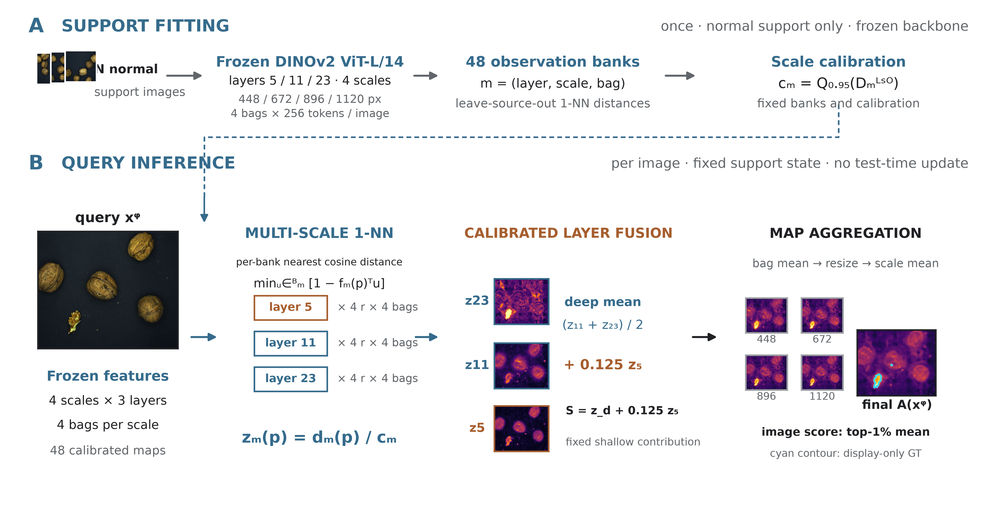

# ScopeAD: Support-Calibrated Fusion with Observation Expansion for Few-Shot Industrial Anomaly Localization

> **문서 목적**: CVPR/WACV 제출용 본문 8쪽 기준 연구 아웃라인 (v18).
> **v18 주요 개정 사항 (v16.3 기반)**:
>
> 1. **방법 교체**: shallow 결합을 비대칭 초과 게이트에서 고정 선형 가산 $S = z_d + 0.125\,z_5$ (linear0125)로 교체한다. §3과 §4의 결과는 v17.1의 linear0125 실행 결과로 맞추고 게이트 설정의 결과는 제거했다.
> 2. **결과 갱신**: 표 6(private)은 linear0125 결과 대기 상태다. 표 10의 총 cap 통제 비교는 완료된 linear0125 실행으로 갱신했으며, 단일·다중 해상도 비교는 표 10a·10b에 둔다.
> 3. **서론**: v16.3의 §1.1–1.3 구성을 개선했다. §1.1에서 저-FPR 파급효과 항목을 제거하고, §1.2에 관측별 bank와 점수 단위 정렬의 논리, 관측·결합의 역할 분담을 추가했다. §1.3 주요 기여에 관측 확장(Observation Expansion) 자체의 기여를 전면 명시하여 서론 전반의 논리 정합성을 확보했다. 일반 Vision 문헌으로 각 단계의 근거를 보강했다.
> 4. **명칭 및 타이틀 개정**: 비대칭 잔차 게이트에서 고정 선형 가산 및 관측 확장 중심으로 방법이 변경됨에 따라, 방법론 명칭을 **ScopeAD** (*Support-Calibrated Observation-expanded Patch Ensemble for Anomaly Detection*)로 변경하고 타이틀을 *Observation Expansion and Support-Calibrated Fusion for Few-Shot Industrial Anomaly Localization*으로 개정했다.
> 5. **관련 연구·서지**: §2.1·§2.3의 서지를 갱신하고 부록 A.4에 검증한 서지 표를 추가했다.
>
> **원고 작성 가이드 (CVPR/WACV 본문 약 8쪽 배분)**:
>
> - §1. Introduction (약 1.0쪽) | §2. Related Work (약 0.5쪽) | §3. Method (약 2.0쪽, ASD-STE100 규격 기술)
> - §4. Experiments (약 4.0쪽) | §5. Discussion & Limitations (약 0.35쪽) | §6. Conclusion (약 0.15쪽)
> - ※ 저자용 검증 매트릭스 및 연구 기록은 문서 말미의 `[Appendix: Author Research Notes]`에 보존한다.

---

## Index

- **Abstract**
- **1. Introduction**
  - 1.1. 소수 정상 reference와 거리 해석의 모호성 (High-Score Ambiguity)
  - 1.2. 고정 다층·다해상도 관측 결합의 과제
  - 1.3. ScopeAD 프레임워크와 주요 기여
- **2. Related Work**
  - 2.1. Frozen-feature reference matching in few-shot AD
  - 2.2. Multi-scale and multi-layer feature fusion in vision
  - 2.3. Low-FPR localization under distribution shifts
- **3. Method (ASD-STE100 기술 규격 스타일)**
  - 3.1. 시스템 개요 및 서포트 피팅·쿼리 추론 절차 (그림 1)
  - 3.2. 정상 서포트 뱅크 구축 및 메모리 배깅 (그림 M1)
  - 3.3. Scale Calibration: 분위수 기반 거리 정규화 (Axis 1: Scale, 그림 M2)
  - 3.4. Contribution Control: 고정 가중 shallow 가산 (Axis 2: Layer)
  - 3.5. 고정 다해상도 결함 맵 공간 통합 (Anomaly Map Aggregation)
  - 3.6. 파라미터 규격 및 재현성 계약
- **4. Experiments**
  - 4.1. 평가 설정 (표 1, 2, 3)
  - 4.2. Few-shot 주 비교 (표 4, 5, 5b)
  - 4.3. Distribution Shift 평가 (표 6, 그림 2, 표 7)
  - 4.4. Ablation Study (표 8, 8a–8d, 10, 10a, 10b, 11)
  - 4.5. Efficiency and Qualitative Analysis (표 12, 12a, 그림 3)
- **5. Discussion & Limitations**
  - 5.1. 관측 확장과 관측별 결합의 역할
  - 5.2. 저-FPR 곡선 메트릭과 고정 배포 임계값의 과제
- **6. Conclusion**
- **[Appendix: Author Research Notes]**
  - A.1. Claim–evidence–status matrix
  - A.2. Controlled comparison and decision rules
  - A.3. Review and audit feedback record
  - A.4. Verified literature

---

## Abstract

산업 이상 탐지에서는 새로운 제품을 소수의 정상 이미지로 검사해야 한다. 동결된 시각 백본의 패치를 정상 reference와 매칭하는 방식은 재학습 비용을 없애지만, 큰 최근접 거리는 실제 결함뿐 아니라 support에 포함되지 않은 정상 변동이나 촬영 조건 변화에서도 발생한다. 미세 결함 탐지력을 높이기 위해 다층(Shallow/Deep)과 다해상도(448~1120px)로 관측을 확장하면, 관측마다 정상 거리 척도가 다르고 얕은 층의 정상 외관 반응이 결합 점수에 섞여 저-FPR(False Positive Rate) 영역의 localization 성능이 크게 낮아질 수 있다.

본 논문은 **ScopeAD**(Support-Calibrated Observation-expanded Patch Ensemble for Anomaly Detection)를 제안한다. ScopeAD는 큰 점수의 원인을 판별하는 대신, 각 관측의 점수를 정상 support에서 관측되는 분포에 비추어 정규화하고 결합 비중을 정한다. 구체적으로 (1) 계층·해상도 조합마다 별도 memory bank를 만들고 정상 support의 **기준 상위 분위수(reference upper quantile, $q=0.95$)**로 관측 단위를 공통 척도로 정렬하며(Scale Calibration), (2) Deep feature 평균을 기준선으로 삼아 Shallow 점수를 고정 가중치 $\lambda=0.125$로 가산하고(Contribution Control), (3) 4개 고정 해상도의 맵을 역투영 평균한다. 학습되는 가중치와 query 적응은 없다.

MVTec AD 2 public 16-shot에서 ScopeAD는 3-seed 평균 **60.06 ± 0.88% AUPRO@0.05**를 기록해, 동일 support와 DINOv2 ViT-L/14를 사용한 SuperAD 파이프라인(55.89 ± 1.07%)보다 AUPRO@0.05가 **4.17pp**, pAUROC@0.05가 **3.01pp** 높았다. 같은 조건의 구성 비교(seed 0)에서 계층 특징을 하나의 bank로 합치면 AUPRO@0.05가 2.09pp 낮았고, 정렬 후 shallow 점수 전체를 가산하면 59.57%에서 54.02%로 낮아졌다. 4개 해상도 결합은 최선의 단일 해상도보다 2-shot에서 4.95pp, 16-shot에서 2.10pp 높았다. MVTec AD와 VisA 16-shot에서는 3-seed I-AUROC 98.52%와 95.78%를 기록했다.

---

## 1. Introduction — 약 1.0쪽

### 1.1. 소수 정상 reference와 거리 해석의 모호성 (High-Score Ambiguity)

- **소수 정상 이미지 기반 검사의 실용성**: 다품종 소량 생산 및 빈번한 생산 라인 전환 환경에서는 제품마다 충분한 결함 데이터를 수집하거나 모델을 재학습하기 어렵다. 대규모 데이터로 사전학습된 동결(frozen) 시각 백본은 분류와 dense prediction 등 여러 과제로 별도 학습 없이 전이된다(Oquab et al., 2023). 이 표현과 소수의 정상 이미지로 구성한 참조 뱅크(reference bank)를 결합하면, 별도 미세조정 없이 query 패치와 가장 가까운 정상 패치 사이의 거리를 측정하여 결함 영역을 국소화할 수 있다(Roth et al., 2022; Damm et al., 2025).
- **획득 조건 변화(Distribution Shift)와 거리 해석의 딜레마**: 소수의 정상 reference는 실제 공정에서 발생하는 조명 드리프트, 부품 자세 변동, 표면 난반사, 센서 노이즈 같은 다양한 환경 변화를 모두 포괄하기 어렵다. 일반 시각 인식에서도 모델은 corruption이나 분포 변화 아래에서 원래 분포의 성능을 유지하지 못하며(Hendrycks and Dietterich, 2019), 예측 점수의 신뢰도 해석도 달라진다(Ovadia et al., 2019). 같은 이치로 결함이 없는 정상 query 패치라도 reference bank에 없는 정상 변동이 발생하면 최근접 거리가 크게 벌어지며, 이는 실제 결함이 유발하는 큰 거리와 외형상 구별되지 않는다. 즉, **"큰 거리값"이라는 관측만으로는 그 원인이 실제 결함인지, reference에 미포함된 정상적 외관 변화인지 확정할 수 없다(High-Score Ambiguity).**

### 1.2. 고정 다층·다해상도 관측 결합의 과제

Few-shot 검사에서는 reference 표본이 극도로 희소하므로, 각 이미지에서 가능한 한 다양한 수준의 시각적 단서를 확보하는 것이 유리하다. 정상 이미지를 늘릴 수 없을 때 같은 이미지를 여러 표현 깊이와 입력 척도에서 관찰하는 방식은 일반 시각 인식에서도 dense prediction의 성능을 높여 왔다.

1. **표현 계층(Layer Depth)**: ViT의 여러 중간 계층 토큰을 공간 맵으로 재구성해 결합하면 깊이 추정과 분할이 개선된다(Ranftl et al., 2021). ViT는 얕은 층에서도 local과 global 정보를 함께 담지만 계층에 따라 표현이 달라진다(Raghu et al., 2021). 백본의 심층 레이어(Deep, Layer 11/23)는 의미 수준의 안정적 기준선(semantic base)을 제공하지만 미세 윤곽과 국소 텍스처에 둔감하다. 반면 얕은 레이어(Shallow, Layer 5)는 미세 스크래치와 국소 결함에 민감하지만 정상 외관 변화에도 과민 반응한다.
2. **입력 해상도(Input Resolution)**: 다중 척도 feature는 크기가 다른 객체의 인식에 유효하며(Lin et al., 2017), 동결된 사전학습 모델을 여러 입력 척도에서 실행하는 것만으로도 분류·분할·깊이 추정 성능이 높아진다(Shi et al., 2024). 의미가 풍부한 feature도 공간 해상도가 낮으면 dense prediction이 제한된다(Fu et al., 2024). 패치 크기가 $14 \times 14$로 고정된 구조에서, 448px 저해상도는 이미지 짧은 변의 3.1%를 하나의 토큰이 덮어 거시적 형태 안정성을 제공한다. 반면 1120px 고해상도는 토큰이 덮는 길이가 1.25%로 줄어들어 미세 결함에 대한 공간 표본 밀도를 높여준다.

**관측 결합의 어려움**:
다층·다해상도 관측을 구성했다고 해서 모든 점수를 그대로 더하는 것이 유리한 것은 아니다. 첫째, 기존 패치 매칭은 여러 계층의 특징을 이어 붙여 bank 하나를 만들고 점수 하나를 계산한다(Roth et al., 2022). 이 경우 계층마다 다른 정상 변동이 하나의 거리 안에 섞인다. 같은 저장 용량에서 계층 특징을 하나의 bank로 합치면 AUPRO@0.05가 관측별 bank를 유지할 때의 59.57%보다 낮은 57.48%였다(표 8). 반대로 관측마다 bank를 따로 두면 bank마다 정상 거리 분포가 달라지므로, 결합하기 전에 점수 단위를 맞춰야 한다. 둘째, shallow 점수에는 결함 반응뿐 아니라 정상 질감과 외관 반응도 포함된다. 기준 상위 분위수($q=0.95$)로 단위를 맞춘 뒤에도 shallow 점수 전체를 가산하면($\lambda=1$) AUPRO@0.05가 54.02%로 낮아졌고, 고정 가중치로 가산하면 59.57%였다(표 8b). 이 비교는 척도 보정만으로는 shallow 기여량 제어를 대체할 수 없음을 보여준다.

고정 다층·다해상도 관측을 결합하기 위해 다음 두 문제를 구분한다:

1. **Scale Calibration — 관측 간 거리 단위 정렬**: 계층·해상도·bag 조합마다 만든 bank의 정상 거리 척도를 support 기준 상위 분위수($q$-quantile, $q=0.95$)로 보정하여, 서로 다른 관측을 공통의 통계적 단위에서 비교 가능하도록 정규화한다. 일반 시각 연구에서도 점수 맵의 정규화 방식은 위치 추정 결과를 바꾸며(Kim et al., 2021), 성질이 다른 점수를 결합할 때는 데이터 기준으로 상대 척도를 맞춘다(Wang et al., 2022). ScopeAD는 이 기준을 정상 support의 leave-source-out 거리에서 정한다. 레이블로 예측 confidence를 맞추는 calibration(Guo et al., 2017)과 달리 정상 이미지만으로 정하는 거리 단위다. q95 정렬은 MAD 기반 정렬보다 AUPRO@0.05가 모든 shot에서 0.76~1.69pp 높았다(표 8d).
2. **Contribution Control — Shallow의 추가 기여량 제어**: 공통 단위로 변환된 상태에서 Deep 평균을 기준선으로 삼고, Shallow 점수를 고정 가중치 $\lambda=0.125$로 가산한다. 각 고정 해상도에서 동일한 결합 규칙을 적용한 뒤 맵을 평균한다. $\lambda$는 AD2 2-shot 개발 평가에서 선택해 동결했다(표 8b).

**관측과 결합의 역할 분담**:
세 요소는 결합 과정의 서로 다른 단계를 맡는다. 계층·해상도 확장은 관측 단계에서 정보를 늘리고, 관측별 bank와 Scale Calibration은 결합 단계에서 서로 다른 관측을 같은 기준으로 비교하게 하며, Contribution Control은 정렬된 관측 가운데 shallow의 비중을 정한다. 따라서 한 요소가 다른 요소를 대신하지 않는다. 16-shot 구성 비교에서 각 요소를 하나씩 바꾸면 AUPRO@0.05가 448 단일 해상도에서 7.56pp, 단일 bank에서 2.09pp, 동일 가중 3계층 평균에서 1.36pp, MAD 보정에서 1.05pp 낮아졌다(표 8).

해상도 집합은 관측 구성의 사양이며, 두 결합 규칙은 그 관측을 어떻게 해석하고 합칠지를 정한다. 다해상도 구성의 이득은 단일 해상도 구성과의 비교(표 10a·10b)와 총 뱅크 토큰 수를 맞춘 비교(표 10)로 확인한다.

### 1.3. ScopeAD 프레임워크와 주요 기여

본 논문은 High-Score Ambiguity가 존재하는 소수 정상 reference 환경에서, 동일 이미지의 관측 축을 체계적으로 확장하고 이질적인 관측 점수를 보정·결합하는 **ScopeAD**를 제안한다. 핵심 기여는 다음과 같다:

1. **소수 정상 표본의 한계를 극복하는 다차원 관측 확장 (Observation Expansion)**: 새로운 정상 표본을 추가할 수 없는 few-shot 조건에서, 동결된 백본을 재학습하지 않고 동일 입력에 대해 입력 해상도(토큰 커버리지 3.1%~1.25%의 공간 표본 밀도 확장)와 표현 계층(미세 외관의 Shallow vs 거시 의미의 Deep)이라는 두 직교 관측 축을 체계적으로 확장하여 한정된 정상 reference로부터의 시각 단서 획득을 극대화한다.
2. **관측별 Bank 결합에서 척도 보정과 기여 제어의 분리 (Calibrated & Controlled Fusion)**: 다차원 관측 확장의 이점을 온전히 보존하기 위해 관측 조건($l, r, b$)마다 독립 memory bank를 구축한다. 나아가 관측 간 상이한 거리 단위를 정상 support 상위 분위수($q=0.95$)로 정규화하는 척도 보정(Scale Calibration)과, shallow의 정상 질감 과민반응을 억제하는 기여 제어(Contribution Control, $\lambda=0.125$)를 별개의 문제로 정식화하고 결합하는 결정론적(training-free) 파이프라인을 제안한다.
3. **관측 확장(구성) 이득과 결합 이득의 분리 검증 (Empirical Disentanglement & SOTA)**: 다해상도 관측 확장이 제공하는 공간 해상력 이득(최선 단일 대비 2-shot +4.95pp, 16-shot +2.10pp, 총 bank 용량 통제 하에서도 유효)과, 관측별 bank·분위수 정렬·shallow 제어가 제공하는 결합 이득(단일 bank 대비 +2.09pp, shallow 전체 가산 대비 +5.55pp)을 통제된 개발 실험으로 분리 입증한다. MVTec AD 2 16-shot에서 동일 백본의 SuperAD 대비 3-seed AUPRO@0.05를 4.17pp 향상시키며 SOTA를 달성한다.

---

## 2. Related Work — 약 0.5쪽

### 2.1. Frozen-Feature Reference Matching in Few-Shot AD

소수 정상 이미지만으로 이상을 탐지하는 패치 매칭 방식은 재학습이 필요 없어 산업 현장에서 활발히 연구되어 왔다. [PatchCore (Roth et al., 2022)](https://openaccess.thecvf.com/content/CVPR2022/html/Roth_Towards_Total_Recall_in_Industrial_Anomaly_Detection_CVPR_2022_paper.html)는 동결된 CNN 백본의 중간 계층 특징을 이어 붙여 coreset 메모리 뱅크를 구축하고 최근접 패치 거리를 계산했다. 대규모 자기지도 비전 백본 DINOv2(Oquab et al., 2023)가 등장한 뒤 최근 연구들은 이를 도입해 성능을 크게 끌어올렸다. [AnomalyDINO (Damm et al., 2025)](https://openaccess.thecvf.com/content/WACV2025/html/Damm_AnomalyDINO_Boosting_Patch-Based_Few-Shot_Anomaly_Detection_with_DINOv2_WACV_2025_paper.html)는 DINOv2 패치 특징만으로 few-shot 매칭의 성능을 높였고, [SuperAD (Zhang et al., 2025)](https://arxiv.org/abs/2505.19750)는 여러 계층의 DINOv2 특징으로 MVTec AD 2의 복잡한 조명과 다양한 결함 크기를 다뤘다. ScopeAD는 이 계열의 최근접 거리 점수를 사용하되, 관측 조건마다 bank를 분리하고 결합 전에 정상 support 기준으로 점수 단위를 맞춘다.

### 2.2. Multi-Scale and Multi-Layer Feature Fusion in Vision

Vision Transformer(ViT)의 계층별 표현 분석(Raghu et al., 2021)에 따르면 ViT는 얕은 층에서도 local과 global 정보를 함께 담지만 계층마다 표현이 달라지며, DPT(Ranftl et al., 2021)는 여러 ViT 계층의 토큰을 공간 맵으로 재구성·결합해 깊이 추정과 분할을 개선했다. 입력 척도 측면에서 FPN(Lin et al., 2017)은 다중 척도 feature pyramid로 객체 검출을 개선했고, S²(Shi et al., 2024)는 동결된 모델을 여러 입력 척도에서 실행해 분류·분할·깊이 추정 성능을 높였으며, FeatUp(Fu et al., 2024)은 deep feature의 공간 해상도를 높여 dense prediction에 활용했다. 이상 탐지 분야에서도 미세 결함과 대형 결함을 동시에 잡기 위해 여러 layer나 multi-scale 입력을 결합하려는 시도가 이어져 왔다. S²가 확대 입력을 기본 크기의 타일로 나눠 feature를 재조립·연결하는 것과 달리, ScopeAD는 해상도별 전체 입력에서 정상 패치 거리를 계산하고 원본 좌표의 거리 맵을 평균한다.

서로 다른 관측의 점수를 결합할 때는 척도가 결과를 좌우한다. Kim et al. (2021)은 CAM의 정규화 방식이 약지도 위치 추정 성능을 바꾼다고 보고했고, ViM(Wang et al., 2022)은 feature residual과 분류 logit을 결합하기 전에 학습 데이터 기준으로 두 점수의 척도를 맞췄다. 기존 이상 탐지 방법은 feature concatenation이나 동일 가중 평균으로 관측을 결합하여, 질감에 민감한 얕은 층의 정상 반응이 결합 점수에 그대로 섞인다. ScopeAD는 관측별 bank의 점수를 정상 support 분위수로 정렬한 뒤 Deep 기준선에 Shallow를 작은 고정 가중치로 더한다.

### 2.3. Low-FPR Localization under Distribution Shifts

실제 제조 공정에서는 조명 드리프트, 부품 각도 변화, 표면 난반사 등 다양한 획득 조건 변화(Distribution Shift)가 빈번히 발생한다. 일반 시각 인식에서 ImageNet-C/P(Hendrycks and Dietterich, 2019)는 common corruption과 perturbation 아래의 성능 저하를 체계적으로 평가했고, Ovadia et al. (2019)은 학습 분포에서 맞춘 confidence calibration(Guo et al., 2017)이 dataset shift 아래에서 유지되지 않음을 보였다. [MVTec AD 2 (Heckler-Kram et al., 2026)](https://link.springer.com/article/10.1007/s11263-026-02743-0)는 조명 변화와 작은 결함을 포함한 실제 환경의 산업 벤치마크를 정립했다. 공정 신뢰성을 위해서는 전체 ROC 곡선 아래 면적보다 엄격한 저-FPR 구간(pAUROC@0.05, AUPRO@0.05)에서의 위치 특정 성능이 결정적이다. 본 연구는 추가적인 레이블이나 테스트 시점 최적화 없이, 소수 정상 reference의 분위수로 관측 점수의 단위를 정하는 결합 방식을 다룬다.

---

## 3. Method (ASD-STE100 기술 규격 스타일) — 약 2.0쪽

### 3.1. 시스템 개요 및 서포트 피팅·쿼리 추론 절차

**목적**:
동결된 사전학습 비전 백본의 고정 다층·다해상도 패치 특징을 사용하여, 정상 서포트 이미지 $N$장으로부터 테스트 쿼리 이미지 $x^q$의 결함 영역을 국소화한다.

**입력**:

1. 정상 서포트 이미지 집합 $\mathcal{S} = \{x_1^s, x_2^s, \dots, x_N^s\}$.
2. 테스트 쿼리 이미지 $x^q$.
3. 동결된 DINOv2-L/14 백본 네트워크.
4. 고정 계층 집합 $\mathcal{L} = \{5, 11, 23\}$, 고정 해상도 집합 $\mathcal{R} = \{448, 672, 896, 1120\}$, 배그 수 $B=4$.

**출력**:

1. 픽셀 단위 결함 국소화 맵 $A(x^q) \in \mathbb{R}^{H \times W}$.
2. 이미지 단위 결함 점수 $s(x^q) \in \mathbb{R}$.

**공통 설계 연산자 (Support-Referenced Ratio Operator)**:
임의의 관측 통계량 $t$와 정상 서포트 기준 분포 $\mathcal{N}_S[t]$에 대해, 분위수 비율 연산자 $\mathcal{T}_q[t]$를 다음과 같이 정의한다:

$$
\mathcal{T}_q[t] = \frac{t}{Q_q(\mathcal{N}_S[t])}
$$

여기서 $Q_q(D)$는 분포 $D$의 $q$-분위수(Quantile) 값이다. 이 연산자는 척도 보정($q=0.95$)에 적용된다.

*그림 1. ScopeAD 전체 파이프라인 개요도. (A) 정상 support에서 48개 관측별 뱅크를 구축하고 LSO 거리의 $q=0.95$ 분위수 $c_m$을 사전 계산한다. (B) 4개 해상도와 3개 계층으로 관측을 확장하고, 컴포넌트별 1-NN 코사인 거리를 $c_m$으로 정규화한다. (C) Deep 평균에 $0.125\,z_5$를 가산한다. (D) 4-bag 평균, bilinear 역투영, 4-scale 평균으로 결함 맵을 구성하고 상위 1% 픽셀 평균으로 이미지 점수를 산출한다. Heatmap은 캐시된 bag 평균 계층별 정규화 맵에서 linear0125로 재구성한 표시용 예시이며, CQ는 이 개요도에서 제외한다.*

**전체 파이프라인의 2단계 절차**:

- **1단계 (서포트 피팅 단계, 사전 1회 수행)**:
  1. 계층 $l \in \{5, 11, 23\}$, 해상도 $r \in \{448, 672, 896, 1120\}$, bag $b \in \{1, 2, 3, 4\}$의 조합 $m = (l, r, b)$를 각각 보정하는 관측 단위인 **컴포넌트(Component)**로 정의한다 (총 $3 \times 4 \times 4 = 48$개). 컴포넌트들은 같은 support와 backbone을 공유하며 통계적 독립성을 가정하지 않는다.
  2. 서포트 이미지 집합 $\mathcal{S}$로부터 각 컴포넌트 $m$에 대응하는 총 48개의 전용 메모리 뱅크 $B_m$을 생성한다.
  3. Leave-Source-Out (LSO) 매칭을 수행하여 48개 컴포넌트의 정상 거리 분포 $D_m^{\text{LSO}}$를 측정한다.
  4. 단위 척도 $c_m = Q_q(D_m^{\text{LSO}})$ ($q=0.95$)를 사전 계산한다.
- **2단계 (쿼리 추론 단계, 온라인)**:
  1. 쿼리 영상 $x^q$에 대해 고정 4개 해상도 $\mathcal{R}$에서 계층별 패치 특징 벡터를 추출한다.
  2. 48개 컴포넌트 뱅크에 대해 1-NN 코사인 거리 $d_m(x^q, p)$를 계산하고, 사전 계산된 단위 척도 $c_m$으로 나누어 무차원 정규화 점수 $z_m(x^q, p)$를 산출한다.
  3. 각 해상도와 배그에서 Deep 기준선 $z_{d,r,b}(x^q, p)$에 Shallow 점수 $z_{5,r,b}(x^q, p)$를 고정 가중치 $\lambda=0.125$로 가산하여 결합 점수 $S_{r,b}(x^q, p)$를 산출한다.
  4. 4개 배그의 점수 맵을 동일 토큰 격자에서 산술 평균하여 해상도별 점수 맵 $S_r(x^q, p)$를 생성한다.
  5. 4개 고정 해상도의 점수 맵을 원본 영상 크기 $(H, W)$로 양선형 보간한 뒤 동일 가중 평균하여 최종 결함 국소화 맵 $A(x^q)$ 및 이미지 단위 결함 점수 $s(x^q)$를 출력한다.

---

### 3.2. 정상 서포트 뱅크 구축 및 메모리 배깅

**목적**:
VRAM 사용량을 낮추고 표본화 분산을 줄이면서, 다층·다해상도 패치 특징을 저장하는 참조 뱅크를 구축한다.

**입력 파라미터 규격**:

1. **계층 집합 $\mathcal{L}$**: $\{5, 11, 23\}$. DINOv2-L/14의 5번째, 11번째, 23번째 블록 출력이다.
2. **해상도 집합 $\mathcal{R}$**: $\{448, 672, 896, 1120\}$. 영상의 짧은 변 길이를 해당 수치로 조정한다. 백본 패치 크기는 $14 \times 14$ 픽셀로 고정된다.
3. **배그 수 $B$**: 4.

|  해상도$r$  | 짧은 변 토큰 수 | 정사각 기준 토큰 수 | 토큰 1개가 덮는 영상 길이 비율 | 관측 특성                             |
| :------------: | :-------------: | :-----------------: | :----------------------------: | :------------------------------------ |
| **448** |       32       |        1,024        |            약 3.1%            | 짧은 변 32개 토큰의 가장 성긴 관측    |
| **672** |       48       |        2,304        |            약 2.1%            | 중간 수준의 구조 정보 제공            |
| **896** |       64       |        4,096        |            약 1.6%            | 국소 결함 표본화 밀도 강화            |
| **1120** |       80       |        6,400        |            약 1.25%            | 선택한 4개 해상도 중 가장 촘촘한 관측 |

**배깅 뱅크 생성 절차**:

1. 해상도 $r$에서 각 서포트 이미지 $x_i^s$로부터 256개의 패치 토큰을 무작위 비복원 추출한다.
2. 서로 다른 4개의 난수 시드를 적용하여 이 과정을 4회 반복한다. 4개의 독립 배그 $b \in \{1, 2, 3, 4\}$를 생성한다.
3. 동일한 배그 $b$ 내에서 세 계층($l \in \{5, 11, 23\}$)은 동일한 공간 위치의 패치 토큰을 공유한다.
4. 계층 $l$, 해상도 $r$, 배그 $b$의 조합을 하나의 컴포넌트 $m = (l, r, b)$로 정의한다. 총 컴포넌트 수는 $3 \times 4 \times 4 = 48$개이다.
5. 16-shot 조건에서 단일 컴포넌트 뱅크 $B_m$은 $16 \times 256 = 4,096$개의 토큰으로 구성된다.

**1-NN 최근접 거리 계산**:
쿼리 위치 $p$에서 추출된 L2 정규화 특징 벡터를 $f_{l,r}(x^q, p)$라 한다. 컴포넌트 뱅크 $B_{l,r,b}$에 대한 1-NN 코사인 거리 $d_{l,r,b}(x^q, p)$를 다음과 같이 계산한다:

$$
d_{l,r,b}(x^q, p) = \min_{u \in B_{l,r,b}} \left[ 1 - f_{l,r}(x^q, p)^\top u \right]
$$

*그림 M1. 실제 hazelnut query(1120px)의 4개 독립 Bag 점수 맵과 평균. 각 Bag은 이미지당 256개 토큰을 사용한다. 오른쪽은 픽셀별 Bag 간 표준편차(전체 평균 0.038)를 나타내며, 4-Bag 평균이 희소 표본화 차이를 완화함을 보여준다.*

---

### 3.3. Scale Calibration: 분위수 기반 거리 정규화 (Axis 1: Scale)

**목적**:
서로 다른 계층과 해상도의 거리 척도를 동일한 무차원 척도로 정렬한다.

**입력**:

1. 컴포넌트 메모리 뱅크 $B_m$ ($m = (l, r, b)$).
2. 쿼리 패치 특징 벡터 $f_m(x^q, p)$.
3. 분위수 파라미터 $q \in (0, 1)$ (기본값: $q = 0.95$).

**출력**:

1. 컴포넌트 단위 척도 $c_m \in \mathbb{R}$.
2. 무차원 정규화 점수 맵 $z_m(x^q, p) \in \mathbb{R}$.

**계산 절차**:

1. **Leave-Source-Out (LSO) 정상 거리 분포 수집**:

   - 컴포넌트 뱅크 $B_m$에서 서포트 이미지 $x_i^s$로부터 추출된 토큰 부분집합을 $B_m^{(i)}$로 정의한다.
   - 각 토큰 $v \in B_m^{(i)}$에 대해 나머지 서포트 토큰 집합 $B_m \setminus B_m^{(i)}$와의 최근접 거리를 계산한다.
   - 모든 서포트 이미지 $i \in \{1, \dots, N\}$의 거리값을 모아 LSO 정상 거리 분포 $D_m^{\text{LSO}}$를 생성한다:
     $$
     D_m^{\text{LSO}} = \bigcup_{i=1}^{N} \left\{ \min_{u \in B_m \setminus B_m^{(i)}} \left[1 - v^\top u\right] \;:\; v \in B_m^{(i)} \right\}
     $$
   - 16-shot 조건에서 $D_m^{\text{LSO}}$는 4,096개의 거리값으로 구성된다.
2. **컴포넌트 단위 척도 $c_m$ 결정**:

   - 정상 support 거리의 상위 5% 기준점을 단위로 사용한다.
   - $q = 0.95$를 기본값으로 설정한다.
   - 정상 거리 분포 $D_m^{\text{LSO}}$의 $q$-분위수를 컴포넌트 단위 척도 $c_m$으로 결정한다:
     $$
     c_m = Q_{q}\!\left(D_m^{\text{LSO}}\right)
     $$
3. **쿼리 패치 코사인 거리 $d_m(x^q, p)$ 계산**:

   - 쿼리 특징 $f_m(x^q, p)$와 메모리 뱅크 $B_m$ 사이의 1-NN 코사인 거리를 $d_m(x^q, p)$로 정의한다:
     $$
     d_m(x^q, p) \triangleq \min_{u \in B_m} \left[ 1 - f_m(x^q, p)^\top u \right]
     $$
   - $f_m(x^q, p)^\top u$는 L2 정규화 특징 간 코사인 유사도이다.
   - $1 - f_m^\top u$는 정상 reference와의 특징 차이를 나타낸다.
   - 아래첨자 $m$은 대상 메모리 뱅크 $B_m$을 지정한다.
   - 인자 $(x^q, p)$는 쿼리 영상 $x^q$의 2차원 공간 위치 $p$를 지정한다.
4. **무차원 정규화 점수 $z_m(x^q, p)$ 계산**:

   - 쿼리 거리 $d_m(x^q, p)$를 단위 척도 $c_m$으로 나누어 정규화 점수 $z_m(x^q, p)$를 계산한다:
     $$
     z_m(x^q, p) = \mathcal{T}_{q}[d_m] = \frac{d_m(x^q, p)}{c_m}
     $$

**기술 규격 및 판정 기준**:

- **$z_m(x^q, p) = 1.0$**: 해당 패치 거리가 정상 상위 5% 경계값과 일치함을 나타낸다. 결합 전 support 참조 단위이며 최종 판정 임계값이 아니다.
- **$z_m(x^q, p) = 2.0$**: 해당 패치 거리가 정상 상위 5% 경계값의 2배임을 나타낸다.
- **support 기준점 정렬**: 분위수를 추정한 LSO 정상 거리 표본에서 $z_m \le 1.0$인 비율은 약 95%다. 이 단위는 결합 전 관측 간 비중을 맞추는 기준이며, 최종 판정 임계값은 결합 맵에서 따로 정한다.
- **파라미터 검증 상태**: 기본값은 $q=0.95$다. $q$ 민감도는 표 11, 정규화 방식(none/MAD/q95) 비교는 표 8c·8d에 제시한다.

그림 M2. 실제 query의 원시·정규화 점수 맵과 정상 픽셀 분포. 위 분포의 예시 원시 거리 $d^*$는 레이어별 support 기준 상위 분위수($q=0.95$) 기준 사이에 놓여, 같은 수치가 Layer 5에서는 기준 초과, Layer 23에서는 기준 미만으로 해석될 수 있음을 보여준다. 아래에서는 각 점수를 해당 레이어의 $q=0.95$ 단위로 환산해 $z=1$을 공통 기준으로 비교한다.

---

### 3.4. Contribution Control: 고정 가중 shallow 가산 (Axis 2: Layer)

**목적**:
Deep 기준선에 shallow 계층의 관측을 고정 가중치로 가산해 관측 축을 깊이 방향으로 확장한다. 각 계층은 자체 bank와 점수 맵을 유지하며, 결합은 점수 맵 단위에서 이루어진다(계층 특징을 합쳐 bank 하나를 만드는 방식과 구분한다).

**입력**:

1. 각 계층의 정규화 점수 맵 $z_{l,r,b}(x^q, p)$ ($l \in \{5, 11, 23\}$).
2. Shallow 가중치 $\lambda = 0.125$.

**출력**:

1. 계층 결합 점수 맵 $S_{r,b}(x^q, p) \in \mathbb{R}$.

**계산 절차**:

1. **Deep 기준선 점수 계산**: Layer 11과 Layer 23의 정규화 점수를 산술 평균한다:
   $$
   z_{d,r,b}(x^q, p) = \frac{z_{11,r,b}(x^q, p) + z_{23,r,b}(x^q, p)}{2}
   $$
2. **Shallow 가산**: Layer 5의 정규화 점수에 고정 가중치를 곱해 더한다:
   $$
   S_{r,b}(x^q, p) = z_{d,r,b}(x^q, p) + \lambda\, z_{5,r,b}(x^q, p), \qquad \lambda = 0.125
   $$

**기술 규격 및 판정 기준**:

- 임계값, 게이트, 학습되는 가중치는 없다.
- $\lambda$는 AD2 public 2-shot seed 0 AUPRO로 $\{0, 0.125, 0.25, 0.5, 1, 2\}$ 중 선택해 동결했다. 개발 평가를 사용한 post-hoc 선택이며 다른 데이터셋에서 다시 조정하지 않았다(표 8b).
- $z_5$는 정규화 이후의 점수이므로 $\lambda$의 상대 기여는 normalization 방식에 따라 달라진다. 서로 다른 normalization 사이에서 같은 $\lambda$의 효과를 직접 비교하지 않는다.

예시 계산(설명용, 실측값 아님; $\lambda=0.125$):

| 픽셀 위치 유형     | $z_d$ (Deep 기준선) | $z_5$ (Shallow) | $\lambda z_5$ | 결합 점수 ($S$) |      |
| :----------------- | :-------------------: | :---------------: | :---------------------------------: | :---: |
| 정상 매끈한 면     |         0.55         |       0.40       |                0.050                | 0.600 |
| 정상 질감 변화 면  |         0.65         |       1.25       |                0.156                | 0.806 |
| 미세 스크래치 결함 |         0.85         |       2.80       |                0.350                | 1.200 |
| 대형 파손 결함     |         2.40         |       3.00       |                0.375                | 2.775 |

v17의 잔차 분해 그림(그림 M3)은 게이트 방식의 맵이므로 이 버전에서는 사용하지 않으며, linear0125 기준의 Deep·Shallow·결합 맵 그림으로 교체해야 한다.

---

### 3.5. 고정 다해상도 결함 맵 공간 통합 (Anomaly Map Aggregation)

**목적**:
고정 4개 해상도와 다중 배그의 국소 결합 점수를 단일 2차원 결함 국소화 맵 및 이미지 단위 결함 점수로 통합한다.

**입력**:

1. 각 해상도 $r$ 및 배그 $b$에서의 결합 점수 맵 $S_{r,b}(x^q, p)$.
2. 고정 해상도 집합 $\mathcal{R} = \{448, 672, 896, 1120\}$.

**출력**:

1. 픽셀 단위 최종 결함 국소화 맵 $A(x^q) \in \mathbb{R}^{H \times W}$.
2. 이미지 단위 결함 점수 $s(x^q) \in \mathbb{R}$.

**계산 절차**:

1. **Bag 점수 평균**:

   - 해상도 $r$에서 4개 배그의 결합 점수를 동일 토큰 위치 $p$에서 산술 평균한다:
     $$
     S_r(x^q, p) = \frac{1}{4} \sum_{b=1}^{4} S_{r,b}(x^q, p)
     $$
2. **공간 역투영 및 다해상도 평균**:

   - 각 해상도의 점수 맵 $S_r(x^q)$를 원래 입력 영상 크기 $(H, W)$로 양선형 보간(Bilinear Interpolation)한다.
   - 고정 4개 해상도 집합 $\mathcal{R}$의 맵을 동일 가중 평균하여 최종 결함 국소화 맵 $A(x^q)$를 산출한다:
     $$
     A(x^q) = \frac{1}{|\mathcal{R}|} \sum_{r \in \mathcal{R}} \operatorname{Resize}_{H,W}\left[ S_r(x^q) \right]
     $$
3. **이미지 단위 결함 점수 산출**:

   - 최종 결함 맵 $A(x^q)$의 상위 1% 픽셀 평균(top-1% mean)으로 이미지 단위 결함 점수 $s(x^q)$를 정의한다. 이 정의는 SuperAD·PatchCore의 I-AUROC 집계와 같다:
     $$
     s(x^q) = \frac{1}{|\Omega_{1\%}|}\sum_{p\in\Omega_{1\%}} A(x^q, p),\quad \Omega_{1\%}=\{\text{상위 1% 픽셀}\}
     $$

---

### 3.6. 파라미터 규격 및 재현성 계약

**시스템 파라미터 고정 사양**:

- 시각 백본: DINOv2-L/14 (동결, 파라미터 수 약 304M, 패치 크기 14).
- 서포트 이미지 수 $N$: $\{1, 2, 4, 8, 16\}$.
- 계층 인덱스 $\mathcal{L}$: $\{5, 11, 23\}$.
- 입력 해상도 짧은 변 $\mathcal{R}$: $\{448, 672, 896, 1120\}$ (모든 query에서 고정).
- 배그 수 $B$: 4.
- 배그당 이미지별 샘플링 토큰 수: 256.
- 척도 분위수 $q$: 0.95 (Scale Calibration).
- Shallow 가산 가중치 $\lambda$: 0.125 (Layer 5에만 적용; AD2 public 2-shot seed 0 AUPRO로 $\{0,0.125,0.25,0.5,1,2\}$ 중 선택한 post-hoc 값이며 이후 재조정하지 않음).
- 계산 정밀도: FP16 autocast, 뱅크 용량 256 토큰/source.

**재현성 데이터 계약**:
모든 실험은 고정된 난수 시드(Seed 0, 1, 2)와 고정된 서포트 이미지 매니페스트를 사용하여 결정론적으로 실행된다. 추론 시 역전파, 파라미터 업데이트, 테스트 라벨 입력은 사용되지 않는다. (선택적으로 국소 결함 요철 완화를 위해 가벼운 형태학적 연결 성분 최댓값 채움 후처리를 적용할 수 있다.)

---

## 4. Experiments — 약 4.0쪽

### 4.1. 평가 설정 (Evaluation Setup)

**표 1. MVTec AD 2 split과 레이블 범위**

| Split                |                        이미지 수 | 조명·레이블 범위                                                                  |
| :------------------- | -------------------------------: | :--------------------------------------------------------------------------------- |
| `train/good`       |                            2,528 | 정상; regular 조명                                                                 |
| `validation/good`  |                              302 | 정상; regular 조명                                                                 |
| `test_public`      | 1,084 (379 normal / 705 anomaly) | 여러 조명; 라벨 공개 개발 평가                                                     |
| `test_private`     |              2,045 (748 / 1,297) | regular 조명; GT 서버 비공개                                                       |
| `test_private,mix` |              2,045 (748 / 1,297) | 대응 장면의 seen/unseen 조명을 무작위 구성; 별도 split, public/private 합집합 아님 |

**표 2. support·seed·지표·threshold 설정**

| 항목                      | 설정                                                                                                                                               |
| :------------------------ | :------------------------------------------------------------------------------------------------------------------------------------------------- |
| 주 few-shot 평가          | MVTec AD 2`test_public`; 8 classes; 1/2/4/8/16 normal support images per class                                                                   |
| Seed / 집계               | 표 4: 비교군과 Ours(linear0125) 모두 seed 0–2 mean ± sample SD; AD2 Ours는 1/2/4/8/16-shot 전체 완료. 표 5: 모든 방법 seed 0 단일값 |
| MVTec AD / VisA 범위      | MVTec AD 15 classes, VisA 12 classes; 1/2/4-shot 표는 §4.2                                                                                        |
| Primary metric            | Class-macro AUPRO@0.05 (%)                                                                                                                         |
| 보조 metric               | Class-macro pAUROC@0.05, I-AUROC (%)                                                                                                               |
| 연속 score metric         | AUPRO·pAUROC는 anomaly score map에서 계산; I-AUROC는 SuperAD/PatchCore와 동일하게 anomaly score map 상위 1% 평균(top-1% mean)을 기준으로 집계     |
| 공식 private F1 threshold | `train/good` 중 16-shot support 제외 후 매 8번째 이미지를 calibration에 사용; class별 calibration pixel score p95 × 1.421. Private GT 미사용    |
| F1 oracle                 | Query label로 threshold를 선택하는 진단값; 운영 지표 표에는 포함하지 않음                                                                          |

**표 3. AD2 `test_public` 비교군 설정 (표 4 / 기존 입력)**

| 방법                            | 학습·support fit                                                   | Backbone / feature layers                | 입력·resolution·추가 설정                                                                                     |
| :------------------------------ | :------------------------------------------------------------------ | :--------------------------------------- | :-------------------------------------------------------------------------------------------------------------- |
| ScopeAD (Ours, linear0125)      | Frozen; support bank·scale fitting                                 | DINOv2 ViT-L/14; [5, 11, 23]             | 448/672/896/1120; 4-scale memory bank;$z_d+0.125 z_5$                                                         |
| SuperAD                         | Frozen; support reference bank                                      | DINOv2 ViT-L/14; [5, 11, 17, 23]         | 1120; 기존 입력 672                                                                                             |
| PatchCore                       | Frozen; support memory / coreset                                    | DINOv2 ViT-L/14; [5, 11, 17, 23]         | 1120; 기존 입력 672                                                                                             |
| AnomalyDINO                     | Frozen; support references                                          | Project DINOv2 ViT-L/14; [23]            | 1120 (모든 클래스); 기존 입력 672,`sheet_metal` 448                                                           |
| FastRecon (paper configuration) | No gradient training; closed-form support fit                       | ResNet-50                                | 1120, grid 140×140; 기존 입력 368; 15% coreset; λ=0.3                                                         |
| RAD                             | Frozen; support retrieval bank                                      | DINOv3 ViT-B/16; [3, 6, 9, 11]           | Square 1280 → center crop 1120; 기존 설정 512 → 448; global category bank                                     |
| SubspaceAD                      | Frozen; support PCA fit                                             | DINOv2-with-registers ViT-G/14; [22–28] | 1120; 기존 입력 672                                                                                             |
| RegAD                           | Official source-trained registration model; fixed source checkpoint | ResNet-18 STN; learned registration      | 224×224; official positional Gaussian and Mahalanobis scoring; same 2-shot bottle checkpoint for all AD2 shots |

모든 방법은 같은 support 경로·query·evaluator를 사용한다. 표 4는 비교군의 유효 입력을 1120으로 변경한 해상도 실험이며, backbone·feature layer·method fitting·후처리는 각 방법 설정을 유지한다. RegAD는 224 입력을 유지한다. FastRecon의 원 논문 입력은 368이며, 표 4의 1120 설정은 명시적인 해상도 변경 실험이다. FastRecon은 논문 설정의 독립 재구현이며([구현 감사](../../configs/benchmarks/public_v13_20260929/FASTRECON_REGAD_AUDIT.md)), RAD도 논문 식을 따른 독립 구현([프로토콜](../../configs/benchmarks/public_v13_20260929/RAD_PROTOCOL.md))이다. 이 비교의 SuperAD는 공통 support를 사용하며, 원 논문에서 전체 `train`으로 coreset을 만들어 16 reference를 고르는 설정과 다르다([paper](https://arxiv.org/abs/2505.19750)). 따라서 외부 비교는 전체 파이프라인 비교다.

---

### 4.2. Few-shot 주 비교 (Few-shot Main Benchmark)

**표 4. MVTec AD 2 `test_public`: 입력 최대 해상도 1120 few-shot 비교 (%)**

PatchCore·SuperAD·AnomalyDINO·FastRecon·SubspaceAD는 단일 1120 입력, RAD는 1280 resize → 1120 center crop을 사용하며, 여섯 비교군은 FP32다. Ours(ScopeAD, linear0125)는 FP16 autocast, cap256, 448/672/896/1120 네 scale과 $z_d+0.125z_5$ 결합을 사용한다. † RegAD는 공식 체크포인트의 STN 구조가 224 입력에 고정된 모델이므로 224 측정값을 함께 병기했다. 최대 입력 해상도를 맞춘 비교에서도 backbone·feature layer·관측 수·정밀도·계산량은 서로 다른 전체 파이프라인 비교다.

| Shot | Metric      |     PatchCore |          AnomalyDINO |     FastRecon |           RAD |           SubspaceAD |              SuperAD | RegAD (224)† | Ours (ScopeAD, linear0125, FP16)‡ |
| ---: | :---------- | ------------: | -------------------: | ------------: | ------------: | -------------------: | -------------------: | ------------: | --------------------------------: |
|    1 | AUPRO@0.05  | 38.45 ± 1.85 |        35.95 ± 2.24 | 14.92 ± 2.27 | 26.42 ± 1.71 |        44.87 ± 1.87 | 46.31 ± 3.73 | 12.73 ± 0.38 | **51.31 ± 4.01** |
|      | pAUROC@0.05 | 64.19 ± 0.68 | 70.67 ± 0.69 | 55.70 ± 0.67 | 59.57 ± 0.35 |        70.56 ± 0.56 |        70.13 ± 1.14 | 57.76 ± 0.30 | **72.93 ± 1.69** |
|      | I-AUROC     | 65.51 ± 1.91 |        66.83 ± 1.08 | 58.10 ± 4.46 | 58.68 ± 3.03 |        67.02 ± 2.27 | 67.68 ± 0.32 | 57.73 ± 1.82 | **73.47 ± 1.23** |
|    2 | AUPRO@0.05  | 42.25 ± 2.08 |        38.20 ± 1.90 | 16.73 ± 2.39 | 31.61 ± 1.47 |        45.90 ± 0.75 | <u>49.80 ± 2.33</u> | 15.05 ± 0.30 |          **56.03 ± 2.99** |
|      | pAUROC@0.05 | 65.43 ± 0.38 | <u>72.26 ± 0.56</u> | 57.14 ± 1.03 | 61.78 ± 0.15 |        71.53 ± 0.18 |        71.52 ± 0.58 | 58.76 ± 0.49 |          **75.86 ± 0.59** |
|      | I-AUROC     | 67.53 ± 1.55 |        68.95 ± 3.84 | 57.63 ± 6.82 | 59.37 ± 2.54 | <u>70.42 ± 1.79</u> |        70.19 ± 2.16 | 60.56 ± 3.94 |          **74.93 ± 1.54** |
|    4 | AUPRO@0.05  | 46.94 ± 1.00 |        40.32 ± 0.75 | 21.88 ± 1.73 | 36.51 ± 1.02 |        47.14 ± 0.76 | 54.25 ± 0.86 | 17.40 ± 1.07 | **58.73 ± 0.12** |
|      | pAUROC@0.05 | 66.90 ± 0.22 |        73.09 ± 0.91 | 59.26 ± 0.80 | 63.84 ± 0.41 |        72.45 ± 0.20 | 73.59 ± 0.13 | 60.36 ± 0.48 | **76.94 ± 0.60** |
|      | I-AUROC     | 68.62 ± 2.28 |        70.90 ± 0.97 | 59.73 ± 4.40 | 62.31 ± 4.84 | 71.02 ± 0.56 |        70.97 ± 2.08 | 63.79 ± 2.34 | **75.88 ± 0.46** |
|    8 | AUPRO@0.05  | 49.98 ± 1.90 |        41.64 ± 1.01 | 27.32 ± 0.14 | 40.79 ± 0.79 |        47.28 ± 0.40 | 55.44 ± 1.21 | 19.25 ± 0.64 | **59.74 ± 1.03** |
|      | pAUROC@0.05 | 68.22 ± 0.53 |        73.71 ± 0.20 | 61.74 ± 0.50 | 65.62 ± 0.69 |        72.56 ± 0.21 | 74.31 ± 0.38 | 62.02 ± 0.32 | **77.51 ± 0.17** |
|      | I-AUROC     | 69.20 ± 0.75 | 71.29 ± 1.69 | 63.46 ± 4.29 | 65.84 ± 0.43 |        70.46 ± 1.18 |        70.75 ± 0.58 | 64.34 ± 1.05 | **75.99 ± 0.58** |
|   16 | AUPRO@0.05  | 52.73 ± 1.36 |        42.30 ± 1.25 | 35.23 ± 0.57 | 42.58 ± 1.10 |        47.63 ± 0.14 | <u>55.89 ± 1.07</u> | 20.28 ± 0.80 |          **60.06 ± 0.88** |
|      | pAUROC@0.05 | 69.36 ± 0.51 |        73.97 ± 0.23 | 65.63 ± 0.43 | 66.62 ± 0.89 |        72.78 ± 0.07 | <u>74.60 ± 0.52</u> | 63.46 ± 0.76 |          **77.61 ± 0.37** |
|      | I-AUROC     | 69.00 ± 0.53 | <u>72.07 ± 1.27</u> | 67.45 ± 1.16 | 67.60 ± 1.35 |        70.46 ± 1.07 |        69.79 ± 0.52 | 65.64 ± 1.34 |          **75.92 ± 0.82** |

비교군과 Ours는 seed별 8-class macro를 먼저 계산한 뒤 seed 0/1/2의 평균 ± 표본 표준편차로 집계했다. ‡ Ours의 1/2/4/8/16-shot 값은 corrected linear0125 결과이며, 각 shot에서 세 seed를 모두 포함한다. 1·4·8-shot seed 1/2는 corrected suite에서 재실행했고, seed 0은 기존 linear0125 seed-0 실행에서 가져왔다. Ours는 세 지표 모두 1·2·4·8·16-shot에서 표에 표시된 방법 중 1위다. 정상 support만 fitting에 사용하며, GT·레이블은 평가에만 사용했다. AD2 `test_public`은 반복 사용한 개발 평가다. RegAD의 224 결과는 1120 실험 결과가 아니며 공식 224 모델 특성을 참고하기 위해 병기된 수치다.

수치 출처: [PatchCore·SuperAD·AnomalyDINO 1120 완료·검증 보고서](../../results/remote_runs/dsba3/public_1120_multishot_20261003/comparison.md), [FastRecon·RAD·SubspaceAD 1120 최종 3-seed 집계](../../results/remote_runs/dsba3/public_1120_remaining_20261005/retry1/partial_suite_effective1120/comparison.md#final-seed-aggregates), [해상도 변경·실행 프로토콜](../../configs/benchmarks/public_1120_remaining_20261005/PROTOCOL.md), [linear0125 seed 0 all-shot 결과](../../results/remote_runs/dsba3/scarf_linear0125_seed0_fp16_20261008/)(AD2 2/16-shot은 [fusion sensitivity 실행](../../results/remote_runs/dsba3/scarf_fusion_sensitivity_fp16_20261008/comparison.md)의 동일 설정 결과), [corrected linear0125 seed 1/2 결과](../../results/remote_runs/dsba3/scopead_v18_q95_linear0125_fp16_20261012/combined/multiseed_ad2/comparison.md). 추가 세 비교군은 2026-10-06 10:46:54 KST에 360/360 class run으로 완료되었으며, 45개 설정 모두 full8 coverage를 갖는다. 최종 metric은 finite이고 prediction/GT map 수·shape가 일치하며 non-finite prediction은 0이다.

**표 5. MVTec AD·VisA few-shot 비교.** 각 방법 셀은 I-AUROC / P-AUROC(전체 FPR 구간, %) 순서다.

| Dataset  | Shot |   PatchCore   |  AnomalyDINO  |       FastRecon       |      RAD      |       SubspaceAD       |              SuperAD              |     RegAD     |    Ours (ScopeAD, linear0125)    |
| :------- | ---: | :-----------: | :-----------: | :--------------------: | :-----------: | :--------------------: | :-------------------------------: | :-----------: | :------------------------------: |
| MVTec AD |    1 | 88.12 / 96.22 | 92.52 / 94.49 |     88.84 / 96.60     | 80.83 / 93.25 |  89.25 /96.92  |  92.54 / 96.93  |    — / —    |      92.76 / 96.77      |
| MVTec AD |    2 | 92.67 / 96.97 | 95.17 / 95.56 |     93.51 / 97.29     | 84.15 / 94.27 |     90.95 / 97.24     |    <u>95.43</u> / <u>97.36</u>    |    — / —    | **96.13** / **97.39** |
| MVTec AD |    4 | 95.06 / 97.37 | 95.92 / 96.07 | 95.61 /97.87 | 85.38 / 94.67 |     91.35 / 97.16     |    96.65 / 97.70    |    — / —    |      96.99 / 97.68      |
| MVTec AD |    8 | 96.13 / 97.80 | 96.67 / 96.45 | 96.76 /98.16 | 87.85 / 95.29 |     92.94 / 97.17     |    97.39 / 97.95    |    — / —    |      97.60 / 97.93      |
| MVTec AD |   16 | 98.15 / 97.99 | 97.48 / 96.80 | 98.52 /**98.38** | 90.29 / 95.61 |     92.51 / 97.19     |  **98.94** / <u>98.09</u>  |    — / —    |       <u>98.74</u> / 98.05       |
| VisA | 1 | 86.09 / 95.56 | 87.06 / 95.62 | 84.65 / 96.75 | 72.67 / 95.37 | 85.44 / **98.09** | **90.29** / <u>97.06</u> | 71.12 / 93.41 | <u>89.88</u> / 96.73 |
| VisA | 2 | 87.87 / 96.29 | 90.64 / 96.63 | 87.67 / 97.43 | 77.24 / 96.37 | 86.36 / **98.21** | **92.20** / <u>97.68</u> | 71.59 / 94.59 | <u>92.15</u> / 97.32 |
| VisA | 4 | 89.52 / 96.92 | 91.37 / 97.57 | 89.21 / 97.91 | 79.16 / 97.45 | 86.85 / **98.26** | <u>92.94</u> / <u>98.02</u> | 76.42 / 96.14 | **94.19** / 97.82 |
| VisA | 8 | 92.36 / 97.18 | 93.11 / 97.99 | 91.53 / 98.11 | 86.32 / 97.93 | 88.29 / **98.33** | <u>94.50</u> / <u>98.29</u> | 80.19 / 96.64 | **95.01** / 98.25 |
| VisA | 16 | 93.64 / 97.30 | 93.53 / 98.30 | 93.38 / 98.32 | 88.56 / 98.18 | 88.99 / 98.37 | <u>95.19</u> / <u>98.43</u> | 81.22 / 96.98 | **95.99** / **98.49** |

표시된 값은 seed 0 단일 측정이며, 각 shot·class에서 비교 방법 간 support hash가 일치하는 15개 MVTec AD 및 12개 VisA 클래스의 macro 평균이다. [E9 MVTec AD](../../results/v7_evidence/E9_mvtec/comparison.md), [E9 VisA](../../results/v7_evidence/E9_visa/comparison.md), [ScopeAD linear0125 seed 0 (MVTec AD·VisA 1/2/4/8/16-shot)](../../results/remote_runs/dsba3/scarf_linear0125_seed0_fp16_20261008/), [VisA RAD·SubspaceAD full-range AUROC 재집계 및 support 감사](../../results/remote_runs/dsba3/table5_fill_visa_audit_20261013/combined/visa_py311/comparison.md#table-5-metrics-full-range-image-and-pixel-auroc).

각 행에서 지표별(I-AUROC, P-AUROC) 1위는 굵게(**), 2위는 밑줄(<u></u>)로 표기했다.
표 5의 신규 비교군(AnomalyDINO, RAD, SubspaceAD)은 표 4와 동일한 1120 입력 해상도 및 E9 매니페스트를 적용했다. MVTec AD 16-shot 행은 E9 baseline 설정(PatchCore, SuperAD, FastRecon) 및 신규 1120 설정을 포함한 15클래스 완료 결과다. Ours(linear0125)는 원본 metrics.json의 I-AUROC 및 전체 구간 pixel AUROC를 클래스별로 평균한 값이며, 기존 ScopeAD 게이트 결과는 포함하지 않았다. RAD·SubspaceAD는 corrected linear0125와 shot별 12개 VisA 클래스 support-content hash가 모두 일치함을 확인했다. 기존 E9 비교군은 v17 pairing 감사를 따른다. 표 5의 기존 FastRecon 값은 E9의 DINOv2 기반 프로젝트 변형이며, 표 4의 `fastrecon_paper` 설정과 구분한다.
**표 5b. Ours(linear0125) 3-seed, MVTec AD·VisA (I-AUROC / P-AUROC, mean ± sample SD, %)**

| Dataset  |             1-shot             |             2-shot             |             4-shot             |             8-shot             |             16-shot             |
| :------- | :----------------------------: | :----------------------------: | :----------------------------: | :----------------------------: | :-----------------------------: |
| MVTec AD | 94.06 ± 1.34 / 96.79 ± 0.03 | 96.04 ± 0.30 / 97.38 ± 0.04 | 96.30 ± 1.03 / 97.69 ± 0.08 | 97.94 ± 0.60 / 97.90 ± 0.04 | 98.52 ± 0.20 / 98.05 ± 0.00 |
| VisA     | 89.66 ± 0.24 / 96.82 ± 0.13 | 92.38 ± 1.04 / 97.40 ± 0.08 | 94.40 ± 0.24 / 97.86 ± 0.05 | 95.11 ± 0.10 / 98.27 ± 0.02 | 95.78 ± 0.18 / 98.50 ± 0.02 |

표 5의 seed 0 단일값과 같은 방법의 3-seed 평균이다. seed 1, 2는 비교군과 support가 짝지어지지 않으므로 표 5의 비교군 열과 직접 순위를 매기지 않는다. 각 seed에서 클래스 macro를 계산한 후 3개 seed 간 sample SD를 계산했다. 출처: [corrected linear0125 MVTec AD 3-seed 결과](../../results/remote_runs/dsba3/scopead_v18_q95_linear0125_fp16_20261012/combined/multiseed_mvtec/comparison.md) 및 동일 run root의 multiseed_visa 보고서.
---

### 4.3. Distribution Shift 평가 (Distribution Shift Evaluation)

#### 4.3.1. 공식 `test_private`·`test_private,mix`

**표 6. MVTec AD 2 공식 private 평가, 8-class macro (%)**

각 셀은 `TESTpriv / TESTpriv,mix` (일반 조명 / 혼합 조명) 순서다. AU-PRO@0.05는 연속 anomaly score map을 평가하며, ClassF1·SegF1은 결정 임계값 적용 결과다.

| 방법                                              |       AU-PRO@0.05       |         ClassF1         |          SegF1          |
| :------------------------------------------------ | :---------------------: | :---------------------: | :---------------------: |
| **(a) Few-shot (16-shot)**                  |                        |                        |                        |
| PatchCore                                         |           —           |           —           |           —           |
| AnomalyDINO                                       |           —           |           —           |           —           |
| SuperAD                                           |           —           |           —           |           —           |
| RAD                                               |           —           |           —           |           —           |
| SubspaceAD                                        |           —           |           —           |           —           |
| Ours (ScopeAD, linear0125)                    |           —           |           —           |           —           |
| **(b) Full-data Reference (출판/리더보드)** |                        |                        |                        |
| PatchCore                                         |       28.8 / 26.0       |        8.0 / 9.9        |        3.7 / 3.4        |
| RD                                                |       26.4 / 25.0       |       70.8 / 72.9       |       18.1 / 16.7       |
| RD++                                              |       27.1 / 25.2       |       70.5 / 73.0       |       19.2 / 16.7       |
| EfficientAD-S                                     |       30.8 / 19.2       |       76.8 / 77.8       |       15.4 / 8.0       |
| MSFlow                                            |       24.3 / 11.9       |       51.1 / 72.0       |       21.8 / 9.0       |
| SimpleNet                                         |       21.1 / 13.7       |       73.3 / 77.1       |       17.7 / 8.7       |
| DSR                                               |       20.3 / 17.4       |       78.0 / 78.0       |       10.9 / 9.5       |
| SuperAD                                           |      60.51 / 58.37      |      70.20 / 74.40      |      47.18 / 42.51      |
| RoBiS                                             |      67.25 / 59.65      |      79.62 / 79.86      |      51.00 / 46.52      |
| SuperADD                                          |      61.36 / 59.07      |      68.03 / 73.25      |      57.42 / 54.35      |

linear0125 결과는 공식 private 서버 재평가 후 기입한다. 이전 비대칭 게이트 제출 결과는 현재 방법과 다르므로 이 표에서 제외했다.

ScopeAD의 Score map은 표 4와 동일한 16-shot support(seed 0) 기반이며, ClassF1·SegF1 threshold는 support 제외 `train/good`의 8번째 간격 샘플링(pixel p95 × 1.421)을 사용했다(private labels 미사용). Full-data rows는 원 논문 및 공식 리더보드 발표 수치로 정상 데이터 예산·백본·입력 크기·후처리가 달라 few-shot과 직접 순위화하지 않는다. 출처: [공식 제출 보고서](../../results/rsg4_private_submission_20260928/comparison.md).

#### 4.3.2. MVTec AD 2 public native acquisition strata

**그림 2. Support shot별 `test_public` native acquisition strata의 AUPRO@0.05.** 아래는 seed 0 개발 평가 값이다. ScopeAD는 corrected linear0125, FP16, 4-scale 설정이다. PatchCore와 SuperAD는 DINOv2-L/14, 입력 1120, FP32 비교 실행이다. Regular와 Shift 1은 같은 8개 클래스, Shift 2·3은 `fruit_jelly`를 제외한 같은 7개 클래스의 macro다.

| Shot | Method | Regular (8 cls) | Shift 1 (8 cls) | Shift 2 (7 cls) | Shift 3 (7 cls) |
| ---: | :----- | --------------: | ---------------: | --------------: | --------------: |
| 1 | PatchCore | 41.37 | 40.43 | 39.84 | 40.40 |
| 1 | SuperAD | 50.55 | 49.53 | 49.20 | 50.05 |
| 1 | ScopeAD (linear0125) | 55.94 | 55.41 | 53.63 | 54.30 |
| 2 | PatchCore | 45.37 | 44.94 | 43.56 | 44.27 |
| 2 | SuperAD | 53.78 | 52.67 | 51.46 | 52.47 |
| 2 | ScopeAD (linear0125) | 61.01 | 59.73 | 58.20 | 58.31 |
| 4 | PatchCore | 48.65 | 48.01 | 46.81 | 46.81 |
| 4 | SuperAD | 56.70 | 55.70 | 53.14 | 54.02 |
| 4 | ScopeAD (linear0125) | 60.40 | 58.51 | 58.33 | 57.85 |
| 8 | PatchCore | 50.20 | 48.07 | 46.94 | 46.93 |
| 8 | SuperAD | 57.04 | 55.35 | 52.90 | 53.52 |
| 8 | ScopeAD (linear0125) | 59.94 | 58.17 | 57.42 | 57.86 |
| 16 | PatchCore | 55.51 | 53.04 | 52.34 | 52.75 |
| 16 | SuperAD | 58.51 | 56.33 | 54.04 | 55.24 |
| 16 | ScopeAD (linear0125) | 61.17 | 60.03 | 58.10 | 59.45 |

Regular 대비 strata 차이는 같은 클래스 집합 기준으로 계산했다. 각 조건은 원본 `test_public`의 native acquisition split이며 ScopeAD·PatchCore·SuperAD가 동일한 split과 shot별 support를 사용한다. ScopeAD 1·2·4·8-shot 출처: [corrected linear0125 AD2 strata 결과](../../results/remote_runs/dsba3/scopead_v18_q95_linear0125_fp16_20261012/combined/strata_ad2/comparison.md); 16-shot 출처: 같은 suite의 [cap256 multi-resolution strata 결과](../../results/remote_runs/dsba3/scopead_v18_q95_linear0125_fp16_20261012/combined/capacity_cost_ad2/comparison.md). PatchCore·SuperAD의 5-shot strata 수치와 coverage 감사: [1120 multi-shot 비교 결과](../../results/remote_runs/dsba3/public_1120_multishot_20261003/comparison.md).
**획득 조건 주석**: Regular와 Shift 1–3은 MVTec AD 2의 `test_public`에 원래 포함된 실제 촬영 조건이며, 동일 장면을 조명·노출 조건을 바꾸어 촬영한 이미지들이다. 정상 support는 regular 조명의 `train/good`에서 선택하므로, Shift 1–3은 support에서 관측하지 못한 환경 변화에 대한 평가이다. Regular와 Shift 1은 8개 클래스, Shift 2·3은 `fruit_jelly`를 제외한 7개 클래스의 macro 값이다.

#### 4.3.3. MVTec AD synthetic corruption

**표 7. MVTec AD synthetic corruption 비교.** 각 조건은 AUPRO@0.05 / pAUROC@0.05(%) 순서다.

| 방법                               |               Clean               |     Brightness s3     |      Contrast s3      |          Defocus blur s3          |         Gaussian noise s3         |
| :--------------------------------- | :-------------------------------: | :--------------------: | :--------------------: | :-------------------------------: | :-------------------------------: |
| PatchCore                          |           83.97 / 88.80           |     83.43 / <u>88.38</u>     |     77.15 / 85.27     |           81.58 / 87.41           | **74.03 / 83.66** |
| AnomalyDINO                        |       77.62 / 85.31       | 72.54 / 82.61 | 72.08 / 82.48 | 70.69 / 81.06 |              33.02 / 66.81              |
| FastRecon (project adaptation)†   | **85.74 / 90.82** |     77.53 / 86.35     |     69.72 / 84.47     | **82.35 / 88.90** |           57.70 / 77.37           |
| RAD                                |       80.12 / 87.03       |        — / —        |        — / —        |              — / —              |              — / —              |
| SubspaceAD                         |       83.89 / 86.98       |        — / —        |        — / —        |              — / —              |              — / —              |
| SuperAD                            |           84.49 / <u>89.15</u>           | <u>83.68</u> / **88.47** | <u>82.27</u> / **87.86** |           <u>82.17</u> / <u>87.74</u>           |           <u>71.10</u> / <u>82.45</u>           |
| RegAD (DINOv2 project adaptation)‡ |       38.11 / 78.65       |       36.14 / 77.02       |       32.01 / 74.77       |       37.33 / 77.91       |       28.12 / 70.00       |
| Ours (ScopeAD, linear0125)     | <u>85.42</u> / 88.98 | **84.64** / 88.35 | **83.40** / <u>87.59</u> | 81.46 / 86.38 | 68.43 / 80.19 |

RAD Clean 재집계: AUPRO@0.05 80.12 / pAUROC@0.05 87.03. 네 GPU의 Table 5 MVTec AD 16-shot seed-0 shard summary에서 15/15 클래스가 중복 없이 확인됐고, 두 지표 모두 finite였다. Source: [Table 5 MVTec completed shards](../../results/remote_runs/dsba3/table5_fill_20261007/).

MVTec AD 15 classes; 16 normal support images; seed 0; corruption severity 3; support remains clean. 굵게/밑줄은 실행된 비교군과 Ours의 각 지표별 1·2위이며, 결측 비교군은 순위 판단에서 제외한다. AnomalyDINO와 SubspaceAD의 Clean 값은 Table 5의 15-class, 16-shot, seed-0 실행에서 재사용했다. 해당 실행은 각 방법의 표 4 설정(1120 입력)과 동일한 고정 support manifest 및 지표 계약을 사용한다. AnomalyDINO는 Clean 77.62 / 85.31, SubspaceAD는 Clean 83.89 / 86.98이다. AnomalyDINO의 Brightness, Contrast, Defocus blur, Gaussian noise 결과는 각 15개 클래스의 완료 실행에서 집계했다: [brightness](../../results/remote_runs/dsba3/scopead_v18_q95_corruption_comparators_20261013/combined/anomalydino_brightness/comparison.md), [contrast](../../results/remote_runs/dsba3/scopead_v18_q95_corruption_comparators_20261013/combined/anomalydino_contrast/comparison.md), [defocus blur](../../results/remote_runs/dsba3/scopead_v18_q95_corruption_comparators_20261013/combined/anomalydino_defocus_blur/comparison.md), [Gaussian noise](../../results/remote_runs/dsba3/scopead_v18_q95_corruption_comparators_20261013/combined/anomalydino_gaussian_noise/comparison.md). RAD·SubspaceAD corruption 조건은 아직 미완료다. Clean 값 출처: [Table 5 MVTec completed shards](../../results/remote_runs/dsba3/table5_fill_20261007/). Corruption별 구분 평가는 Hendrycks and Dietterich (2019)의 연구와 연결된다. 기존 비교군 출처: [MVTec AD corruption comparison](../../results/comparisons/corruption_compare_20260922/comparison.md); Ours 출처: corrected linear0125 suite 완료 보고서.† FastRecon은 기존 `fastrecon` DINOv2-L/14 기반 local-neighbor ridge reconstruction 변형의 완료 결과(5조건 × 15클래스)다. 표 4의 ResNet-50 기반 `fastrecon_paper`와 다른 구성으로, 원 논문 재현 결과로 해석하지 않는다. ‡ RegAD 행은 공식 Table 4 구현과 구별되는 DINOv2 dense-matching 프로젝트 변형이며, 결과를 official RegAD 수치로 해석하지 않는다([구현 차이 감사](../../configs/benchmarks/public_v13_20260929/FASTRECON_REGAD_AUDIT.md)).

---

### 4.4. Ablation Study (소거 및 기제 분석)

#### 4.4.1. Component effectiveness

**표 8. 구성 요소 소거 분석 (linear0125 기준, AD2 `test_public` 16-shot, seed 0, full8, %)**

동결된 DINOv2 ViT-L/14, FP16, 448/672/896/1120, cap256, 4 bags, CQ99, top-1% mean 이미지 점수, 동일 support manifest를 공유한다. 각 행은 Full(linear0125)에서 한 구성만 바꾼다. "—"는 linear0125 설정으로 아직 실행하지 않은 조건이다.

| 구성                          | Bank 구조      | Score normalization | Shallow 항               |      AUPRO@0.05 |     pAUROC@0.05 | $\Delta$ AUPRO vs. Full |
| :---------------------------- | :------------- | :------------------ | :----------------------- | --------------: | --------------: | ------------------------: |
| **Full (linear0125)**   | 계층별 bank    | q95                 | $+0.125\,z_5$          | **59.57** |           77.46 |                      0.00 |
| (b) w/o Score normalization   | 계층별 bank    | 없음                | $+0.125\,z_5$          |           59.17 | **77.65** |                    −0.40 |
| (c) Equal-weight 3-layer mean | 계층별 bank    | q95                 | $z_5$를 동일 가중 평균 |           58.21 |           76.31 |                    −1.36 |
| (d) Layer concat (단일 bank)  | 합친 단일 bank | q95                 | —                       |           57.48 |           74.80 |                    −2.09 |
| (e) MAD 보정                  | 계층별 bank    | MAD                 | $+0.125\,z_5$          |           58.52 |           77.17 |                    −1.05 |
| (f) 448 단일 해상도           | 계층별 bank    | q95                 | $+0.125\,z_5$          |           52.01 |           76.52 |                    −7.56 |

**해석**:

1. **관측별 bank 유지의 효과**: 계층 특징을 하나의 bank로 합치면(d) AUPRO가 2.09pp, pAUROC가 2.66pp 낮다. 이 대조는 같은 저장 float 수와 코사인 거리 정의를 유지하므로 bank 구조 차이를 분리한다. MVTec AD·VisA에서도 모든 shot에서 concat이 낮다(표 8a).
2. **Score normalization(b)**: 정규화를 제거하면 AUPRO는 −0.40pp이고 pAUROC는 +0.19pp다. 전체 방법에서 normalization만 바꾼 완료 factorial(표 8c·8d)에서도 q95의 none 대비 일관된 성능 이득은 없었다.
3. **Equal-weight 평균(c)**: 얕은 계층에 deep과 같은 비중을 주면 AUPRO가 −1.36pp이다. 가중치 민감도는 표 8b에서 보고한다.
4. MAD 보정(e)은 q95보다 AUPRO가 1.05pp 낮다. 448 단일 해상도(f)는 Full보다 AUPRO가 7.56pp 낮다. 전체 해상도 비교와 출처는 표 10a에 제시한다.

출처: [component ablation](../../results/local_runs/scarf_component_ablation_local_seed0_fp16_20261009/comparison.md), [linear0125 seed 0](../../results/remote_runs/dsba3/scarf_linear0125_seed0_fp16_20261008/), [fusion sensitivity](../../results/remote_runs/dsba3/scarf_fusion_sensitivity_fp16_20261008/comparison.md). 단일 seed 개발 비교이며 통계적 유의성은 판단하지 않는다.

**표 8a. 데이터셋·shot별 구성 소거 (seed 0).** AD2는 AUPRO@0.05 / pAUROC@0.05, MVTec AD·VisA는 I-AUROC / P-AUROC(전체 FPR) (%). AD2 1/4/8-shot arm은 local 4090 실행, 2/16-shot Full은 fusion sensitivity 실행의 동일 설정이다.

| Dataset  | Shot | Full (linear0125) | No normalization | Equal-weight mean |  Layer concat |
| :------- | ---: | ----------------: | ---------------: | ----------------: | ------------: |
| AD2      |    1 |     54.81 / 73.32 |    55.06 / 73.84 |     52.39 / 72.09 | 46.75 / 69.40 |
| AD2      |    2 |     59.33 / 76.48 |    59.06 / 76.47 |     54.92 / 74.39 | 52.12 / 71.97 |
| AD2      |    4 |     58.69 / 76.87 |    59.02 / 77.25 |     56.59 / 75.52 | 54.60 / 73.44 |
| AD2      |    8 |     58.68 / 77.35 |    58.68 / 77.67 |     57.36 / 76.25 | 55.85 / 74.47 |
| AD2      |   16 |     59.57 / 77.46 |    59.17 / 77.65 |     58.21 / 76.31 | 57.48 / 74.80 |
| MVTec AD |    1 |     92.76 / 96.77 |    93.22 / 96.68 |     90.62 / 96.58 | 89.63 / 96.14 |
| MVTec AD |    2 |     96.13 / 97.39 |    96.53 / 97.20 |     93.30 / 97.17 | 93.08 / 96.86 |
| MVTec AD |    4 |     96.99 / 97.68 |    97.24 / 97.54 |     95.62 / 97.52 | 95.33 / 97.23 |
| MVTec AD |    8 |     97.60 / 97.93 |    97.89 / 97.78 |     96.66 / 97.82 | 96.56 / 97.61 |
| MVTec AD |   16 |     98.74 / 98.05 |    98.81 / 97.92 |     98.22 / 97.98 | 98.19 / 97.79 |
| VisA     |    1 |     89.88 / 96.73 |    90.94 / 96.83 |     87.37 / 95.72 | 86.55 / 94.99 |
| VisA     |    2 |     92.15 / 97.32 |    93.06 / 97.42 |     90.08 / 96.25 | 89.09 / 95.79 |
| VisA     |    4 |     94.19 / 97.82 |    94.57 / 97.83 |     93.06 / 96.97 | 91.08 / 96.38 |
| VisA     |    8 |     95.01 / 98.25 |    95.17 / 98.22 |     94.46 / 97.50 | 93.49 / 96.75 |
| VisA     |   16 |     95.99 / 98.49 |    96.18 / 98.43 |     95.62 / 97.82 | 94.09 / 97.02 |

읽는 법: Full은 모든 데이터셋·shot·지표에서 Equal-weight mean과 Layer concat보다 높다. No normalization은 MVTec AD·VisA I-AUROC에서 Full보다 0.07~1.06pp 높고 AD2 AUPRO는 shot별로 −0.40~+0.33pp다. 모두 seed 0 단일값이며 seed 간 변동을 평가할 수 없다.

**표 8c. Score normalization factorial: Full(linear0125), MVTec AD·VisA (seed 0, I-AUROC / P-AUROC, %)**

| Dataset  | Shot |          none |           MAD |    q95 (기본) |
| :------- | ---: | ------------: | ------------: | ------------: |
| MVTec AD |    1 | 93.22 / 96.68 | 91.45 / 96.74 | 92.76 / 96.77 |
| MVTec AD |    2 | 96.53 / 97.20 | 94.53 / 97.38 | 96.13 / 97.39 |
| MVTec AD |    4 | 97.24 / 97.54 | 96.15 / 97.69 | 96.99 / 97.68 |
| MVTec AD |    8 | 97.89 / 97.78 | 96.68 / 97.95 | 97.60 / 97.93 |
| MVTec AD |   16 | 98.81 / 97.92 | 98.27 / 98.09 | 98.74 / 98.05 |
| VisA     |    1 | 90.94 / 96.83 | 88.58 / 96.35 | 89.88 / 96.73 |
| VisA     |    2 | 93.06 / 97.42 | 91.17 / 97.02 | 92.15 / 97.32 |
| VisA     |    4 | 94.57 / 97.83 | 93.46 / 97.55 | 94.19 / 97.82 |
| VisA     |    8 | 95.17 / 98.22 | 94.63 / 98.00 | 95.01 / 98.25 |
| VisA     |   16 | 96.18 / 98.43 | 95.65 / 98.28 | 95.99 / 98.49 |

linear0125(전체 방법)에서 normalization만 바꾼 대조다(4 해상도, cap256, 같은 support). q95 − none: MVTec AD I-AUROC −0.07~−0.46pp, P-AUROC +0.09~+0.18pp; VisA I-AUROC −0.16~−1.06pp, P-AUROC −0.10~+0.06pp. q95 − MAD: MVTec AD I-AUROC +0.47~+1.60pp, P-AUROC ±0.04pp 이내; VisA I-AUROC +0.34~+1.30pp, P-AUROC +0.21~+0.38pp. 즉 q95는 MAD보다 모든 shot에서 높지만 none보다 I-AUROC가 낮아, 이 개발 결과는 q95가 정규화를 쓰지 않는 경우보다 성능을 올린다는 근거가 되지 못한다. MVTec AD pixel AUROC에서만 작은 이득이 있다. AD2 결과는 표 8d에 제시한다. 출처: [calibration factorial](../../results/remote_runs/dsba3/scarf_calibration_factorial_seed0_fp16_20261009/comparison.md).

**표 8d. Score normalization factorial: Full(linear0125), AD2 `test_public` full8 (seed 0, AUPRO@0.05 / pAUROC@0.05 / I-AUROC, %)**

| Shot |                  none |                   MAD |            q95 (기본) | q95 − none (AUPRO) | q95 − MAD (AUPRO) |
| ---: | --------------------: | --------------------: | --------------------: | ------------------: | -----------------: |
|    1 | 55.06 / 73.84 / 74.46 | 53.59 / 72.73 / 73.95 | 54.81 / 73.32 / 74.47 |              −0.25 |              +1.22 |
|    2 | 59.06 / 76.47 / 76.75 | 58.57 / 76.34 / 75.85 | 59.33 / 76.48 / 76.52 |               +0.27 |              +0.76 |
|    4 | 59.02 / 77.25 / 76.29 | 57.00 / 76.29 / 74.86 | 58.69 / 76.87 / 75.71 |              −0.33 |              +1.69 |
|    8 | 58.69 / 77.67 / 75.70 | 57.28 / 76.67 / 74.88 | 58.68 / 77.35 / 75.41 |              −0.01 |              +1.40 |
|   16 | 59.17 / 77.65 / 75.11 | 58.52 / 77.17 / 74.45 | 59.57 / 77.46 / 74.98 |               +0.40 |              +1.05 |

4 해상도, cap256, 같은 support에서 normalization만 바꾼 대조다. q95 − none은 AUPRO가 −0.33~+0.40pp로 부호가 엇갈리고(평균 +0.02pp), pAUROC는 4개 shot에서 q95가 0.19~0.52pp 낮다. 따라서 AD2에서도 q95가 정규화를 쓰지 않는 경우보다 성능을 올린다는 근거는 없다. q95는 MAD보다 AUPRO가 모든 shot에서 +0.76~+1.69pp, pAUROC가 +0.14~+0.68pp 높다. none 열과 q95 열은 dsba3에서 재실행해 이전 로컬(RTX 4090) ablation과 소수 둘째 자리까지 일치함을 확인했다. 출처: [calibration factorial](../../results/remote_runs/dsba3/scarf_calibration_factorial_seed0_fp16_20261009/comparison.md). 단일 seed 개발 결과이며 보정 효과는 전체 방법의 q95 대 none으로 판단한다.

**Calibration support 제외 단위 대조 (전체 방법, seed 0)**: LOO-token 대 LSO의 AD2 AUPRO는 2-shot 59.45 대 59.33, 16-shot 59.55 대 59.57이다. MVTec AD의 LOO-token I/P-AUROC는 2-shot 96.02/97.31, 16-shot 98.72/97.99이고, VisA는 92.22/97.35, 95.92/98.38이다. 표 10b의 LSO 기본값과 비교하면 MVTec AD·VisA의 I/P-AUROC 차이는 최대 약 0.11pp이고 방향이 일관되지 않는다. LSO 선택 자체의 성능 우위는 주장하지 않는다. 출처: [calibration factorial](../../results/remote_runs/dsba3/scarf_calibration_factorial_seed0_fp16_20261009/comparison.md).

#### 4.4.2. Shallow 가중치 민감도

**표 8b. Shallow 가중치 $\lambda$ 민감도 (AD2 `test_public`, full8, seed 0, AUPRO@0.05 / pAUROC@0.05, %)**

| 결합 규칙                                            |    2-shot AUPRO | 2-shot pAUROC |   16-shot AUPRO |  16-shot pAUROC |
| :--------------------------------------------------- | --------------: | ------------: | --------------: | --------------: |
| **Linear $d+0.125s$ (선택된 $\lambda^*$)** | **59.33** |         76.48 | **59.57** | **77.46** |
| Linear$d+0.25s$                                    |           58.43 |         76.00 |           59.48 |           77.21 |
| Linear$d+0.5s$                                     |           54.92 |         74.39 |           58.21 |           76.31 |
| Linear$d+s$                                        |           48.39 |         71.31 |           54.02 |           74.04 |
| Linear$d+2s$                                       |           40.48 |         67.00 |           47.33 |           70.19 |

$d=(z_{11}+z_{23})/2$, $s=z_5$. FP16, 4-scale, cap256, q95, CQ99 고정. $\lambda^*=0.125$는 2-shot full8 AUPRO만으로 $\{0,0.125,0.25,0.5,1,2\}$ 중 선택해 16-shot 해석 전에 동결했다(개발 평가 사용, post-hoc). 표에는 양의 가중치 조건을 제시한다. $\lambda\ge0.5$에서는 급격히 낮아진다. 단일 seed 결과다. 출처: [FP16 결합·민감도 결과](../../results/remote_runs/dsba3/scarf_fusion_sensitivity_fp16_20261008/comparison.md), [선형 가중치 선택 기록](../../results/remote_runs/dsba3/scarf_fusion_sensitivity_fp16_20261008/lambda_selection.json).

전체 방법의 2·16-shot 3-seed 결과는 표 4·5b에 제시한다. AD2는 E1 seed manifest를 사용하며, MVTec AD·VisA는 seed로 support를 결정적으로 선택했다. 후자의 seed 1·2 support는 외부 비교 방법과 짝지어지지 않는다. 출처: [multi-seed 실행](../../results/remote_runs/dsba3/scarf_linear0125_multiseed_fp16_20261010/comparison.md).

#### 4.4.3. Resolution Construction: 해상도 구성 비교

**표 10. 해상도 구성의 총 bank 용량 통제 비교 (linear0125, AD2 test_public, seed 0, 16-shot, %)**

| 해상도 구성 | 설정상 총 cap (4 scales 대비) | Full8 AUPRO@0.05 | $\Delta$ vs. 1120 cap256 | Full8 pAUROC@0.05 |
| :-- | --: | --: | --: | --: |
| **Multi-scale cap256 (448/672/896/1120)** | 1024 | **59.57** | **+2.10** | **77.46** |
| 1120 only cap256 | 256 | 57.47 | 0.00 (Base) | 74.86 |
| 1120 only cap1024 (설정상 총 cap 일치) | 1024 | 57.14 | −0.33 | 75.49 |
| Multi-scale cap1024 | 4096 | 59.17 | +1.70 | 77.56 |

DINOv2 ViT-L/14, q95, FP16, linear0125. 설정상 cap 합계 기준으로 multi-scale cap256과 1120-only cap1024를 맞췄다. 단일 seed의 반복 사용 개발 평가이므로 독립 용량 검증으로 확대 해석하지 않는다. 이 설정상 용량 일치 조건에서 multi-scale은 1120-only보다 AUPRO +2.43pp, pAUROC +1.97pp 높다. 1120 단일에서 cap을 256에서 1024로 늘리면 AUPRO는 −0.33pp, pAUROC는 +0.63pp 변했다. 결과: [corrected linear0125 capacity comparison](../../results/remote_runs/dsba3/scopead_v18_q95_linear0125_fp16_20261012/combined/capacity_cost_ad2/comparison.md).

**표 10a. 단일·다중 해상도 비교 (linear0125, AD2 test_public, seed 0, full8, AUPRO@0.05 / pAUROC@0.05, %)**

| 해상도 구성                           |                  2-shot |                 16-shot |
| :------------------------------------ | ----------------------: | ----------------------: |
| 448                                   |           51.14 / 75.80 |           52.01 / 76.52 |
| 672                                   |           54.38 / 74.97 |           55.01 / 76.17 |
| 896                                   |           52.65 / 73.46 |           55.12 / 74.62 |
| 1120                                  |           54.27 / 72.47 |           57.47 / 74.86 |
| **4 해상도 (448/672/896/1120)** | **59.33 / 76.48** | **59.57 / 77.46** |

q95, FP16, cap256, 같은 support를 유지했다. 448/672/896 조건 48개 클래스 실행은 모두 완료했고, 1120과 4 해상도는 동일 src tree의 factorial 결과다. 4 해상도는 최선의 단일 해상도 대비 AUPRO가 **+4.95pp(2-shot, 672 기준), +2.10pp(16-shot, 1120 기준)** 높다. 1120 대비 2-shot 이득은 +5.06pp로, 최선 단일 대비 이득과 구분한다. 단일 해상도의 성능은 해상도 증가에 따라 모든 지표에서 단조롭게 높아지지 않는다. 4 해상도는 두 shot에서 AUPRO와 pAUROC 모두 가장 높지만, I-AUROC까지 항상 최고인 것은 아니다. 각 bank의 cap은 같고 총 용량은 다르므로 총 용량 효과를 분리한 비교는 아니다. 단일 seed 개발 결과다. 출처: [single-resolution diagnostic](../../results/remote_runs/dsba3/scarf_single_resolution_fp16_20261012/comparison.md), [calibration factorial](../../results/remote_runs/dsba3/scarf_calibration_factorial_seed0_fp16_20261009/comparison.md).

**표 10b. 전체 방법의 해상도 비교: MVTec AD·VisA (linear0125, q95, FP16, cap256, seed 0, I-AUROC / P-AUROC, %)**

| Dataset  | 해상도 구성        |                  2-shot |                 16-shot |
| :------- | :----------------- | ----------------------: | ----------------------: |
| MVTec AD | 1120 단일          |           94.90 / 96.51 |           98.21 / 97.49 |
| MVTec AD | **4 해상도** | **96.13 / 97.39** | **98.74 / 98.05** |
| VisA     | 1120 단일          |           86.88 / 96.19 |           94.39 / 97.80 |
| VisA     | **4 해상도** | **92.15 / 97.32** | **95.99 / 98.49** |

전체 방법에서 4 해상도 결합이 두 데이터셋·두 shot의 I/P-AUROC 모두 높다. 이 비교는 총 bank 용량 효과를 분리하지 않는다. 출처: [calibration factorial, Stage B](../../results/remote_runs/dsba3/scarf_calibration_factorial_seed0_fp16_20261009/comparison.md).

#### 4.4.4. Hyperparameter sensitivity and stability

**표 11. 척도 분위수 $q$ 민감도 (linear0125, AD2 `test_public`, seed 0, AUPRO@0.05 / pAUROC@0.05, %)**

|             척도 분위수$q$             |         2-shot         |         16-shot         | $\Delta$ AUPRO vs. Default (2-shot / 16-shot) |
| :---------------------------------------: | :---------------------: | :---------------------: | :---------------------------------------------: |
|                   0.50                   |      58.22 / 75.47      |      59.03 / 77.15      |                 −1.11 / −0.55                 |
|                   0.80                   |      59.11 / 76.29      |      59.56 / 77.53      |                 −0.22 / −0.02                 |
|                   0.90                   |      59.29 / 76.42      |      59.60 / 77.49      |                 −0.04 / +0.03                 |
|         **0.95 (Default)**         | **59.33 / 76.48** | **59.57 / 77.46** |                   0.00 / 0.00                   |
|                   0.99                   |      59.37 / 76.52      |      59.55 / 77.39      |                 +0.04 / −0.02                 |
|                   0.999                   |      59.20 / 76.22      |      59.55 / 77.26      |                 −0.13 / −0.02                 |
|  꼬리 확률 변환(−log 생존확률), q=0.95  |      59.11 / 76.65      |      59.25 / 77.14      |                 −0.22 / −0.32                 |
| 토큰별 로컬 척도(local_reliability=scale) |      52.34 / 75.33      |      57.46 / 78.03      |                 −6.99 / −2.11                 |

잔차 게이트 분위수 $\beta$는 방법에서 제거되었다. $q=0.80$~$0.999$에서 AUPRO 변화는 −0.22~+0.04pp로 평탄하다. 중앙값 기준($q=0.5$)만 낮다. 단위 변환·로컬 척도·분위수 변경 중 두 shot에서 일관된 개선 기준을 충족한 변형은 없었다. 단일 seed, AD2 개발 결과이며 $\lambda=0.125$는 고정했다. 출처: [calibration variants](../../results/remote_runs/dsba3/scarf_calibration_variants_fp16_20261011/comparison.md).

**척도 차이 진단**: 12개 layer×resolution 컴포넌트의 support q95 척도 차이는 평균 약 1.8배이고, deep 컴포넌트 사이는 약 1.4배다. 척도 변동계수는 AD2 0.18, MVTec AD 0.19, VisA 0.24다. q95가 컴포넌트의 상대 가중치를 완만하게 조정한다는 해석과 부합하며, none 대비 성능 차이가 작은 원인을 확정한 것은 아니다. 출처: [calibration variants 진단](../../results/remote_runs/dsba3/scarf_calibration_variants_fp16_20261011/comparison.md).

**후속 실험 결과 (2026-10-13)**: AD2 `test_public` 개발 split, seed 0에서 local-center alpha=0.25는 2-shot AUPRO@0.05 56.66%로 q95 59.33%, 무보정 59.06%보다 낮았다. 16-shot은 59.49%로 q95 59.57%보다 낮고 무보정 59.17%보다 높았다. 2-shot pAUROC@0.05는 q95 대비 -0.48pp, 무보정 대비 -0.47pp로 사전 허용치 -0.30pp를 넘게 하락했다. alpha=0.5는 2-shot AUPRO 51.74%로 더 낮았다. 어느 후보도 사전 채택 기준을 만족하지 않았으므로 local-center는 기본 방법에 채택하지 않는다. 전체 클래스 표와 provenance: [local-center comparison](../../results/remote_runs/dsba3/scarf_local_center_fp16_20261012/combined/local_center_ad2/comparison.md); [protocol](../../configs/benchmarks/scarf_local_center_fp16_20261012/PROTOCOL.md).

---

### 4.5. Efficiency and Qualitative Analysis (효율성 및 정성 분석)

#### 4.5.1. 계산 비용 및 런타임 프로파일링

**표 12. ScopeAD(linear0125) 및 비교군 계산 비용·런타임 프로파일링**

기본 fit/query 평균은 AD2 test_public, 16-shot, seed 0, full8의 클래스별 memorybank_time과 mean_inference_time 평균이다. 별도 component profiler는 8개 클래스에서 클래스당 test_public 12개 query를 측정했다. 아래 p95와 allocated VRAM은 이 제한된 프로파일 표본에서 계산한 진단치이며, 기본 평균 런타임과는 계측 조건이 다르다.

| Arm                    | Reference bank vectors / class | Support fit time (s) | Query macro mean (ms) | Pooled query mean / p95 (ms) | Peak PyTorch allocated VRAM, fit / query (GiB) | Peak sampled GPU-used memory, fit / query (GiB) |
| :--------------------- | -----------------------------: | -------------------: | --------------------: | ---------------------------: | ---------------------------------------------: | ----------------------------------------------: |
| ScopeAD (linear0125)   |   196,608 (48 component banks) |              20.64 |               1,525 |                 1,534 / 3,333 |                                  10.03 / 3.77 |                                             — |
| 1120-only (linear0125) |    49,152 (12 component banks) |              12.65 |                 994 |                   980 / 2,039 |                                    6.47 / 2.45 |                                             — |
| SuperAD                |       All tokens; count unspec |        10.48 ± 2.17 |      793.95 ± 154.16 |            803.03 / 1,069.34 |                                    1.42 / 1.42 |                                     9.04 / 9.04 |

SuperAD 측정 조건: MVTec AD 2 full8 test_public, seed 0, 16 support images per class, frozen DINOv2 ViT-L/14, FP32, batch size 1. 출처: [cost-profile report](../../results/remote_runs/dsba3/rsg4_cost_profile_20260930/comparison.md). Bank 벡터 수는 구성에서 계산한 값이다(16-shot, 컴포넌트당 4,096 토큰).

Peak PyTorch allocated VRAM은 8개 클래스 profile 중 최댓값이다. pooled query mean/p95는 클래스당 12개 query(총 96개)의 per-image 시간을 합쳐 계산했다. sampled GPU-used memory는 기록하지 않아 공란이다.

#### 4.5.2. Bank cap 확대 비용

**표 12a. Multi-scale cap256 / cap1024 paired 비용 계측 (linear0125)**

|  Cap | Fit (s/class) | Query mean (s/image) | 클래스별 query p95 (s/image) | Peak allocated fit / query (GiB) |
| ---: | ------------: | -------------------: | ---------------------------: | -------------------------------: |
|  256 |        20.64 |               1.525 |                       1.566 |                       10.03 / 3.77 |
| 1024 |        27.13 |               1.957 |                       2.020 |                       11.72 / 7.85 |

AD2 test_public, 16-shot, seed 0, full8. Fit 및 query 평균은 각 arm의 8개 클래스 요약치 평균이다. 클래스별 query p95는 별도 profiler에서 8개 클래스·클래스당 12개 query로 측정한 p95의 클래스 평균이다. Peak allocated VRAM은 같은 profile arm의 클래스별 최댓값이다. 따라서 p95/VRAM은 진단 profile로, 기본 평균 runtime과 계측 구성이 완전히 같지는 않다. cap1024는 cap256 대비 기본 fit 시간이 약 31.5%, query 평균이 약 28.3% 증가했다.

**표 12b. Multi-scale cap256 구성 요소별 시간 분해 (8-class descriptive profile)**

| 단계 | 구성 요소 | 절대 시간 | 전체 단계 비율 |
| :--- | :--- | ---: | ---: |
| Fit (s/class) | DINOv2 backbone | 11.87 | 48.9% |
| Fit (s/class) | 이미지 읽기 | 1.87 | 7.7% |
| Fit (s/class) | 전처리 | 4.55 | 18.8% |
| Fit (s/class) | feature 처리 | 0.09 | 0.4% |
| Fit (s/class) | bank 조립 | 0.69 | 2.9% |
| Fit (s/class) | nearest-neighbor | 0.30 | 1.2% |
| Fit (s/class) | q95 calibration | 0.43 | 1.8% |
| Fit (s/class) | noise guard | 4.09 | 16.8% |
| Fit (s/class) | 기타·계측 | 0.39 | 1.6% |
| Query (ms/image) | DINOv2 backbone | 644.3 | 41.5% |
| Query (ms/image) | 이미지 읽기 | 112.8 | 7.3% |
| Query (ms/image) | 전처리 | 274.9 | 17.7% |
| Query (ms/image) | feature 처리 | 3.1 | 0.2% |
| Query (ms/image) | nearest-neighbor | 160.6 | 10.3% |
| Query (ms/image) | matching | 3.2 | 0.2% |
| Query (ms/image) | layer fusion | 1.8 | 0.1% |
| Query (ms/image) | Component Quantile | 100.2 | 6.4% |
| Query (ms/image) | noise guard | 228.3 | 14.7% |
| Query (ms/image) | 기타·계측 | 25.2 | 1.6% |

프로파일 절대 시간은 8개 클래스별 component 측정의 평균이다. Query는 각 클래스 12개 test_public 이미지에서 측정한 component 시간을 이미지 수로 나눴다. noise guard는 현재 실행 경로에서 실제 호출되는 단계이며, 기타·계측은 명시된 component 이외의 처리와 instrumentation을 포함한다. 계측을 포함한 component profile 수치로, 표 12의 기본 query 평균과 직접 등치하지 않는다. provenance는 corrected linear0125 suite 결과 폴더에 기록되어 있다.
#### 4.5.3. 정성적 비교

**그림 3. 정성적 이상치 맵(Qualitative Anomaly Map) 비교 패널 사양**

- **행 구성 (3 Rows)**:
  1. (Row 1) Regular 환경의 정상 및 미세 스크래치 결함.
  2. (Row 2) Shift 1 조명/외관 드리프트 환경.
  3. (Row 3) Gaussian noise 환경.
- **열 구성 (6 Columns)**:
  Input Query Image, Ground Truth Mask, SuperAD, PatchCore, Ours (ScopeAD, linear0125), Shallow term ($\lambda z_5$).
- **시각적 확인 항목** (그림에서 관측한 결과를 서술하며 아래 효과를 미리 확정하지 않는다):
  1. Row 1: $z_5$, $\lambda z_5$와 최종 맵의 결함 경계·정상 질감 반응을 관찰한다. 이 시각화만으로 shallow의 독립적인 기여를 확정하지 않는다.
  2. Row 2: Shift 1에서 정상 배경의 $z_5$와 $\lambda z_5$를 비교한다. 맵만으로 최종 오경보율이나 조명 불변성을 확정하지 않는다.
  3. Row 3: 노이즈 조건에서 각 해상도와 최종 맵의 결함·배경 반응을 비교한다. 잡음 상쇄의 인과 설명은 추가 분석이 필요한 가설로 두고, 표 7의 Gaussian noise 결과와 함께 해석한다.

---

## 5. Discussion & Limitations — 약 0.35쪽

### 5.1. 관측 확장과 관측별 결합의 역할

다해상도 관측과 관측별 bank는 서로 다른 단계에서 성능에 기여한다. 4개 해상도 결합은 최선의 단일 해상도보다 AUPRO@0.05가 2-shot에서 4.95pp, 16-shot에서 2.10pp 높고, MVTec AD·VisA에서도 I/P-AUROC가 높다(표 10a·10b). 설정상 총 cap을 맞춘 linear0125 비교에서도 다해상도 결합이 1120 단일보다 AUPRO 2.43pp, pAUROC 1.97pp 높았다(표 10). 관측별 bank는 계층 특징을 하나로 합친 bank보다 세 데이터셋의 모든 shot에서 높다(표 8a). 이는 다중 척도 표현(Lin et al., 2017; Shi et al., 2024)과 공간 해상도(Fu et al., 2024)의 이점이 정상 패치 매칭에서도 나타나며, 관측을 하나의 bank로 합치기보다 관측별 점수로 결합할 때 그 이점이 유지됨을 보여준다.

Shallow 가산은 가중치에 민감하다. $\lambda \ge 0.5$에서 AUPRO@0.05가 빠르게 낮아지고, $\lambda=0.125$에서 2·16-shot 모두 가장 높았다(표 8b). 얕은 층의 정상 질감 반응이 결합 점수에 섞이는 정도를 가중치가 정한다는 해석과 일치한다.

q95 정렬은 MAD 정렬보다 세 데이터셋에서 높지만, 정규화를 생략한 경우와의 차이는 작고 방향이 엇갈린다(표 8c·8d). 컴포넌트 간 q95 척도 차이가 평균 약 1.8배로 크지 않아, 정렬이 결합 비중을 완만하게 조정하기 때문으로 보인다(§4.4.4). 척도 차이가 더 큰 관측 구성이나 촬영 조건이 바뀐 query에서 정렬의 효과를 확인하는 것은 후속 과제다.

### 5.2. 저-FPR 곡선 메트릭과 고정 배포 임계값의 과제

저-FPR 곡선 지표의 차이는 비교 기준에 따라 해석해야 한다. 표 8에서 q95는 정규화를 생략한 경우보다 AUPRO@0.05가 0.40pp 높지만 pAUROC@0.05는 0.19pp 낮다. support 분위수로 점수 단위를 정렬해도 query 분포의 FPR이 정해지는 것은 아니므로, 고정된 단일 컷오프(cutoff)로 공정에 배포할 때는 획득 조건 변화에 따른 별도의 threshold calibration과 검증이 필요하다. 표 6의 private 결과는 게이트 설정의 결과다. linear0125의 AD2 native acquisition strata는 그림 2 자료로 확보했지만, private 및 synthetic corruption 평가는 아직 수행하지 않았다.

---

## 6. Conclusion — 약 0.15쪽

본 논문은 동결된 시각 표현의 다해상도·다계층 관측마다 별도 bank를 만들고, 정상 support 분위수로 점수 단위를 정렬한 뒤 Deep 기준선에 Shallow를 고정 가중치로 더하는 **ScopeAD**를 제안했다. 해상도와 계층의 확장은 정상 이미지를 늘리지 않고 같은 이미지의 관측을 늘리며, 관측별 bank와 단위 정렬은 이 관측들을 결합 단계에서 같은 기준으로 비교하게 하고, 고정 가중 가산은 shallow 관측의 비중을 정한다. MVTec AD 2 public 16-shot에서 3-seed 60.06 ± 0.88% AUPRO@0.05로 동일 support의 SuperAD보다 4.17pp 높았고, 구성 비교에서 단일 bank 대비 +2.09pp, 최선 단일 해상도 대비 +2.10pp였다. linear0125 설정의 private·synthetic corruption 평가와 MVTec AD·VisA 1·4·8-shot 다중 seed는 후속 과제다.

---

## [Appendix: Author Research Notes & Evidence Tracking] — 저자용 보존

### A.1. Claim–evidence–status matrix

| Claim                                                  | 핵심 근거 (개발 모집단, seed 수 별도 명시)                                                                                                                                          |            상태            | 원고 내 기술 원칙                                              |
| :----------------------------------------------------- | :---------------------------------------------------------------------------------------------------------------------------------------------------------------------------------- | :-------------------------: | :------------------------------------------------------------- |
| **관측 조건별 bank 유지가 bank 합치기보다 높다** | Full vs Layer concat, 16-shot: AD2 AUPRO 59.57 vs 57.48 (+2.09pp), MVTec AD I-AUROC 98.74 vs 98.19, VisA I-AUROC 95.99 vs 94.09 (표 8, 8a). 세 데이터셋의 모든 shot에서 Full이 높음 |      seed 0에서 지지됨      | 같은 float 수·거리 정의의 구조 대조로 서술; 다중 seed 후 확정 |
| **q95 보정이 MAD보다 높다**                      | AD2 AUPRO +0.76~+1.69pp 전 shot (표 8d); MVTec AD·VisA I-AUROC 전 shot (표 8c)                                                                                                     |      seed 0에서 지지됨      | 본문에서 사용하는 보정 우위의 범위                             |
| **q95 보정의 정규화 생략(none) 대비 성능 기여**  | AD2 AUPRO −0.33~+0.40pp, pAUROC 4/5 shot에서 q95가 낮음 (표 8d); MVTec AD·VisA I-AUROC −0.07~−1.06pp (표 8c)                                                                   |        지지되지 않음        | 본문은 관측별 bank의 설계 요구와 MAD 대비 우위로 서술          |
| **정렬 후에도 shallow 기여량 제어가 필요**       | 16-shot$\lambda=1$ 54.02, $\lambda=0.5$ 58.21, $\lambda=0.125$ 59.57 (표 8b)                                                                                                  |      seed 0에서 지지됨      | $\lambda$는 post-hoc 선택임을 명시                           |
| **다해상도 결합 이득**                           | linear0125 최선 단일 대비 AUPRO +4.95/+2.10pp(2/16-shot, 표 10a); MVTec AD·VisA I/P-AUROC 모두 상승(표 10b); 설정상 cap 일치 비교에서 AUPRO +2.43pp, pAUROC +1.97pp(표 10)                           | seed 0 개발 비교에서 지지됨 | 설정상 cap 합계 비교이며 단일 seed 개발 결과로 한정               |
| **$\lambda=0.125$ 선택**                       | AD2 public 2-shot seed 0 AUPRO로 선택(표 8b)                                                                                                                                        |          post-hoc          | 개발 평가로 선택했음을 명시; 다른 데이터셋에서 재조정하지 않음 |
| **SuperAD 등 외부 비교**                         | AD2 2·16-shot은 3-seed 비교(표 4; 16-shot +4.17pp, 2-shot +6.23pp); MVTec AD·VisA Ours는 2·16-shot 3-seed (표 5b) | 2·16-shot은 다중 seed, 기타 AD2 shot도 seed별 비교 가능 | MVTec AD·VisA의 1·4·8-shot은 seed 0 비교로 한정 |
| **private 성능**                                 | 표 6의 64.80 / 62.49는 게이트 설정 결과                                                                                                                                             |      linear0125 미검증      | 재제출 후 교체; 본문 초록·결론에서는 인용하지 않음            |
| **shift·corruption 성능**                       | corrected linear0125 AD2 strata와 MVTec AD clean/corruption Ours 값 확보; 표 7 외부 비교군 일부 결측 | 일부 확보 | comparator strata와 그림 합성, private 평가 필요                                            |
| **계산 비용**                                    | AD2 fit/query 평균, cap256/1024 paired 비교 및 component profile은 표 12·12a·12b에 기록 | 확보 | component profile은 계측 포함 descriptive profile이며 기본 runtime과 구분                                              |

### A.2. Controlled Comparison and Decision Rules

- **다중 seed**: AD2 1·2·4·8·16-shot과 MVTec AD·VisA 1·2·4·8·16-shot의 linear0125 seed 0/1/2 결과를 확보했다. 표 4와 표 5b는 각 seed의 class macro를 계산한 뒤 mean ± sample SD로 집계했다.
- **Score calibration**: 전체 방법의 q95 대 none으로 판단한다. 기존 factorial에서는 일관된 이득이 없었다. 후속 local-center 변형도 사전 기준을 만족하지 못해 기본 방법으로 채택하지 않는다(§4.4.4).
- **$\lambda$ 선택 기록**: 선택 split·shot·seed·사용 레이블을 보존하고 개발 평가로 선택했음을 명시한다.
- **남은 교체·보완**: 표 6 private 평가는 아직 linear0125 결과로 교체되지 않았다. 그림 2의 세 방법×5-shot 수치와 coverage 검증은 완료했으며 최종 그림 합성이 남았다. 표 7의 AnomalyDINO Clean/4 corruption과 RAD·SubspaceAD Clean 값은 확보했다. SubspaceAD 네 corruption 조건의 클래스 집계·검증·등록이 남아 있다. RAD 최초 corruption 시도는 gated Hugging Face repo 401로 실패했지만, 로컬 DINOv3 ViT-B/16 캐시 경로를 지정한 Gaussian-noise bottle 단일 클래스 smoke는 완료했다. 네 corruption 전체 실행 및 결과 검증이 남아 있다. local-center는 실행·집계·비교가 완료됐으며 채택 기준을 통과하지 못했다.
- 2026-10-13 continuation: AnomalyDINO brightness/contrast/defocus blur/Gaussian noise는 각각 15/15 클래스 완료, finite metric 및 prediction-map/GT shape 검사 후 collector에 등록했다. 표 7에 Gaussian noise 33.02 / 66.81을 추가했다. SubspaceAD brightness·contrast·defocus blur·Gaussian noise는 2026-10-13 08:46 KST live check 기준 각각 6/15, 4/15, 4/15, 6/15 클래스 산출물이 있다. 네 GPU에서 각 lane의 grid 또는 leather 클래스 프로세스가 실행 중이며 08:32 확인 뒤에도 마지막 클래스 결과 개수는 바뀌지 않았다. RAD watcher는 SubspaceAD 네 lane이 각각 15/15가 될 때까지 대기 중이고 RAD 결과는 아직 없다. RAD는 gated model ID로 첫 시도가 실패했으나, DINOV3_MODEL_ID를 로컬 캐시로 지정한 Gaussian-noise bottle smoke는 통과했다. [대기 실행 스크립트](../../configs/benchmarks/scopead_v18_q95_corruption_comparators_20261013/queue_rad_after_subspacead.sh)는 기존 watcher를 유지한다. 각 lane 완료 후 finite metric, class coverage, prediction/GT shape를 확인하고 collector에 등록한 뒤 표 7을 갱신한다.
- **편집 범위**: 계층 제거 대조는 원고에서 제외했다. 원본 ablation·factorial·multi-seed 보고서는 보존한다.
- 2026-10-13 10:28 KST continuation check: SubspaceAD corruption 클래스 결과는 brightness 8/15, contrast 6/15, defocus blur 6/15, Gaussian noise 8/15다. Gaussian noise metal_nut의 새 산출물을 회수하고 기존 collector로 등록했다. metrics는 finite 범위, prediction map·GT shape coverage를 통과했으며 partial scope라 macro 값은 계산하지 않았다. 나머지 세 조건도 기존 run을 계속 실행 중이며 네 GPU가 모두 작업 중이다. RAD 대기 watcher는 SubspaceAD 네 조건이 각각 15/15를 채운 뒤 실행을 시작하도록 대기 중이다. 표 7의 SubspaceAD·RAD corruption 값은 전체 클래스 coverage와 유효 지표 검증 전까지 비워 둔다.
- 2026-10-13 10:53 KST continuation check: SubspaceAD brightness가 9/15로 늘어 완료 클래스 산출물 9개를 회수·검증하고 collector에 등록했다. contrast 6/15, defocus blur 6/15, Gaussian noise 8/15는 변화가 없으며 네 실행 모두 계속 살아 있고 GPU를 사용 중이다. brightness의 stale-active 실패 기록은 해당 클래스(capsule)가 이후 완료 목록에 포함되어 있어 미완료 결과가 아니다. RAD watcher는 네 SubspaceAD 조건의 전체 완료를 기다리고 있다. 전체 15-class macro가 아직 없으므로 표 7의 SubspaceAD·RAD corruption 셀은 비워 둔다.

### A.3. Review and Audit Feedback Record

- v18 (2026-10-12): 기존 q95 completion 실행은 일부 1·4·8-shot/strata/corruption/profile에서 residual-gate 설정을 사용했음을 확인했다. 해당 수치를 보류하고 corrected linear0125 suite를 dsba3에서 재실행했다. 2026-10-13 결과 취합에서 AD2 multi-seed, MVTec AD·VisA multi-seed, AD2 strata, clean/corruption, component profile이 완료된 것을 확인해 표 4, 5b, 그림 2 데이터, 표 7, 12b를 갱신했다. v16.3을 기반으로 재구성했으며 v17.1의 linear0125를 반영했다. 게이트 활성 비율 표(v16.3 표 9)는 제거했다.
- v17.1 (2026-10-10): 방법을 비대칭 게이트에서 linear0125로 교체했다. 이전 게이트 방식의 수치는 재사용하지 않는다.
- v17.1 (2026-10-12): 단일 해상도 48개 실행, 전체 방법의 해상도 대조, 척도 진단과 LSO 비교를 반영했다. 계층 제거 대조 표·열·관련 성능 주장을 원고에서 제외하고 원본 실험 기록은 보존했다.
- 표 4의 Ours AD2는 corrected linear0125 seed 0/1/2 결과로 1·2·4·8·16-shot을 모두 제시한다. 표 5 비교는 seed 0이고 표 5b는 1·2·4·8·16-shot 3-seed 요약이다.
- 그림 1(개요도)은 linear0125 구성으로 갱신했다. 그림 M3는 게이트 설정 기준이다. 그림 2의 세 방법×5-shot strata 수치는 수집·검증해 반영했으며 최종 도식 합성이 남았다.
- 방법 명칭의 Asymmetric은 게이트 제거 후 재검토가 필요하다.
- 완료: 전체 방법 보정 factorial(표 8c·8d), AD2·MVTec AD·VisA 전 shot multi-seed, 해상도·cap 통제 비교(표 10·10a·10b), q 민감도(표 11), AD2 native strata 수집, MVTec AD clean/corruption Ours 결과, 세부 구성 요소별 비용 프로파일, local-center 후보의 전체 개발 비교. 남음: 표 6 private 평가, 그림 2 comparator strata 및 최종 합성, 표 7 일부 외부 comparator, 정성 패널.
- v16.3과 v17.1의 원문은 [Outline_v16.3.md](Outline_v16.3.md), [Outline_v17.1.md](Outline_v17.1.md)에 보존한다.

### A.4. Verified Literature

**검증일: 2026-10-08.** 본문에서 인용한 일반 Vision 문헌의 서지와, 각 논문에서 확인한 내용 및 본문 연결 위치다. Shi et al. (2024), Fu et al. (2024), Ranftl et al. (2021)은 공간·계층 관측의 근거로, Kim et al. (2021)과 Wang et al. (2022)은 관측별 점수 정렬의 근거로, Hendrycks and Dietterich (2019), Guo et al. (2017), Ovadia et al. (2019)은 shift 아래의 점수 해석 근거로 사용한다.

| 인용                            | 논문·연도·발표 상태                                                                                                                                                                                                                                                                                                                                                                                                                       | 원문 근거 및 본문 연결                                                                                                                   | 적용 범위·차이                                                                                                                                                                                                                     |
| :------------------------------ | :------------------------------------------------------------------------------------------------------------------------------------------------------------------------------------------------------------------------------------------------------------------------------------------------------------------------------------------------------------------------------------------------------------------------------------------ | :--------------------------------------------------------------------------------------------------------------------------------------- | :---------------------------------------------------------------------------------------------------------------------------------------------------------------------------------------------------------------------------------- |
| Oquab et al. (2023)             | [Maxime Oquab et al. **DINOv2: Learning Robust Visual Features without Supervision.** arXiv:2304.07193, 2023 (확인 원문 v2, 2024-02-02).](https://arxiv.org/abs/2304.07193)                                                                                                                                                                                                                                                            | Image-level·pixel-level 전이 평가와 동결 feature 재사용 → §1.1, §2.1                                                                 | 특정 산업 shift 불변성이나 계층별 조명 강건성을 보장하지 않는다. 저자 공식 repository의 arXiv 서지를 사용했다.                                                                                                                      |
| Lin et al. (2017)               | [Tsung-Yi Lin, Piotr Dollár, Ross Girshick, Kaiming He, Bharath Hariharan, and Serge Belongie. **Feature Pyramid Networks for Object Detection.** *Proceedings of the IEEE Conference on Computer Vision and Pattern Recognition (CVPR)*, pp. 2117–2125, 2017.](https://openaccess.thecvf.com/content_cvpr_2017/html/Lin_Feature_Pyramid_Networks_CVPR_2017_paper.html)                                                            | §3 top-down/lateral pyramid 및 COCO 검출 실험 → §1.2, §2.2                                                                           | 학습된 CNN feature pyramid다. 다중 입력 해상도·normal-only bank와 구분한다.                                                                                                                                                        |
| Shi et al. (2024)               | [Baifeng Shi, Ziyang Wu, Maolin Mao, Xin Wang, and Trevor Darrell. **When Do We Not Need Larger Vision Models?** *European Conference on Computer Vision (ECCV)*, 2024. 방법명: Scaling on Scales (S²).](https://www.ecva.net/papers/eccv_2024/papers_ECCV/papers/01334.pdf)                                                                                                                                                        | §3.1·그림 1의 타일 처리·재조립·평균 풀링·채널 연결; §3.2의 분류·분할·깊이 추정 평가 → §1.2, §2.2, 표 10a                      | 동결 backbone의 다중 척도 feature 구성이다. ScopeAD의 전체 입력 처리·거리 맵 결합과 구분한다. Downstream head 학습을 포함하므로 전체 평가 절차를 training-free라 부르지 않는다. 정상 사례 부족이나 저-FPR 성능의 직접 증거가 아니다. |
| Fu et al. (2024)                | [Stephanie Fu, Mark Hamilton, Laura E. Brandt, Axel Feldmann, Zhoutong Zhang, and William Freeman. **FeatUp: A Model-Agnostic Framework for Features at Any Resolution.** *International Conference on Learning Representations (ICLR)*, 2024.](https://proceedings.iclr.cc/paper_files/paper/2024/hash/c5601d99ed028448f29d1dae2e4a926d-Abstract-Conference.html)                                                                   | §1–3 공간 해상도 병목·multiview consistency, 범용 JBU upsampler와 단일 이미지 implicit variant, dense prediction 평가 → §1.2, §2.2 | Upsampler 학습 또는 이미지별 fitting을 포함한다. ScopeAD의 입력 해상도 확장과 동일한 기법은 아니다.                                                                                                                                 |
| Raghu et al. (2021)             | [Maithra Raghu, Thomas Unterthiner, Simon Kornblith, Chiyuan Zhang, and Alexey Dosovitskiy. **Do Vision Transformers See Like Convolutional Neural Networks?** *Advances in Neural Information Processing Systems (NeurIPS)* 34, 2021.](https://proceedings.neurips.cc/paper/2021/hash/652cf38361a209088302ba2b8b7f51e0-Abstract.html)                                                                                               | 계층 표현 유사도·초기 global 정보·공간 정보 보존 분석 → §1.2, §2.2, §5.1                                                           | 분류용 ViT 분석이다. DINOv2 Layer 5/11/23의 기능이나 잔차 선택성을 직접 증명하지 않는다.                                                                                                                                            |
| Hendrycks and Dietterich (2019) | [Dan Hendrycks and Thomas Dietterich. **Benchmarking Neural Network Robustness to Common Corruptions and Perturbations.** *International Conference on Learning Representations (ICLR)*, 2019.](https://arxiv.org/abs/1903.12261)                                                                                                                                                                                                    | ImageNet-C/P와 clean 성능 외의 강건성 평가 → §1.1, §2.3, 표 7                                                                         | 분류용 corruption 평가다. 실제 조명 shift는 MVTec AD 2로 따로 평가한다.                                                                                                                                                             |
| Guo et al. (2017)               | [Chuan Guo, Geoff Pleiss, Yu Sun, and Kilian Q. Weinberger. **On Calibration of Modern Neural Networks.** *Proceedings of the 34th International Conference on Machine Learning (ICML)*, PMLR 70:1321–1330, 2017.](https://proceedings.mlr.press/v70/guo17a.html)                                                                                                                                                                   | Confidence 정확도와 calibration의 구분, temperature scaling 비교 → §1.2, §2.3, §3.3                                                  | 레이블 있는 분류 confidence calibration이다. 정상 거리 q95 보정이나 FPR 보장의 근거로 사용하지 않는다.                                                                                                                              |
| Ovadia et al. (2019)            | [Yaniv Ovadia, Emily Fertig, Jie Ren, Zachary Nado, D. Sculley, Sebastian Nowozin, Joshua Dillon, Balaji Lakshminarayanan, and Jasper Snoek. **Can You Trust Your Model’s Uncertainty? Evaluating Predictive Uncertainty Under Dataset Shift.** *Advances in Neural Information Processing Systems (NeurIPS)* 32, 2019.](https://proceedings.neurips.cc/paper_files/paper/2019/hash/8558cb408c1d76621371888657d2eb1d-Abstract.html) | §1–4 i.i.d. calibration의 shift 전이 한계, ImageNet/CIFAR 등 평가 → §1.1, §1.2, §2.3, §5.2                                        | 분류 불확실성 평가다. ScopeAD의 shift 효과는 자체 regular/shift 비교로 확인한다.                                                                                                                                                    |
| Ranftl et al. (2021)            | [René Ranftl, Alexey Bochkovskiy, and Vladlen Koltun. **Vision Transformers for Dense Prediction.** *Proceedings of the IEEE/CVF International Conference on Computer Vision (ICCV)*, pp. 12179–12188, 2021. 방법명: DPT.](https://openaccess.thecvf.com/content/ICCV2021/html/Ranftl_Vision_Transformers_for_Dense_Prediction_ICCV_2021_paper.html)                                                                               | §3 여러 ViT 계층 토큰의 공간 재구성과 progressive fusion, 깊이 추정·분할 평가 → §1.2, §2.2                                          | 학습된 decoder를 포함한다. 다층 관측의 동기이며 training-free shallow 가산 효과는 자체 소거로 지지한다.                                                                                                                             |
| Kim et al. (2021)               | [Jeesoo Kim, Junsuk Choe, Sangdoo Yun, and Nojun Kwak. **Normalization Matters in Weakly Supervised Object Localization.** *Proceedings of the IEEE/CVF International Conference on Computer Vision (ICCV)*, pp. 3427–3436, 2021.](https://openaccess.thecvf.com/content/ICCV2021/html/Kim_Normalization_Matters_in_Weakly_Supervised_Object_Localization_ICCV_2021_paper.html)                                                     | CAM 정규화 방식에 따른 CUB·ImageNet·OpenImages 위치 추정 결과 비교 → §1.2, §2.2                                                     | 이미지별 CAM의 정규화이며 정상 support 패치 거리 q95와 다르다. ScopeAD 보정의 효과 크기는 자체 소거로 평가한다.                                                                                                                     |
| Wang et al. (2022)              | [Haoqi Wang, Zhizhong Li, Litong Feng, and Wayne Zhang. **ViM: Out-of-Distribution with Virtual-logit Matching.** *Proceedings of the IEEE/CVF Conference on Computer Vision and Pattern Recognition (CVPR)*, pp. 4921–4930, 2022.](https://openaccess.thecvf.com/content/CVPR2022/html/Wang_ViM_Out-of-Distribution_With_Virtual-Logit_Matching_CVPR_2022_paper.html)                                                              | §4에서 학습 데이터의 평균을 이용해 feature residual 기반 가상 logit과 기존 분류 logit의 척도를 맞춘 뒤 결합 → §1.2, §2.2             | 지도 분류의 이미지 단위 OOD 점수다. 정상 패치 거리 분위수나 저-FPR 이상 국소화의 직접 증거는 아니다.                                                                                                                                |
