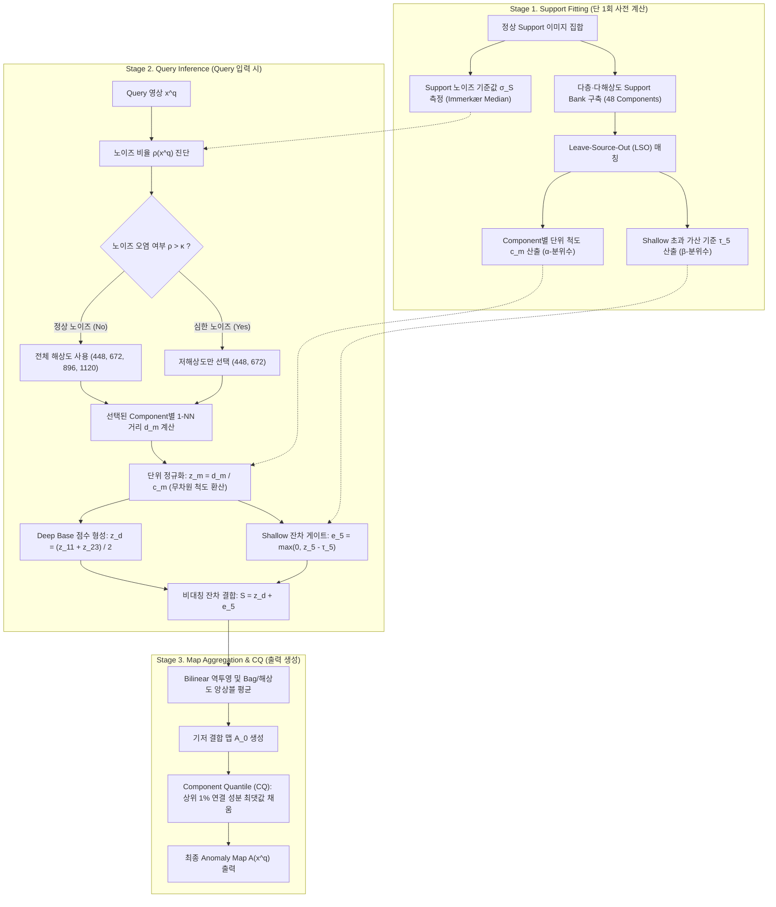
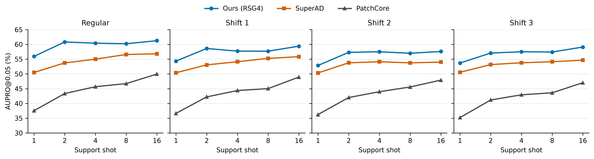

# Support-Calibrated Asymmetric Residual Fusion for Few-Shot Industrial Anomaly Detection

> 논문의 중심 질문: 소수 정상 reference에서 큰 거리의 원인이 모호할 때, 서로 다른 표현의 최근접 거리 중 어느 반응을 이상 점수에 얼마나 반영할 것인가?

## Index

- Abstract
- 1. Introduction

  - 1.1. 소수 정상 reference와 거리 해석의 모호성
  - 1.2. 다층·다해상도 관측의 결합과 기술적 과제
  - 1.3. (SCARF) Support-Calibrated Asymmetric Residual Fusion과 기여
- 2. Method

  - 2.1. 문제 재정의와 공통 설계 규칙
  - 2.2. 다층·다해상도 정상 support bank
  - 2.3. Scale calibration: support 기준 component 단위 (Axis 1: Scale)
  - 2.4. Contribution control: 비대칭 초과량 결합 (Axis 2: Layer)
  - 2.5. Resolution reliability: support 기준 해상도 적응 제어 (Axis 3: Resolution)
  - 2.6. Anomaly map 통합 및 Component Quantile (CQ)
  - 2.7. 구현 세부
- 3. Experiments

  - 3.1. 비교 조건과 측정 지표
  - 3.2. 기존 논문 방법 비교와 정상 support 수·획득 조건
  - 3.3. Ablation Study: 구성 요소별 소거 분석 및 기여도 분해
  - 3.4. 노이즈 조건과 해상도 선택
  - 3.5. 정성 분석
  - 3.6. 실험 진행 상태와 결과 확정 조건
- 4. Discussion & Conclusion

## Abstract

산업 이상 탐지에서는 새로운 제품을 소수의 정상 이미지로 검사해야 한다. 동결된 백본의 patch를 정상 reference와 매칭하는 방법은 재학습 비용을 줄이지만, 큰 최근접 거리는 결함뿐 아니라 support에 포함되지 않은 정상 변동이나 촬영 조건 변화에서도 발생한다. 여러 layer·해상도에서 거리를 얻으면 관측 범위는 넓어지지만, component마다 정상 거리의 크기가 다르고 shallow 반응을 항상 더하면 정상 수준의 반응도 anomaly map에 누적된다. 본 논문은 **Support-Calibrated Asymmetric Residual Fusion**을 제안한다. 이 방법은 큰 거리의 원인을 판별하는 대신, 각 반응을 같은 반응이 정상 support에서 보이는 분포에 비추어 읽는다. 구체적으로 정상 support의 leave-source-out 최근접 거리에서 component별 upper-tail 분위수로 상대적 단위를 정하고, deep score를 기본값으로 유지하면서 정규화된 shallow score가 정상 상위 분위수 기준을 넘는 초과량만 연속적으로 더한다. 동일한 support·백본·해상도·bank·후처리를 사용한 MVTec AD 2 16-shot 개발 비교에서 이 결합은 shallow 전체 가산보다 AUPRO@0.05가 **5.13pp**, MAD scale을 사용한 residual 결합보다 **1.66pp** 높았다. Deep-only 대비 차이는 **+0.47pp**로 작아 shallow의 독립적인 순이득은 확립되지 않았다. 동일 support와 DINOv2 ViT-L/14를 사용한 SuperAD와의 전체 파이프라인 비교에서는 AUPRO@0.05가 **4.47pp**, pAUROC@0.05가 **0.70pp** 높고 oracle F1은 **2.18pp** 낮았다. 공식 MVTec AD 2 private 평가에서 AUPRO@0.05는 TESTpriv **64.80%**, TESTpriv,mix **62.49%**였다. 같은 support 기준 비율을 입력 노이즈 추정치에 적용해, support보다 노이즈가 뚜렷이 큰 query에서는 고해상도 경로를 제외한다.

## 1. Introduction

### 1.1. 소수 정상 reference와 거리 해석의 모호성

- **소수 정상 이미지에 기반한 검사**: 다품종 소량 생산과 빈번한 라인 전환에서는 제품마다 충분한 결함 데이터를 모으거나 모델을 다시 학습하기 어렵다. 동결된 시각 백본과 소수의 정상 이미지로 만든 reference bank를 사용하면, 별도 재학습 없이 query patch가 관측된 정상 patch에서 얼마나 떨어져 있는지 측정할 수 있다.
- **획득 조건 변화(Distribution Shift)와 거리 해석의 모호성**: 소수의 정상 reference는 실제 생산 라인에서 발생하는 조명 드리프트, 부품 자세 변경, 표면 난반사, 센서 노이즈 같은 **획득 조건의 변화(distribution shift)**를 모두 대변하지 못한다. 따라서 결함이 없는 정상 query patch라도 이러한 환경 변화에 의해 reference bank와의 거리가 크게 벌어질 수 있으며, 이는 실제 결함이 유발하는 큰 거리와 외형상 구별되지 않는다. **즉, 큰 최근접 거리라는 관측만으로는 그 원인이 결함인지, reference에 포함되지 않은 정상적인 조건 변화(shift)인지 확정할 수 없다.** 본 논문은 이처럼 큰 거리값이 이상 후보를 가리키지만 그 원인을 확정하지 못하는 문제를 **High-Score Ambiguity**라고 부른다.
- **저-FPR 검사에서의 파급효과와 점수 제어 방향**: 이러한 모호성은 정상 영역에서 발생한 큰 거리가 오경보(False Alarm)로 직결되게 만든다. 특히 신뢰도가 엄격히 요구되는 저-FPR 검사 영역(예: pAUROC@0.05)에서는 정상 반응의 극단적인 상위 꼬리(extreme upper tail)가 전체 결정 경계를 좌우하므로, 우연한 큰 거리값 하나가 검출 성능을 심각하게 왜곡한다. **따라서 저-FPR 환경에서 오경보를 억제하려면, 소수 support가 설명할 수 있는 정상 수준의 반응은 결합 점수에 누적되지 않도록 차단하고 그 기준선을 명백히 초과한 반응만을 이상 징후로 반영해야 한다.**

### 1.2. 다층·다해상도 관측의 결합과 기술적 과제

Few-shot 검사에서는 support가 극히 제한적이므로 단일 관측의 정보 부족을 극복하기 위해 각 이미지에서 가능한 한 다양한 단서를 확보하는 것이 유리하다. ViT의 각 layer는 서로 다른 추상화 수준의 정보를 담고 있으며([Raghu et al., NeurIPS 2021](https://arxiv.org/abs/2108.08810)), 입력 해상도를 높이면 미세 결함에 대한 공간 표본화 밀도를 높일 수 있다([Damm et al., WACV 2025](https://openaccess.thecvf.com/content/WACV2025/html/Damm_AnomalyDINO_Boosting_Patch-Based_Few-Shot_Anomaly_Detection_with_DINOv2_WACV_2025_paper.html)).

**그러나 관측을 단순히 결합하면, 각 표현에서 나타나는 정상 변동까지 점수에 누적되어 High-Score Ambiguity가 오히려 증폭된다.** 선행 연구들은 feature를 이어 붙이거나(PatchCore; [Roth et al., CVPR 2022](https://openaccess.thecvf.com/content/CVPR2022/html/Roth_Towards_Total_Recall_in_Industrial_Anomaly_Detection_CVPR_2022_paper.html)) 거리 점수를 단순 평균하는 등(SuperAD; [Zhang et al., 2025](https://arxiv.org/abs/2505.19750)) 고정된 결합 규칙을 사용하여, 각 표현의 정상 범위와 무관하게 모든 반응을 결합 점수에 누적한다. 그 결과, 추가된 표현이 미세한 외관 변화에 반응하여 일시적으로 거리가 커진 정상 위치들이 실제 결함 위치만큼 높은 결합 점수를 받게 된다. 실제로 동일한 백본과 support 조건에서 수행한 통제 비교(표 3)에 따르면, component 단위를 맞춘 후에도 shallow score 전체를 단순 가산할 경우 deep score만 사용할 때보다 저-FPR 검출 성능(AUPRO@0.05)이 **4.65pp** 하락했다(54.02% vs. 58.67%).

따라서 다층·다해상도 관측이 High-Score Ambiguity를 증폭시키지 않으려면, 소수 support의 정상 기준선에 비추어 각 표현의 반응을 보정하고 유의미한 초과 단서만을 선별 결합해야 한다. 그러나 별도 학습 없이 소수 정상 데이터만으로 이를 실현하는 과정에서 세 가지 기술적 과제가 발생한다.

1. **표현 간 상위 꼬리 척도의 불일치 (Scale Calibration Problem)**: 저-FPR 환경(AUPRO@0.05)의 판정 임계값은 정상 점수 분포의 **상위 꼬리(upper tail)**에 의해 결정된다. 그러나 layer와 해상도마다 표현 공간의 특성이 달라 정상 거리 척도와 상위 꼬리 두께가 상이하다. 중심 경향성 기반의 일반 표준화로는 이 비대칭 꼬리를 정렬할 수 없어, 꼬리가 두꺼운 특정 표현이 결합 점수를 지배하고 **거짓 높은 점수(false high-score)**를 유발한다. 따라서 **각 표현의 공간적 변별 패턴을 보존한 채, 소수 support의 상위 분위수를 기준으로 거리 척도를 공정하게 정렬해야 한다.**
2. **외관 변화에 따른 얕은 층 정상 반응 누적 (Contribution Control Problem)**: 심층(deep) feature는 조명·반사 등 외관 변화에 상대적으로 덜 민감한 의미 기준선(semantic base)을 제공하는 반면, 얕은 층(shallow) feature는 국소 텍스처에 민감한 대신 환경 변화에도 쉽게 반응한다. 둘을 대칭적으로 합산하면, support에 없는 정상 외관 변화 시 얕은 층의 일상적 변동이 누적되어 결함 후보 영역을 오염시킨다. 따라서 **외관 변화에 강건한 deep 표현을 기본 탐지 축으로 삼고, shallow 표현은 support의 정상 범위를 초과했을 때만 국소적 잔차 단서(residual evidence)로 선별 반영하는 비대칭 결합**이 요구된다.
3. **고주파 영상 변동에 따른 고해상도 신뢰성 저하 (Resolution Reliability Problem)**: 기본 해상도 관측이 거시적 형태를 안정적으로 유지하는 기준선이 되는 반면, 고해상도 관측은 미세 결함에 대한 표본화 밀도를 높여주는 대신 센서 노이즈 등 고주파 영상 변동에 민감하다. 둘을 무조건 결합하면 노이즈 환경에서 고해상도 경로의 왜곡된 반응이 결합 점수를 지배하여 오경보를 유발한다. 따라서 **기본 해상도의 안정성을 유지하되, 고해상도 관측은 query의 고주파 상태가 support의 정상 범위 내에 있을 때만 선별 반영하는 적응적 해상도 제어**가 요구된다.

이 세 가지 과제는 **소수 정상 support의 기준선 대비 얼마나 벗어났는가라는 상대적 비율(support-referenced ratio)로 모든 신호를 통일된 기준으로 읽고 제어한다**는 공통 설계 규칙 아래 하나의 유기적인 프레임워크로 통합된다.

### 1.3. (SCARF) Support-Calibrated Asymmetric Residual Fusion 와 기여

본 논문은 High-Score Ambiguity를 해소하기 위해 다층·다해상도로 관측을 확장하되, 이를 단순 결합하지 않고 소수 support의 정상 기준선에 맞추어 선별 통합하는 **Support-Calibrated Asymmetric Residual Fusion (Ours)**을 제안한다. 추가 학습 없이 **"소수 정상 support의 기준선 대비 상대적 비율(support-referenced ratio)"**이라는 공통 설계 규칙을 관철하여, 다양한 획득 조건 변화(distribution shift) 속에서도 정상 위치의 거짓 높은 점수를 억제한다. 본 연구의 주요 기여는 다음과 같다.

1. **결합 과정의 정상 반응 누적 메커니즘 진단**: Few-shot patch matching에서 복수의 표현을 고정 규칙으로 단순 결합할 경우, 각 표현의 정상 수준 반응이 결합 점수의 상위 꼬리에 누적되어 저-FPR localization 성능이 저하됨을 규명했다. 동일 조건의 16-shot 통제 비교에서 shallow score 전체를 단순 가산한 구성은 deep score 단일 구성 대비 AUPRO@0.05가 **4.65pp** 하락함을 확인했다.
2. **Support 기준 비율에 기반한 학습 없는 통합 결합 방법**: 세 가지 과제를 관통하는 단일한 support-referenced ratio 규칙을 기반으로, 추가 학습 없이 소수 support만으로 동작하는 결합 파이프라인을 구축했다. (i) Support의 leave-source-out 최근접 거리 상위 분위수로 거리를 나누어 단위를 일치시키고(Scale Calibration), (ii) deep score를 기본 축으로 삼고 shallow score가 정상 기준선을 초과한 잔차만 선별 반영하며(Contribution Control), (iii) support 대비 입력 노이즈 비율에 따라 query별 해상도 반영 여부를 결정한다(Resolution Reliability).
3. **Few-shot 및 획득 변동 전반에서의 포괄적 실증**: MVTec AD 2의 1–16 shot 전 구간과 모든 획득 조건(Regular, Shift 1·2·3)에서 기존 최고 수준 방법들을 일관되게 상회했다. 16-shot AUPRO@0.05 기준 59.63%를 기록하여 AnomalyDINO 대비 **+15.27pp**, SubspaceAD 대비 **+20.09pp**, SuperAD 대비 **+4.47pp**, PatchCore 대비 **+10.47pp** 향상되었으며, 공식 blind private 평가에서도 TESTpriv 64.80%, TESTpriv,mix 62.49%를 달성했다. 아울러 요인별 ablation(§3.3)을 통해 비대칭 결합(+5.13pp)과 분위수 척도 보정(+1.66pp)의 개별적 유효성을 실증했다.

## 2. Method

### 2.1. 문제 재정의와 공통 설계 규칙 (Overview & Core Principle)

**문제 전제와 방법론 설계 목표**

- **전제 (High-Score Ambiguity, §1.1)**: 소수 support 환경에서는 큰 최근접 거리의 원인(실제 결함 vs. support에 미포함된 정상 변동)을 개별 query 관측만으로 확정할 수 없다.
- **핵심 목표 (결함 탐지 시너지 실현)**: 따라서 SCARF는 불확실한 원인 판별 대신, support가 설명하는 정상 수준 반응의 점수 누적을 통제하고 **각 표현이 정상 기준선을 넘어선 순수 초과 단서만을 선택 결합하여 다관측 시너지를 안전하게 실현**하는 것을 목표로 한다.
- **평가와의 연결**: 저-FPR 평가(AUPRO@0.05)의 결정 경계는 정상 반응의 상위 꼬리에 의해 좌우되므로, 정상 수준 신호의 누적을 억제하고 기준 초과량만 반영하는 이 설계는 평가 요구조건에 직접 부합한다.

**SCARF의 직관적 3단계 파이프라인 (3-Stage Workflow)**

제안하는 **SCARF (Support-Calibrated Asymmetric Residual Fusion)**는 추가 학습이나 복잡한 최적화 없이, 소수 support 정상 데이터만을 기준으로 동작하는 3단계 통합 파이프라인으로 구성된다.



**공통 설계 규칙: support-referenced ratio**

SCARF의 세 가지 구성 요소(단위 정규화, 얕은 층 초과량 가산, 해상도 선택)는 개별적인 휴리스틱이 아니라, **"임의의 관측치를 support 정상 분포의 기준 분위수 대비 배율로 읽는다"**는 단 하나의 공통 설계 규칙 아래 유기적으로 통합된다.

$$
\mathcal T_q[t] = \frac{t}{Q_q\!\left(\mathcal N_S[t]\right)}
$$

- $\mathcal N_S[t]$: Support 이미지 집합 내부에서 산출된 통계량 $t$의 정상 기준 분포. "처음 보는 정상 이미지가 들어왔을 때 나타나는 분포"를 모사하기 위해 leave-source-out 또는 support 간 통계로 구성한다.
- $Q_q(\cdot)$: 해당 분포의 $q$-분위수(Quantile).
- 동일한 연산자 $\mathcal T_q[t]$를 분위수 $q$와 통계량 $t$만 바꾸어 §1.2에서 제기된 3대 기술적 과제에 일관되게 적용한다.

| 적용 축                                                | 통계량$t$             |   분위수$q$   | 결정 메커니즘                                                   | 물리적 직관 및 대응 과제 (§1.2)                                               |  절  |
| :----------------------------------------------------- | :---------------------- | :--------------: | :-------------------------------------------------------------- | :----------------------------------------------------------------------------- | :---: |
| **척도 축 (Scale)**Scale Calibration             | 최근접 거리$d_m$      |    $\alpha$    | $z_m = \mathcal T_\alpha[d_m] = \frac{d_m}{c_m}$              | 임의 거리를 "정상 변동 상위 꼬리 대비 몇 배인가"의 무차원 단위로 환산 (과제 1) | §2.3 |
| **계층 축 (Layer)**Contribution Control          | Shallow 거리$d_5$     |    $\beta$    | $e_5 = \left[\mathcal T_\beta[d_5] - 1\right]_+ \cdot \tau_5$ | 정상 한계를 넘어선 순수 초과량만 잔차로 반영 (과제 2)                          | §2.4 |
| **해상도 축 (Resolution)**Resolution Reliability | 고주파 노이즈$\sigma$ | $0.5$ (median) | $\mathcal T_{0.5}[\sigma] > \kappa$ 시 고해상도 배제          | 입력 영상의 센서 노이즈가 정상 범위를 초과할 때 고해상도 오염 차단 (과제 3)    | §2.5 |

- **Label 사용 및 학습 불필요성**: 모든 기준값($c_m, \tau_5, \sigma_S$)은 정상 support 이미지만으로 사전 계산된다. Query의 정답 mask나 결함 레이블은 기준치 설정에 일체 사용되지 않으며, 테스트 시점의 파라미터 업데이트나 메모리 갱신도 없다.

**그림 1. SCARF의 support 보정과 query 추론 흐름.** 정상 support로 feature bank, component별 scale, shallow 가산 기준, 입력 노이즈 기준을 한 번 정한다. Query에서는 노이즈 비율에 따라 해상도를 선택하고, 선택된 component의 최근접 거리를 정규화한 뒤 deep base에 shallow 기준 초과량만 더한다. 각 score를 원본 크기로 투영·평균하고 CQ를 적용해 anomaly map을 얻는다. 점선 화살표는 query 단계에서 고정해 사용하는 support 산출물을 뜻한다.

---

### 2.2. 다층·다해상도 정상 Support Bank

**역할**: 결합의 기초 신호가 되는 최근접 거리 $d_m$을 측정하고, 각 표현의 정상 기준 분포를 생성하기 위한 다면적 관측 저장소를 구축한다.

**구성 요소의 직관적 설계**

1. **다층(Multi-Layer) 축 — $\mathcal L = \{5, 11, 23\}$**:
   - ViT의 표현 계층은 깊이에 따라 포착하는 정보의 물리적 특성이 상이하다([Raghu et al., NeurIPS 2021](https://arxiv.org/abs/2108.08810)).
   - **Layer 5 (Shallow)**: 패치 내 미세한 국소 질감(texture), 긁힘, 미세 경계에 민감하다. 반면 조명이나 반사 등 외관 변화(appearance shift)에도 반응하기 쉽다.
   - **Layer 11 (Mid-Deep)**: 부품의 국소적 형태 및 부분 패턴 정보를 안정적으로 포착한다.
   - **Layer 23 (Deep)**: 고수준의 의미론적(semantic) 정보와 거시적 구조를 담고 있으며, 조명이나 색상 변동에 대해 상대적으로 높은 강건성(robustness)을 가진다.
2. **다해상도(Multi-Resolution) 축 — $\mathcal R = \{448, 672, 896, 1120\}$**:
   - 패치 크기가 $14 \times 14$로 고정되어 있으므로, 입력 영상의 해상도가 높아질수록 토큰 하나가 커버하는 원본 영상의 공간 면적이 좁아진다(토큰 격자: 448 해상도 기준 $32 \times 32 \rightarrow$ 1120 해상도 기준 $80 \times 80$).
   - 저해상도(448)는 영상 전반의 거시적 이상을 안정적으로 감지하며 고주파 노이즈에 둔감하다.
   - 고해상도(1120)는 작은 점 결함이나 미세 균열에 대한 공간 표본화 밀도를 높인다([Damm et al., WACV 2025](https://openaccess.thecvf.com/content/WACV2025/html/Damm_AnomalyDINO_Boosting_Patch-Based_Few-Shot_Anomaly_Detection_with_DINOv2_WACV_2025_paper.html)).
3. **독립 Bag 표본화(Bagging)**:
   - Few-shot 환경이라도 고해상도 영상의 모든 토큰을 bank에 저장하면 메모리와 1-NN 탐색 시간이 크게 증가한다.
   - 연산 효율을 확보하고 특정 패치 표본에 대한 편향을 방지하기 위해, 각 support 이미지에서 최대 256개 위치를 무작위 비복원 표본화하여 Bag을 구성한다.
   - 해상도마다 4개의 독립적인 무작위 Bag($b \in \{1, 2, 3, 4\}$)을 구성하며, 세 layer는 동일한 공간 위치의 토큰을 공유하여 표현 간 순수한 계층 차이만을 반영하도록 설계한다.
   - 16-shot 기준 layer당 최대 $16 \times 256 = 4,096$개 토큰이 하나의 Bag bank $B_{l,r,b}$를 형성한다.
4. **Component 정의**:
   - Layer $l$, 해상도 $r$, Bag $b$의 단일 조합을 하나의 독립 관측 단위인 **Component** $m = (l, r, b)$로 정의한다 (총 $3 \times 4 \times 4 = 48$개).

**1-NN 최근접 거리 계산**

Query 영상 $x^q$의 위치 $p$에서 추출된 L2 정규화 feature $f_{l,r}(x^q, p)$와 해당 Bank $B_{l,r,b}$ 사이의 최근접 코사인 거리를 계산한다.

$$
d_{l,r,b}(x^q, p) = \min_{u \in B_{l,r,b}} \left[ 1 - f_{l,r}(x^q, p)^\top u \right]
$$

- **독립적 매칭의 원칙**: 여러 layer의 feature를 임의로 이어 붙이지 않고, 각 layer 고유의 표현 공간에서 가장 가까운 정상 이웃을 독립적으로 탐색한다. 결합의 대상은 '공유된 이웃'이 아니라 '각 관측 공간에서 평가된 이상 거리'이다.

---

### 2.3. Scale Calibration: Support 기준 분위수 정규화 (Axis 1: Component Scale)

**해결하는 문제 (§1.2, 과제 1)**

- 48개 component의 거리 $d_m$은 표현 공간의 차원 구조, 토큰의 의미론적 깊이, 해상도에 따라 거리의 절대적 규모(scale)와 상위 꼬리 분포가 상이하다.
- 예컨대 Layer 23의 정상 거리가 평균 0.6이고 Layer 5의 정상 거리가 평균 0.2라면, 단순 가산 시 Layer 23이 결합 점수의 대부분을 차지하게 된다. 또한 상위 꼬리가 두꺼운 특정 표현에서 우연히 발생한 큰 정상 거리가 전체 오경보를 유발한다.

**메커니즘: Leave-Source-Out (LSO) 정상 기준 분포와 단위 $c_m$**

1. **Leave-Source-Out (LSO) 시뮬레이션**:
   - Support 이미지 내부의 토큰을 자신이 포함된 뱅크와 매칭하면 거리가 $0$이 되어 정상 변동의 크기를 과소추정하게 된다.
   - Query는 뱅크에 포함되지 않은 '새로운 정상 영상'으로 주어지므로, support 데이터 안에서도 동일하게 **"특정 support 이미지 $x_i^s$의 토큰을 자기 자신을 제외한 나머지 support 이미지들로 구성된 뱅크와 매칭"**하는 Leave-Source-Out 절차를 거친다.
   - 이를 통해 실제 테스트 환경에서 마주할 '정상 이미지 간의 변동 분포' $\mathcal N_S[d_m] = D_m^{\mathrm{LSO}}$를 support 집합 내에서 충실하게 모사한다.
2. **단위 척도 $c_m$과 무차원 정규화 점수 $z_m$**:
   - 공통 설계 규칙을 척도 축에 적용하여, 정상 LSO 거리 분포의 $\alpha$-분위수(예: $\alpha = 0.90$)를 해당 component의 고유 단위 척도 $c_m$으로 정의한다.

$$
c_m = Q_\alpha\!\left(D_m^{\mathrm{LSO}}\right), \qquad z_m(x^q, p) = \mathcal T_\alpha[d_m] = \frac{d_m(x^q, p)}{c_m}
$$

**물리적 성질과 직관적 의미**

- **물리적 무차원화 (Dimensionless Ratio)**: $z_m(x^q, p) = 1.0$은 "해당 위치의 거리가 정상 제품 간 변동의 상위 $(1-\alpha)$ 지점에 해당한다"는 명확한 물리적 단위를 부여한다.
- **상위 꼬리의 일관된 정렬**: 48개 component 모두에서 정상 토큰 중 $z_m > 1.0$을 초과하는 비율이 약 $1-\alpha$로 균일하게 통제된다. 특정 계층이나 해상도가 결합 점수를 부당하게 독점하는 현상이 체계적으로 방지된다.
- **공간 순위의 보존**: 양의 스칼라 $c_m$으로 나누는 선형 변환이므로, 각 표현이 지닌 고유한 이상 패턴의 공간적 상대 순위(ranking)가 왜곡 없이 보존된다.

---

### 2.4. Contribution Control: 비대칭 초과량 결합 (Axis 2: Layer Contribution)

**해결하는 문제 (§1.2, 과제 2)**

- 단위를 일치시킨 정규화 점수 $z_m$을 얻었더라도, 모든 layer를 단순히 더하는 대칭적 가산(Symmetric Addition)은 오경보를 증가시킨다.
- Deep feature(Layer 11, 23)는 조명이나 반사 등 정상적인 외관 변동에 비교적 안정적인 반면, Shallow feature(Layer 5)는 정상적인 표면 텍스처 변동에도 쉽게 반응한다.
- 둘을 무조건 더하면 정상 배경 전체에 얕은 층의 일상적인 텍스처 반응이 누적되어, 통제된 16-shot 실험에서 보듯 저-FPR 성능이 deep-only 대비 **4.65pp 하락**함을 확인했다(표 3, 54.02% vs. 58.67%).

**메커니즘: Anchor & Residual 비대칭 결합**

SCARF는 공통 설계 규칙을 계층 축에 적용하여, 외관 변화에 안정적인 심층 레이어를 **판정의 뼈대(Deep Base Anchor)**로 삼고, 얕은 층 레이어는 **정상 범위를 넘어선 순수 초과량만을 덧붙이는 잔차(Residual Booster)**로 취급한다.

```
       [ Deep Base (Layer 11, 23) ]   ───────────► 항상 기본 점수로 반영 (안정적 뼈대)
                                                            +
       [ Shallow Layer (Layer 5)  ] ──► [초과량 게이트] ──► 기준선 초과분만 조건부 가산
                                        [z_5 - τ_5]_+
```

1. **Deep Base 점수 ($z_d$)**:
   - 해상도 $r$, Bag $b$에서 Layer 11과 Layer 23의 정규화 점수를 평균하여 안정적인 거시적 기준선을 형성한다.

$$
z_{d,r,b}(p) = \frac{z_{11,r,b}(p) + z_{23,r,b}(p)}{2}
$$

2. **Shallow 초과 가산 기준선 ($\tau_5$)**:
   - Shallow 점수 $z_5$가 정상 LSO 분포의 $\beta$-분위수($\beta > \alpha$, 예: $\beta = 0.98$)를 초과할 때만 가산을 허용한다. 이를 $\alpha$-정규화 척도로 환산한 기준값 $\tau_5$는 다음과 같다.

$$
\tau_{5,r,b} = \frac{Q_\beta\!\left(D_{5,r,b}^{\mathrm{LSO}}\right)}{c_{5,r,b}} \quad (\beta > \alpha \implies \tau_5 \ge 1.0)
$$

3. **연속적 초과량(ReLU형) 가산**:
   - 기준선을 넘는 순간 점수가 급격히 변하는 계단형 스위치 대신, 기준선을 초과한 크기에 비례하여 매끄럽게 더해지는 단조 연속 함수를 적용한다.

$$
e_{5,r,b}(p) = \left[ z_{5,r,b}(p) - \tau_{5,r,b} \right]_+ = \max\!\left(0, \; z_{5,r,b}(p) - \tau_{5,r,b}\right)
$$

$$
S_{r,b}(p) = z_{d,r,b}(p) + e_{5,r,b}(p)
$$

**위치별 동작과 직관적 해석**

- **정상 배경 영역 ($z_5 \le \tau_5$)**: $e_5 = 0$이 되므로 최종 점수는 순수하게 Deep Base 점수와 일치한다($S = z_d$). 얕은 층의 정상 텍스처 변동이 결합 점수에 가산되지 않아 오경보가 효과적으로 억제된다.
- **미세 결함 발생 영역 ($z_5 > \tau_5$, $z_d$ 낮음)**: 딥 레이어가 약하게 반응하는 미세한 긁힘이나 얼룩에 대해, 정상 기준선을 넘은 순수 이상 반응 $e_5$가 Deep Base 위에 가산되어 결함 단서를 보강한다.
- **뚜렷한 대형 결함 영역 ($z_5 > \tau_5$, $z_d$ 높음)**: Deep Base와 Shallow 잔차가 함께 반영되어 명확하게 높은 이상 점수를 형성한다.
- **추가 하이퍼파라미터 배제**: 초과량 $e_5$의 가산 계수는 1이다. $z$와 $\tau$가 이미 support 정상 변동 단위($c_m$)로 환산되어 있으므로, 인위적인 결합 가중치 튜닝 없이도 일관된 결합이 성립한다.

---

### 2.5. Resolution Reliability: Support 기준 해상도 적응 제어 (Axis 3: Resolution Reliability)

**해결하는 문제 (§1.2, 과제 3)**

- Few-shot 다관측 결합의 3대 자유도는 (1) 거리 척도(Component Scale), (2) 표현 계층(Layer Depth), (3) 공간 표본 밀도(Spatial Resolution)이다.
- 고해상도($r \in \{896, 1120\}$) 관측은 작은 결함의 공간 표본화 밀도를 높여주지만, 토큰 하나가 커버하는 원본 픽셀 면적이 좁아 센서 노이즈 등 고주파 영상 변동이 발생할 때 노이즈가 feature 공간에 민감하게 반영된다.
- 노이즈가 심한 환경에서 고해상도 뱅크를 결합하면, 왜곡된 거리가 정상 영역의 점수를 지배하여 오경보가 증가한다.

**설계 철학: 계층 축과 해상도 축의 구조적 대칭성**

SCARF는 별도의 외부 분류기나 복잡한 라우팅 네트워크를 도입하지 않고, §2.1의 공통 설계 규칙인 `support-referenced ratio`를 해상도 축에 동일하게 적용한다. 이는 계층 축(§2.4)의 비대칭 잔차 게이트와 완벽한 개념적 대칭을 이룬다:

1. **계층 축 (Layer Axis, §2.4)**:
   - *안정적 기준선 (Base)*: 외관 변화에 안정적인 심층 레이어(11, 23) 점수 $z_d$.
   - *조건부 확장 관측 (Expansion)*: 국소 질감에 민감한 천층 레이어(5).
   - *Support 기준 게이트*: $\mathcal T_\beta[d_5] > 1$ (정상 범위 초과 시에만 잔차 가산, 정상 범위 내에서는 기여도 0).
2. **해상도 축 (Resolution Axis, §2.5)**:
   - *안정적 기준선 (Base)*: 고주파 잡음에 강건한 기본 해상도 $\{448, 672\}$.
   - *조건부 확장 관측 (Expansion)*: 공간 표본화 밀도를 극대화하는 고해상도 $\{896, 1120\}$.
   - *Support 기준 게이트*: $\mathcal T_{0.5}[\sigma] \le \kappa$ (입력 노이즈가 support 정상 범위 내일 때만 고해상도 결합, 정상 범위를 초과하면 기여도 0).

이처럼 두 축은 **"신뢰할 수 있는 기저 관측(base) 위에, 잡음에 민감하지만 미세 단서를 제공하는 확장 관측(shallow / high-res)을 support 정상 기준선에 맞추어 조건부로 제어한다"**는 단일한 설계 철학 아래 통합된다.

**메커니즘: Support 기준 상대 노이즈 비율에 따른 적응 선택**

1. **구조 무관 고주파 노이즈 추정 ($\sigma$)**:
   - 영상의 물체 경계선이나 질감에는 반응하지 않고 순수 고주파 센서 노이즈만을 신속하게 분리하기 위해 $3 \times 3$ Immerkær 라플라시안 커널 $M = \left[\begin{smallmatrix}1&-2&1\\-2&4&-2\\1&-2&1\end{smallmatrix}\right]$을 사용한다.
   - Grayscale 영상에 대한 빠른 공간 필터링으로 노이즈 표준편차 $\sigma(x)$를 산출한다.

$$
\sigma(x) = \sqrt{\frac{\pi}{2}} \, \frac{1}{6(W-2)(H-2)} \sum_{i,j} \left| (x * M)(i,j) \right|
$$

2. **Support 기준 노이즈 비율 ($\rho$)**:
   - 절대적인 노이즈 수치는 제품 재질과 촬영 장비에 따라 상이하므로, support 정상 영상들의 노이즈 중앙값 $\sigma_S = \operatorname{median}(\{\sigma(x_i^s)\}_{i=1}^N)$을 고유한 기준선으로 삼는다.
   - 공통 설계 규칙을 노이즈 통계량에 적용하여 상대 노이즈 비율 $\rho(x^q)$를 산출한다.

$$
\rho(x^q) = \mathcal T_{0.5}[\sigma(x^q)] = \frac{\sigma(x^q)}{\sigma_S}
$$

3. **신뢰 해상도 집합 $\mathcal R(x^q)$의 결정**:
   - 사전에 고정된 노이즈 허용 한계 $\kappa$에 따라 최종 결합에 참여할 해상도 집합 $\mathcal R(x^q)$를 결정한다.

$$
\mathcal R(x^q) = 
\begin{cases}
\{448, 672\}, & \rho(x^q) > \kappa \quad (\text{고주파 노이즈 환경: 고해상도 배제}) \\
\{448, 672, 896, 1120\}, & \text{otherwise} \quad (\text{정상 환경: 전 해상도 활용})
\end{cases}
$$

**결합 메커니즘으로서의 일체성**

- **추가 학습 및 재계산 없음**: 선택된 해상도 $\mathcal R(x^q)$에 속한 모든 component는 이미 §2.2의 bank와 §2.3의 척도 단위($c_m$), §2.4의 비대칭 잔차 규칙($S_{r,b}$)이 완전히 준비되어 있다. 해상도 제어는 단지 후속 §2.6의 앙상블 평균에서 유효한 해상도 인덱스를 선별하는 역할을 수행할 뿐, 새로운 파라미터나 분리된 2단계 파이프라인을 형성하지 않는다.
- **물리적 안전성**: 일반적인 환경($\rho \le \kappa$)에서는 4개 해상도를 모두 활용하여 미세 결함 탐지력을 유지하고, 노이즈가 비정상적으로 심한 환경($\rho > \kappa$)에서는 고해상도를 배제한다. 저해상도로 리사이즈하는 과정에서 다운샘플링 안티앨리어싱(antialiasing) 필터가 고주파 노이즈를 자연스럽게 감쇠하기 때문이다.

---

### 2.6. Anomaly Map 통합 및 Component Quantile (CQ) (Map Aggregation & Contrast Enhancement)

3대 축(척도, 계층, 해상도)의 support 기준 통제가 완료되면, 유효한 다관측 점수들을 공간적으로 통합하여 최종 이상치 맵을 생성한다.

**Step 1. 다해상도 역투영 및 앙상블 평균 (Bilinear Upsampling & Averaging)**

- 각 해상도 $r$과 Bag $b$에서 계산된 토큰 격자 점수 $S_{r,b}$를 bilinear 보간을 통해 원본 영상 해상도 $H \times W$로 업샘플링한다.
- 4개 Bag 점수를 평균하여 표본화 분산을 줄인 뒤, §2.5에서 결정된 신뢰 해상도 집합 $\mathcal R(x^q)$에 대해 균등 평균하여 기저 이상치 맵 $A_0(x^q)$를 생성한다.

$$
A_0(x^q) = \frac{1}{|\mathcal R(x^q)|} \sum_{r \in \mathcal R(x^q)} \left[ \frac{1}{4} \sum_{b=1}^{4} \operatorname{Up}_{H,W}\!\left(S_{r,b}\right) \right]
$$

- 모든 해상도의 점수가 §2.3에서 이미 support 기준 단위($c_m$)로 일치되어 있으므로, 추가적인 해상도 간 가중치 튜닝 없이 단순 평균하는 것만으로 안정적인 다해상도 통합을 달성한다.

**Step 2. Component Quantile (CQ) 영역 응집성 보강**

- **필요성**: 패치 기반 최근접 거리는 결함 내부의 질감이나 경계 특성에 따라 결함 영역 내부에서도 국소적으로 점수가 불균일하거나 작은 구멍(hole)이 형성될 수 있다.
- **영역 단위 보강 메커니즘**:
  1. 기저 맵 $A_0(x^q)$ 자체의 상위 99백분위수($Q_{0.99}$) 이상인 픽셀들을 추출하여 고점수 바이너리 마스크를 생성한다.
  2. 마스크 내에서 8-연결(8-connected) 성분들을 개별 결함 후보 덩어리로 분리한다.
  3. 각 연결 성분 내부의 모든 픽셀 값을 해당 성분이 가진 **최댓값(maximum)**으로 균일하게 채워 넣는다.
  4. 마스크 외부의 배경 픽셀 값은 원래의 $A_0$ 값을 그대로 유지하여 최종 이상치 맵 $A(x^q)$를 완성한다.
- **효과**: 마스크 외부 픽셀들 간의 순위 및 내부와 외부 간의 경계 순위는 유지하면서, 결함 덩어리 내부를 응집력 있게 채워 저-FPR(특히 영역 중첩도를 평가하는 AUPRO) 국소화 정확도를 개선한다.
- **최종 출력**:
  - Pixel-level Localization: 최종 맵 $A(x^q) \in \mathbb R^{H \times W}$.
  - Image-level Detection: 전체 영상의 최댓값 $\max_p A(p)$ (CQ 전후의 전체 최댓값은 $\max_p A_0(p)$와 동일하므로 CQ의 영향을 받지 않는 순수한 전역 지표임).

---

### 2.7. 구현 세부 및 안정성 설계 (Implementation Details)

- **수치적 하한 (Numerical Stability)**: 영분모 방지를 위해 모든 단위 척도 $c_m$과 노이즈 분모에는 $\max(c_m, 10^{-4})$, $\max(\sigma_S, 10^{-12})$의 수치 하한을 적용한다.
- **1-Shot 극한 환경의 기준 분포 (Leave-Token-Out)**:
  - Support 이미지가 1장뿐인 1-shot 환경에서는 제외할 다른 support 이미지가 존재하지 않는다.
  - 따라서 1-shot에서는 동일 이미지 내에서 **자기 자신 토큰만을 제외한 나머지 토큰 뱅크와 매칭(Leave-Token-Out)**하여 $D_m$을 형성한다. 이를 통해 1-shot에서도 완결된 자체 교정 분포를 수립한다.
- **전처리 및 보간**: 모든 영상 리사이즈에는 antialiasing이 활성화된 Bicubic 보간을 사용하며, 격자 점수 업샘플링에는 Bilinear 보간을 적용한다.
- **재현성 보장**: Bag 표본화와 난수 생성은 고정된 시드(seed) 시퀀스를 따르며, 모든 실험은 결정론적으로 재현된다.

## 3. Experiments

### 3.1. 비교 조건과 측정 지표

- **주 평가**: MVTec AD 2의 8개 클래스, 정상 support 1/2/4/8/16장, `test_public`의 동일 query·평가 계약을 사용한다. 이 split은 개발 평가에 이미 사용되었으므로 최종 미사용 평가로 부르지 않으며, RSG4 설정은 고정한 뒤 blind private 평가(표 1a)로 보완한다. Ours는 §2의 **RSG4** 전체 구성이다. 별도로 확보한 공식 `test_private`·`test_private_mixed` 결과는 표 1a에 제시한다. few-shot 주 비교군(표 1)은 PatchCore, AnomalyDINO, FastRecon, RegAD, RAD, SuperAD이며 SubspaceAD는 추가 후보로 검토한다. 모두 동일 support·`test_public`·evaluator로 재실행하며, 결과가 확보되지 않은 칸은 `—`로 둔다. 전체 정상 데이터를 사용하는 방법은 few-shot 비교와 분리해 ReFP-AD를 `test_public` full-data 참고(표 1b)로, RoBiS·SuperADD 등을 private 평가(표 1a)로 제시한다. 내부에서 시험한 별도 방법·변형은 외부 비교 표에 넣지 않는다.
- **비교 통제**: 가능한 경우 같은 support 이미지, query와 evaluator를 사용한다. 기존 방법은 원래의 scoring 설정을 유지하므로 layer·해상도·후처리까지 동일한 방법 단위 ablation으로 해석하지 않는다. 백본이 다른 결과는 별도 블록으로 표시한다. 방법 요소의 효과는 같은 백본·support·bank·후처리를 사용한 §3.3과 §3.4의 ablation에서만 논한다.
- **지표와 표기**: Pixel-level 주 지표는 클래스 macro AUPRO@0.05이고, pAUROC@0.05와 image-level I-AUROC를 보조 지표로 둔다. AUPRO@0.05는 FPR 0–5% 구간에서 결함 영역 overlap을 적분하므로, 정상 pixel score의 상위 꼬리가 만드는 오경보가 작은 결함 검출에 미치는 영향(§1.1)을 직접 반영한다. SegF1·ClassF1은 모든 방법에 support만 사용하는 동일 임계값 규칙을 적용한다. F1-oracle은 query label로 임계값을 고르는 진단 지표이며 실제 운영 임계값 성능이 아니다. 모든 표의 수치는 백분율(%)이고 `—`는 해당 계약의 결과가 아직 없다는 뜻이다. 서로 다른 클래스 범위나 평가 조건의 수치는 같은 열에서 직접 순위화하지 않는다.

### 3.2. 기존 논문 방법 비교와 정상 support 수·획득 조건

**표 1. MVTec AD 2 `test_public` few-shot 비교.** Full 8 classes, 동일 정상 support manifest·query·streaming evaluator. (a) support shot별 AU-PRO@0.05(%), (b) 16-shot 다중 지표(%). 값은 seed 0·1·2 평균 ± 표본 표준편차이며, 같은 seed끼리 support를 맞췄다. `*`는 seed 0 단일 실행값이다. `test_public`은 RSG4 개발에 사용한 split이므로, RSG4 설정은 이후 변경 없이 고정하고 blind 평가는 표 1a에 제시한다. SegF1·ClassF1은 모든 방법에 support만 사용하는 동일 임계값 규칙을 적용하며, 규칙 확정 전까지 `—`로 둔다. `—`는 해당 계약의 결과가 아직 없음을 뜻한다.

(a) Support shot별 AU-PRO@0.05

| 구분      | 방법                         | 게재처           |           1-shot |                  2-shot |           4-shot |           8-shot |                 16-shot |
| :-------- | :--------------------------- | :--------------- | ---------------: | ----------------------: | ---------------: | ---------------: | ----------------------: |
| 학습 없음 | PatchCore                    | CVPR 2022        |           36.78* |           40.07 ± 2.43 |           44.41* |           45.73* |           49.16 ± 0.77 |
|           | AnomalyDINO                  | WACV 2025        |    39.92 ± 2.43 |           42.36 ± 1.24 |    43.40 ± 0.40 |    44.28 ± 0.59 |           44.36 ± 0.27 |
|           | FastRecon (논문 설정 재구현) | ICCV 2023        |    17.96 ± 1.21 |           18.93 ± 1.94 |    20.00 ± 1.51 |    18.09 ± 0.45 |           17.31 ± 1.20 |
|           | RAD                          | ICML 2026        |    23.32 ± 0.26 |           26.85 ± 1.11 |    30.28 ± 0.83 |    32.96 ± 1.60 |           33.54 ± 0.98 |
|           | SubspaceAD†                 | CVPR 2026        |    37.31 ± 1.99 |           38.28 ± 0.70 |    39.22 ± 0.70 |    39.38 ± 0.42 |           39.54 ± 0.34 |
|           | SuperAD‡                    | VAND 2025 보고서 |           49.96* |           50.56 ± 2.37 |           53.68* |           54.73* |           55.16 ± 0.46 |
| 학습 기반 | RegAD                        | ECCV 2022        |               — |                      — |               — |               — |                      — |
| 학습 없음 | **Ours (RSG4)**        | —               | **54.23*** | **55.62 ± 2.70** | **58.36*** | **58.40*** | **59.63 ± 0.80** |

(b) 16-shot 다중 지표

| 방법                         |             AU-PRO@0.05 |             pAUROC@0.05 |                 I-AUROC | SegF1 | ClassF1 |
| :--------------------------- | ----------------------: | ----------------------: | ----------------------: | ----: | ------: |
| PatchCore                    |           49.16 ± 0.77 |           70.87 ± 0.33 |           71.33 ± 0.93 |    — |      — |
| AnomalyDINO                  |           44.36 ± 0.27 |           75.10 ± 0.17 |           74.59 ± 1.47 |    — |      — |
| FastRecon (논문 설정 재구현) |           17.31 ± 1.20 |           60.64 ± 0.97 |           59.79 ± 1.70 |    — |      — |
| RAD                          |           33.54 ± 0.98 |           70.03 ± 0.78 |           65.60 ± 1.64 |    — |      — |
| SubspaceAD†                 |           39.54 ± 0.34 |           71.80 ± 0.23 |           71.39 ± 0.07 |    — |      — |
| SuperAD‡                    |           55.16 ± 0.46 |           76.53 ± 0.60 |           74.25 ± 0.37 |    — |      — |
| RegAD                        |                      — |                      — |                      — |    — |      — |
| **Ours (RSG4)**        | **59.63 ± 0.80** | **77.23 ± 0.30** | **76.58 ± 0.24** |    — |      — |

†SubspaceAD는 [공식 few-shot 방법을 이 평가 계약에 맞춘 어댑터](../../../configs/benchmarks/public_v13_20260929/SUBSPACEAD_PROTOCOL.md)로 실행했다. 원 논문의 DINOv2-with-registers-Giant 백본과 동일 support·query·evaluator를 사용했으며, 결과는 [120건의 full8 실행](../../../results/public_v13_20260929/subspacead_paper_full8/comparison.md)에서 집계했다. ‡SuperAD는 VAND 3.0 챌린지 보고서이며, 원 논문은 참조 16장을 전체 train에서 coreset으로 선택하지만 표 1에서는 다른 방법과 같은 support를 사용한다. RAD는 [논문 식을 따른 독립 구현](../../../configs/benchmarks/public_v13_20260929/RAD_PROTOCOL.md)으로 공식 DINOv3 ViT-B/16, 원 논문의 512→448 중앙 crop, 전 범주 정상 support bank를 사용했다. 동일 seed·shot manifest와 공통 evaluator로 얻은 [120건 full8 결과](../../../results/public_v13_20260929/rad_paper_full8/comparison.md)를 표 1에 집계했으며, 입력 변환과 백본 차이는 방법 비교 조건에 포함된다. I-AUROC는 query map의 최댓값을 image score로 사용하며, CQ는 최댓값을 바꾸지 않는다. 비교군은 동일 계약에서 재실행할 수 있는 few-shot 방법으로 구성했다: 학습 없는 memory bank(PatchCore), DINOv2 기반 few-shot([AnomalyDINO](https://arxiv.org/abs/2405.14529)), few-shot 전용 재구성(FastRecon), 학습 없는 retrieval([RAD](https://arxiv.org/abs/2601.22763)), 동일 DINOv2 백본의 layer 거리 평균(SuperAD), 메타학습 기반 few-shot(RegAD). FastRecon은 논문의 ResNet-50·368 입력·15% coreset·λ=0.3 설정을 따른 별도 구현이며, rank 부족 시 논문 목적식의 Moore–Penrose 해를 사용한다. 따라서 공식 코드 실행값이 아니며 백본·입력 크기도 DINOv2 비교군과 다르다([구현 감사](../../../configs/benchmarks/public_v13_20260929/FASTRECON_REGAD_AUDIT.md)). 이전 FastRecon·RegAD 단순화 재구현 결과는 논문 방법의 비교값으로 사용하지 않았다. RegAD의 공식 학습 모델을 준비하기 전까지 해당 칸은 비워 둔다. 전체 정상 데이터를 사용하는 방법(ReFP-AD, RoBiS, SuperADD)은 few-shot 표에 넣지 않고 표 1b·1a에 분리한다. 누락된 방법의 측정이 확보되면 해당 `—`를 대체한다.

같은 seed의 support·query에서 RSG4−SuperAD의 AU-PRO 차이 평균은 2-shot **+5.06pp**, 16-shot **+4.47pp**다. 16-shot에서 pAUROC@0.05와 I-AUROC도 측정된 방법 중 가장 높다. RSG4 noise guard는 MVTec AD 2의 각 실행에서 1,084개 query 중 0건 발동했다.

수치 출처: [SuperAD·PatchCore의 seed 0 shot 비교](../../../results/paper_v10_stage1_20260928/comparison.md)와 [seed 1·2 반복](../../../results/paper_v10_stage2_20260928/comparison.md), [RSG4 seed 0](../../../results/rsg4_fewshot_seed0_20260926/comparison.md), [seed 1](../../../results/rsg4_fewshot_seed1_20260926/comparison.md), [seed 2의 2-shot](../../../results/rsg4_seed2_s02_20260926/comparison.md)·[16-shot](../../../results/rsg4_seed2_s16_20260926/comparison.md), [AnomalyDINO seed 0, 1-shot](../../../results/local_runs/bcma_docker_20260911/public_v13_20260929/anomalydino_seed0_s01_full8/comparison.md)·[2-shot](../../../results/local_runs/bcma_docker_20260911/public_v13_20260929/anomalydino_seed0_s02_full8/comparison.md)·[16-shot](../../../results/public_v13_20260929/anomalydino_seed0_s16/comparison.md)·[나머지 shot 및 seed 1·2의 full8 실행](../../../results/public_v13_20260929/anomalydino_remaining_full8/comparison.md), [FastRecon 논문 설정 재구현의 15개 full8 실행](../../../results/public_v13_20260929/fastrecon_paper_full8/comparison.md). (b)의 pAUROC@0.05·I-AUROC는 같은 실행의 클래스별 `metrics.json`에서 8개 클래스 평균으로 집계했다. AnomalyDINO는 공식 코드의 마지막 DINOv2 layer·정규화된 1-NN·Gaussian score-map 절차를 동일 support·evaluator에 맞춰 적용했고, 백본은 ViT-L/14를 사용했다. 결합 규칙의 효과는 표 3에서 평가한다.

**표 1b. `test_public` full-data 참고.** 전체 정상 train을 사용하는 방법으로, split·지표는 표 1과 같지만 정상 데이터 예산이 달라 few-shot 비교와 순위화하지 않는다.

| 방법                                       | 게재처    | 설정                                     | AUPRO@0.05 |
| :----------------------------------------- | :-------- | :--------------------------------------- | ---------: |
| [ReFP-AD](https://arxiv.org/abs/2608.01793) | ECCV 2026 | full-shot 다중클래스, DINOv2 토큰 위 EBM |     38.6§ |

§ReFP-AD의 38.6은 원 논문 부록 D, 표 D.3에 보고된 MVTec AD 2 공식 `test_public` AU-PRO@0.05 값이다. 논문에는 AD 2의 클래스별 값과 집계 구현이 공개되지 않아, 이 값은 본 연구의 8개 클래스 macro·streaming evaluator로 재현한 결과가 아닌 **출판된 full-data 참고값**이다.

**표 1a. MVTec AD 2 공식 private 평가 (blind).** 각 셀은 `TESTpriv / TESTpriv,mix` 순서의 8개 클래스 macro 평균(%)이다. AU-PRO@0.05는 연속 anomaly map을 평가하고, ClassF1과 SegF1은 각각 이미지 판별과 결함 영역 분할의 임계값 적용 결과다. (i) few-shot 블록은 표 1과 같은 16-shot support(seed 0)로 공식 서버에 제출한 결과이고, (ii) full-data 참고 블록은 원 논문·공식 리더보드의 발표 수치로 정상 데이터 예산·백본·입력 크기·후처리가 서로 달라 (i)과 순위화하지 않는다. 서버 제출은 7일당 2회로 제한되므로 (i)은 대표 설정만 제출한다.

| 구분                  | 방법                  |             AU-PRO@0.05 |         ClassF1 |           SegF1 |
| :-------------------- | :-------------------- | ----------------------: | --------------: | --------------: |
| (i) few-shot, 16-shot | PatchCore             |                      — |              — |              — |
|                       | AnomalyDINO           |                      — |              — |              — |
|                       | SuperAD               |                      — |              — |              — |
|                       | RAD                   |                      — |              — |              — |
|                       | **Ours (RSG4)** | **64.80 / 62.49** | 76.38 / 77.52§ | 34.84 / 30.68§ |
| (ii) full-data 참고   | PatchCore             |             28.8 / 26.0 |       8.0 / 9.9 |       3.7 / 3.4 |
|                       | RD                    |             26.4 / 25.0 |     70.8 / 72.9 |     18.1 / 16.7 |
|                       | RD++                  |             27.1 / 25.2 |     70.5 / 73.0 |     19.2 / 16.7 |
|                       | EfficientAD-S         |             30.8 / 19.2 |     76.8 / 77.8 |      15.4 / 8.0 |
|                       | MSFlow                |             24.3 / 11.9 |     51.1 / 72.0 |      21.8 / 9.0 |
|                       | SimpleNet             |             21.1 / 13.7 |     73.3 / 77.1 |      17.7 / 8.7 |
|                       | DSR                   |             20.3 / 17.4 |     78.0 / 78.0 |      10.9 / 9.5 |
|                       | SuperAD               |           60.51 / 58.37 |   70.20 / 74.40 |   47.18 / 42.51 |
|                       | RoBiS                 |           67.25 / 59.65 |   79.62 / 79.86 |   51.00 / 46.52 |
|                       | SuperADD              |           61.36 / 59.07 |   68.03 / 73.25 |   57.42 / 54.35 |

§현재 Ours의 ClassF1·SegF1은 16-shot 이외의 정상 `train/good` 이미지로 정한 임계값을 사용했다(아래 출처 참조). Support만 사용하는 임계값 규칙이 확정되면 (i)의 모든 방법에 같은 규칙을 적용해 다시 제출한다.

PatchCore부터 DSR까지의 수치는 [MVTec AD 2 데이터셋 논문 Table 7·8·12](https://arxiv.org/abs/2503.21622)의 재평가 결과이며, 이 논문은 EfficientAD-S를 사용했다. SuperAD는 [논문 §3.1](https://arxiv.org/abs/2505.19750)과 그 AU-PRO에 대응하는 공식 제출(`VAND2025 SuperAD 4`), RoBiS는 [논문 Table 1·2](https://arxiv.org/abs/2505.21152), SuperADD는 [논문](https://arxiv.org/abs/2605.14808)에 연결된 공식 제출(`VAND2026_regular SuperADD`)을 따른다. 제출값은 [MVTec AD 2 공식 리더보드](https://benchmark.mvtec.com/)에서 확인했다. SuperAD 논문 Table 2의 SegF1 평균(47.8 / 43.2)은 §3.1 및 해당 공식 제출값(47.18 / 42.51)과 일치하지 않아, 이 표에는 동일 제출의 AU-PRO·ClassF1·SegF1 조합을 사용했다. Ours는 공식 제출 `RSG4_DINOv2_ViTL_16shot_SuperADDthr`(ID `6591739e-957d-48e5-ba23-cd009189f33f`, [제출 기록](../../../results/rsg4_private_submission_20260928/comparison.md))의 결과다. Score map은 16-shot support 기반 RSG4로 생성했지만, ClassF1·SegF1용 임계값은 **16-shot 이외의 정상 `train/good` 이미지도 사용**해 산출했다. 각 클래스에서 support를 제외한 정상 이미지를 정렬해 8장마다 한 장을 선택하고, 해당 score의 전체 pixel p95에 1.421을 곱했다. Private label은 사용하지 않았고 SuperADD의 morphology도 적용하지 않았다. 따라서 Ours의 임계값 성능을 순수 16-shot 정상 데이터 예산의 결과로 해석하지 않는다. Mixed split에서 Ours의 AU-PRO는 −2.31pp, SegF1은 −4.16pp, ClassF1은 +1.14pp 변화했다. SuperAD·RoBiS·SuperADD는 VAND 챌린지 보고서이며, 모두 전체 train에 접근한다(RoBiS는 전체 train으로 학습).

**표 2. MVTec AD 2의 획득 조건별 AUPRO@0.05.** 16-shot, seed 0, 동일 support·query·evaluator. `regular`와 `shift_1`은 8개 클래스, `shift_2/3`은 각각 해당 조건이 존재하는 7개 클래스의 macro 값이다. `—`는 이 계약의 조건별 결과가 아직 없음을 뜻한다. Ours의 조건별 값은 [RSG4 전용 실행](../../../results/rsg4_fewshot_seed0_20260926/comparison.md)에 직접 저장된 stratum 지표를 집계했다. 비교군은 표 1과 같다. †SubspaceAD는 검토 중인 후보, ‡FiCo(AAAI 2025)는 distribution shift 대응 방법으로 참고 비교 여부를 검토 중이며, 원 설정(full train 학습·test-time adaptation)과 다름을 함께 표기한다.

| 방법                         | Regular (8) | Shift 1 (8) | Shift 2 (7) | Shift 3 (7) |
| :--------------------------- | ----------: | ----------: | ----------: | ----------: |
| PatchCore                    |       49.95 |       48.94 |       47.91 |       47.03 |
| AnomalyDINO                  |       51.86 |       43.89 |       43.76 |       43.14 |
| FastRecon (논문 설정 재구현) |          — |          — |          — |          — |
| RegAD                        |          — |          — |          — |          — |
| RAD                          |          — |          — |          — |          — |
| SuperAD (DINOv2)             |       56.82 |       55.84 |       54.02 |       54.66 |

**그림 2. MVTec AD 2의 support shot별 획득 조건 AUPRO@0.05.** Seed 0, 동일 support·query·evaluator. 각 패널은 regular 또는 shift 조건의 클래스 macro AUPRO(%)를 shot에 따라 나타내며, 선은 기존 논문 방법 SuperAD·PatchCore와 Ours (RSG4)를 구분한다. Regular와 Shift 1은 8개 클래스, Shift 2·3은 해당 조건이 있는 7개 클래스이므로 서로 다른 범위의 패널 높이를 직접 빼서 변화량으로 해석하지 않는다.



[벡터 PDF](../../figures/fig_acquisition_shift_by_shot.pdf) · [재현 스크립트](../../figures/plot_acquisition_shift_by_shot.py)

RSG4의 절대 AUPRO는 표시한 모든 shot·획득 조건에서 세 방법 중 가장 높다. 16-shot에서 SuperAD 대비 차이는 Regular **+4.44pp**, Shift 1/2/3 **+3.56/+3.59/+4.45pp**로, 획득 조건이 바뀐 모든 조건에서 우위가 유지된다. 동일 클래스의 regular를 기준으로 계산한 감소량(16-shot Shift 1/2/3: RSG4 −1.86/−4.59/−3.09pp, SuperAD −0.97/−2.68/−2.03pp, PatchCore −1.01/−1.34/−2.21pp)은 RSG4가 두 비교군보다 크므로, 본 논문은 shift 조건의 절대 성능 우위만 주장하고 감소 폭이 작다는 주장은 하지 않는다. 수치 출처: [RSG4 shot별 전용 실행](../../../results/rsg4_fewshot_seed0_20260926/comparison.md)과 [SuperAD·PatchCore 실행](../../../results/paper_v10_stage1_20260928/comparison.md)의 클래스별 stratum 지표.

### 3.3. Ablation Study: 구성 요소별 소거 분석 및 기여도 분해

본 절에서는 SCARF의 핵심 설계 축인 **(1) Support-Referenced Scale Normalization ($Q_\alpha$)**, **(2) Asymmetric Residual Gating ($\tau_5$)**, **(3) Shallow Feature Injection ($z_5$)**의 역할을 체계적으로 검증한다. MVTec AD 2 16-shot (seed 0, full 8 classes) 환경에서 동일한 백본(DINOv2 ViT-L/14), support feature bank, CQ 후처리, evaluator를 엄격히 고정하고 결합 규칙만을 독립 제어한 5개 구성(Config 1~5)의 factorial 비교를 수행했다.

비교 기준인 Median Absolute Deviation(MAD)은 정상 거리 표본 $D_m$에 대해 $\operatorname{median}_{d\in D_m}|d-\operatorname{median}(D_m)|$로 산출하며, 질의 거리 $d_m$을 $1.4826\,\mathrm{MAD}_m$으로 정규화한다. 이는 분위수 기반 $Q_\alpha$ 스케일링과의 공정한 비교를 위해 동일한 스케일 정규화 역할을 수행한다.

#### (1) 점진적 구성 요소 추가에 따른 성능 변화 (Component-wise Progression)

**표 3. SCARF 점수 결합 구성 요소의 단계별 소거 분석 (Ablation Study).** MVTec AD 2 `test_public` (16-shot, seed 0, full 8 classes). 모든 변형은 동일 백본·support bank·CQ·evaluator를 공유한다. $\Delta_{\text{base}}$는 나이브 결합(Config 1) 대비 누적 향상폭(pp), $\Delta_{\text{step}}$은 직전 구성 대비 변화량(pp)이다.

|       Config       |      Scale Normalization      | Deep Base ($z_{20,24}$) | Shallow Residual ($z_5$) |  AUPRO@0.05 (%)  | $\Delta_{\text{base}}$ (pp) |   $\Delta_{\text{step}}$ (pp)   |    pAUROC@0.05 (%)    |  F1-oracle (%)  |                |
| :----------------: | :----------------------------: | :-----------------------------------------------------: | :--------------: | :---------------------------: | :--------------------------------: | :--------------------: | :-------------: | :-------------: |
|     1 (Naive)     |              MAD              |                     $\checkmark$                     | Linear (Ungated) |             51.16             |             — (Ref.)             |           —           |      73.02      |      29.98      |
|         2         |      Support$Q_\alpha$      |                     $\checkmark$                     | Linear (Ungated) |             54.02             |               +2.86               |      +2.86 (vs 1)      |      74.04      |      32.90      |
|         3         |              MAD              |      $\checkmark$ | Gated ($[z_5 - \tau_5]_+$)      |      57.48      |             +6.32             |            +6.32 (vs 1)            |         76.16         |      33.89      |                |
|   4 (Deep-only)   |      Support$Q_\alpha$      |                     $\checkmark$                     |    — (None)    |             58.67             |               +7.51               | **+4.65** (vs 2) | **77.35** | **37.11** |
| 5 (**Ours**) | **Support $Q_\alpha$** | $\checkmark$ | **Gated ($[z_5 - \tau_5]_+$)** | **59.15** |        **+7.99**        | **+5.13** (vs 2)+0.47 (vs 4) |         77.11         |      35.87      |                |

수치 출처: [통제된 결합 비교](../../../results/comparisons/fusion_factorial_20260922/comparison.md) (40/40 완료, RSG4 전용 16-shot 동일 환경 재현).

#### (2) 핵심 설계 요인별 독립 효과 분해 (Factorial Effect Decomposition)

2×2 요인 설계(Scale Normalization × Residual Gating)와 Deep-only 베이스라인의 교차 비교를 통해 각 메커니즘의 독립적인 기여량($\Delta$)을 분해하여 요약하면 표 3b와 같다.

**표 3b. 핵심 설계 요인의 독립 효과 분해 (Isolated Factorial Effects).**

| 분리된 설계 요인 (Isolated Factor)                              |             비교 구성             | $\Delta$ AUPRO (pp) | $\Delta$ pAUROC (pp) |    개선 클래스 비율    | 메커니즘 검증 및 해석                                                                                                            |
| :-------------------------------------------------------------- | :--------------------------------: | :-------------------: | :--------------------: | :--------------------: | :------------------------------------------------------------------------------------------------------------------------------- |
| **A. Support Scale Normalization ($Q_\alpha$ vs. MAD)** |    (5) vs. (3)*(Gated 조건)*    |    **+1.66**    |         +0.95         | **8 / 8 (100%)** | 극단치에 민감한 MAD 대신 정상 상위$\alpha$-분위수로 거리를 정규화하여 **전 클래스(100%)에서 일관된 성능 향상** 달성      |
| **B. Asymmetric Residual Gating (Gated vs. Ungated)**     | (5) vs. (2)*($Q_\alpha$ 조건)* |    **+5.13**    |         +3.07         |      6 / 8 (75%)      | 얕은 층의 일상적 정상 변동이 결합 점수에 누적되는 것을 차단하여 순진한 다계층 가산의**심각한 노이즈 페널티(-4.65pp) 극복** |
| **C. Shallow Residual Injection (Full vs. Deep-only)**    | (5) vs. (4)*(순수 얕은 층 기여)* |    **+0.47**    |         -0.24         |      5 / 8 (63%)      | 심층 단독 점수 위에 미세 결함 단서를 보충하여 저-FPR 국소화 정밀도 향상 (`can` +2.91pp, `wallplugs` +1.63pp)                 |
| **D. Cumulative System Gain (Full vs. Naive Baseline)**   |  (5) vs. (1)*(전체 프레임워크)*  |    **+7.99**    |         +4.09         | **8 / 8 (100%)** | 나이브 결합 대비 저-FPR 국소화 및 F1-oracle 지표 대폭 개선                                                                       |

#### (3) 상세 결과 분석 및 고찰

**1. 나이브 가산의 페널티와 비대칭 잔차 게이팅의 필수성**:
다계층 특징을 무조건적으로 합산하는 기존 관행의 치명적인 한계가 수치로 입증된다. 얕은 층($z_5$)을 단순 가산한 Config 2(54.02%)는 심층 층만 사용한 Config 4(58.67%)보다 AUPRO가 **4.65pp 하락**한다. 이는 얕은 층의 높은 공간 해상도가 가진 미세 표현력이 정상 영역의 사소한 질감·조명 변화에도 반응하여 결합 점수에 정상 노이즈를 누적시키기 때문이다. 반면, support 정상 99% 분위수($\tau_5$)를 초과한 신호만을 선별 가산하는 비대칭 게이팅을 적용했을 때(Config 5), 점수는 54.02%에서 **59.15%로 +5.13pp 반등**하며 순진한 가산의 페널티를 완벽히 극복한다.

**2. Support-Referenced Scale Normalization의 범용적 이득**:
게이팅이 적용된 동일 조건에서 정규화 기준을 MAD에서 정상 분위수 $Q_\alpha$로 전환했을 때(Config 3 $\rightarrow$ Config 5), AUPRO는 **+1.66pp** (57.48% $\rightarrow$ 59.15%), pAUROC는 **+0.95pp** 향상된다. 특히 이 이득은 평가 대상인 **8개 클래스 전체(100%)에서 단 하나의 예외 없이 일관되게 관측**되었다(표 3c 참조). 이는 support 정상 분포의 상위 tail을 기준으로 component 간 척도를 일치시키는 것이 단순 중앙값 편차(MAD)보다 다중 표현 결합에 훨씬 안정적임을 증명한다.

**3. 얕은 층 잔차(Shallow Residual)의 역할과 클래스별 특성**:
심층 단독 베이스라인(Config 4, 58.67%) 대비 제안 방법(Config 5, 59.15%)의 순이득은 **+0.47pp**다(pAUROC는 -0.24pp). 클래스별 상세 분석에 따르면 이 이득은 결함의 유형에 따라 명확히 구분된다:

- **미세 구조/텍스처 결함 클래스**: 심층 레이어의 거친 해상도로 인해 경계가 뭉개지기 쉬운 `can` (**+2.91pp**), `wallplugs` (**+1.63pp**), `vial` (**+0.64pp**), `walnuts` (**+0.49pp**) 등에서는 잔차로 주입된 얕은 층의 고해상도 단서가 뚜렷한 성능 향상을 견인했다.
- **배경 변동 민감 클래스**: 반면 배경 텍스처가 복잡하거나 조명 변화가 큰 `fabric` (게이트 효과 **+15.34pp**), `rice` (게이트 효과 **+11.44pp**), `sheet_metal` (게이트 효과 **+9.70pp**)에서는 얕은 층의 추가 자체보다 **비대칭 게이트의 거짓 반응 차단 효과**가 성능을 지배했다.

**표 3c. 클래스별 핵심 요인 기여도 분해 (AUPRO@0.05, pp).**

| Class           | Scale Normalization (5 vs 3) | Residual Gating (5 vs 2) | Shallow Residual (5 vs 4) | Cumulative Gain (5 vs 1) | 주된 성능 기여 메커니즘                                  |
| :-------------- | :--------------------------: | :----------------------: | :-----------------------: | :----------------------: | :------------------------------------------------------- |
| `can`         |            +0.30            |          -3.61          |      **+2.91**      |          -3.75          | 미세 결함 검출을 위한 얕은 층 잔차 기여가 지배적         |
| `fabric`      |            +0.32            |     **+15.34**     |           +0.24           |     **+12.31**     | 직물 텍스처 노이즈 억제를 위한 잔차 게이팅이 지배적      |
| `fruit_jelly` |       **+7.15**       |          +2.79          |           -1.49           |     **+13.36**     | 투명 체적 및 굴절에 대응하는 스케일 정규화 효과 극대화   |
| `rice`        |            +1.50            |     **+11.44**     |           -0.24           |     **+13.77**     | 불규칙 과립 배경의 거짓 경보를 잔차 게이팅으로 완벽 차단 |
| `sheet_metal` |            +1.17            |     **+9.70**     |           -0.39           |     **+10.73**     | 금속 표면 반사 노이즈 억제 및 스케일 정규화 시너지       |
| `vial`        |            +1.06            |          +3.42          |      **+0.64**      |     **+12.43**     | 스케일 정규화와 얕은 층 미세 균열 단서의 균형적 기여     |
| `wallplugs`   |            +1.25            |          -0.99          |      **+1.63**      |          -3.40          | 플라스틱 사출 미세 결함에 대한 얕은 층 잔차 보강         |
| `walnuts`     |            +0.56            |          +2.96          |      **+0.49**      |     **+8.44**     | 불규칙 자연물 껍질 텍스처에서 게이팅과 잔차의 동시 기여  |
| **Macro** |    **+1.66** (8/8)    |  **+5.13** (6/8)  |   **+0.47** (5/8)   |  **+7.99** (8/8)  | **전 클래스 평균 +7.99pp 개선 달성**               |

**4. 획득 조건(Acquisition Conditions) 전반의 일관된 위계**:
이러한 구성 요소별 성능 위계는 정규 환경(Regular)뿐만 아니라 조명 및 획득 조건이 급변한 환경(Shift 1~3, Overexposed)에서도 엄격히 유지되었다. 모든 조건에서 **Config 5 (Ours) > Config 4 (Deep-only) > Config 3 (MAD-Gated) > Config 2 (Quantile-Ungated) > Config 1 (Naive)** 의 일관된 순서가 성립했다(표 2 및 세부 데이터 참조: Regular에서 61.26 vs. 60.83 vs. 60.10 vs. 54.75 vs. 52.40, Shift 1에서 59.40 vs. 58.77 vs. 57.27 vs. 54.79 vs. 51.50). 이는 제안된 스케일 정규화와 잔차 게이팅이 특정 데이터 분포나 특정 조건에 국한된 것이 아니라, 다중 관측치 결합 시 발생하는 노이즈 누적을 체계적으로 억제하는 일반적 원리임을 뒷받침한다.

이 표의 ungated 구성은 shallow의 **전체 score**를 deep base에 더하므로, 단순 3-layer 평균과는 다르다. 표 3만으로 기준 이하 제거와 기준 초과량의 연속 가산을 분리할 수 없다. 같은 $Q_\alpha$ scale에서 shallow의 고정 가중치와 hard gate를 바꾸는 ablation은 §3.6의 추가 실험으로 둔다. 같은 pre-CQ fusion map의 CQ 적용 전후도 별도 ablation으로 비교한다. 현재 표 3은 CQ를 공통으로 적용한 결합 규칙 비교다.

### 3.4. 노이즈 조건과 해상도 선택

**표 4. 기존 논문 방법과의 Gaussian noise 비교.** MVTec AD 15개 클래스, 정상 support 16장, seed 0, clean support와 동일 query corruption 계약. 주 지표는 macro AUPRO@0.05다. Ours의 clean 값은 guard가 발동하지 않아 동일 구성의 clean 결과와 일치한다. Gaussian noise s3는 routing 설계에 사용한 개발 조건이다.

| 방법                  |        Clean ↑ | Gaussian noise s3 ↑ |      변화량 (pp) |
| :-------------------- | --------------: | -------------------: | ---------------: |
| RegAD                 |           38.11 |                28.12 |           −9.99 |
| RD4AD                 |           76.42 |                40.41 |          −36.01 |
| RN-FMLK               |           74.53 |                46.56 |          −27.97 |
| FastRecon             | **85.74** |                57.70 |          −28.03 |
| SuperAD               |           84.49 |                71.10 |          −13.39 |
| PatchCore             |           83.97 |      **74.03** | **−9.94** |
| **Ours (RSG4)** |           85.36 |                69.01 |          −16.35 |

RSG4는 Gaussian s3에서 guard 비활성 구성보다 **+4.33pp** 높지만 SuperAD보다 **−2.10pp**, PatchCore보다 **−5.02pp** 낮다. 표 4는 서로 다른 방법의 절대 성능을 비교하고, 다음 표는 **RSG4 내부의 routing ablation**만 비교한다.

수치 출처: [기존 논문 방법의 동일 조건 비교](../../../results/comparisons/corruption_compare_20260922/comparison.md)와 [RSG4 routing 결과](../../../results/noise_remedy/remedy_summary.json).

**표 5. RSG4 noise guard ablation.** MVTec AD full 15, 16-shot, seed 0. `Guard off`는 같은 fusion·bank에서 네 해상도를 항상 사용하는 구성이다. 다른 노이즈 종류와 Gaussian s1/s5는 routing 선택에 사용하지 않은 held-out 조건이다.

| Query 조건                  | Guard off AUPRO | **Ours (RSG4)** AUPRO | 차이 (pp) |  Guard 발동 |
| :-------------------------- | --------------: | --------------------------: | --------: | ----------: |
| Gaussian s3 (개발)          |           64.67 |             **69.01** |     +4.33 | 1,725/1,725 |
| Shot noise s3 (held-out)    |           56.00 |             **65.10** |     +9.10 | 1,725/1,725 |
| Impulse noise s3 (held-out) |           54.02 |             **58.67** |     +4.65 | 1,725/1,725 |
| Speckle noise s3 (held-out) |           47.55 |             **60.56** |    +13.01 | 1,725/1,725 |
| Gaussian s1 (held-out)      |           75.06 |             **75.86** |     +0.80 | 1,725/1,725 |
| Gaussian s5 (held-out)      |           36.34 |             **48.49** |    +12.16 | 1,725/1,725 |

수치 출처: [고정된 noise remedy 집계](../../../results/noise_remedy/remedy_summary.json).

Guard의 동작은 $\rho$ 분포 및 조건별 발동률과 함께 보고한다. 기존 guardrail 집합의 clean·brightness/contrast s3·defocus blur s3·MVTec AD 2 public query에서는 0/7,984건이 발동했다. MVTec AD brightness s5에서는 pill 2/167장, toothbrush 1/42장의 오발동과 해당 클래스의 성능 변화(−0.54~+0.47pp)를 별도 진단으로 제시한다. 항상 저해상도를 쓰는 구성, guard off, CQ 제거의 비교는 표 4의 외부 방법 행으로 추가하지 않고 routing·후처리 ablation으로 보고한다.

### 3.5. 정성 분석

- 정상적인 반사·질감 변화, 작은 결함, 강한 입력 노이즈에서 RSG4의 raw layer distance, upper-tail 정규화 score, deep base, shallow residual, CQ 전후 map을 같은 좌표로 배치한다.
- 결합 ablation의 ungated shallow 및 deep-only map은 정상 반응의 누적과 shallow 추가의 득실을 보여주는 진단에만 사용한다. 사례 선택 기준과 실패 사례를 함께 기록한다.
- Noise routing 사례에는 $\sigma(x^q)$, $\sigma_S$, $\rho$, 선택된 해상도를 표기한다. 예시 map만으로 전체 조건의 개선을 주장하지 않고 표 4·5의 집계와 연결한다.

### 3.6. 실험 진행 상태와 결과 확정 조건

1. **획득 조건별 shot 축 확장 — 완료**: RSG4, SuperAD, PatchCore의 1/2/4/8/16-shot AUPRO를 main table인 표 1에, 획득 조건별 결과를 그림 2에 제시한다. 표 1의 2/16-shot은 세 seed의 평균과 표본분산이다. `shift_2/3` 변화량은 동일한 7개 클래스의 regular를 기준으로 집계했고, RSG4 전용 실행에 저장된 stratum 지표를 사용했다.
2. **외부 방법의 support seed 반복 — 부분 완료**: SuperAD·PatchCore와 RSG4의 2/16-shot, AnomalyDINO·FastRecon·RAD·SubspaceAD의 1/2/4/8/16-shot을 seed 0·1·2의 동일 support로 비교하고, 평균·표본 표준편차를 표 1에 통합했다. PatchCore·SuperAD·RSG4의 나머지 shot은 단일 seed 결과로 표시하고, RegAD는 공식 학습 모델이 준비되지 않아 비워 두었다. 같은 seed에서의 방법 차이는 별도로 명시한다.
3. **결합 규칙의 식별 ablation**: $Q_\alpha$ scale을 고정하고 shallow 가중치, hard gate, $\tau_5$ 초과량을 분리한다. 표 3의 deep-only 대비 이득이 작은 점을 고려해 클래스·결함 크기별 paired 분석과 pAUROC/F1 trade-off를 함께 보고한다.
4. **출력·routing ablation**: 같은 pre-CQ map에 CQ를 켜고 끈 결과를 측정한다. Noise 조건에서는 항상 전체 해상도, 항상 저해상도, query별 routing을 같은 support와 query에서 비교하여 선택 규칙의 추가 이득과 clean 비용을 분리한다.
5. **데이터셋 및 평가 범위 확장**: MVTec AD·VisA에서 RSG4와 기존 논문 방법을 동일 few-shot 계약으로 비교한다. MVTec AD 2의 공식 private 평가는 확보했지만, MVTec AD·VisA의 기존 수치는 개발 평가이므로 이들 데이터셋에 대한 최종 일반화 주장은 별도로 고정한 미사용 평가 또는 재현 가능한 외부 평가가 확보된 뒤 확정한다.
6. **정성 그림의 근거 확보**: §3.5의 동일 query에서 layer별 점수·CQ 전후 map·routing 정보를 저장하고, 성공 사례와 실패 사례의 선택 기준을 먼저 정한다. 현재의 수치 artifact만으로는 이 그림을 채울 수 없다.

## 4. Discussion & Conclusion

- 본 방법은 정상 support의 최근접 거리 분포에서 **component별 score 단위와 shallow 가산 시작점**을 정하고, deep base에 shallow 초과량을 더해 pixel score를 구성한다. 다층 정보를 얻는 단계보다 그 거리들을 정상 기준으로 읽고 비대칭적으로 결합하는 단계에 방법의 초점이 있다.
- 모든 기준은 support에 나타난 정상 변동에서 정해지므로, support에 전혀 없는 변동이 만든 큰 거리 자체를 정상으로 되돌리지는 않는다. 본 방법의 효과는 결합 과정에서 정상 수준의 반응이 추가로 누적되지 않게 하는 데 있다.
- 통제된 ablation에서는 component scale 보정과 shallow residual의 역할을 분리해 평가한다. Shallow 전체를 더하는 구성과 deep-only 구성을 함께 비교한 결과, 정상 수준의 shallow 반응을 제한하는 이득은 확인되지만 deep-only 대비 shallow 추가의 순이득은 확립되지 않았다. 세부 수치와 지표별 trade-off는 §3.3에서 보고한다.
- CQ는 fusion map의 공간 출력 구성이고, query-side noise check는 같은 support 기준 비율로 입력 노이즈에 따른 해상도 집합을 정하는 단계다. 내부 비교는 score-level fusion, 출력 후처리와 해상도 선택의 효과를 각각 드러내며, 외부 방법과의 비교는 전체 pipeline의 성능을 보여준다.
