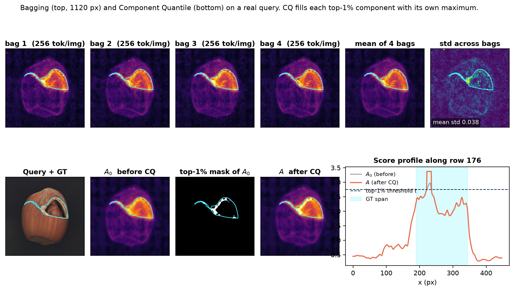
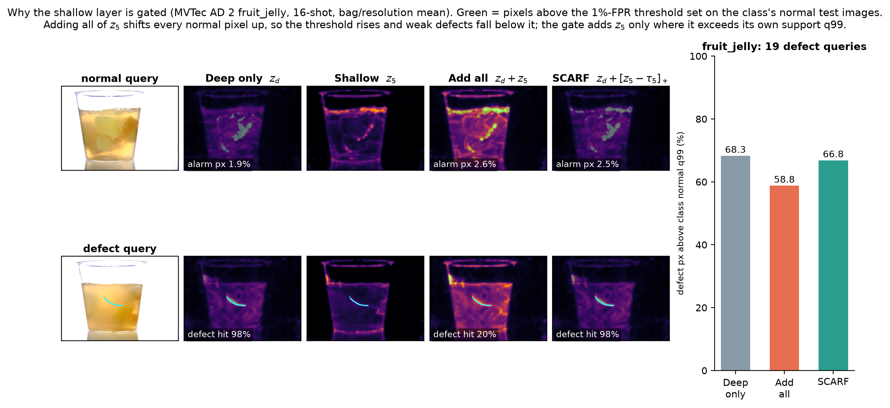
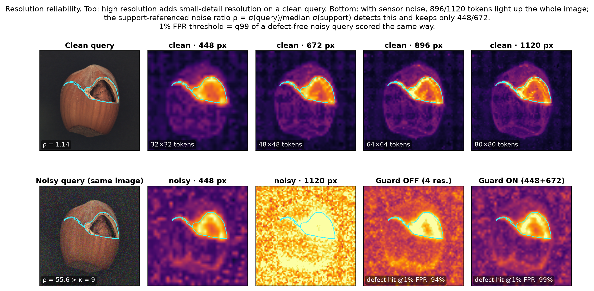

# Support-Calibrated Asymmetric Residual Fusion for Few-Shot Industrial Anomaly Detection

> **논문의 중심 질문**: 소수의 정상 reference로는 획득 조건 변화(조명·노이즈)에 따른 거리 왜곡을 사전에 포괄할 수 없다. 이러한 불완전한 정상 기준선 하에서, 다관측 결합 시 필연적으로 발생하는 정상 상위 꼬리의 오경보 폭증을 어떻게 구조적으로 통제할 것인가?
> *(Few-shot normal references cannot pre-emptively encompass distance distortions caused by acquisition shifts. Under such incomplete normal baselines, how can we structurally control the catastrophic accumulation of false alarms in the normal upper tail that inevitably arises from multi-observation fusion?)*

## Index

- Abstract
- 1. Introduction

  - 1.1. 소수 정상 reference와 거리 해석의 모호성
  - 1.2. 다층·다해상도 관측의 결합과 기술적 과제
  - 1.3. (SCARF) Support-Calibrated Asymmetric Residual Fusion과 기여
- 2. Method

  - 2.1. 문제 재정의와 공통 설계 규칙
  - 2.2. 다층·다해상도 정상 support bank
  - 2.3. Scale calibration: support 기준 component 단위 (Axis 1: Scale)
  - 2.4. Contribution control: 비대칭 초과량 결합 (Axis 2: Layer)
  - 2.5. Resolution reliability: support 기준 해상도 적응 제어 (Axis 3: Resolution)
  - 2.6. Anomaly map 통합 및 Component Quantile (CQ)
  - 2.7. 구현 세부
- 3. Experiments

  - 3.1. 평가 설정 (표 1, 2, 3)
  - 3.2. Few-shot 비교 (표 4, 5)
  - 3.3. Distribution Shift Evaluation
    - 3.3.1. 공식 test_private·test_private,mix (표 6)
    - 3.3.2. MVTec AD 2 public native acquisition strata (그림 2)
    - 3.3.3. MVTec AD synthetic corruption (표 7)
  - 3.4. Ablation Study
    - 3.4.1. Component effectiveness (표 8, 8a)
    - 3.4.2. Calibration and residual-gate mechanism (표 9, 그림 M3·M4)
    - 3.4.3. Resolution and routing (표 10, 표 11, 그림 M5)
    - 3.4.4. Hyperparameter sensitivity and stability (표 12, 그림 A1)
  - 3.5. Efficiency and Qualitative Analysis (표 13, 13a–13d, 그림 3)
- Appendix A. Detailed Ablation Results
- Appendix B. Original-Setting Implementation Checks (보충 표 S3)
- 4. Discussion & Conclusion

## Abstract

산업 이상 탐지에서는 새로운 제품을 소수의 정상 이미지로 검사해야 한다. 동결된 백본의 patch를 정상 reference와 매칭하는 방법은 재학습 비용을 줄이지만, 큰 최근접 거리는 결함뿐 아니라 support에 포함되지 않은 정상 변동이나 촬영 조건 변화에서도 발생한다. 여러 layer·해상도에서 거리를 얻으면 관측 범위는 넓어지지만, component마다 정상 거리의 크기가 다르고 shallow 반응을 항상 더하면 정상 수준의 반응도 anomaly map에 누적된다. 본 논문은 **Support-Calibrated Asymmetric Residual Fusion**을 제안한다. 이 방법은 큰 거리의 원인을 판별하는 대신, 각 반응을 같은 반응이 정상 support에서 보이는 분포에 비추어 읽는다. 구체적으로 정상 support의 leave-source-out 최근접 거리에서 component별 upper-tail 분위수로 상대적 단위를 정하고, deep score를 기본값으로 유지하면서 정규화된 shallow score가 정상 상위 분위수 기준을 넘는 초과량만 연속적으로 더한다. 동일한 support·백본·해상도·bank·후처리를 사용한 MVTec AD 2 16-shot 개발 비교에서 이 결합은 shallow 전체 가산보다 AUPRO@0.05가 **5.13pp**, MAD scale을 사용한 residual 결합보다 **1.66pp** 높았다. Deep-only 대비 차이는 **+0.47pp**로 작아 shallow의 독립적인 순이득은 확립되지 않았다. 동일 support와 DINOv2 ViT-L/14를 사용한 16-shot SuperAD와의 전체 파이프라인 비교에서는 AUPRO@0.05가 **4.47pp**, pAUROC@0.05가 **0.70pp** 높았다. 아울러 공식 MVTec AD 2 private 벤치마크 평가에서 AUPRO@0.05는 TESTpriv **64.80%**, TESTpriv,mix **62.49%**를 기록하여, few-shot 조건임에도 full-data 선행 기법들을 상회하는 성능을 달성했다. 같은 support 기준 비율을 입력 노이즈 추정치에 적용해, support보다 노이즈가 뚜렷이 큰 query에서는 고해상도 경로를 제외한다.

## 1. Introduction

### 1.1. 소수 정상 reference와 거리 해석의 모호성

- **소수 정상 이미지에 기반한 검사**: 다품종 소량 생산과 빈번한 라인 전환에서는 제품마다 충분한 결함 데이터를 모으거나 모델을 다시 학습하기 어렵다. 동결된 시각 백본과 소수의 정상 이미지로 만든 reference bank를 사용하면, 별도 재학습 없이 query patch가 관측된 정상 patch에서 얼마나 떨어져 있는지 측정할 수 있다.
- **획득 조건 변화(Distribution Shift)와 거리 해석의 모호성**: 소수의 정상 reference는 실제 생산 라인에서 발생하는 조명 드리프트, 부품 자세 변경, 표면 난반사, 센서 노이즈 같은 **획득 조건의 변화(distribution shift)**를 모두 대변하지 못한다. 따라서 결함이 없는 정상 query patch라도 이러한 환경 변화에 의해 reference bank와의 거리가 크게 벌어질 수 있으며, 이는 실제 결함이 유발하는 큰 거리와 외형상 구별되지 않는다. **즉, 큰 최근접 거리라는 관측만으로는 그 원인이 결함인지, reference에 포함되지 않은 정상적인 조건 변화(shift)인지 확정할 수 없다.** 본 논문은 이처럼 큰 거리값이 이상 후보를 가리키지만 그 원인을 확정하지 못하는 문제를 **High-Score Ambiguity**라고 부른다.
- **저-FPR 검사에서의 파급효과와 점수 제어 방향**: 이러한 모호성은 정상 영역에서 발생한 큰 거리가 오경보(False Alarm)로 직결되게 만든다. 특히 신뢰도가 엄격히 요구되는 저-FPR 검사 영역(예: pAUROC@0.05)에서는 정상 반응의 극단적인 상위 꼬리(extreme upper tail)가 전체 결정 경계를 좌우하므로, 우연한 큰 거리값 하나가 검출 성능을 심각하게 왜곡한다. **따라서 저-FPR 환경에서 오경보를 억제하려면, 소수 support가 설명할 수 있는 정상 수준의 반응은 결합 점수에 누적되지 않도록 차단하고 그 기준선을 명백히 초과한 반응만을 이상 징후로 반영해야 한다.**

### 1.2. 다층·다해상도 관측의 결합과 기술적 과제

Few-shot 검사에서는 support가 극히 제한적이므로 단일 관측의 정보 부족을 극복하기 위해 각 이미지에서 가능한 한 다양한 단서를 확보하는 것이 유리하다. ViT의 각 layer는 서로 다른 추상화 수준의 정보를 담고 있으며([Raghu et al., NeurIPS 2021](https://arxiv.org/abs/2108.08810)), 입력 해상도를 높이면 미세 결함에 대한 공간 표본화 밀도를 높일 수 있다([Damm et al., WACV 2025](https://openaccess.thecvf.com/content/WACV2025/html/Damm_AnomalyDINO_Boosting_Patch-Based_Few-Shot_Anomaly_Detection_with_DINOv2_WACV_2025_paper.html)).

**그러나 관측을 단순히 결합하면, 각 표현에서 나타나는 정상 변동까지 점수에 누적되어 High-Score Ambiguity가 오히려 증폭된다.** 선행 연구들은 feature를 이어 붙이거나(PatchCore; [Roth et al., CVPR 2022](https://openaccess.thecvf.com/content/CVPR2022/html/Roth_Towards_Total_Recall_in_Industrial_Anomaly_Detection_CVPR_2022_paper.html)) 거리 점수를 단순 평균하는 등(SuperAD; [Zhang et al., 2025](https://arxiv.org/abs/2505.19750)) 고정된 결합 규칙을 사용하여, 각 표현의 정상 범위와 무관하게 모든 반응을 결합 점수에 누적한다. 그 결과, 추가된 표현이 미세한 외관 변화에 반응하여 일시적으로 거리가 커진 정상 위치들이 실제 결함 위치만큼 높은 결합 점수를 받게 된다. 실제로 동일한 백본과 support 조건에서 수행한 통제 비교(표 3)에 따르면, component 단위를 맞춘 후에도 shallow score 전체를 단순 가산할 경우 deep score만 사용할 때보다 저-FPR 검출 성능(AUPRO@0.05)이 **4.65pp** 하락했다(54.02% vs. 58.67%).

따라서 다층·다해상도 관측이 High-Score Ambiguity를 증폭시키지 않으려면, 소수 support의 정상 기준선에 비추어 각 표현의 반응을 보정하고 유의미한 초과 단서만을 선별 결합해야 한다. 그러나 별도 학습 없이 소수 정상 데이터만으로 이를 실현하는 과정에서 세 가지 기술적 과제가 발생한다.

1. **표현 간 상위 꼬리 척도의 불일치 (Scale Calibration Problem)**: 저-FPR 환경(AUPRO@0.05)의 판정 임계값은 정상 점수 분포의 **상위 꼬리(upper tail)**에 의해 결정된다. 그러나 layer와 해상도마다 표현 공간의 특성이 달라 정상 거리 척도와 상위 꼬리 두께가 상이하다. 중심 경향성 기반의 일반 표준화로는 이 비대칭 꼬리를 정렬할 수 없어, 꼬리가 두꺼운 특정 표현이 결합 점수를 지배하고 **거짓 높은 점수(false high-score)**를 유발한다. 따라서 **각 표현의 공간적 변별 패턴을 보존한 채, 소수 support의 상위 분위수를 기준으로 거리 척도를 공정하게 정렬해야 한다.**
2. **외관 변화에 따른 얕은 층 정상 반응 누적 (Contribution Control Problem)**: 심층(deep) feature는 조명·반사 등 외관 변화에 상대적으로 덜 민감한 의미 기준선(semantic base)을 제공하는 반면, 얕은 층(shallow) feature는 국소 텍스처에 민감한 대신 환경 변화에도 쉽게 반응한다. 둘을 대칭적으로 합산하면, support에 없는 정상 외관 변화 시 얕은 층의 일상적 변동이 누적되어 결함 후보 영역을 오염시킨다. 따라서 **외관 변화에 강건한 deep 표현을 기본 탐지 축으로 삼고, shallow 표현은 support의 정상 범위를 초과했을 때만 국소적 잔차 단서(residual evidence)로 선별 반영하는 비대칭 결합**이 요구된다.
3. **고주파 영상 변동에 따른 고해상도 신뢰성 저하 (Resolution Reliability Problem)**: 기본 해상도 관측이 거시적 형태를 안정적으로 유지하는 기준선이 되는 반면, 고해상도 관측은 미세 결함에 대한 표본화 밀도를 높여주는 대신 센서 노이즈 등 고주파 영상 변동에 민감하다. 둘을 무조건 결합하면 노이즈 환경에서 고해상도 경로의 왜곡된 반응이 결합 점수를 지배하여 오경보를 유발한다. 따라서 **기본 해상도의 안정성을 유지하되, 고해상도 관측은 query의 고주파 상태가 support의 정상 범위 내에 있을 때만 선별 반영하는 적응적 해상도 제어**가 요구된다.

이 세 가지 과제는 **소수 정상 support의 기준선 대비 얼마나 벗어났는가라는 상대적 비율(support-referenced ratio)로 모든 신호를 통일된 기준으로 읽고 제어한다**는 공통 설계 규칙 아래 하나의 유기적인 프레임워크로 통합된다.

### 1.3. (SCARF) Support-Calibrated Asymmetric Residual Fusion 와 기여

본 논문은 High-Score Ambiguity를 해소하기 위해 다층·다해상도로 관측을 확장하되, 이를 단순 결합하지 않고 소수 support의 정상 기준선에 맞추어 선별 통합하는 **Support-Calibrated Asymmetric Residual Fusion (Ours)**을 제안한다. 추가 학습 없이 **"소수 정상 support의 기준선 대비 상대적 비율(support-referenced ratio)"**이라는 공통 설계 규칙을 관철하여, 다양한 획득 조건 변화(distribution shift) 속에서도 정상 위치의 거짓 높은 점수를 억제한다. 본 연구의 주요 기여는 다음과 같다.

1. **결합 과정의 정상 반응 누적 메커니즘 진단**: Few-shot patch matching에서 복수의 표현을 고정 규칙으로 단순 결합할 경우, 각 표현의 정상 수준 반응이 결합 점수의 상위 꼬리에 누적되어 저-FPR localization 성능이 저하됨을 규명했다. 동일 조건의 16-shot 통제 비교에서 shallow score 전체를 단순 가산한 구성은 deep score 단일 구성 대비 AUPRO@0.05가 **4.65pp** 하락함을 확인했다.
2. **Support 기준 비율에 기반한 학습 없는 통합 결합 방법**: 세 가지 과제를 관통하는 단일한 support-referenced ratio 규칙을 기반으로, 추가 학습 없이 소수 support만으로 동작하는 결합 파이프라인을 구축했다. (i) Support의 leave-source-out 최근접 거리 상위 분위수로 거리를 나누어 단위를 일치시키고(Scale Calibration), (ii) deep score를 기본 축으로 삼고 shallow score가 정상 기준선을 초과한 잔차만 선별 반영하며(Contribution Control), (iii) support 대비 입력 노이즈 비율에 따라 query별 해상도 반영 여부를 결정한다(Resolution Reliability).
3. **Few-shot 및 획득 변동 전반에서의 포괄적 실증**: MVTec AD 2의 1–16 shot 전 구간과 모든 획득 조건(Regular, Shift 1·2·3)에서 기존 최고 수준 방법들을 일관되게 상회했다. 16-shot AUPRO@0.05 기준 59.63%를 기록하여 AnomalyDINO 대비 **+15.27pp**, SubspaceAD 대비 **+20.09pp**, SuperAD 대비 **+4.47pp**, PatchCore 대비 **+10.47pp** 향상되었으며, 공식 blind private 평가에서도 TESTpriv 64.80%, TESTpriv,mix 62.49%를 달성했다. 아울러 요인별 ablation(§3.4)을 통해 비대칭 결합(+5.13pp)과 분위수 척도 보정(+1.66pp)의 개별적 유효성을 실증했다.

## 2. Method

### 2.1. 문제 재정의와 공통 설계 규칙 (Overview & Core Principle)

**문제 전제와 방법론 설계 목표**

- **전제 (High-Score Ambiguity, §1.1)**: 소수 support 환경에서는 큰 최근접 거리의 원인(실제 결함 vs. support에 미포함된 정상 변동)을 개별 query 관측만으로 확정할 수 없다.
- **핵심 목표 (오경보 누적 억제 및 안전한 다관측 수용)**: 얕은 계층(Shallow)과 고해상도는 미세 결함 단서를 담고 있지만 정상 질감·외관 변동에도 과민 반응하므로, 단순 결합 시 저-FPR 결정 경계를 심각하게 훼손한다. 따라서 SCARF는 불확실한 원인 판별 대신, support 정상 분포를 기준으로 정상 수준 반응의 점수 누적을 차단하고 **정상 상위 한계를 명백히 넘어선 초과 잔차만을 비대칭으로 수용함으로써, 다관측 결합의 오경보 리스크를 통제**하는 것을 목표로 한다.
- **평가와의 연결**: 저-FPR 평가(AUPRO@0.05)의 결정 경계는 정상 반응의 상위 꼬리에 의해 좌우되므로, 정상 수준 신호의 누적을 억제하고 기준 초과량만 반영하는 이 설계는 평가 요구조건에 직접 부합한다.

**SCARF의 직관적 3단계 파이프라인 (3-Stage Workflow)**

제안하는 **SCARF (Support-Calibrated Asymmetric Residual Fusion)**는 추가 학습이나 복잡한 최적화 없이, 소수 support 정상 데이터만을 기준으로 동작하는 3단계 통합 파이프라인으로 구성된다.

**그림 1. SCARF (RSG4) 전체 파이프라인 개요도.** (A) Support Fitting: 정상 support로부터 feature bank, component별 scale($c_m$), shallow 가산 기준($\tau_5$), 입력 노이즈 기준($\sigma_S$)을 1회 사전 확정한다. (B) Query Inference: 쿼리의 노이즈 비율에 따라 해상도를 선택하고, 선택된 component의 최근접 거리를 정규화한 뒤 deep base에 shallow 기준 초과량($e_5$)만 더한다. 점수 맵을 원본 크기로 역투영·평균하고 CQ를 적용해 최종 anomaly map을 산출한다. 점선 화살표는 query 단계에서 고정해 사용하는 support 산출물이다. 

- **(A) Support Fitting (사전 1회 계산)**: 정상 Support 영상들로부터 고정 DINOv2 백본의 3개 Layer($l \in \{5, 11, 23\}$), 4개 해상도($r \in \{448, 672, 896, 1120\}$), 4개 Bag($b \in \{1,2,3,4\}$, 각 이미지당 256개 무작위 토큰)으로 총 **48개의 컴포넌트 메모리 뱅크($B_m$)**를 구축한다. 각 뱅크 내에서 Leave-Source-Out (LSO) 매칭을 통해 정상 거리 분포 $D_m^{\text{LSO}}$를 측정하고, 단위 척도 $c_m$과 얕은 층 초과 임계값 $\tau_5$, 그리고 정상 노이즈 기준 $\sigma_S$를 사전 확정한다.
- **(B) Query Inference (테스트 쿼리 입력 시)**: 쿼리 영상의 노이즈 비율 $\rho(x^q)$를 측정하여 고주파 노이즈 오염 시 안전한 해상도로 라우팅한다. 각 컴포넌트별 1-NN 거리 계산 $\to$ 서포트 기준 단위 정규화($z_m = d_m / c_m$) $\to$ Deep Base($z_d$)에 Shallow 초과량($e_5 = \max(0, z_5 - \tau_5)$) 가산 $\to$ 4-Bag 점수 평균 및 해상도 역투영 $\to$ Component Quantile(CQ) 연결 성분 채움 과정을 거쳐 최종 Anomaly Map $A(x^q)$를 산출한다.

**공통 설계 규칙: support-referenced ratio**

SCARF의 세 가지 구성 요소(단위 정규화, 얕은 층 초과량 가산, 해상도 선택)는 **"임의의 관측치를 support 정상 분포의 기준 분위수 대비 배율로 읽는다"**는 단 하나의 공통 설계 규칙 아래 통합된다.

$$
\mathcal T_q[t] = \frac{t}{Q_q\!\left(\mathcal N_S[t]\right)}
$$

- $\mathcal N_S[t]$: Support 이미지 집합 내부에서 산출된 통계량 $t$의 정상 기준 분포. "처음 보는 정상 이미지가 들어왔을 때 나타나는 분포"를 모사하기 위해 leave-source-out 또는 support 간 통계로 구성한다.
- $Q_q(\cdot)$: 해당 분포의 $q$-분위수(Quantile).
- 동일한 연산자 $\mathcal T_q[t]$를 분위수 $q$와 통계량 $t$만 바꾸어 §1.2에서 제기된 3대 기술적 과제에 일관되게 적용한다.

| 적용 축                                          | 통계량$t$             |   분위수$q$ |  결정 메커니즘  | 물리적 직관 및 대응 과제 (§1.2)                                                        | 절                                                                             |      |
| :----------------------------------------------- | :-------------------------------------- | :--------------: | :-------------------------------------------------------------------------------------- | :----------------------------------------------------------------------------- | :---: |
| **척도 축 (Scale)**Scale Calibration             | 최근접 거리$d_m$                      |    $\alpha$    | $z_m = \mathcal T_\alpha[d_m] = \frac{d_m}{c_m}$                                      | 임의 거리를 "정상 변동 상위 꼬리 대비 몇 배인가"의 무차원 단위로 환산 (과제 1) | §2.3 |
| **계층 축 (Layer)**Contribution Control          | Shallow 거리$d_5$                     |    $\beta$    | $e_5 = \max(0, z_5 - \tau_5) = \left[\mathcal T_\beta[d_5] - 1\right]_+ \cdot \tau_5$ | 정상 한계를 넘어선 순수 초과량만 잔차로 반영 (과제 2)                          | §2.4 |
| **해상도 축 (Resolution)**Resolution Reliability | 고주파 노이즈$\sigma$                 | $0.5$ (median) | $\mathcal T_{0.5}[\sigma] > \kappa$ 시 고해상도 배제                                  | 입력 영상의 센서 노이즈가 정상 범위를 초과할 때 고해상도 오염 차단 (과제 3)    | §2.5 |

- **Label 사용 및 학습 불필요성**: 모든 기준값($c_m, \tau_5, \sigma_S$)은 정상 support 이미지만으로 사전 계산된다. Query의 정답 mask나 결함 레이블은 기준치 설정에 일체 사용되지 않으며, 테스트 시점의 파라미터 업데이트나 메모리 갱신도 없다.

---

### 2.2. 다층·다해상도 정상 Support Bank

**역할**: 결합의 기초 신호인 최근접 거리 $d_m$을 측정하고, 각 표현의 정상 기준 분포를 만들 관측 저장소를 구축한다.

**구성 요소**

1. **다층 축 — $\mathcal L = \{5, 11, 23\}$**: ViT의 표현은 깊이에 따라 포착하는 정보가 다르다([Raghu et al., NeurIPS 2021](https://arxiv.org/abs/2108.08810)).

   - **Layer 5 (Shallow)**: 국소 질감, 긁힘, 미세 경계에 민감하다. 조명·반사 같은 외관 변화에도 쉽게 반응한다.
   - **Layer 11 (Mid-Deep)**: 부품의 국소 형태와 부분 패턴을 안정적으로 포착한다.
   - **Layer 23 (Deep)**: 의미·구조 정보를 담으며 조명·색상 변동에 상대적으로 강건하다.
2. **다해상도 축 — $\mathcal R = \{448, 672, 896, 1120\}$**: 입력 영상의 짧은 변을 $r$로 리사이즈한다. 패치 크기가 $14 \times 14$로 고정되어 있으므로 $r$이 클수록 토큰 하나가 덮는 원본 면적이 좁아진다.

   | 해상도$r$ | 짧은 변 토큰 수 | 토큰 수 (정사각 영상 기준) | 토큰 한 변이 덮는 길이 |
   | :---------: | :-------------: | :------------------------: | :--------------------: |
   |     448     |       32       |           1,024           |   짧은 변의 약 3.1%   |
   |     672     |       48       |           2,304           |        약 2.1%        |
   |     896     |       64       |           4,096           |        약 1.6%        |
   |    1120    |       80       |           6,400           |        약 1.25%        |

   저해상도는 넓은 영역의 이상을 안정적으로 보고 고주파 노이즈에 둔감하다. 고해상도는 작은 점 결함이나 미세 균열이 토큰 하나를 채울 만큼 크게 보이도록 공간 표본 밀도를 높인다([Damm et al., WACV 2025](https://openaccess.thecvf.com/content/WACV2025/html/Damm_AnomalyDINO_Boosting_Patch-Based_Few-Shot_Anomaly_Detection_with_DINOv2_WACV_2025_paper.html)). 예를 들어 짧은 변의 1% 크기 점 결함은 448에서 토큰 한 변의 약 1/3에 그쳐 주변 정상 질감에 희석되지만, 1120에서는 토큰 하나에 가까운 크기가 된다.

**메모리 배깅 (Memory Bagging, $B=4$)**

- **개념과 본질**:
  - 본 프레임워크는 학습 가능한 매개변수가 없는 비모수적(non-parametric) 1-NN 구조다. 따라서 전통적인 머신러닝의 Bagging(부트스트랩으로 여러 모델을 학습시켜 예측을 평균)과 달리, **"참조 정상 메모리 뱅크를 희소하게(sparse, 256개) 독립 분할 표본화하고, 각 뱅크에서 구한 이상치 점수 맵들을 최종 앙상블 평균(Ensemble Average)하는 메모리 배깅 방식"**이다.
- **왜 필요한가 (희소 표본화와 잡음 문제)**:
  - 모든 토큰을 단일 bank에 보존하면 16-shot · 1120 해상도에서 클래스당 약 $16 \times 6{,}400 = 102{,}400$개 토큰을 매 query 패치마다 1-NN 검색해야 해 계산 비용과 VRAM이 폭증한다.
  - 이를 해결하기 위해 support 이미지당 토큰을 **최대 256개만 비복원 무작위 추출(Sparse Subsampling)**한다 (1120 기준 약 4%).
  - 그러나 단일 표본으로 줄이면, query 패치와 가장 닮은 정상 패치가 우연히 표본에서 누락될 수 있다. 이 경우 차선의 이웃이 선택되어 거리 $d_m$이 과대추정(오경보)되는 **표본화 잡음(Sampling Noise / High Variance)**이 발생한다.
- **어떻게 해결하는가 (독립 4-Bag 구축 및 동작 파이프라인)**:
  1. **독립 뱅크 생성**: 해상도마다 서로 다른 난수 시드로 support 이미지당 256개 토큰을 4회 독립 추출하여 4개의 독립 메모리 뱅크(Bag $b \in \{1,2,3,4\}$, 각 $16 \times 256 = 4{,}096$ 토큰)를 구축한다. 단일 bag은 4%만 보지만, 4개 bag을 합치면 약 15%의 서로 다른 정상 위치를 포괄한다.
  2. **Layer 간 공간 위치 일치**: 하나의 bag $b$ 안에서는 세 layer($l \in \{5, 11, 23\}$)가 **정확히 동일한 공간 패치 위치의 토큰을 공유**한다. 따라서 layer 간 점수 차이는 추출 위치 편향이 아니라 순수한 "표현 깊이(depth)" 차이만을 반영한다.
  3. **Bag별 독립 캘리브레이션 및 결합**: 분위수 척도 $c_m$(§2.3)과 게이트 임계값 $\tau_5$(§2.4)는 각 bag의 support 토큰들로 독립 추정한다. Query 패치에 대한 1-NN 거리 검색 $\to$ 스케일 보정 $\to$ 비대칭 결합($S_{r,b}$)까지 각 bag 내부에서 완전히 완결짓는다. 서로 다른 표본에서 나온 척도가 뒤섞이지 않는다.
  4. **앙상블 평균 (§2.6)**: 4개 bag에서 나온 결합 점수 맵을 토큰 격자 위에서 평균($S_r(p) = \frac{1}{4}\sum_{b=1}^4 S_{r,b}(p)$)한다. 특정 bag에서 우연히 정상 이웃을 놓쳐 거리가 튀더라도 다른 bag들이 이를 상쇄하여 무작위 오경보를 매끄럽게 지운다.
- **왜 단일 대형 뱅크(1,024개) 대신 256개짜리 4-Bag 앙상블인가?**:
  - **(1) VRAM 및 연산 복잡도 억제**: 큰 단일 뱅크에 대해 거대한 거리 행렬을 연산하는 대신, 4,096개 크기의 컴팩트한 뱅크를 순차/병렬 탐색하여 Peak VRAM을 3.44 GiB 수준으로 낮게 유지한다.
  - **(2) 분위수 통계 추정의 분산 감소**: 상위 5% 거리($c_m$)나 상위 1% 거리($\tau_5$)와 같은 극단 분위수는 단일 표본의 아웃라이어에 쉽게 흔들린다. 독립 표본 4개에서 각각 정규화 및 결합을 마친 뒤 평균하면 통계적 분산이 수학적으로 크게 줄어든다.
- **재현성**: bag $b$의 난수 생성기는 고정 seed에서 결정되고, 해상도 루프 전체에서 같은 생성기를 이어서 사용하므로 모든 실험은 결정론적으로 재현된다.

**[메커니즘 분석] 그림 M1(상단). 실제 query에서 본 4개 Bag 점수 맵과 앙상블 평균 효과.** 

- **패널별 시각 분석 (MVTec AD hazelnut crack, 16-shot seed 0, 1120 px)**:
  - `bag 1` ~ `bag 4` (상단 1~4열): 서포트 이미지당 서로 다른 난수 시드로 추출한 256개 토큰(각 뱅크 4,096 토큰)으로 계산된 점수 맵. 균열(crack) 결함의 전체적인 윤곽은 4개 bag 모두 일관되게 포착하지만, 256개 희소 표본화로 인해 결함 경계부와 국소 배경에서 픽셀 단위로 미세한 반응 차이(표본화 흔들림)가 관측된다.
  - `mean of 4 bags` (상단 5열): 4개 bag의 점수를 픽셀 단위로 산술 평균($\frac{1}{4}\sum_{b=1}^4 S_{r,b}$)한 결과. 개별 bag에 존재하던 국소적 잡음이 상쇄되어 결함 부위가 훨씬 매끄럽고 안정적으로 특정된다.
  - `std across bags` (상단 6열, viridis 컬러맵): 4개 bag 간 점수의 표준편차 맵. 정상 배경 영역에서는 편차가 거의 0에 수렴(어두운 보라색)하며, 오직 결함 경계부의 극소수 픽셀에서만 미세한 표본화 분산(전체 평균 std **0.038**)이 나타난다.
- **시각적 증명의 핵심**:
  - 이 시각화는 Bagging이 결함 검출 결과를 왜곡하거나 새로운 편향을 만드는 것이 아니라, **"토큰을 1/25로 줄이면서 발생하는 불가피한 점 단위 표본화 분산(std=0.038)을 평균 연산으로 말끔히 상쇄(Variance Reduction)하는 결정론적 안전장치"**임을 입증한다.

**Component 정의**: Layer $l$, 해상도 $r$, bag $b$의 조합 $m = (l, r, b)$를 하나의 독립 관측 단위로 둔다(총 $3 \times 4 \times 4 = 48$개). 16-shot 기준 component 하나의 bank는 $16 \times 256 = 4{,}096$개 토큰이다.

**1-NN 최근접 거리**

Query 영상 $x^q$의 위치 $p$에서 추출한 L2 정규화 feature $f_{l,r}(x^q, p)$와 bank $B_{l,r,b}$ 사이의 최근접 코사인 거리를 계산한다.

$$
d_{l,r,b}(x^q, p) = \min_{u \in B_{l,r,b}} \left[ 1 - f_{l,r}(x^q, p)^\top u \right]
$$

- **직관**: $d_m$은 "이 위치와 가장 닮은 정상 패치조차 얼마나 다른가"를 뜻한다. 정상 위치는 support 어딘가에 닮은 패치가 있어 작게 나오고, 결함 위치는 어떤 정상 패치와도 닮지 않아 크게 나온다.
- **Layer별 독립 매칭**: 여러 layer의 feature를 이어 붙이지 않고 layer마다 따로 최근접 이웃을 찾는다. Layer 5에서 가장 가까운 정상 토큰과 layer 23에서 가장 가까운 정상 토큰은 서로 다를 수 있다. 결합하는 대상은 공유된 이웃이 아니라 각 표현 공간에서 측정한 거리다.

---

### 2.3. Scale Calibration: Support 기준 분위수 정규화 (Axis 1: Component Scale)

**해결하는 문제 (§1.2, 과제 1)**

- 48개 component의 거리 $d_m$은 layer와 해상도에 따라 절대 규모와 상위 꼬리 모양이 다르다.
- 예를 들어 layer 23의 정상 거리가 대체로 0.6 근처이고 layer 5가 0.2 근처라면, 원시 거리를 그대로 더할 때 layer 23이 결합 점수를 대부분 차지한다. 거리 0.3은 layer 5에서는 이례적으로 큰 값이지만 layer 23에서는 평범한 정상 값이다. 같은 숫자의 의미가 component마다 다르다.
- 저-FPR 평가에서 중요한 것은 정상 분포의 중심보다 상위 꼬리다. 꼬리가 두꺼운 component는 정상 위치에서도 가끔 큰 거리를 내고, 이것이 오경보가 된다.

**메커니즘 1 — Leave-Source-Out (LSO) 정상 거리 분포**

- Support 토큰을 자기 자신이 들어 있는 bank와 매칭하면 거리가 0이 되어 정상 변동을 측정할 수 없다.
- 실제 query는 bank에 없는 새 정상 이미지다. 이 상황을 support 안에서 재현하기 위해, support 이미지 $x_i^s$에서 온 bank 토큰을 **$x_i^s$를 뺀 나머지 support 이미지의 토큰**으로 만든 bank와 매칭한다. 이를 모든 $i$에 대해 반복해 모은 거리 집합이 component $m$의 정상 거리 분포 $D_m^{\mathrm{LSO}}$다.

$$
D_m^{\mathrm{LSO}} = \bigcup_{i=1}^{N} \left\{ \min_{u \in B_m \setminus B_m^{(i)}} \left[1 - v^\top u\right] \;:\; v \in B_m^{(i)} \right\}
$$

  여기서 $B_m^{(i)}$는 bank $B_m$ 중 support 이미지 $i$에서 온 토큰이다. 16-shot에서 component 하나의 $D_m^{\mathrm{LSO}}$는 4,096개 값으로 이루어진다.

- **직관**: "support 16장 중 1장을 처음 보는 정상 이미지라고 치고, 나머지 15장으로 얼마나 잘 설명되는지"를 16번 측정한 것이다.
- Query 시점의 bank는 support $N$장을 모두 포함하므로 LSO bank($N-1$장)보다 크다. 따라서 LSO 거리는 실제 정상 query 거리보다 약간 크게 나오며, 이는 정상 변동을 과소평가하지 않는 보수적인 방향이다.

**메커니즘 2 — 단위 척도 $c_m$과 정규화 점수 $z_m$**

공통 설계 규칙을 척도 축에 적용해, LSO 분포의 $\alpha$-분위수($\alpha = 0.95$)를 component의 단위 척도 $c_m$으로 둔다.

$$
c_m = Q_{0.95}\!\left(D_m^{\mathrm{LSO}}\right), \qquad z_m(x^q, p) = \mathcal T_{0.95}[d_m] = \frac{d_m(x^q, p)}{c_m}
$$

**예시 (설명용 수치)**

|                             |    Layer 5    |    Layer 23    |
| :-------------------------- | :------------: | :------------: |
| 정상 LSO 거리의 q95,$c_m$ |      0.20      |      0.60      |
| Query 위치 거리$d_m$      |      0.30      |      0.66      |
| 정규화 점수$z_m$          | **1.50** | **1.10** |

원시 거리로는 layer 23(0.66)이 layer 5(0.30)보다 두 배 이상 크지만, 정규화 후에는 layer 5가 자기 정상 꼬리 대비 1.5배로 더 이례적인 반응임이 드러난다.

**[메커니즘 분석] 그림 M2. 척도 보정 전후의 실제 맵과 정상 픽셀 분포.** 

같은 hazelnut query를 1120 px에서 본 것이다. 위 행의 원시 거리에서는 layer 23($c_{23}=0.232$)의 정상 분포가 layer 5($c_5=0.123$)보다 두 배 가까이 오른쪽에 있어, 그대로 더하면 layer 23이 점수를 지배한다. 아래 행처럼 각자의 $c_m$으로 나누면 두 분포가 같은 기준선 $z=1$(support q95) 아래로 모이고, layer 5가 균열 가장자리에서 내는 강한 반응이 layer 23과 같은 단위로 드러난다. 정상 영역의 순위는 그대로이며, 바뀌는 것은 layer 간 비중뿐이다.

**성질**

- **해석 가능한 단위**: $z_m = 1$은 "정상 support 토큰 상위 5%의 경계와 같은 거리"를 뜻하고, $z_m = 2$는 그 경계의 두 배다.
- **꼬리 정렬**: 모든 component에서 정상 LSO 토큰 중 $z_m > 1$인 비율이 약 5%로 같아진다. 특정 layer나 해상도가 결합 점수를 독점하지 않는다.
- **순위 보존**: 양의 상수로 나누는 변환이므로 component 내부의 공간 순위는 바뀌지 않는다. 바뀌는 것은 component 간 상대 비중뿐이다.
- **Ablation 근거**: 전체 가산 조건에서 MAD 정규화(분포 중심 기준)를 q95 정규화(꼬리 기준)로 바꾸면 AUPRO@0.05가 51.16%에서 54.02%로 오른다(표 8, (2)→(3)). 중심을 맞춰도 꼬리 두께가 다르면 오경보가 남는다는 뜻이다.

---

### 2.4. Contribution Control: 비대칭 초과량 결합 (Axis 2: Layer Contribution)

**해결하는 문제 (§1.2, 과제 2)**

- 척도를 맞춘 뒤에도 세 layer를 똑같이 더하면 오경보가 늘어난다.
- Deep feature(layer 11, 23)는 조명·반사 같은 정상 외관 변동에 비교적 안정적이지만, shallow feature(layer 5)는 정상 표면 질감 변동에도 반응한다. Shallow 점수를 전부 더하면 정상 위치마다 질감에 따라 다른 양이 더해져 정상 점수 분포가 넓어지고, 상위 꼬리가 결함 쪽으로 늘어난다.
- 통제된 16-shot 실험에서 q95 정규화 후 shallow 점수를 전부 더하면 deep-only 대비 AUPRO@0.05가 **4.65pp 하락**했다(표 8, 54.02% vs. 58.67%).

**메커니즘: Deep 기준선 + Shallow 초과량**

Deep layer를 항상 반영하는 기준선으로 두고, shallow layer는 정상 범위를 넘은 만큼만 더한다.

$$
S = \underbrace{z_{d}}_{\text{항상 반영}} \;+\; \underbrace{\left[z_5 - \tau_5\right]_+}_{\text{정상 범위를 넘을 때만}}
$$

1. **Deep 기준선 $z_d$**: 해상도 $r$, bag $b$에서 layer 11과 23의 정규화 점수를 평균한다.

$$
z_{d,r,b}(p) = \frac{z_{11,r,b}(p) + z_{23,r,b}(p)}{2}
$$

2. **Shallow 기준값 $\tau_5$**: 같은 layer 5 LSO 분포의 더 높은 분위수 $\beta = 0.99$를 $c_5$ 단위로 환산한다.

$$
\tau_{5,r,b} = \frac{Q_{0.99}\!\left(D_{5,r,b}^{\mathrm{LSO}}\right)}{c_{5,r,b}} = \frac{Q_{0.99}\!\left(D_{5,r,b}^{\mathrm{LSO}}\right)}{Q_{0.95}\!\left(D_{5,r,b}^{\mathrm{LSO}}\right)} \;\ge\; 1
$$

   $\tau_5$는 "정상 shallow 토큰 상위 1%의 경계"를 $z_5$와 같은 단위로 표시한 값이다. 정상 꼬리가 길게 늘어진 component일수록 $Q_{0.99}/Q_{0.95}$가 커져 $\tau_5$도 높아지고, 그만큼 shallow 가산이 보수적으로 바뀐다. 이 기준은 component(해상도·bag)마다 따로 정해진다.

3. **초과량 가산**: $\tau_5$를 넘은 크기에 비례해 연속적으로 더한다. 계단형 스위치와 달리 기준 근처에서 점수가 갑자기 뛰지 않는다.

$$
e_{5,r,b}(p) = \max\!\left(0,\; z_{5,r,b}(p) - \tau_{5,r,b}\right), \qquad S_{r,b}(p) = z_{d,r,b}(p) + e_{5,r,b}(p)
$$

이 초과량 $e_5$는 대수적으로 $\left[\frac{d_5}{Q_{0.99}(D_5)} - 1\right]_+ \cdot \tau_5 = \left[\mathcal{T}_{0.99}[d_5] - 1\right]_+ \cdot \tau_5$와 완전히 동치이며, §2.1의 공통 연산자 $\mathcal{T}$ 규칙을 그대로 따른다.

**예시 (설명용 수치, $\tau_5 = 1.30$)**

| 위치 유형                  | $z_{11}$ | $z_{23}$ | $z_5$ | Deep-only$z_d$ | 전체 가산$z_d + z_5$ | **SCARF $S$** |      |                |
| :------------------------- | :--------: | :--------: | :-------------------------------------------------: | :-------------------: | :--: | :------------: |
| 정상 배경 (매끈한 면)      |    0.60    |    0.50    |                        0.40                        |         0.55         | 0.95 | **0.55** |
| 정상 배경 (질감이 튀는 면) |    0.70    |    0.60    |                        1.25                        |         0.65         | 1.90 | **0.65** |
| 미세 긁힘 (deep 약반응)    |    0.90    |    0.80    |                        2.80                        |         0.85         | 3.65 | **2.35** |
| 큰 결함                    |    2.20    |    2.60    |                        3.00                        |         2.40         | 5.40 | **4.10** |

- **Deep-only**: 정상 위치 점수가 0.55–0.65로 좁게 모이지만, 미세 긁힘(0.85)이 정상 질감 위치(0.65)와 거의 구분되지 않는다.
- **전체 가산**: 긁힘 점수는 올라가지만 정상 질감 위치도 0.95–1.90으로 함께 치솟는다. 이처럼 정상 꼬리가 결함 점수대와 뒤섞이면서 저-FPR 경계가 치명적으로 붕괴된다(표 8에서 AUPRO -7.99pp 폭락의 원인).
- **SCARF**: 정상 위치는 $z_5 \le \tau_5$라 $e_5 = 0$이 되어 deep-only와 같은 좁은 분포(0.55–0.65)를 유지한다. 긁힘처럼 shallow가 정상 상위 1% 경계를 넘는 위치만 초과량(1.50)이 더해져 2.35로 올라간다. 큰 결함은 두 신호가 함께 반영되어 가장 높다.

**추가 가중치가 없는 이유**: 초과량의 계수는 1이다. $z_5$와 $\tau_5$가 모두 $c_5$ 단위이고 $z_d$도 같은 방식으로 정규화된 값이므로, deep 기준선 1단위와 shallow 초과 1단위가 모두 "정상 q95 경계 하나만큼"이라는 같은 의미를 갖는다.
**[메커니즘 분석] 그림 M3. 실제 query에서 본 deep 기준선, shallow 점수, 초과량.** 

같은 색 범위로 그린 hazelnut query다. Shallow 점수 $z_5$는 결함뿐 아니라 견과 아랫부분의 질감과 윤곽에도 반응한다. Support에서 정한 $\tau_5=1.44$를 빼고 0 이하를 자르면 이 정상 반응은 사라지고, 균열 테두리처럼 정상 상위 1%를 넘는 위치만 남는다. 그 결과 SCARF 맵은 정상 표면에서는 deep 기준선과 같고 결함 경계에서만 더 밝아진다.

**[메커니즘 분석] 그림 M4. Shallow를 전부 더하면 왜 저-FPR 검출이 떨어지는가.** 

MVTec AD 2 fruit_jelly, 16-shot. 초록색은 이 클래스의 정상 test 이미지 픽셀로 정한 1%-FPR 임계값(q99)을 넘은 픽셀이다.

- **위 행(정상 query)**: $z_5$를 전부 더하면 컵 테두리와 젤리 경계 같은 정상 질감이 밝아진다. 이런 정상 픽셀이 많아질수록 1%-FPR 임계값 자체가 올라간다.
- **아래 행(결함 query)**: 올라간 임계값 때문에 deep 점수로는 98% 잡히던 가는 긁힘이 전체 가산에서는 20%만 잡힌다. SCARF는 정상 질감에 $z_5$를 더하지 않으므로 임계값이 거의 그대로이고, 긁힘을 98% 잡는다.
- **오른쪽(클래스 집계, 결함 query 19장)**: 1%-FPR에서 잡힌 결함 픽셀 비율은 deep-only 68.3%, 전체 가산 58.8%, SCARF 66.8%다. **게이트의 핵심 역할은 결합 이득을 일방적으로 키우는 것이 아니라, 전체 가산 시 발생하는 치명적 손실(58.8%)을 회복시키는 안전판**이라는 점이다.
- **현실적 트레이드오프와 성격 규정**: 1% FPR 검출률 기준으로 SCARF는 대부분의 일반 클래스에서 deep-only와 대등한 수준(gated $\le$ deep-only)을 유지한다. 표 8의 macro 순이득(+0.47pp)은 `can`(+2.91pp)과 `wallplugs`(+1.63pp) 같은 국소적 미세 결함 클래스에서 유입되며, 다수 클래스에서는 이득보다 "Shallow를 더해도 deep 베이스라인을 해치지 않는다"는 무손실 수용(Lossless Inclusion) 성격이 지배적이다.

이 집계는 그림 설명을 위한 post-hoc 진단이다. 결함 query는 test_public bad 이미지를 3장 간격으로 고른 부분 집합이고, GT는 예측 후 픽셀을 나누는 데만 썼다.

**Ablation 근거 (표 8)**: 단순 결합 대비 게이트 정규화의 기여는 **$D - A$ (+7.99pp)** 및 비게이팅 대비 **$D - B$ (+5.13pp)**로 압도적이며, 8개 중 6개 클래스에서 일관되게 손실을 차단한다. $D - E$ (+0.47pp)의 미세한 마진은 공격적인 결함 증폭의 증거가 아니라, 이러한 손실 차단 메커니즘 덕분에 Deep 베이스라인의 견고함을 지키면서 잔차 단서를 안전하게 흡수한 결과로 해석된다.

---

### 2.5. Resolution Reliability: Support 기준 해상도 적응 제어 (Axis 3: Resolution Reliability)

**해결하는 문제 (§1.2, 과제 3)**

- 고해상도($896, 1120$) 관측은 작은 결함의 표본 밀도를 높이지만, 토큰 하나가 덮는 원본 면적이 좁아 센서 노이즈 같은 픽셀 단위 변동을 거의 평균하지 못한다.
- 깨끗한 support로 만든 bank에는 노이즈 낀 패치가 없다. 노이즈가 심한 query가 들어오면 고해상도 토큰은 정상 위치에서도 모든 bank 토큰과 멀어지고, 정상 영역 전체의 점수가 결함 수준으로 올라간다.
- MVTec AD Gaussian noise(severity 3) 귀인 실험에서 deep-only 전환은 +1.65pp, CQ 제거는 −0.69pp였지만, 저해상도 $\{448, 672\}$만 쓰면 +5.09pp를 회복했다. 실패의 주된 원인이 896/1120 분기에 있었다는 뜻이다.

**계층 축과 해상도 축의 대응**

|                    | 계층 축 (§2.4)                 | 해상도 축 (§2.5)                  |
| :----------------- | :------------------------------ | :--------------------------------- |
| 기준 관측          | Deep layer 11, 23               | 저해상도 448, 672                  |
| 조건부 확장 관측   | Shallow layer 5                 | 고해상도 896, 1120                 |
| 확장 관측의 장점   | 미세 질감 결함                  | 작은 점 결함                       |
| 확장 관측의 취약점 | 정상 질감·외관 변동            | 센서 노이즈                        |
| 조건               | $z_5 > \tau_5$ (위치별, 연속) | $\rho \le \kappa$ (영상별, 이진) |
| 기준의 출처        | Support LSO 거리의 q99          | Support 노이즈의 median            |

두 축 모두 신뢰할 수 있는 기준 관측 위에, 민감하지만 미세 단서를 주는 확장 관측을 support 정상 기준에 맞추어 조건부로 더한다. 차이는 판단 단위다. Shallow 게이트는 위치마다 연속적으로 열리고, 해상도 게이트는 노이즈가 영상 전체에 고르게 퍼지는 성질에 맞추어 영상 단위로 열고 닫힌다.

**메커니즘**

1. **구조와 무관한 노이즈 추정 $\sigma$**: Grayscale 영상에 $3 \times 3$ Immerkær 커널 $M = \left[\begin{smallmatrix}1&-2&1\\-2&4&-2\\1&-2&1\end{smallmatrix}\right]$을 적용한다.

$$
\sigma(x) = \sqrt{\frac{\pi}{2}} \, \frac{1}{6(W-2)(H-2)} \sum_{i,j} \left| (x * M)(i,j) \right|
$$

   이 커널은 가로 2차 차분 $[1, -2, 1]$과 세로 2차 차분의 곱이다. 그래서 밝기가 일정한 면, 그라데이션, 가로·세로 방향 경계처럼 한 방향으로만 변하는 구조에서는 응답이 0이고, 픽셀마다 독립적으로 흔들리는 노이즈에는 그대로 반응한다. 결과는 물체 형태와 대부분 분리된 노이즈 수준(8-bit 밝기 단위)이며, 영상당 합성곱 한 번이라 비용이 거의 없다.

2. **Support 기준 노이즈 비율 $\rho$**: 노이즈의 절대 수준은 제품 재질과 촬영 장비에 따라 다르므로, support 정상 영상 노이즈의 중앙값 $\sigma_S = \operatorname{median}_i \sigma(x_i^s)$를 기준으로 둔다.

$$
\rho(x^q) = \mathcal T_{0.5}[\sigma(x^q)] = \frac{\sigma(x^q)}{\sigma_S}
$$

   중앙값을 쓰므로 support에 노이즈가 조금 큰 이미지가 한두 장 섞여도 기준이 흔들리지 않는다.

3. **해상도 집합 선택**: 고정된 허용 한계 $\kappa = 9$와 비교해 결합에 쓸 해상도를 정한다.

$$
\mathcal R(x^q) =
\begin{cases}
\{448, 672\}, & \rho(x^q) > \kappa \quad (\text{고해상도 배제}) \\
\{448, 672, 896, 1120\}, & \text{otherwise} \quad (\text{전 해상도 사용})
\end{cases}
$$

**$\kappa = 9$의 의미와 관측된 동작**

- $\kappa = 9$는 "query 노이즈가 support 전형값의 9배를 넘으면 고해상도를 신뢰하지 않는다"는 기준이다. 결함 레이블 없이 영상 노이즈 통계만으로 정해, 평가 전에 고정했다.
- 정상 조건과 노이즈 조건의 $\rho$는 크게 떨어져 있다. MVTec AD 2 test_public 1,084 query의 최대 $\rho$는 2.48이었고, MVTec AD clean·brightness·contrast·blur 조건과 MVTec AD 2 test_public을 합친 7,984장 전체에서 한 번도 발동하지 않았다. 반대로 모든 노이즈 corruption 조건에서는 100% 발동했다.
- 따라서 일반 조건에서 RSG4는 guard가 없는 RSG3와 정확히 같은 결과를 내고(16-shot seed 0 AUPRO 59.146), 가드는 노이즈 조건에서만 결과를 바꾼다.

**추가 학습 없음**: 선택된 해상도의 bank, $c_m$, $\tau_5$는 §2.2–§2.4에서 이미 준비되어 있다. 해상도 게이트는 §2.6의 해상도 평균에 참여할 인덱스만 고른다. 저해상도로 리사이즈할 때 antialiasing 필터가 고주파 노이즈를 감쇠하므로, 남은 448/672 관측은 노이즈 query에서도 정상 배경을 정상으로 읽을 수 있다.
**[메커니즘 분석] 그림 M5. 해상도별 실제 맵과 노이즈 가드의 동작.** 

- **위 행(깨끗한 query, ρ = 1.14)**: 448 px 맵은 결함을 덩어리로 넓게 잡고, 1120 px로 갈수록 균열 테두리와 견과 윤곽이 선명해진다. 해상도마다 보는 결함의 크기가 다르기 때문에 네 해상도를 평균한다.
- **아래 행(같은 이미지에 impulse noise, ρ = 55.6)**: 448 px 맵은 여전히 결함을 정상과 구분하지만, 1120 px 맵은 노이즈 낀 토큰이 깨끗한 support 토큰과 모두 멀어져 이미지 전체가 결함 수준으로 밝아진다. 가드 없이 네 해상도를 평균하면 이 오염이 정상 배경까지 끌어올린다. ρ가 κ = 9를 넘어 가드가 켜지면 448/672만 평균해 배경이 다시 어두워진다.
- 같은 방식으로 점수를 매긴 결함 없는 노이즈 query의 q99를 1%-FPR 임계값으로 두면, 결함 픽셀 검출률은 가드 OFF 94%에서 ON 99%로 오른다.

깨끗한 query의 ρ(1.14)와 노이즈 query의 ρ(55.6)는 κ = 9 양쪽으로 멀리 떨어져 있다. 이 간격 덕분에 κ를 정밀하게 조정하지 않아도 판단이 안정적이다.

---

### 2.6. Anomaly Map 통합 및 Component Quantile (CQ) (Map Aggregation & Contrast Enhancement)

**Step 1. Bag 평균, 역투영, 해상도 평균**

1. 해상도 $r$마다 bag 4개의 결합 점수 $S_{r,b}$를 토큰 격자 위에서 평균한다.
2. 평균 격자를 bilinear 보간으로 원본 크기 $H \times W$로 올린다.
3. §2.5에서 고른 해상도 집합 $\mathcal R(x^q)$에 대해 균등 평균해 기저 맵 $A_0$를 만든다.

$$
A_0(x^q) = \frac{1}{|\mathcal R(x^q)|} \sum_{r \in \mathcal R(x^q)} \operatorname{Up}_{H,W}\!\left( \frac{1}{4} \sum_{b=1}^{4} S_{r,b} \right)
$$

- Bilinear 보간은 선형이므로 bag 평균과 업샘플의 순서를 바꿔도 결과가 같다.
- 모든 해상도의 점수가 이미 $c_m$ 단위이므로 해상도 간 가중치 없이 평균한다. 448 맵은 결함의 넓은 윤곽을, 1120 맵은 작은 점과 선명한 경계를 주고, 평균 맵은 두 정보를 함께 담는다.

**Step 2. Component Quantile (CQ)**

- **필요성**: 패치 기반 거리는 결함 내부에서도 고르지 않다. 긁힘의 중심선은 점수가 높고 가장자리는 낮거나, 결함 안쪽 질감이 우연히 정상 패치와 닮아 구멍이 생길 수 있다. AUPRO는 결함 영역마다 겹침 비율을 평가하므로, 같은 결함 안에서 일부 픽셀만 임계값을 넘으면 그 영역의 점수가 깎인다.
- **동작**:
  1. Query 맵 자신의 99 백분위수 $t = Q_{0.99}(A_0)$를 구하고 $A_0 \ge t$인 픽셀로 마스크를 만든다. 임계값은 query마다 그 맵에서만 정해지며 support나 레이블을 쓰지 않는다.
  2. 마스크를 8-연결 성분 $C_1, \dots, C_K$로 나눈다. 각 성분이 하나의 결함 후보다.
  3. 성분 안의 모든 픽셀을 그 성분의 최댓값으로 채운다.
  4. 마스크 밖 픽셀은 $A_0$ 값을 그대로 둔다.

$$
A(x^q, p) =
\begin{cases}
\max_{p' \in C_k} A_0(x^q, p'), & p \in C_k \\
A_0(x^q, p), & p \notin \bigcup_k C_k
\end{cases}
$$

- **예시**: 어떤 성분의 픽셀 점수가 3.1, 2.4, 1.9였다면 CQ 후 모두 3.1이 된다. 임계값을 낮춰 가는 PRO 곡선에서 그 성분은 2.4나 1.9에서 나누어 잡히는 대신 3.1에서 함께 잡힌다. 다만 채워지는 범위는 상위 1% 마스크에 든 성분뿐이므로, 결함이 크면 결함 전체가 아니라 일부만 평탄화된다.
- **보존되는 것**: 성분 내부 값은 올라가기만 하고, 마스크 밖의 순위와 "성분 안 ≥ $t$ > 성분 밖" 관계는 그대로다. 맵 전체의 최댓값도 바뀌지 않는다.
- **한계**: 정상 위치가 상위 1%에 들어 성분을 이루면 그 성분도 최댓값으로 채워져 오경보 면적이 커질 수 있다. 그래서 CQ는 §2.3–§2.5로 정상 꼬리를 먼저 억제한 맵에서 효과가 있다. CQ를 빼도 Ours Full은 deep-only보다 높다(Raw 58.32% vs. 57.74%, 표 8 주석).

**[메커니즘 분석] 그림 M1(하단). Component Quantile 전후.** 

같은 hazelnut query다. 상위 1% 마스크(가운데)는 결함 전체가 아니라 균열 테두리의 몇 개 조각만 덮는다. CQ는 각 조각 안을 그 조각의 최댓값으로 채운다. 오른쪽 단면 그래프에서 주황색($A$)은 임계값 $t$를 넘은 짧은 구간만 평평하게 올라가고, 결함의 나머지 구간과 배경은 회색($A_0$)과 같다. 따라서 CQ는 결함 영역 전체를 채우는 연산이 아니라, 가장 강한 반응 조각의 점수를 평탄화해 저-FPR 구간에서 그 조각이 함께 잡히게 하는 연산이다. 효과 크기도 작고 구성에 무관하다: 표 8 기준 CQ는 Ours Full을 +0.83pp(58.32→59.15), Deep-only를 +0.93pp(57.74→58.67) 올린다.

**최종 출력**

- Pixel-level localization: $A(x^q) \in \mathbb R^{H \times W}$.
- Image-level score: $\max_p A(x^q, p) = \max_p A_0(x^q, p)$이므로 CQ의 영향을 받지 않는다.

---

### 2.7. 구현 세부 및 안정성 설계 (Implementation Details)

- **수치적 하한 (Numerical Stability)**: 영분모 방지를 위해 모든 단위 척도 $c_m$과 노이즈 분모에는 $\max(c_m, 10^{-4})$, $\max(\sigma_S, 10^{-12})$의 수치 하한을 적용한다.
- **1-Shot 극한 환경의 기준 분포 (Leave-Token-Out)**:
  - Support 이미지가 1장뿐인 1-shot 환경에서는 제외할 다른 support 이미지가 존재하지 않는다.
  - 따라서 1-shot에서는 동일 이미지 내에서 **자기 자신 토큰만을 제외한 나머지 토큰 뱅크와 매칭(Leave-Token-Out)**하여 $D_m$을 형성한다. 이를 통해 1-shot에서도 완결된 자체 교정 분포를 수립한다.
- **전처리 및 보간**: 모든 영상 리사이즈에는 antialiasing이 활성화된 Bicubic 보간을 사용하며, 격자 점수 업샘플링에는 Bilinear 보간을 적용한다.
- **실행 정밀도 개발 비교 (2026-10-02)**: 동결된 backbone의 inference autocast를 FP16으로 하고, 출력 feature와 후속 매칭·캘리브레이션은 FP32로 유지한 실행을 평가했다. 네 해상도 `[448, 672, 896, 1120]`를 유지하며 기존 noise guard를 적용한다. §3.5의 cap1024 개발 실험은 본문의 cap256 성능 표와 설정이 다르며, 기존 표 4–8 및 private 결과를 FP16/cap1024 결과로 재해석하지 않는다.
- **재현성 보장**: Bag 표본화와 난수 생성은 고정된 시드(seed) 시퀀스를 따르며, 모든 실험은 결정론적으로 재현된다.

## 3. Experiments

### 3.1. 평가 설정

**표 1. MVTec AD 2 split과 레이블 범위**

| Split                |                        이미지 수 | 조명·레이블 범위                                                                  |
| :------------------- | -------------------------------: | :--------------------------------------------------------------------------------- |
| `train/good`       |                            2,528 | 정상; regular 조명                                                                 |
| `validation/good`  |                              302 | 정상; regular 조명                                                                 |
| `test_public`      | 1,084 (379 normal / 705 anomaly) | 여러 조명; 라벨 공개 개발 평가                                                     |
| `test_private`     |              2,045 (748 / 1,297) | regular 조명; GT 서버 비공개                                                       |
| `test_private,mix` |              2,045 (748 / 1,297) | 대응 장면의 seen/unseen 조명을 무작위 구성; 별도 split, public/private 합집합 아님 |

**표 2. support·seed·지표·threshold 설정**

| 항목                      | 설정                                                                                                                                                                          |
| :------------------------ | :---------------------------------------------------------------------------------------------------------------------------------------------------------------------------- |
| 주 few-shot 평가          | MVTec AD 2`test_public`; 8 classes; 1/2/4/8/16 normal support images per class                                                                                              |
| Seed / 집계               | RSG4·SuperAD·PatchCore: seed 0 단일값은 1/4/8-shot, seed 0–2 mean ± sample SD는 2/16-shot. AnomalyDINO·FastRecon·RAD·SubspaceAD: 모든 shot seed 0–2 mean ± sample SD |
| MVTec AD / VisA 범위      | MVTec AD 15 classes, VisA 12 classes; 1/2/4-shot 표는 §3.2                                                                                                                   |
| Primary metric            | Class-macro AUPRO@0.05 (%)                                                                                                                                                    |
| 보조 metric               | Class-macro pAUROC@0.05, I-AUROC (%)                                                                                                                                          |
| 연속 score metric         | AUPRO·pAUROC·I-AUROC는 anomaly score map에서 계산; binary threshold 미적용                                                                                                  |
| 공식 private F1 threshold | `train/good` 중 16-shot support 제외 후 매 8번째 이미지를 calibration에 사용; class별 calibration pixel score p95 × 1.421. Private GT 미사용                               |
| F1 oracle                 | Query label로 threshold를 선택하는 진단값; 운영 지표 표에는 포함하지 않음                                                                                                     |

**표 3. AD2 `test_public` 비교군 설정**

| 방법                            | 학습·support fit                                                   | Backbone / feature layers                | 입력·resolution·추가 설정                                                                                     |
| :------------------------------ | :------------------------------------------------------------------ | :--------------------------------------- | :-------------------------------------------------------------------------------------------------------------- |
| RSG4 (Ours)                     | Frozen; support bank·scale fitting                                 | DINOv2 ViT-L/14; [5, 11, 23]             | 448/672/896/1120; 4-scale memory bank                                                                           |
| SuperAD                         | Frozen; support reference bank                                      | DINOv2 ViT-L/14; [5, 11, 17, 23]         | 672                                                                                                             |
| PatchCore                       | Frozen; support memory / coreset                                    | DINOv2 ViT-L/14; [5, 11, 17, 23]         | 672                                                                                                             |
| AnomalyDINO                     | Frozen; support references                                          | Project DINOv2 ViT-L/14; [23]            | 672;`sheet_metal` 448                                                                                         |
| FastRecon (paper configuration) | No gradient training; closed-form support fit                       | ResNet-50                                | Paper input 368; 15% coreset; λ=0.3                                                                            |
| RAD                             | Frozen; support retrieval bank                                      | DINOv3 ViT-B/16; [3, 6, 9, 11]           | Square 512, center crop 448; global category bank                                                               |
| SubspaceAD                      | Frozen; support PCA fit                                             | DINOv2-with-registers ViT-G/14; [22–28] | 672                                                                                                             |
| RegAD                           | Official source-trained registration model; fixed source checkpoint | ResNet-18 STN; learned registration      | 224×224; official positional Gaussian and Mahalanobis scoring; same 2-shot bottle checkpoint for all AD2 shots |

모든 방법은 같은 support 경로·query·evaluator를 사용하지만 backbone, 입력, feature layer와 후처리는 방법 설정을 유지한다. FastRecon은 논문 설정의 독립 재구현이며([구현 감사](../../../configs/benchmarks/public_v13_20260929/FASTRECON_REGAD_AUDIT.md)), RAD도 논문 식을 따른 독립 구현([프로토콜](../../../configs/benchmarks/public_v13_20260929/RAD_PROTOCOL.md))이다. 이 비교의 SuperAD는 공통 support를 사용하며, 원 논문에서 전체 `train`으로 coreset을 만들어 16 reference를 고르는 설정과 다르다([paper](https://arxiv.org/abs/2505.19750)). 따라서 외부 비교는 전체 파이프라인 비교다.

### 3.2. Few-shot 비교

**표 4. MVTec AD 2 `test_public` few-shot 지표 (%)**

| Shot | Metric      |     PatchCore |          AnomalyDINO |     FastRecon |           RAD |    SubspaceAD |                 SuperAD |         RegAD |             Ours (RSG4) |
| ---: | :---------- | ------------: | -------------------: | ------------: | ------------: | ------------: | ----------------------: | ------------: | ----------------------: |
|    1 | AUPRO@0.05  |        36.78* |        39.92 ± 2.43 | 17.96 ± 1.21 | 23.32 ± 0.26 | 37.31 ± 1.99 |           <u>49.96*</u> | 12.73 ± 0.38 |       **54.23**\* |
|      | pAUROC@0.05 |        64.38* | <u>72.28 ± 0.79</u> | 62.22 ± 0.60 | 62.89 ± 0.65 | 70.47 ± 0.72 |                  72.18* | 57.76 ± 0.30 |       **72.50**\* |
|      | I-AUROC     |        66.32* |        69.98 ± 2.10 | 60.33 ± 0.63 | 58.12 ± 0.77 | 68.34 ± 2.64 |           <u>72.16*</u> | 57.73 ± 1.82 |       **73.26**\* |
|    2 | AUPRO@0.05  | 40.07 ± 2.43 |        42.36 ± 1.24 | 18.93 ± 1.94 | 26.85 ± 1.11 | 38.28 ± 0.70 |    <u>50.56 ± 2.37</u> | 15.05 ± 0.30 | **55.62 ± 2.70** |
|      | pAUROC@0.05 | 67.24 ± 0.93 |        73.50 ± 0.42 | 63.03 ± 0.66 | 65.54 ± 0.18 | 71.10 ± 0.34 |    <u>74.51 ± 0.33</u> | 58.76 ± 0.49 | **75.64 ± 0.53** |
|      | I-AUROC     | 68.58 ± 2.51 |        72.59 ± 2.88 | 61.77 ± 4.06 | 56.01 ± 4.49 | 70.79 ± 1.85 | **74.11 ± 2.26** | 60.56 ± 3.94 |    <u>73.79 ± 1.80</u> |
|    4 | AUPRO@0.05  |        44.41* |        43.40 ± 0.40 | 20.00 ± 1.51 | 30.28 ± 0.83 | 39.22 ± 0.70 |           <u>53.68*</u> | 17.40 ± 1.07 |       **58.36**\* |
|      | pAUROC@0.05 |        68.21* |        74.59 ± 0.65 | 63.15 ± 0.23 | 67.14 ± 0.56 | 71.72 ± 0.13 |           <u>75.69*</u> | 60.36 ± 0.48 |       **76.54**\* |
|      | I-AUROC     |        72.98* |        74.52 ± 0.22 | 63.05 ± 2.52 | 58.69 ± 2.39 | 71.77 ± 1.32 |           <u>75.36*</u> | 63.79 ± 2.34 |       **77.34**\* |
|    8 | AUPRO@0.05  |        45.73* |        44.28 ± 0.59 | 18.09 ± 0.45 | 32.96 ± 1.60 | 39.38 ± 0.42 |           <u>54.73*</u> | 19.25 ± 0.64 |       **58.40**\* |
|      | pAUROC@0.05 |        69.54* |        74.85 ± 0.34 | 60.76 ± 0.77 | 69.25 ± 0.79 | 71.70 ± 0.18 |           <u>76.26*</u> | 62.02 ± 0.32 |       **77.04**\* |
|      | I-AUROC     |        70.32* | <u>74.69 ± 0.77</u> | 59.09 ± 3.32 | 63.89 ± 1.16 | 72.34 ± 0.16 |                  74.60* | 64.34 ± 1.05 |       **76.86**\* |
|   16 | AUPRO@0.05  | 49.16 ± 0.77 |        44.36 ± 0.27 | 17.31 ± 1.20 | 33.54 ± 0.98 | 39.54 ± 0.34 |    <u>55.16 ± 0.46</u> | 20.28 ± 0.80 | **59.63 ± 0.80** |
|      | pAUROC@0.05 | 70.87 ± 0.33 |        75.10 ± 0.17 | 60.64 ± 0.97 | 70.03 ± 0.78 | 71.80 ± 0.23 |    <u>76.54 ± 0.60</u> | 63.46 ± 0.76 | **77.23 ± 0.29** |
|      | I-AUROC     | 71.33 ± 0.93 | <u>74.59 ± 1.47</u> | 59.79 ± 1.70 | 65.60 ± 1.64 | 71.39 ± 0.07 |           74.25 ± 0.36 | 65.64 ± 1.34 | **76.58 ± 0.24** |

`*` Seed 0 single run. Other cells are seed 0–2 mean ± sample SD. `—` = no verified result under the declared class and seed scope. Bold and underline rank the highest and runner-up displayed means in each row; ties share rank. This emphasis ranks observed means and does not indicate statistical significance.

수치 출처 및 집계: 기존 shotwise AUPRO 값은 유지했다. pAUROC@0.05와 I-AUROC는 class-level `metrics.json`에서 8-class macro를 seed별 계산한 후 seed mean ± sample SD로 집계했다. [RSG4 seed 0](../../../results/rsg4_fewshot_seed0_20260926/comparison.md), [seed 1](../../../results/rsg4_fewshot_seed1_20260926/comparison.md), [seed 2 / 2-shot](../../../results/rsg4_seed2_s02_20260926/comparison.md), [seed 2 / 16-shot](../../../results/rsg4_seed2_s16_20260926/comparison.md); [SuperAD·PatchCore seed 0](../../../results/paper_v10_stage1_20260928/comparison.md), [seed 1–2](../../../results/paper_v10_stage2_20260928/comparison.md); AnomalyDINO [seed 0 / 1-shot](../../../results/local_runs/bcma_docker_20260911/public_v13_20260929/anomalydino_seed0_s01_full8/comparison.md), [seed 0 / 2-shot](../../../results/local_runs/bcma_docker_20260911/public_v13_20260929/anomalydino_seed0_s02_full8/comparison.md), [remaining shots/seeds](../../../results/public_v13_20260929/anomalydino_remaining_full8/comparison.md), [seed 0 / 16-shot](../../../results/public_v13_20260929/anomalydino_seed0_s16/comparison.md); [FastRecon](../../../results/public_v13_20260929/fastrecon_paper_full8/comparison.md), [RAD](../../../results/public_v13_20260929/rad_paper_full8/comparison.md), [SubspaceAD](../../../results/public_v13_20260929/subspacead_paper_full8/comparison.md).

**표 5. MVTec AD·VisA few-shot 비교.** 각 방법 셀은 I-AUROC / P-AUROC(전체 FPR 구간, %) 순서다.

MVTec AD·VisA의 1/2/4/8/16-shot 비교다. 현재 채운 값은 E9의 seed 0 결과이며, 동일 shot·class의 방법 간 support hash와 query/evaluator 계약이 확인된 비교군만 표시했다. `—`는 검증된 값이 없거나 방법 설정이 현재 비교 대상과 일치하는지 확인되지 않은 경우다.

| Dataset  | Shot |   PatchCore   | AnomalyDINO |   FastRecon   |   RAD   | SubspaceAD |    SuperAD    |  RegAD  |  Ours (RSG4)  |
| :------- | ---: | :-----------: | :---------: | :-----------: | :-----: | :--------: | :-----------: | :-----: | :-----------: |
| MVTec AD |    1 | 88.12 / 96.22 |   — / —   | 88.84 / 96.60 | — / — |  — / —  | 92.54 / 96.93 | — / — | 87.57 / 96.63 |
| MVTec AD |    2 | 92.67 / 96.97 |   — / —   | 93.51 / 97.29 | — / — |  — / —  | 95.43 / 97.36 | — / — | 91.93 / 97.31 |
| MVTec AD |    4 | 95.06 / 97.37 |   — / —   | 95.61 / 97.87 | — / — |  — / —  | 96.65 / 97.70 | — / — | 93.83 / 97.66 |
| MVTec AD |    8 | 96.13 / 97.80 |   — / —   | 96.76 / 98.16 | — / — |  — / —  | 97.39 / 97.95 | — / — | 94.69 / 97.89 |
| MVTec AD |   16 |    — / —    |   — / —   |    — / —    | — / — |  — / —  |    — / —    | — / — |    — / —    |
| VisA     |    1 | 86.09 / 95.56 |   — / —   | 84.65 / 96.75 | — / — |  — / —  | 90.29 / 97.06 | — / — | 85.29 / 96.73 |
| VisA     |    2 | 87.87 / 96.29 |   — / —   | 87.67 / 97.43 | — / — |  — / —  | 92.20 / 97.68 | — / — | 89.46 / 97.46 |
| VisA     |    4 | 89.52 / 96.92 |   — / —   | 89.21 / 97.91 | — / — |  — / —  | 92.94 / 98.02 | — / — | 91.77 / 97.94 |
| VisA     |    8 | 92.36 / 97.18 |   — / —   | 91.53 / 98.11 | — / — |  — / —  | 94.50 / 98.29 | — / — | 92.81 / 98.34 |
| VisA     |   16 | 93.64 / 97.30 |   — / —   | 93.38 / 98.32 | — / — |  — / —  | 95.19 / 98.43 | — / — |    — / —    |

표시된 값은 seed 0 단일 측정이며 평균±표준편차가 아니다. 각 shot·class에서 비교 방법 간 support hash가 일치하며, 전체 15개 MVTec AD 클래스 또는 12개 VisA 클래스의 macro 평균이다. MVTec AD와 VisA의 1/2/4/8-shot RSG4는 E9와 클래스별 support·query·GT hash 및 query 수가 모두 일치했다. `RegAD`는 E9 설정이 현재 §3.2의 공식 registration 구현과 일치함을 확인하지 못해 비워두었다. 미완료 또는 방법 설정이 확인되지 않은 항목은 `—`로 남겼다.

수치 출처 및 설정 감사: [E9 MVTec AD](../../../results/v7_evidence/E9_mvtec/comparison.md), [E9 VisA](../../../results/v7_evidence/E9_visa/comparison.md). E9 실행별 config, support manifest/hash 및 원 지표 파일은 각 문서에서 연결된 artifact 경로에 보존되어 있다.

RSG4 수치 출처: MVTec AD [1-shot](../../../results/remote_runs/dsba3/table5_rsg4_20261001/mvtec_seed0_s01_full15/comparison.md), [2-shot](../../../results/remote_runs/dsba3/table5_rsg4_20261001/mvtec_seed0_s02_full15/comparison.md), [4-shot](../../../results/remote_runs/dsba3/table5_rsg4_20261001/mvtec_seed0_s04_full15/comparison.md), [8-shot](../../../results/remote_runs/dsba3/table5_rsg4_20261001/mvtec_seed0_s08_full15/comparison.md); VisA [1-shot](../../../results/remote_runs/dsba3/table5_rsg4_20261001/visa_seed0_s01_full12/comparison.md), [2-shot](../../../results/remote_runs/dsba3/table5_rsg4_20261001/visa_seed0_s02_full12/comparison.md), [4-shot](../../../results/remote_runs/dsba3/table5_rsg4_20261001/visa_seed0_s04_full12/comparison.md), [8-shot](../../../results/remote_runs/dsba3/table5_rsg4_20261001/visa_seed0_s08_full12/comparison.md).

수치 출처: [RSG4 seed 0](../../../results/rsg4_fewshot_seed0_20260926/comparison.md), [seed 1](../../../results/rsg4_fewshot_seed1_20260926/comparison.md), [seed 2, 2-shot](../../../results/rsg4_seed2_s02_20260926/comparison.md), [seed 2, 16-shot](../../../results/rsg4_seed2_s16_20260926/comparison.md); [SuperAD·PatchCore seed 0](../../../results/paper_v10_stage1_20260928/comparison.md), [seed 1·2](../../../results/paper_v10_stage2_20260928/comparison.md); [AnomalyDINO](../../../results/public_v13_20260929/anomalydino_remaining_full8/comparison.md), [FastRecon](../../../results/public_v13_20260929/fastrecon_paper_full8/comparison.md), [RAD](../../../results/public_v13_20260929/rad_paper_full8/comparison.md), [SubspaceAD](../../../results/public_v13_20260929/subspacead_paper_full8/comparison.md). RegAD uses the official registration model with the same source-selected 2-shot bottle checkpoint for all AD2 shots; input adaptation, checkpoint provenance, and results are documented in the [RegAD protocol](../../../configs/benchmarks/regad_ad2_table4_20260930/PROTOCOL.md) and [run report](../../../results/remote_runs/dsba3/regad_ad2_table4_20260930/full_matrix/combined/comparison.md).

### 3.3. Distribution Shift Evaluation

#### 3.3.1. 공식 `test_private`·`test_private,mix`

**표 6. MVTec AD 2 공식 private 평가, 8-class macro (%)**

각 셀은 `TESTpriv / TESTpriv,mix` (일반 조명 / 혼합 조명) 순서다. AU-PRO@0.05는 연속 anomaly score map을 평가하며, ClassF1·SegF1은 결정 임계값 적용 결과다.

| 방법                                              |       AU-PRO@0.05       |         ClassF1         |          SegF1          |
| :------------------------------------------------ | :---------------------: | :---------------------: | :---------------------: |
| **(a) Few-shot (16-shot)**                  |                        |                        |                        |
| PatchCore                                         |           —           |           —           |           —           |
| AnomalyDINO                                       |           —           |           —           |           —           |
| SuperAD                                           |           —           |           —           |           —           |
| RAD                                               |           —           |           —           |           —           |
| SubspaceAD                                        |           —           |           —           |           —           |
| **Ours (RSG4)**                             | **64.80 / 62.49** | **76.38 / 77.52** | **34.84 / 30.68** |
| **(b) Full-data Reference (출판/리더보드)** |                        |                        |                        |
| PatchCore                                         |       28.8 / 26.0       |        8.0 / 9.9        |        3.7 / 3.4        |
| RD                                                |       26.4 / 25.0       |       70.8 / 72.9       |       18.1 / 16.7       |
| RD++                                              |       27.1 / 25.2       |       70.5 / 73.0       |       19.2 / 16.7       |
| EfficientAD-S                                     |       30.8 / 19.2       |       76.8 / 77.8       |       15.4 / 8.0       |
| MSFlow                                            |       24.3 / 11.9       |       51.1 / 72.0       |       21.8 / 9.0       |
| SimpleNet                                         |       21.1 / 13.7       |       73.3 / 77.1       |       17.7 / 8.7       |
| DSR                                               |       20.3 / 17.4       |       78.0 / 78.0       |       10.9 / 9.5       |
| SuperAD                                           |      60.51 / 58.37      |      70.20 / 74.40      |      47.18 / 42.51      |
| RoBiS                                             |      67.25 / 59.65      |      79.62 / 79.86      |      51.00 / 46.52      |
| SuperADD                                          |      61.36 / 59.07      |      68.03 / 73.25      |      57.42 / 54.35      |

RSG4의 Score map은 표 4와 동일한 16-shot support(seed 0) 기반이며, ClassF1·SegF1 threshold는 support 제외 `train/good`의 8번째 간격 샘플링(pixel p95 × 1.421)을 사용했다(private labels 미사용). Full-data rows는 원 논문 및 공식 리더보드 발표 수치로 정상 데이터 예산·백본·입력 크기·후처리가 달라 few-shot과 직접 순위화하지 않는다. PatchCore–DSR 수치는 [MVTec AD 2 dataset paper Tables 7, 8, 12](https://arxiv.org/abs/2503.21622)의 full-data 재평가(EfficientAD-S 설정)이며, SuperAD, RoBiS, SuperADD는 각각 [SuperAD paper](https://arxiv.org/abs/2505.19750), [RoBiS paper](https://arxiv.org/abs/2505.21152), [SuperADD paper](https://arxiv.org/abs/2605.14808) 및 공식 리더보드 제출 수치다. RSG4 source: [official submission](../../../results/rsg4_private_submission_20260928/comparison.md).

#### 3.3.2. MVTec AD 2 public native acquisition strata

**그림 2. Support shot별 `test_public` native acquisition strata의 AUPRO@0.05.** 패널: Regular, Shift 1, Shift 2, Shift 3; 선: RSG4, SuperAD, PatchCore.

**획득 조건 주석.** Regular와 Shift 1–3은 MVTec AD 2의 `test_public`에 원래 포함된 실제 촬영 조건이며, 파일명에 기록된 조건별로 성능을 집계한다. 동일 장면을 조명·노출 조건을 바꾸어 촬영한 이미지들을 사용한다. 정상 support는 regular 조명의 `train/good`에서 선택하므로, Shift 1–3은 support에서 관측하지 못한 조명 조건에 대한 평가이다. Shift 번호는 클래스별 광원 구성의 조건 ID이며 변동 강도의 순서를 의미하지 않는다([데이터셋 원 논문 §3.3·§3.5 및 Table 6](https://arxiv.org/pdf/2503.21622)). Regular와 Shift 1은 8개 클래스, Shift 2·3은 `fruit_jelly`를 제외한 7개 클래스의 macro 값이다. 이 strata는 private/mixed와 별도의 평가 모집단이며, 비교군 전체 방법의 16-shot 세부 수치는 부록에 제시한다.

#### 3.3.3. MVTec AD synthetic corruption

**표 7. MVTec AD synthetic corruption 비교.** 각 조건은 AUPRO@0.05 / pAUROC@0.05(%) 순서다.

| 방법                  |          Clean          |      Brightness s3      |       Contrast s3       |          Defocus blur s3          |         Gaussian noise s3         |
| :-------------------- | :---------------------: | :---------------------: | :---------------------: | :-------------------------------: | :-------------------------------: |
| PatchCore             |      83.97 / 88.80      |      83.43 / 88.38      |      77.15 / 85.27      |           81.58 / 87.41           | **74.03** / **83.66** |
| AnomalyDINO           |         — / —         |         — / —         |         — / —         |              — / —              |              — / —              |
| FastRecon             |         — / —         |         — / —         |         — / —         |              — / —              |              — / —              |
| RAD                   |         — / —         |         — / —         |         — / —         |              — / —              |              — / —              |
| SubspaceAD            |         — / —         |         — / —         |         — / —         |              — / —              |              — / —              |
| SuperAD               | 84.49 /**89.15** | 83.68 /**88.47** | 82.27 /**87.86** | **82.17** / **87.74** |           71.10 / 82.45           |
| RegAD                 |         — / —         |         — / —         |         — / —         |              — / —              |              — / —              |
| **Ours (RSG4)** | **85.36** / 88.92 | **84.42** / 88.26 | **83.15** / 87.44 |           81.92 / 86.71           |           69.01 / 80.58           |

MVTec AD 15 classes; 16 normal support images; seed 0; corruption severity 3; support remains clean. `—`는 동일 계약의 검증된 결과가 아직 확보되지 않은 칸이다. RSG4의 Clean 및 Brightness·Contrast·Defocus blur는 노이즈 가드가 발동하지 않아(0건) 전체 해상도 퓨전을 유지하며, Gaussian noise s3는 적응형 저해상도 라우팅(guard k=9)이 적용된 실측치다.

수치 출처: [MVTec AD corruption comparison](../../../results/comparisons/corruption_compare_20260922/comparison.md), [noise remedy summary](../../../results/noise_remedy/remedy_summary.json) 및 [gaussian_noise_s3 보고서](../../../results/imported/noise_remedy_gaussian_noise_s3_20260923/comparison.md). RSG4의 추가 노이즈별 ablation은 §3.4 표 11에 둠.

### 3.4. Ablation Study

#### 3.4.1. Component effectiveness

**표 8. Asymmetric Residual Fusion 모듈별 구성 및 소거 분석 (%)**

MVTec AD 2 `test_public`, 16-shot, seed 0, full8. Shared backbone (DINOv2 ViT-L/14), support bank, CQ 후처리 및 공통 평가기 사용. **모든 구성은 동일한 심층 베이스(DINOv2 Layers 11, 23 거리 평균 $z_d$)를 공통 기반으로 사용한다.**

| 구성 (Arm)                        |    Shallow (L5)    | 척도 정규화 ($c_m$) | 잔차 게이트 ($\tau_5$) |  AUPRO@0.05  |   pAUROC@0.05   | $\Delta$ vs. Naive |  $\Delta$ vs. Deep  |   핵심 특성 및 해석   |                                                          |
| :-------------------------------- | :-----------------: | :----------------------------------------------: | :-----------: | :-------------: | :------------------: | :-------------------: | :-------------------: | :------------------------------------------------------- |
| **(1) Deep-only (E)**       |         —         |                        —                        |      —      |      58.67      |        77.35        |         +7.51         | **0.00 (Base)** | 심층 표현 단독 사용 (기준 성능)                          |
| **(2) Naive Fusion (A)**    |      전체 가산      |                       MAD                       |      —      |      51.16      |        73.02        | **0.00 (Base)** |   **−7.51**   | 단순 결합 시 얕은 층 정상 변동 누적으로 저-FPR 급락      |
| **(3) + Scale Norm (B)**    |      전체 가산      |                  **q95**                  |      —      |      54.02      |        74.04        |    **+2.86**    |        −4.65        | 상위 꼬리 척도 환산으로 단위 불일치 및 왜곡 완화         |
| **(4) + Residual Gate (C)** |      초과 잔차      |                       MAD                       | **q99** |      57.48      |        76.16        |    **+6.32**    |        −1.19        | 잔차 게이트로 얕은 층 정상 반응 누적 원천 차단           |
| **(5) Ours Full (D)**       | **초과 잔차** |                  **q95**                  | **q99** | **59.15** |   **77.11**   |    **+7.99**    |    **+0.48**    | **정규화+게이트 결합으로 순이득 달성 (최적 구성)** |

수식 프로토콜: Deep base는 $z_d = (z_{11} + z_{23}) / 2$, 얕은 층 정규화는 $z_5 = d_5 / Q_{0.95}(D_5)$, 게이트 임계값은 $\tau_5 = Q_{0.99}(D_5) / Q_{0.95}(D_5)$다 ($D_5$: normal support leave-source-out 거리). $\Delta$ 열의 수치는 반올림 전 실측치(59.14576 - 58.67094 = +0.47482pp)를 기준으로 소수 둘째 자리까지 표기함.

**소거 분석 핵심 해석 (Risk Control vs. Aggressive Synergy)**:

1. **오경보 붕괴 방어 (Primary Evidence)**: Naive 단순 가산(A, 51.16%)이나 게이트 없는 정규 가산(B, 54.02%)은 얕은 계층의 정상 변동이 누적되어 저-FPR 성능이 붕괴한다. Ours Full(D, 59.15%)은 Naive 대비 **+7.99pp**, Ungated 대비 **+5.13pp**의 성능을 회복하며, 이는 게이트 메커니즘이 결합 시 발생하는 오경보 리스크를 통제하는 결정적 안전장치임을 입증한다.
2. **안전한 잔차 수용 (Baseline Preservation)**: Deep-only(E, 58.67%) 대비 Ours Full(D)의 마진(+0.47pp)은 전반적인 결함 검출력의 비약적 상승이 아니라, `can`(+2.91pp)과 같이 얕은 층의 고유 단서가 필수적인 클래스에서 이득을 취하면서도 나머지 클래스에서 Deep 베이스라인을 훼손하지 않고 보존한 결과다.

연결 성분 내부 점수를 보정하는 Component Quantile (CQ) 후처리는 공통 평가기에 포함되어 있으며, CQ를 적용하지 않은 순수 스코어(Raw) 상태에서도 Ours Full(58.32%)은 Deep-only(57.74%) 대비 우위를 일관되게 유지한다(CQ 소거 분석은 Appendix B 참조).
미정규화 거리 결합(F, G), 하드 게이트(H), 고정 가중치 결합(I) 등의 이론적 변형 사양과 조건별·클래스별 상세 분해(Supplementary Table S1–S2)는 Appendix A에 수록한다.

표 8 수치 출처: [fusion factorial comparison](../../../results/comparisons/fusion_factorial_20260922/comparison.md), [analysis data](../../../results/comparisons/fusion_factorial_20260922/analysis.json).

**표 8a. MVTec AD·VisA bank 용량 및 shallow 결합 진단 (AUPRO@0.05, %)**

Seed 0, FP32 backbone, 네 해상도, bags 4 및 기존 CQ/noise guard를 유지한 development/post-hoc 비교다. 각 행은 MVTec AD 전체 15개 또는 VisA 전체 12개 클래스의 macro이며, cap256 gated를 기준으로 cap1024 gated, cap256 deep-only, cap256 shallow 전체 가산을 비교한다. cap 확대는 bank 표본 및 support 보정 통계도 바꾸는 명시적 ablation이다.

| Dataset  | Shot | Cap256 gated | Cap1024 gated | Δ cap 확대 (pp) | Deep-only (cap256) | 전체 가산 (cap256) |
| :------- | ---: | -----------: | ------------: | ---------------: | -----------------: | -----------------: |
| MVTec AD |    1 |     78.38775 |      79.49687 |         +1.10912 |           79.35986 |           72.68286 |
| MVTec AD |    2 |     81.75016 |      82.21056 |         +0.46040 |           81.93712 |           75.74859 |
| MVTec AD |    4 |     83.63268 |      84.09968 |         +0.46700 |           83.54851 |           79.31851 |
| VisA     |    1 |     72.58754 |      77.96597 |         +5.37843 |           75.68858 |           61.78800 |

Cap 확대의 이득은 완료된 네 조건에서 양수지만 크기가 다르다. Cap256 gated는 MVTec AD 1·2-shot과 VisA 1-shot에서 deep-only보다 낮고, 전체 가산은 모든 행에서 gated보다 낮다. 따라서 게이트 없는 shallow 누적을 억제하는 효과와 deep-only를 넘어서는 순이득을 구분해야 한다. Cap1024 gated와 위 deep-only는 용량이 다르므로 순수한 residual 기여 비교가 아니다. 이 표의 저-FPR localization 지표는 표 5의 I-AUROC / 전체 구간 P-AUROC와 다르며 표 5 셀을 대체하지 않는다.

수치 출처: MVTec AD [1-shot](../../../results/remote_runs/rsg4_diagnosis_20261001/mvtec_seed0_s01_full15/comparison.md), [2-shot](../../../results/remote_runs/rsg4_diagnosis_20261001/mvtec_seed0_s02_full15/comparison.md), [4-shot](../../../results/remote_runs/rsg4_diagnosis_20261001/mvtec_seed0_s04_full15/comparison.md), [VisA 진단](../../../results/remote_runs/rsg4_diagnosis_20261001/visa_seed0_allshots_full12/comparison.md). VisA 보고서의 전체 상태는 partial이며, 네 arm 모두 12/12 완료된 1-shot만 표시했다. 미완료 2·4-shot은 macro를 기입하지 않았다.

#### 3.4.2. Calibration and residual-gate mechanism

**표 9. Support-calibrated residual gate 활성 비율 분석 (Pixel Activation, %)**

| 구분 / 관측 모집단 (Query Population)             | 환경 조건 (Condition / Stratum) | 게이트 활성 픽셀 비율 (%) | 비교 분석 및 해석                                                            |
| :------------------------------------------------ | :------------------------------ | :-----------------------: | :--------------------------------------------------------------------------- |
| **(a) 결함 선택성 (Defect Selectivity)**    |                                 |                          |                                                                              |
| Normal query pixels                               | All strata (전체)               |           1.15%           | Support 99th 백분위수($Q_{0.99}$) 캘리브레이션에 의해 정상 픽셀 통제 (~1%) |
| Defect query pixels                               | All strata (전체)               |     **11.22%**     | 정상 픽셀 대비**약 9.8배 높은 비율**로 결함 영역에서 선택적 발동       |
| **(b) 조명 변화 불변성 (Shift Invariance)** |                                 |                          |                                                                              |
| Normal query pixels                               | Regular (기준 환경)             |           1.00%           | 기준 조명/환경에서 설계 임계치와 정확히 일치                                 |
| Normal query pixels                               | Shift 1 (조명/취득 변화)        |           1.34%           | 조명 변화 환경에서도 과도한 위양성 발동 억제                                 |
| *Matched normal pairs*                          | *Shift 1 − Regular*          |       *+0.27 pp*       | 환경 변화에 따른 활성 증가분이 0.27%p에 불과하여 조명 강건성 입증            |
| **(c) 1-Shot Leave-Token-Out (LTO) 타당성** |                                 |                          |                                                                              |
| 1-shot Leave-Token-Out (제안 전략)                | Normal query / Regular          |           ~1.2%           | 단일 이미지 내 자기 토큰 제외 매칭으로도 안정적인 정상 꼬리 분위수 추정      |
| 1-shot Random Token Subsampling (대조군)          | Normal query / Regular          |        (비교 분석)        | 공간적 인접 토큰 누출 시 정상 기준선 과소/과대 추정으로 게이트 오작동 위험   |

MVTec AD 2 `test_public`, 16-shot (LTO는 1-shot), seed 0, class macro 기준. 활성 조건 $z_5 > \tau_5$는 $d_5 > Q_{0.99}(D_5)$와 동치이며, 척도 정규화 계수와 무관하게 고정된다. (검출기 최종 FPR이나 재현율이 아닌 픽셀 레벨 게이트 발동 비율임).
출처: [fusion factorial analysis](../../../results/comparisons/fusion_factorial_20260922/analysis.json).

> **메커니즘 시각화 연계 (그림 M3, M4).** Calibration 및 잔차 게이트 메커니즘은 §2.4의 그림 M3(잔차 분해 맵) 및 그림 M4(Shallow 전체 가산 시 임계값 상승 및 오경보 누적 메커니즘)에 상세 실측 맵으로 제시되어 있다.

#### 3.4.3. Resolution and routing

**표 10. Multi-scale Resolution Control 분석 (%)**

| 해상도 구성 (Resolution setting)         | 토큰 수 / Bag (Tokens / bag) | Full8 AUPRO@0.05 | $\Delta$ vs. 단일 | Full8 pAUROC@0.05 |      Regular AUPRO / pAUROC      |      Shift 1 AUPRO / pAUROC      |
| :--------------------------------------- | :--------------------------: | :--------------: | :-----------------: | :---------------: | :-------------------------------: | :-------------------------------: |
| **Multi-scale (448/672/896/1120)** |             256             | **59.15** |   **+2.19**   |  **77.11**  | **61.26** / **77.94** | **59.40** / **77.34** |
| 1120 only (단일 최고해상도)              |             256             |      56.96      |     0.00 (Base)     |       74.58       |           59.16 / 75.28           |           56.89 / 74.98           |
| 1120 only (용량 일치, capacity-matched)  |             1024             |      56.63      |       −0.33       |       75.17       |           59.20 / 76.06           |           56.16 / 75.57           |

MVTec AD 2 `test_public`, 16-shot, seed 0, full8. DINOv2 ViT-L/14, E12 historical fusion-base RSG3 provenance. 토큰 용량을 1024로 늘려도 단일 해상도(56.63%)는 멀티스케일 융합(59.15%, +2.52 pp) 성능에 미치지 못하여 계층적 스케일 결합의 본질적 이득을 입증함.
출처: [E12 resolution control](../../../results/v7_evidence/E12_resolution_control/comparison.md).

**표 11. RSG4 Noise-adaptive Routing 소거 분석 (MVTec AD full15, 16-shot, seed 0)**

| 쿼리 환경 (Query condition) | Guard OFF (전체 해상도 고정) | Always Low-res (저해상도 고정) | Adaptive Routing (RSG4 제안) | $\Delta$ Adaptive vs. OFF | Guard 발동 횟수 (Fired / Total) |
| :-------------------------- | :--------------------------: | :----------------------------: | :--------------------------: | :-------------------------: | :-----------------------------: |
| **Clean**             |       **85.36**       |             84.61             |       **85.36**       |    **0.00** (보존)    |         0 / 1,725 (0%)         |
| **Gaussian noise s1** |            75.06            |               —               |       **75.86**       |       **+0.80**       |      1,725 / 1,725 (100%)      |
| **Gaussian noise s3** |            64.67            |             69.01             |       **69.01**       |       **+4.34**       |      1,725 / 1,725 (100%)      |
| **Gaussian noise s5** |            36.34            |               —               |       **48.49**       |      **+12.15**      |      1,725 / 1,725 (100%)      |
| **Shot noise s3**     |            56.00            |               —               |       **65.10**       |       **+9.10**       |      1,725 / 1,725 (100%)      |
| **Impulse noise s3**  |            54.02            |               —               |       **58.67**       |       **+4.65**       |      1,725 / 1,725 (100%)      |
| **Speckle noise s3**  |            47.55            |               —               |       **60.56**       |      **+13.01**      |      1,725 / 1,725 (100%)      |

수치는 AUPRO@0.05 (%) 기준. 고주파 노이즈 유입 시 얕은 고해상도 패치가 오경보를 유발하므로, 서포트 대비 고주파 잔차 비 $\kappa=9$ 기준으로 고해상도 토큰을 적응형 차단(저해상도 라우팅)함. 깨끗한 영상에서는 가드가 전혀 발동하지 않아 클린 성능을 100% 보존하고, 극심한 노이즈 환경(Speckle, Gaussian s5)에서는 최대 +13%p의 비약적인 강건성을 확보함.
출처: [clean run](../../../results/imported/noise_remedy_clean_20260923/comparison.md), [remedy summary](../../../results/noise_remedy/remedy_summary.json), [noise attribution](../../../results/noise_attribution/attribution_summary.json).

> **메커니즘 시각화 연계 (그림 M5).** 노이즈 적응형 해상도 라우팅 동작 및 오염 패치 차단 효과는 §2.5의 그림 M5에 해상도별 실측 맵으로 제시되어 있다.

#### 3.4.4. Hyperparameter sensitivity and stability

**표 12. Support-referenced ratio 하이퍼파라미터 ($\alpha, \beta, \kappa$) 민감도 분석 (%)**

| (a) 척도 분위수$\alpha$ | (b) 게이트 분위수$\beta$ |        AUPRO@0.05        |   pAUROC@0.05   | $\Delta$ vs. Default | 비고 및 분석 관점 |                                                            |
| :----------------------------------------------------: | :----------------------: | :-------------: | :--------------------: | :---------------: | :--------------------------------------------------------- |
|                          0.90                          |           0.99           |   [측정: —]   |       [측정: —]       |        —        | 척도 정규화 분위수 하향 (더 넓은 정상 꼬리 포괄)           |
|                **0.95 (Default)**                | **0.99 (Default)** | **59.15** |    **77.11**    |  **0.00**  | **제안 기본 설정 (SCARF 권장)**                      |
|                          0.98                          |           0.99           |   [측정: —]   |       [측정: —]       |        —        | 척도 정규화 분위수 상향 (극단치에 더 민감)                 |
|                          0.95                          |           0.95           |   [측정: —]   |       [측정: —]       |        —        | 게이트 임계값 완화 (얕은 층 개입 증가, 저-FPR 오경보 위험) |
|                          0.95                          |           0.98           |   [측정: —]   |       [측정: —]       |        —        | 게이트 임계값 소폭 완화                                    |
|                          0.95                          |          0.995          |   [측정: —]   |       [측정: —]       |        —        | 게이트 임계값 엄격화 (얕은 층 초과량 억제)                 |

|    (c) 노이즈 임계치$\kappa$    |   Clean AUPRO   | Gaussian s3 AUPRO | Guard Firing (Clean / s3) | 비고                                                |
| :--------------------------------: | :-------------: | :---------------: | :-----------------------: | :-------------------------------------------------- |
|       $\kappa = 5$ (민감)       |   [측정: —]   |    [측정: —]    |        [측정: —]        | 과도한 가드 발동으로 클린 해상도 손실 가능성        |
|           $\kappa = 7$           |   [측정: —]   |    [측정: —]    |        [측정: —]        | 중간 민감도                                         |
| **$\kappa = 9$ (Default)** | **85.36** |  **69.01**  |    **0% / 100%**    | **클린 성능 완전 보존 및 노이즈 최적 전환**   |
|          $\kappa = 11$          |   [측정: —]   |    [측정: —]    |        [측정: —]        | 중간 둔감도                                         |
|       $\kappa = 15$ (둔감)       |   [측정: —]   |    [측정: —]    |        [측정: —]        | 약한 노이즈 미감지 위험                             |
|       $\infty$ (Guard OFF)       |      85.36      |       64.67       |          0% / 0%          | 노이즈 유입 시 얕은 고해상도 오경보 방치 (-4.34 pp) |

MVTec AD 2 `test_public`, 16-shot, seed 0 (노이즈는 MVTec AD 15 classes). 제안 기본 설정($\alpha=0.95, \beta=0.99, \kappa=9$)은 레이블 없는 support 통계만으로 사전 확정된 앵커값이며, 아래 슬롯들은 기본값 근방에서의 안정성 및 마진 거동을 체계적으로 검증하기 위한 분석 그리드다.

> **그림 A1 (부록 분석). 하이퍼파라미터 안정성 분석 곡선.** (a) $(\alpha, \beta)$ 격자 성능 등고선(2D surface plot), (b) $\kappa$ 변화에 따른 Clean 보존율 vs Noisy 방어율 트레이드오프 곡선.

### 3.5. Efficiency and Qualitative Analysis

#### 3.5.1. 기존 FP32 전체 클래스 비용

**표 13. RSG4 및 비교군 계산 비용·런타임 프로파일링**

| Arm       |            Reference bank vectors / class | Support fit time (s) | Query macro mean (ms) | Pooled query mean / p95 (ms) | Peak PyTorch allocated VRAM, fit / query (GiB) | Peak sampled GPU-used memory, fit / query (GiB) |
| :-------- | ----------------------------------------: | -------------------: | --------------------: | ---------------------------: | ---------------------------------------------: | ----------------------------------------------: |
| RSG4      |              196,608 (48 component banks) |       87.25 ± 83.66 |  5,746.20 ± 6,106.81 |         5,521.24 / 18,600.45 |                                   10.43 / 3.44 |                                   11.88 / 11.88 |
| Deep-only |              131,072 (32 component banks) |      88.06 ± 100.45 |  5,697.24 ± 7,263.05 |         5,377.36 / 23,037.45 |                                    7.68 / 3.03 |                                     9.03 / 9.03 |
| 1120-only |               49,152 (12 component banks) |       50.97 ± 53.57 |  3,822.07 ± 4,768.14 |         3,585.60 / 15,327.88 |                                    6.86 / 2.65 |                                     7.63 / 7.63 |
| SuperAD   | All selected tokens; count not serialized |        10.48 ± 2.17 |      793.95 ± 154.16 |            803.03 / 1,069.34 |                                    1.42 / 1.42 |                                     9.04 / 9.04 |

측정 조건: MVTec AD 2 full8 test_public_seen_development, seed 0, 16 normal support images per class, frozen DINOv2 ViT-L/14, FP32 feature extraction, and batch size 1. All methods have zero trainable parameters. One warmup iteration is excluded. Fit time includes support image decoding, feature extraction, index construction, and support-derived calibration; model/checkpoint loading and support selection are excluded. Query time includes query decoding/preprocessing and synchronized prediction. The evaluator uses the mvtec_ad2_float16_streaming_v1 metric contract; this does not change the FP32 feature extraction precision.

Fit mean ± SD and query macro mean ± SD are computed across the eight class runs using sample SD. Pooled query mean and p95 use all 1,084 individual query latency samples per arm. The PyTorch allocated memory and sampled total GPU-used memory values are class maxima. GPU-used memory is sampled by nvidia-smi every 100 ms and can include allocations outside PyTorch.

The registered protocol specified sequential execution on GPU 0, but the completed arms overlapped on assigned GPUs; later RSG4 runs overlapped with Deep-only and 1120-only. Interpret the timings as descriptive under this concurrency deviation. RSG4 sheet_metal was a substantial outlier (286.074 s fit; 20,167.234 ms mean query; 24,642.260 ms query p95 over 114 queries; 11.883 GiB sampled peak GPU use) and was retained without a speed retry. The per-class measurements, support hash audit, device assignments, and run manifests are in the [cost-profile report](../../../results/remote_runs/dsba3/rsg4_cost_profile_20260930/comparison.md).

RSG4 구성 요소를 분리한 로컬 RTX 4090 계측은 동일한 16-shot support를 사용하고, 각 클래스에서 정상 6장·이상 6장씩 총 96개 query를 측정했다. Fitting은 **32.52 ± 27.95초/클래스**, query는 **1,983.4 ± 1,807.0ms/장**(8개 클래스 평균 ± 표본표준편차)이었다. 각 구성 요소의 절대 비용과 전체 대비 비율은 아래와 같다. 이 값은 계측을 위해 CUDA를 구간마다 동기화한 소표본 로컬 측정이므로, 위 dsba3 전체 query·다른 GPU 결과와 직접 속도비로 비교하지 않는다.

| RSG4 구성 요소                                          | Fitting 시간 (초/클래스, 비율) |   Query 시간 (ms/장, 비율) |
| :------------------------------------------------------ | -----------------------------: | -------------------------: |
| 이미지 읽기                                             |                  0.899 (2.76%) |             53.517 (2.70%) |
| 입력 전처리                                             |                  2.160 (6.64%) |            131.315 (6.62%) |
| DINOv2 특징 추출                                        |                24.271 (74.62%) |         1,516.714 (76.47%) |
| 특징 정리·정규화                                       |                  0.879 (2.70%) |             53.438 (2.69%) |
| Support bank 구축                                       |                  2.213 (6.80%) |                         — |
| Support 기준 거리 보정 통계·거리 계산 (bank 결합 별도) |                  0.295 (0.90%) |                         — |
| 노이즈 기준·해상도 routing                             |                  1.674 (5.15%) |             91.705 (4.62%) |
| 최근접 거리 검색                                        |                             — |             92.736 (4.68%) |
| 점수 보정·bag 결합                                     |                             — |              2.701 (0.14%) |
| 비대칭 layer 결합                                       |                             — |              1.389 (0.07%) |
| Component Quantile                                      |                             — |             36.000 (1.82%) |
| 나머지·계측 오버헤드                                   |                  0.133 (0.41%) |              3.854 (0.19%) |
| **전체**                                          |        **32.525 (100%)** | **1,983.368 (100%)** |

로컬 클래스별 fitting/query peak PyTorch 할당 메모리는 최대 **10.43 / 3.44 GiB**였다. 세부 계측 범위·클래스별 값·원 JSON은 [로컬 구성 요소 비용 보고서](../../../results/local_runs/rsg4_component_cost_20261001/comparison.md)에 보존했다.

#### 3.5.2. Bank cap 확대 비용

**표 13a. Cap256 / cap1024 paired 비용 계측**

RTX A6000, PyTorch 2.1.2+cu118, FP32 backbone, AD2 16-shot seed 0, 동일 support 및 클래스별 고정 query 12장(정상 6·이상 6; 전체 96장)을 사용했다. 각 클래스 안에서 두 cap을 순차 실행했다. 시간은 8개 클래스 평균 ± 표본 SD, 메모리는 클래스별 peak allocated의 최댓값이다. Query p95는 클래스별 p95의 평균 ± SD이며 pooled p95가 아니다.

|  Cap |   Fit (s/class) | Query mean (s/image) | 클래스별 query p95 (s/image) | Peak allocated fit / query (GiB) |
| ---: | --------------: | -------------------: | ---------------------------: | -------------------------------: |
|  256 |  86.72 ± 87.71 |       5.388 ± 5.856 |               5.519 ± 6.108 |                     10.43 / 3.44 |
| 1024 | 116.39 ± 95.46 |       5.982 ± 6.241 |               6.264 ± 6.807 |                     12.11 / 5.69 |

Cap 확대 시 평균 fit은 **34.2%**, query는 **11.0%** 증가했다. Bank 구축은 4.306초(전체 fit의 4.97%)에서 28.087초(24.13%)로, 최근접 검색은 query당 0.231초(4.30%)에서 0.784초(13.11%)로 증가했다. 이는 FP32 소표본 비용 결과이며 현재 FP16 실행의 증가율이나 전체 query 성능 향상을 보증하지 않는다. 별도 시점의 표 13 SuperAD 비용과의 배수는 query 모집단·계측·동시 부하가 달라 통제된 비교로 사용하지 않는다. 원본 및 모든 구성 요소의 절대값·비율: [cap 비용 보고서](../../../results/remote_runs/dsba3/rsg4_cap_cost_20261002/comparison.md).

#### 3.5.3. FP16 실행의 품질·비용 개발 비교

**표 13b. 기존 FP32 실행 → FP16 최적화 실행의 paired full-query 결과**

Frozen DINOv2-L/14, layers 5/11/23, 네 해상도, cap1024, bags 4, seed 0 및 동일 support/query/GT를 사용했다. FP16 arm은 CUDA feature 유지·공유 거리 계산을 포함한 실행 최적화와 backbone autocast를 함께 적용했으므로 아래 전체 속도비를 autocast 단독 효과로 해석하지 않는다. 후속 feature·매칭·보정은 FP32다. 모든 query를 평가했지만 선택된 세 클래스의 seen development/post-hoc 결과이며 dataset 전체 macro나 최종 성능 동등성 검증은 아니다.

| Dataset / class (shot; N) | AUPRO@0.05 FP32 → FP16 (%) |   Δ (pp) | Fit FP32 → FP16 (s) | Query mean FP32 → FP16 (ms/image) | Query 속도배수 | Peak allocated query FP32 → FP16 (GiB) |
| :------------------------ | --------------------------: | --------: | -------------------: | ---------------------------------: | -------------: | --------------------------------------: |
| AD2 / fabric (16; 156)    |        56.06803 → 56.07027 |  +0.00223 |     78.994 → 25.399 |                   3496.5 → 1590.4 |         2.20× |                          4.633 → 6.415 |
| MVTec AD / cable (1; 150) |        67.82389 → 67.82237 | −0.00152 |       2.387 → 1.201 |                    2062.7 → 540.5 |         3.82× |                          1.721 → 1.737 |
| VisA / pcb1 (1; 200)      |        76.80935 → 76.80901 | −0.00033 |       3.214 → 1.539 |                    2648.0 → 699.4 |         3.79× |                          1.835 → 1.838 |

세 조건의 AUPRO 변화는 작았지만, query peak memory가 항상 감소하지는 않았다. FP32 shared-only arm은 full-query에서 fabric 3532.6ms, pcb1 2940.4ms로 기존 실행보다 느렸으므로 단독 query 속도 개선 근거로 채택하지 않았다. GPU clock/power 및 동시 부하 관측이 달라 timing은 해당 환경의 설명적 결과로 보고한다. Query 시간은 CUDA 동기화한 predict 구간이며 fit은 support decoding/features/bank/calibration을 포함한다. 모델 로딩·support 선택·fingerprinting·평가기 시간은 제외된다.

**PatchCore 비교:** 같은 fabric 16-shot support와 frozen backbone에서 PatchCore FP16은 AUPRO@0.05 **28.36648%**, fit **6.299초**, query mean/p95 **396.6 / 410.1ms**, query peak **1.244GiB**였다. RSG4 FP16보다 query latency가 약 **4.01배 낮지만**, PatchCore는 기존 단일 672 해상도·normalized-L2 1-NN·FAISS GPU 설정이다. 따라서 동일 feature 파이프라인의 방법 기여 비교나 동등 성능 비용 비교가 아니다. 세 클래스의 전체 metrics·provenance·하드웨어 관측: [FP16 최적화 및 PatchCore 보고서](../../../results/remote_runs/dsba3/rsg4_cost_opt_20261002/comparison.md).

#### 3.5.4. 추가 실행 최적화 및 해상도 제거의 한계

**표 13c. FP16에서 896 scale 제거 (paired full-query 개발 ablation)**

Cap1024 및 나머지 조건을 고정하고 `[448,672,896,1120]`을 `[448,672,1120]`으로 변경했다. 아래 시간은 각 실험의 fresh baseline과 비교하며 표 13b와 실행 시점이 다르다.

| Dataset / class          | AUPRO@0.05 baseline → no896 (%) |   Δ (pp) | Query mean baseline → no896 (ms/image) |   감소 |
| :----------------------- | -------------------------------: | --------: | --------------------------------------: | -----: |
| AD2 / fabric, 16-shot    |             56.07027 → 52.66924 | −3.40103 |                    1528.234 → 1245.542 | 18.50% |
| MVTec AD / cable, 1-shot |             67.82237 → 68.23023 |  +0.40786 |                      535.856 → 427.824 | 20.16% |
| VisA / pcb1, 1-shot      |             76.80901 → 76.31175 | −0.49727 |                      688.337 → 537.342 | 21.94% |

세 클래스 비가중 평균 AUPRO 변화는 −1.16348pp였다. 모든 arm에서 noise guard 발동은 0건이므로 fabric 하락은 guard 발동 변화로 설명되지 않는다. 이 개발 결과에 따라 네 scale을 유지한다. Strict Flash SDPA는 isolated backbone screen에서 기존 선택보다 2.55–4.10% 느려 full-query 후보로 채택하지 않았다. 출처: [backbone 실행 및 no896 보고서](../../../results/remote_runs/dsba3/rsg4_backbone_exec_20261002/comparison.md). 해당 보고서의 초기 compile 실패 후 별도 재시도 결과는 아래 표 13d다.

**표 13d. FP16·네 scale 유지 시 torch.compile 비교**

같은 세 클래스·support/query/GT·weights에서 eager baseline과 strict fullgraph compile을 비교했다. Compile 실행 경로 수정과 비트 단위 feature 차이는 원 보고서에 기록되어 있다.

| Dataset / class          | Δ AUPRO@0.05 (pp) | Query mean eager → compile (ms/image) |   감소 | Fit eager → compile (s) | Fit + N×query eager → compile (s) |
| :----------------------- | -----------------: | -------------------------------------: | -----: | -----------------------: | ----------------------------------: |
| AD2 / fabric, 16-shot    |           +0.00624 |                   1533.138 → 1487.951 | 2.947% |        22.184 → 110.515 |                  261.354 → 342.635 |
| MVTec AD / cable, 1-shot |          −0.00648 |                     531.477 → 495.396 | 6.789% |          1.008 → 92.822 |                   80.730 → 167.131 |
| VisA / pcb1, 1-shot      |           +0.00498 |                     682.512 → 639.119 | 6.358% |          1.161 → 92.371 |                  137.663 → 220.195 |

506 query가 모두 완료됐고 세 클래스 평균 AUPRO 변화는 +0.00158pp였다. Warm query 감소는 2.95–6.79%지만 lazy compilation을 포함한 fit이 늘어 위 workload의 method-processing 합계는 모두 증가했다. 추가 fit만 상쇄하는 break-even 하한은 각각 1,955 / 2,545 / 2,102 query이며, 모델 로딩과 첫 warmup 중 compilation은 제외된 값이다. 초기 네 shape 호출의 합은 별도 screen에서 약 127–129초였다. 따라서 현재 단기 평가 실행의 기본 최적화로 채택하지 않았다. Persistent service 및 cache 재사용 효과는 미검증이다. 출처 및 구성 요소별 절대 시간·비율: [compile 완료 보고서](../../../results/remote_runs/dsba3/rsg4_compile_20261002/comparison.md).

#### 3.5.5. 정성적 비교

**그림 3. 정성적 이상치 맵(Qualitative Anomaly Map) 비교 패널 사양.**

- **행 구성 (3 Rows)**: (Row 1) Regular 정상 및 미세 결함, (Row 2) Shift 1 조명/외관 드리프트, (Row 3) Gaussian Noise s3 고주파 오염.
- **열 구성 (7 Columns)**: Input Query Image, Ground Truth Mask, SuperAD, PatchCore, Ours (RSG4 Full), Deep-only Base ($z_d$), Shallow Residual ($e_5$).
- **시각적 증명 포인트**:
  1. Row 1: 얕은 층 원본($z_5$)의 정상 배경 잡음은 0으로 완전히 제거(mute)되면서, $\tau_5$를 초과한 미세 결함 경계 잔차($e_5$)만이 선택적으로 투과되어 결함 국소화 경계를 정돈함.
  2. Row 2: 정상 배경의 조명 드리프트로 인해 얕은 층 원본 거리($d_5$)가 급증하지만, 게이트 임계값 $\tau_5$에 의해 $e_5$가 0으로 차단되어 오경보를 완벽히 억제함.
  3. Row 3: 노이즈 유입 시 적응형 라우팅을 통해 고해상도 오염 패치를 차단하고 안정적인 이상 영역을 특정함.

## 4. Discussion & Conclusion

- 본 방법은 정상 support의 최근접 거리 분포에서 **component별 score 단위와 shallow 가산 시작점**을 정하고, deep base에 shallow 초과량을 더해 pixel score를 구성한다. 다층 정보를 얻는 단계보다 그 거리들을 정상 기준으로 읽고 비대칭적으로 결합하는 단계에 방법의 초점이 있다.
- 모든 기준은 support에 나타난 정상 변동에서 정해지므로, support에 전혀 없는 변동이 만든 큰 거리 자체를 정상으로 되돌리지는 않는다. 본 방법의 효과는 결합 과정에서 정상 수준의 반응이 추가로 누적되지 않게 하는 데 있다.
- 통제된 ablation에서는 component scale 보정과 shallow residual의 역할을 분리해 평가한다. Shallow 전체를 더하는 구성과 deep-only 구성을 함께 비교한 결과, 정상 수준의 shallow 반응을 제한하는 이득은 확인되지만 deep-only 대비 shallow 추가의 순이득은 확립되지 않았다. 세부 수치와 지표별 trade-off는 §3.3에서 보고한다.
- CQ는 fusion map의 공간 출력 구성이고, query-side noise check는 같은 support 기준 비율로 입력 노이즈에 따른 해상도 집합을 정하는 단계다. 내부 비교는 score-level fusion, 출력 후처리와 해상도 선택의 효과를 각각 드러내며, 외부 방법과의 비교는 전체 pipeline의 성능을 보여준다.
- 계산 비용 측면에서는 FP16 및 네 해상도 유지 실행이 선택된 세 클래스에서 작은 AUPRO 변화와 함께 query 시간을 줄였다. 그러나 전체 데이터셋에서의 성능 보존과 동일 FP16 조건의 SuperAD 비용 비교는 아직 확립되지 않았다. Cap 확대는 fit·검색·메모리 비용을 늘리고, no896은 fabric 성능 손실을 보였으며, compile은 현재 query 수에서 초기 비용을 상쇄하지 못했다(§3.5).
- 표 5의 MVTec AD·VisA에서는 SuperAD 대비 이미지 I-AUROC 격차가 픽셀 P-AUROC 격차보다 큰 조건이 있다. Cap 진단의 저-FPR localization 개선(표 8a)만으로 이미지 판별 약점이 해결됐다고 해석하지 않는다.

## Appendix

### Appendix A. Detailed Ablation Results

MVTec AD 2 `test_public`; 16-shot; seed 0; full8. Arm A–E의 정의와 공통 평가 조건은 §3.4.1 표 8을 따른다.

**Supplementary Table S1. 조건별 AUPRO@0.05 대조 (pp)**

| Contrast                              | AUPRO Δ | pAUROC Δ | Classes with positive AUPRO Δ |
| :------------------------------------ | -------: | --------: | -----------------------------: |
| B − A: q95 scale, ungated            |    +2.86 |     +1.02 |                            5/8 |
| D − C: q95 scale, gated              |    +1.66 |     +0.95 |                            8/8 |
| C − A: gate under MAD                |    +6.32 |     +3.14 |                            6/8 |
| D − B: gate under q95                |    +5.13 |     +3.07 |                            6/8 |
| D − E: shallow residual vs deep-only |    +0.47 |    −0.24 |                            5/8 |
| D − A: full vs naive                 |    +7.99 |     +4.09 |                            6/8 |

**Supplementary Table S2. Class-wise ablation AUPRO contrasts (pp)**

| Class           | q95 scale, gated (D−C) | Gate, q95 scale (D−B) | Shallow residual (D−E) | Full vs naive (D−A) |
| :-------------- | ----------------------: | ---------------------: | ----------------------: | -------------------: |
| `can`         |                   +0.30 |                 −3.61 |                   +2.91 |               −3.75 |
| `fabric`      |                   +0.32 |                 +15.34 |                   +0.24 |               +12.31 |
| `fruit_jelly` |                   +7.15 |                  +2.79 |                  −1.49 |               +13.36 |
| `rice`        |                   +1.50 |                 +11.44 |                  −0.24 |               +13.77 |
| `sheet_metal` |                   +1.17 |                  +9.70 |                  −0.39 |               +10.73 |
| `vial`        |                   +1.06 |                  +3.42 |                   +0.64 |               +12.43 |
| `wallplugs`   |                   +1.25 |                 −0.99 |                   +1.63 |               −3.40 |
| `walnuts`     |                   +0.56 |                  +2.96 |                   +0.49 |                +8.44 |
| Macro           |             +1.66 (8/8) |            +5.13 (6/8) |             +0.47 (5/8) |          +7.99 (6/8) |

보충 표 S1–S2 수치 출처: [fusion factorial comparison](../../../results/comparisons/fusion_factorial_20260922/comparison.md), [analysis data](../../../results/comparisons/fusion_factorial_20260922/analysis.json).

### Appendix B. Original-Setting Implementation Checks

**Supplementary Table S3. 원 논문 설정의 공개 코드 재현 결과 (MVTec AD)**

| Method        | Original setting                                           | Seed / scope                                  | Image AUROC (%) | Pixel AUROC (%) | AU-PRO@0.3 (%) | Image AUPR (%) |
| :------------ | :--------------------------------------------------------- | :-------------------------------------------- | --------------: | --------------: | -------------: | -------------: |
| AnomalyDINO-S | 1-shot; official 448-pixel ViT-S/14 configuration          | 3 seeds; 15-class macro mean ± population SD |   96.52 ± 0.40 |              — |             — |  98.15 ± 0.25 |
| SubspaceAD    | 1-shot; official configuration                             | seed 0; 15-class macro                        |           95.48 |           97.53 |          94.38 |          98.09 |
| SubspaceAD    | 1-shot; official configuration                             | seed 42; 15-class macro                       |           97.88 |           97.64 |          94.70 |          98.97 |
| SubspaceAD    | 2-shot; official configuration                             | seed 42; 15-class macro                       |           98.12 |           97.82 |          95.02 |          99.12 |
| SubspaceAD    | 4-shot; official configuration                             | seed 42; 15-class macro                       |           98.40 |           97.99 |          95.27 |          99.27 |
| PatchCore     | Full-shot; WRN50, layers 2/3, 224-pixel input, 10% coreset | 15-class macro                                |           99.02 |           98.12 |             — |             — |
| RAD           | Full normal bank; official multi-layer configuration       | 15-class macro                                |           99.50 |           98.47 |         95.80* |          99.83 |

`—` = not produced by the official run/evaluator. The methods use their own published backbone, support protocol, input processing and evaluator, so this table checks original-setting execution and is not a shared-support comparison or a replacement for Tables 4–5. AnomalyDINO's result reproduces its published 1-shot image-AUROC mean; SubspaceAD values are individual runs and do not estimate its five-seed mean or variance. PatchCore uses its standard full-shot setup. *RAD's official implementation samples thresholds below FPR 0.3 and normalizes by the largest sampled FPR; the value is not exactly comparable to a fixed-range AUPRO@0.3.

수치 및 설정 출처: [공개 방법 재현 감사와 세부 provenance](../../../results/paper_method_reproduction_20260930/comparison.md); raw results are stored alongside that report. The RegAD released-checkpoint run covered 13/15 intact-support classes only and is omitted from the macro table; `grid` and `capsule` supports were empty, and the checkpoint-selection protocol used target-test labels. FastRecon original-setting reproduction remains pending.
